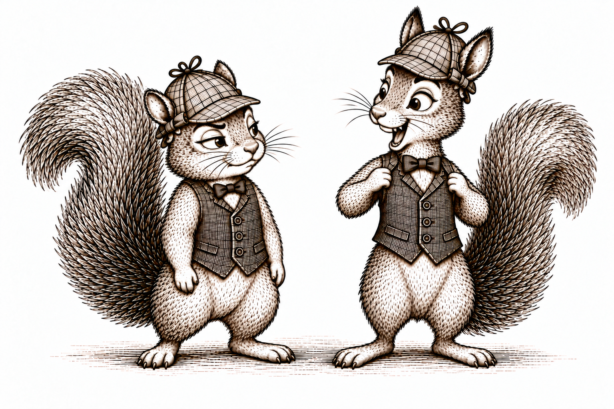

{width=700 fig-align="center" fig-alt="Two distinct squirrels wear matching checked caps, waistcoats, and bow ties. The taller squirrel proudly holds out its waistcoat lapels with a delighted ta-da expression, while the familiar shorter squirrel gives it a skeptical sideways look. Vintage paperback-style ink illustration."}

## Introduction

In the previous section, we estimated the conditional mean 

$$\mu(X,A) = E[Y|X,A]$$ 

using a regression model. This let us predict outcomes at different treatment values, even when few people had exactly the same covariates. But we could get that model wrong. We might miss a nonlinear relationship or an interaction, and those errors can carry through to our estimated causal effect.

We could avoid specifying a regression model by averaging outcomes separately for every combination of $X$ and $A$, as we did in our binary example. But with more covariates, those groups become vanishingly small. Some might contain no one at all.

Matching looks for a middle ground. Rather than specify an outcome-regression model or require a large group at every covariate combination, we compare people with similar values of $X$. The idea is that their conditional means should be similar too. Finding such people can still be difficult, and using approximate matches requires us to consider how much the conditional mean might change between them.

Here, we focus on a binary exposure and two causal contrasts we have already defined: the average treatment effect (ATE) and the average treatment effect among the treated (ATT).

## The idea

Outcome regression estimated both conditional means using a fitted model. Matching takes a different approach: we use a person's observed outcome and the outcome of someone with similar covariates in the other exposure group. Let's see how this works.

::: {.example-intro}
<span class="example-label">Example.</span> Take the following data:

| Person | $X$ | $A$ | $Y$ |
| ------ | --- | --- | --- |
| Acorn   | 4   | 1   | 3   |
| Hazel  | 4   | 0   | 6   |
| Chestnut  | 7   | 1   | 5   |
| Maple   | 7   | 0   | 9   |
| Juniper | 7   | 1   | 9   |
:::

For each person $i$, write their observed covariates, exposure, and outcome as $x_i,a_i,y_i$. We want to estimate $\mu(x_i,1)-\mu(x_i,0)$ for each of our five people.

Start with Acorn, whose observed values are $x_i=4$, $a_i=1$, and $y_i=3$. Acorn's outcome, $3$, estimates $\mu(4,1)$. We need an untreated match to estimate $\mu(4,0)$. Hazel has the same covariates and did not receive treatment, so we use Hazel's outcome, $6$. Acorn's estimated difference is

$$
3-6=-3.
$$

Now consider Hazel, whose observed values are $x_i=4$, $a_i=0$, and $y_i=6$. Hazel's own outcome, $6$, estimates $\mu(4,0)$. This time, we need a treated match to estimate $\mu(4,1)$. Acorn provides that match, with outcome $3$. Hazel's estimated difference is

$$
3-6=-3.
$$

Next is Chestnut, whose observed values are $x_i=7$, $a_i=1$, and $y_i=5$. Chestnut's outcome, $5$, estimates $\mu(7,1)$. Maple has the same covariates and did not receive treatment, so Maple's outcome, $9$, estimates $\mu(7,0)$. Chestnut's estimated difference is

$$
5-9=-4.
$$

Maple has observed values $x_i=7$, $a_i=0$, and $y_i=9$. Maple's own outcome, $9$, estimates $\mu(7,0)$. This time, two treated people have the same covariates: Chestnut and Juniper. We can average their outcomes to estimate $\mu(7,1)$:

$$
\frac{5+9}{2}=7.
$$

Maple's estimated difference is therefore $7-9=-2$.

Finally, Juniper has observed values $x_i=7$, $a_i=1$, and $y_i=9$. Juniper's own outcome estimates $\mu(7,1)$, and Maple's outcome estimates $\mu(7,0)$. Juniper's estimated difference is

$$
9-9=0.
$$

Here is what we constructed:

| Person   | Match             | Estimate of $\mu(x_i,1)$ | Estimate of $\mu(x_i,0)$ | Difference |
| -------- | ----------------- | ------------------------ | ------------------------ | ---------- |
| Acorn    | Hazel             | 3                        | 6                        | $-3$       |
| Hazel    | Acorn             | 3                        | 6                        | $-3$       |
| Chestnut | Maple             | 5                        | 9                        | $-4$       |
| Maple    | Chestnut, Juniper | 7                        | 9                        | $-2$       |
| Juniper  | Maple             | 9                        | 9                        | $0$        |

We always subtract the untreated outcome from the treated outcome. Averaging these differences over all five people gives our estimate of the ATE:

$$
E\left[Y(1)-Y(0)\right]
\approx \frac{-3+(-3)+(-4)+(-2)+0}{5}=-2.40.
$$

These matched differences estimate differences in conditional means. They are not individual treatment effects: the two outcomes in each comparison come from different people.

::: {.definition-box}
**Matching** pairs individuals in different exposure groups who have the same or similar baseline covariates. Comparisons of their outcomes are used to estimate causal contrasts.
:::

## Why matching works

Why did we estimate a difference for each person and then average? Under the measured-confounding SCM, we identified the ATE as

$$
E\left[Y(1)-Y(0)\right]
=E\left[\mu(X,1)-\mu(X,0)\right].
$$

For an independent and identically distributed sample of $n$ people, we can estimate this expectation with a sample mean:

$$
E\left[Y(1)-Y(0)\right]
\approx \frac{1}{n}\sum_{i=1}^{n}
\left[\mu(x_i,1)-\mu(x_i,0)\right].
$$

This is the mean of $n$ i.i.d. random variables. It is unbiased for the ATE. If the conditional-mean differences have finite variance, its standard error is

$$
\frac{\sqrt{\operatorname{Var}\left[\mu(X,1)-\mu(X,0)\right]}}{\sqrt{n}}.
$$

Unbiasedness follows from linearity of expectation. The central limit theorem gives an approximately normal distribution for this sample mean as $n$ grows.

The difficulty is that we do not know the conditional means. Matching estimates them using observed outcomes. Let's see exactly what error this introduces.

Focus on person $i$, with observed values $x_i,a_i,y_i$, and suppose $a_i=1$. Let $J(i)$ contain the untreated people matched to this person, and write $k_i=|J(i)|$ for the number of matches. With at least one match, our estimated difference is

$$
y_i-\frac{1}{k_i}\sum_{j\in J(i)}y_j.
$$

We can write the conditional-mean difference we want as this estimate plus three error terms. The following is an exact equality:

$$
\begin{aligned}
\mu(x_i,1)-\mu(x_i,0)
&=\left[y_i-\frac{1}{k_i}\sum_{j\in J(i)}y_j\right]\\
&\quad-\left[y_i-\mu(x_i,a_i)\right]\\
&\quad+\frac{1}{k_i}\sum_{j\in J(i)}
\left[y_j-\mu(x_j,a_j)\right]\\
&\quad+\frac{1}{k_i}\sum_{j\in J(i)}
\left[\mu(x_j,0)-\mu(x_i,0)\right].
\end{aligned}
$$

The first line is our matching estimate. The second is person $i$'s outcome noise: the difference between their observed outcome and their conditional mean. The third is the average outcome noise among their matches. Here, $a_i=1$ and every match has $a_j=0$.

Both noise terms have mean zero. By the definition of $\mu$,

$$
E\left[Y-\mu(X,A)\mid X,A\right]=0.
$$

Taking expectations gives the same conclusion without conditioning:

$$
\begin{aligned}
E\left[Y-\mu(X,A)\right]
&=E\left[Y\right]-E\left[E\left[Y\mid X,A\right]\right]\\
&=E\left[Y\right]-E\left[Y\right]=0,
\end{aligned}
$$

where the last step uses iterated expectations. When we select matches using covariates and exposure, without using outcomes, the matched outcome noise also retains its zero conditional mean under i.i.d. sampling.

Averaging outcomes can reduce this noise. But when people share a match, their comparisons share an outcome. The $1/\sqrt{n}$ calculation for the average of the true conditional-mean differences does not automatically describe the matching estimate.

The fourth line is different: it reflects covariate mismatch. With exact matches, $x_j=x_i$ for every match, so every conditional-mean difference on that line is zero. With nearby matches, we rely on $\mu(x,0)$ varying smoothly enough that nearby covariates give similar conditional means. Matching tries to make this remaining error small by finding people close to person $i$.

If person $i$ was untreated instead, their own outcome estimates $\mu(x_i,0)$. Their treated matches estimate $\mu(x_i,1)$, giving

$$
\mu(x_i,1)-\mu(x_i,0)
\approx\frac{1}{k_i}\sum_{j\in J(i)}y_j-y_i.
$$

The same distinction between outcome noise and covariate mismatch applies. Either way, we subtract the untreated estimate from the treated estimate.

::: {.callout-note title="Technical note: outcome noise and covariate mismatch" collapse="true"}
Suppose person $i$ received the opposite exposure from $a$, and let $J(i)$ contain their $k_i$ matches, all with exposure $a$. Their average matched outcome satisfies

$$
\begin{aligned}
\frac{1}{k_i}\sum_{j\in J(i)}y_j
&=\mu(x_i,a)\\
&\quad+\frac{1}{k_i}\sum_{j\in J(i)}\left[y_j-\mu(x_j,a)\right]\\
&\quad+\frac{1}{k_i}\sum_{j\in J(i)}\left[\mu(x_j,a)-\mu(x_i,a)\right].
\end{aligned}
$$

The second line is outcome noise around each match's own conditional mean. The third is the mismatch between the conditional mean we need and those of the matches. Exact matching makes this last term zero. Approximate matching need not.

To see why selecting matches preserves the mean-zero noise, condition on all the observed covariates and exposure values. Under i.i.d. sampling, each outcome still has conditional mean $\mu(x_j,a_j)$. A matching rule that uses only these covariates and exposures has now fixed the match indices and their number. The selected residuals therefore each have conditional mean zero, and so does their average. Reusing a match changes dependence between comparisons, but it does not change this mean-zero property.
:::

## Finding matches

Our five squirrels made this easy: everyone had a match with exactly the same covariates, and Maple had two. There are two basic approaches to finding matches: require the same covariates, or look for nearby covariates. In either case, matches come from the opposite exposure group, and we choose them without looking at outcomes.

### Exact matches

Acorn has observed covariates $x_i=4$. An exact match must have covariates $x_j=4$ and the opposite exposure value. If $X$ contains several variables, all their values must agree. For example, if we match on age and maternal weight, a 25-year-old mother weighing 120 pounds needs a match who is also 25 years old and weighs 120 pounds.

::: {.definition-box}
**Exact matching** requires matched individuals to have identical values of every covariate used for matching.
:::

If several people qualify, we can choose one, perhaps at random, or use several of them. We make this choice without looking at their outcomes.

### Nearby matches

::: {.example-intro}
<span class="example-label">Example: One continuous covariate</span>

Consider a different dataset with one continuous covariate $X$. We only need $X$ and $A$ to find matches:

| Person | $X$ | $A$ |
| ------ | --- | --- |
| 1      | 4.3 | 1   |
| 2      | 7   | 0   |
| 3      | 4   | 0   |
| 4      | 3.8 | 1   |
:::

Start with Person 1. The possible untreated matches are Persons 2 and 3. Using absolute difference, their distances from Person 1 are

$$
|4.3-7|=2.70,
\qquad |4.3-4|=0.30.
$$

Person 3 is closer, so we choose Person 3. This is nearest-neighbor matching.

::: {.definition-box}
**Nearest-neighbor matching** selects matches from the opposite exposure group with the smallest covariate distance among the eligible individuals.
:::

For one numerical covariate, absolute difference is a simple distance measure:

$$
d(x_i,x_j)=|x_i-x_j|.
$$

Now use the same data to find a match for Person 3. This person is untreated, so the possible matches are Persons 1 and 4. Their distances are

$$
|4-4.3|=0.30,
\qquad |4-3.8|=0.20.
$$

We choose Person 4. Person 3 was the nearest match for Person 1, but Person 1 is not the nearest match for Person 3. Matching each person's nearest neighbor need not be symmetric, even though the distance between any two people is the same in either direction.

With several covariates, we need to decide how to combine the differences.

::: {.example-intro}
<span class="example-label">Example: Two continuous covariates</span>

Consider a mother aged 25 who weighs 120 pounds. Two eligible matches from the opposite exposure group are aged 27 and 35, with weights 130 and 121 pounds, respectively. Their differences from her are

| Possible match | Difference in age | Difference in weight |
| -------------- | ----------------- | -------------------- |
| First          | 2 years           | 10 pounds            |
| Second         | 10 years          | 1 pound              |
:::

If we simply square the differences, add them, and take a square root, the distances are

$$
\sqrt{2^2+10^2}\approx10.20,
\qquad
\sqrt{10^2+1^2}\approx10.05.
$$

This Euclidean distance chooses the second match. But one year and one pound are different units. Changing pounds to kilograms could change which match wins.

Now try a standardized distance using the same covariates and candidates. Divide each difference by that covariate's sample standard deviation before combining them. Suppose the standard deviations in the full dataset are 5 years and 20 pounds. The distances become

$$
\sqrt{\left(\frac{2}{5}\right)^2+\left(\frac{10}{20}\right)^2}
\approx0.64,
\qquad
\sqrt{\left(\frac{10}{5}\right)^2+\left(\frac{1}{20}\right)^2}
\approx2.00.
$$

Now the first match is closer. The same data give a different match because we changed how we measure similarity.

Standardization also removes the choice of units from this calculation. If we convert pounds to kilograms, both the weight differences and their standard deviation change by the same factor. Their ratios stay the same, so the standardized distances stay the same. We compare differences relative to how much each covariate varies in our sample.

Mahalanobis distance also accounts for how the covariates vary together. If two covariates contain much of the same information, it adjusts for that overlap when measuring distance.

::: {.callout-note title="Technical note: distance with several covariates" collapse="true"}
Write $x_i$ and $x_j$ as vectors. Distances of the form

$$
d(x_i,x_j)=\sqrt{(x_i-x_j)^\mathsf{T}S^{-1}(x_i-x_j)}
$$

include Euclidean distance when $S$ is the identity matrix, standardized Euclidean distance when $S$ is diagonal with the sample variances, and Mahalanobis distance when $S$ is the sample covariance matrix. The inverse requires $S$ to be nonsingular.
:::

### Matching choices

Exact and nearby matching give us two starting points, but many choices remain:

- Which covariates must agree exactly, and which may differ? We can combine the approaches, for example by requiring the same diagnosis while allowing nearby ages.
- How will we measure distance across covariates?
- How many matches will each person receive?
- Can someone be used as a match for several people?
- In what order will we find matches, or will we choose them together?
- Will we impose a caliper?
- Which causal effect are we trying to estimate? This determines whose comparisons we need to average.

Let's work through what some of these choices mean.

#### Calipers

The nearest person is not necessarily a good match. Even the smallest available distance could be large, and we might not want to use that person's outcome to estimate the conditional mean we need. We can restrict how far apart matches are allowed to be.

::: {.definition-box}
A **caliper** is a maximum acceptable distance between matched individuals.
:::

For Acorn in our original squirrel dataset, a caliper of $1$ on $X$ accepts Hazel, whose distance is $0$, and rejects Maple, whose distance is $3$. If no eligible person falls within the caliper, the person has no match under this rule.

#### One match or several?

We used one match for Acorn, Hazel, Chestnut, and Juniper, but two for Maple. When several people qualify, we can use their average outcome to estimate the conditional mean we need.

<details class="lesson-question">
<summary>Maple has two treated matches, Chestnut and Juniper, with outcomes $5$ and $9$. How do these matches enter Maple's comparison?</summary>

Average their outcomes to estimate $\mu(7,1)$:

$$
\frac{5+9}{2}=7.
$$

Maple's own outcome estimates $\mu(7,0)$, so the estimated difference is $7-9=-2$.

</details>

Using several matches can reduce outcome noise. But with approximate matching, adding more people may mean accepting matches who are farther away. We have to weigh the additional outcomes against the additional covariate mismatch.

The number of matches can also vary from person to person. Consider these counts:

|     | $A=0$ | $A=1$ |
| --- | ----- | ----- |
| $X=0$ | 10  | 20    |
| $X=1$ | 40  | 30    |
| $X=2$ | 80  | 10    |

There are many untreated matches available per treated person at $X=2$, but fewer at $X=0$.

<details class="lesson-question">
<summary>Suppose we want matches for each treated person. How could the number of exact matches vary across these covariate values?</summary>

At $X=0$, each of the 20 treated people could receive one untreated match, but some of the 10 untreated people would need to be used more than once.

At $X=1$, we could give one untreated match to each of 20 treated people and two untreated matches to each of the remaining 10. This uses all $20+2(10)=40$ untreated people without reuse.

At $X=2$, each of the 10 treated people could receive eight untreated matches, using all 80 untreated people without reuse.

For a person with several matches, use the average of their matches' outcomes in the comparison.

</details>

When a person can be used as a match more than once, we call this matching with replacement. Without replacement, once someone has been used as a match, they are unavailable as a match for the remaining people in the focal group. Allowing reuse can help when several people have the same best match, but it makes their estimated differences share an outcome.

#### Choosing matches together

Choosing the nearest available match one person at a time is a greedy procedure: it makes the best available choice for the person currently being matched. Without replacement, that choice makes the match unavailable to later people. Someone who comes later might be left with a poor match, and changing the order could change the result.

We can instead choose the matches together. Optimal pair matching chooses pairs to minimize their total distance under the matching restrictions. This considers how one person's match affects the matches available to everyone else.

We can also choose a partition into matched sets. In full matching, every retained person belongs to exactly one set, and every set contains both exposure groups. Each set has either one treated person and one or more untreated people, or one untreated person and one or more treated people. Optimal full matching chooses these sets together, allowing their sizes to vary while seeking close matches.

Our five squirrels form two such sets:

| Matched set | Treated members    | Untreated members |
| ----------- | ------------------ | ----------------- |
| First       | Acorn              | Hazel             |
| Second      | Chestnut, Juniper  | Maple             |

All five squirrels belong to exactly one set. In the second set, Maple supplies the untreated comparison for Chestnut and Juniper, and their average supplies Maple's treated comparison.

These choices can produce different matches for the same dataset. In an analysis, the key next step is to check how well the covariates match before using outcomes to estimate a causal effect.

## Checking the matches

Before matching, the treated and untreated groups may have different covariates. Their outcomes could therefore differ because of treatment, because of those covariates, or both. Matching tries to remove the covariate differences as a possible explanation by comparing people with the same or similar covariates.

Exact matching makes the covariates agree within every comparison. With approximate matching, some differences remain. Checking covariate balance helps us see how much remains, on average.

We do this using the same calculation we will use for outcomes. For each person, replace the outcome with the value of a covariate. Compare their value with their match's value—or the average across their matches—always subtracting untreated from treated. Then average these differences across the people whose effects we are trying to estimate. Repeat this for each covariate.

Let's do this for our squirrels. Before matching, the treated squirrels have covariate values $4,7,7$, and the untreated squirrels have values $4,7$. Their means are

$$
\begin{aligned}
\text{Treated mean of }X&=\frac{4+7+7}{3}=6,\\
\text{Untreated mean of }X&=\frac{4+7}{2}=5.50.
\end{aligned}
$$

The treated mean is $0.50$ higher. Now replace the outcomes in our five matched comparisons with $X$:

| Person   | Treated covariate value | Untreated covariate value | Difference |
| -------- | ----------------------- | ------------------------- | ---------- |
| Acorn    | 4                       | 4                         | 0          |
| Hazel    | 4                       | 4                         | 0          |
| Chestnut | 7                       | 7                         | 0          |
| Maple    | $(7+7)/2=7$             | 7                         | 0          |
| Juniper  | 7                       | 7                         | 0          |

Both sides contribute $4,4,7,7,7$. Their means are

$$
\begin{aligned}
\text{Treated mean of }X\text{ in the comparisons}
&=\frac{4+4+7+7+7}{5}=5.80,\\
\text{Untreated mean of }X\text{ in the comparisons}
&=\frac{4+4+7+7+7}{5}=5.80.
\end{aligned}
$$

The means agree, and the average covariate difference is zero. Here, we used exact matches. With approximate matches, the differences need not be zero.

But the size of a covariate difference depends on its units. The same difference in maternal weight looks numerically larger in pounds than in kilograms. We do not want a covariate to look more or less balanced simply because of the scale on which we recorded it.

We therefore divide the mean difference by a standard deviation. The units cancel, expressing the difference relative to how much that covariate varies. This standardized mean difference gives us a common scale for comparing balance across covariates and across studies.

Write $s_1^2$ and $s_0^2$ for the sample variances of $X$ in the original treated and untreated groups. Here,

$$
\begin{aligned}
s_1^2&=\frac{(4-6)^2+(7-6)^2+(7-6)^2}{3-1}=3,\\
s_0^2&=\frac{(4-5.50)^2+(7-5.50)^2}{2-1}=4.50.
\end{aligned}
$$

We use the square root of their average as our denominator:

$$
\sqrt{\frac{s_1^2+s_0^2}{2}}
=\sqrt{\frac{3+4.50}{2}}
\approx1.94.
$$

This is an ordinary average of the two variances; we do not weight them by the group sizes. We use this same denominator before and after matching, so the comparison scale stays fixed. Our standardized mean differences are therefore

$$
\begin{aligned}
\text{Before matching}&=\frac{6-5.50}{\sqrt{3.75}}\approx0.26,\\
\text{After matching}&=\frac{5.80-5.80}{\sqrt{3.75}}=0.
\end{aligned}
$$

|                            | Treated mean of $X$ | Untreated mean of $X$ | Standardized mean difference |
| -------------------------- | ------------------- | --------------------- | ---------------------------- |
| Before matching            | 6                   | 5.50                  | 0.26                         |
| Matched comparisons for the ATE | 5.80            | 5.80                  | 0                            |

A common rule of thumb is to seek absolute standardized mean differences below $0.10$ for every covariate, ideally closer still to zero. We report these differences before and after matching so we can see how much balance improved.

In this example, the covariate distributions in our comparisons agree too: two of the five comparisons have $X=4$ on each side, and three have $X=7$. With other data, equal means need not imply similar distributions. We also inspect their spread and whether one group contains more people at the extremes.

## Combining the comparisons

The procedure is now the same for each person:

1. Find one or more matches with the opposite exposure value, using the chosen rule for comparing covariates.
2. Average the outcomes of those matches. With one match, this is just that person's outcome.
3. Use the person's own outcome for their observed exposure and the average matched outcome for the other exposure. Subtract the untreated estimate from the treated estimate.
4. To estimate the ATE, average these differences over everyone in the sample.

These steps require a match for every person whose difference we include. We will return to what happens when some people have no suitable match.

We can also average the estimated outcomes under each treatment value first, then subtract. Use the estimates from our squirrel table:

$$
\begin{aligned}
E\left[Y(1)\right]
&\approx\frac{3+3+5+7+9}{5}=5.40,\\
E\left[Y(0)\right]
&\approx\frac{6+6+9+9+9}{5}=7.80.
\end{aligned}
$$

Their difference, $5.40-7.80=-2.40$, is exactly the ATE estimate we obtained by averaging all five matched differences.

It might feel like double-dipping to match Acorn to Hazel and then Hazel to Acorn. These comparisons share outcomes, so they are not independent.

We can instead focus on finding matches for one exposure group. If we match each treated person and average their differences, we estimate the ATT. The treated squirrels are Acorn, Chestnut, and Juniper, whose estimated differences are $-3,-4,0$:

$$
E\left[Y(1)-Y(0)\mid A=1\right]
\approx \frac{-3+(-4)+0}{3}\approx-2.33.
$$

If we match each untreated person to treated people and average their differences, we estimate the average treatment effect among the untreated (ATC). Hazel and Maple have estimated differences $-3$ and $-2$:

$$
E\left[Y(1)-Y(0)\mid A=0\right]
\approx \frac{-3+(-2)}{2}=-2.50.
$$

The ATE, ATT, and ATC estimates differ because they average over different groups. Focusing on one exposure group simplifies the matching procedure, but it changes the causal question. It also does not eliminate shared outcomes or the need for care with standard errors.

We choose the target before selecting matches. For the ATT, each treated person needs an untreated match. For the ATC, each untreated person needs a treated match. For the ATE procedure above, everyone needs a match from the other group.

::: {.callout-note title="Technical note: matching weights and uncertainty" collapse="true"}
Our matching estimates of $E\left[Y(a)\right]$ can also be written as weighted means of the observed outcomes. The weights collect each outcome's contributions to the comparisons we already constructed.

For the treated estimate, Acorn contributes twice: once for Acorn and once for Hazel. Chestnut and Juniper each contribute their own outcome and half of Maple's treated estimate, giving weights of $1.50$ each. For the untreated estimate, Hazel contributes twice and Maple contributes three times.

| Person   | $A$ | ATE weight |
| -------- | --- | ---------- |
| Acorn    | 1   | 2          |
| Hazel    | 0   | 2          |
| Chestnut | 1   | 1.50       |
| Maple    | 0   | 3          |
| Juniper  | 1   | 1.50       |

Using these weights gives the same estimates:

$$
\begin{aligned}
E\left[Y(1)\right]
&\approx\frac{2(3)+1.50(5)+1.50(9)}{5}=5.40,\\
E\left[Y(0)\right]
&\approx\frac{2(6)+3(9)}{5}=7.80.
\end{aligned}
$$

In general, the weighted mean for exposure value $a$ is

$$
\frac{\sum_{i:a_i=a}w_i y_i}{\sum_{i:a_i=a}w_i}.
$$

For full matching with an ATE target, each person's weight is proportional to the size of their matched set divided by the number with their exposure value in that set. The weights depend on the target. For our ATT calculation, each treated squirrel contributes once, Hazel contributes once, and Maple contributes twice. Multiplying all weights in an exposure group by the same constant does not change its weighted mean.

The same weights reproduce our covariate-balance calculation when we replace $Y$ with $X$.

Unequal weights can make a mean rely heavily on a few outcomes. The effective sample size summarizes this concentration within an exposure group:

$$
\frac{\left(\sum_i w_i\right)^2}{\sum_i w_i^2}.
$$

With equal weights, this equals the number of people in that group. Our treated ATE weights give $25/(4+2.25+2.25)\approx2.94$, compared with three distinct treated squirrels. The untreated weights give $25/(4+9)\approx1.92$, compared with two distinct untreated squirrels.

These numbers summarize the unequal contributions. They do not provide a standard error. Our five comparisons still use only five people's outcomes, and several comparisons share the same outcome. Standard errors must account for the matching procedure and this reuse; treating the comparisons as independent would give misleading uncertainty estimates.
:::

## A worked analysis with MatchIt

Let's use MatchIt to find matches and cobalt to check balance in the birth-weight data. We will estimate the ATT with nearest-neighbor matching and the ATE with full matching.

Install the packages once, if needed:

```{r}
#| eval: false
install.packages(c("MatchIt", "cobalt", "optmatch"))
```

::: {.example-intro}
<span class="example-label">Example: Smoking and birth weight</span>

Let $A$ indicate smoking during pregnancy and $Y$ be infant birth weight in grams. This time, collect maternal age and maternal weight at the last menstrual period into the baseline vector $X$. As before, $A=1$ means smoking and $A=0$ means not smoking.
:::

Assume the births are i.i.d. and use the measured-confounding SCM with these two baseline covariates.

```{r}
#| label: prepare-birthweight-matching
birthwt_matching <- if (file.exists("data/birthwt.csv")) {
  read.csv("data/birthwt.csv")
} else {
  MASS::birthwt
}
rownames(birthwt_matching) <- NULL
```

There are 74 mothers who smoked and 115 who did not.

### Finding matches

Find one nonsmoking match for each mother who smoked, using Mahalanobis distance on maternal age and weight:

```{r}
#| label: nearest-birthweight-matching
birthwt_nearest <- MatchIt::matchit(
  smoke ~ age + lwt,
  data = birthwt_matching,
  method = "nearest",
  distance = "mahalanobis",
  estimand = "ATT",
  ratio = 1,
  replace = TRUE,
  m.order = "data"
)
```

The formula lists the exposure and matching covariates; infant birth weight does not appear. `ratio = 1` requests one match per smoker, and `replace = TRUE` allows a nonsmoker to be reused. `m.order = "data"` visits smokers in their row order.

Inspect the first four pairs without looking at birth weight. The row numbers identify the mothers:

```{r}
#| label: inspect-birthweight-pairs
smoker_rows <- as.integer(rownames(birthwt_nearest$match.matrix))[1:4]
nonsmoker_rows <- as.integer(birthwt_nearest$match.matrix[1:4, 1])

birthwt_pairs <- data.frame(
  Smoker = smoker_rows,
  Matched_nonsmoker = nonsmoker_rows,
  Smoker_age = birthwt_matching$age[smoker_rows],
  Match_age = birthwt_matching$age[nonsmoker_rows],
  Smoker_weight = birthwt_matching$lwt[smoker_rows],
  Match_weight = birthwt_matching$lwt[nonsmoker_rows]
)
knitr::kable(birthwt_pairs)
```

MatchIt's nearest-neighbor method targets the ATT or ATC. For the ATE, use full matching with the same covariate distance:

```{r}
#| label: full-birthweight-matching
birthwt_full <- MatchIt::matchit(
  smoke ~ age + lwt,
  data = birthwt_matching,
  method = "full",
  distance = "mahalanobis",
  estimand = "ATE"
)
```

### Checking the matches

Use cobalt to calculate standardized mean differences before and after matching, with the pooled standard deviation as the denominator:

```{r}
#| label: check-birthweight-balance
birthwt_nearest_balance <- cobalt::bal.tab(
  birthwt_nearest, un = TRUE, s.d.denom = "pooled"
)
birthwt_full_balance <- cobalt::bal.tab(
  birthwt_full, un = TRUE, s.d.denom = "pooled"
)

birthwt_balance_table <- data.frame(
  Covariate = c("Maternal age", "Maternal weight"),
  Before = birthwt_nearest_balance$Balance$Diff.Un,
  After_nearest = birthwt_nearest_balance$Balance$Diff.Adj,
  After_full = birthwt_full_balance$Balance$Diff.Adj
)
knitr::kable(birthwt_balance_table, digits = 2)
```

`un = TRUE` includes the original comparison. Both procedures bring the mean differences closer to zero. The signs indicate which group has the larger mean; the absolute values indicate how far apart the means are.

::: {.callout-note title="More ways to inspect balance" collapse="true"}
A balance plot displays the absolute standardized mean differences:

```{r}
#| label: plot-birthweight-balance
#| fig-width: 7
#| fig-height: 4
#| fig-alt: "Absolute standardized differences in maternal age and weight before and after full matching."
cobalt::love.plot(
  birthwt_full_balance,
  abs = TRUE,
  thresholds = c(m = 0.10),
  var.names = c(age = "Maternal age", lwt = "Maternal weight"),
  sample.names = c("Before matching", "After full matching")
)
```

The line at $0.10$ is a common guide for inspecting balance. We can also compare covariate distributions, since similar means can hide other differences:

```{r}
#| label: plot-matched-birthweight-covariates
#| fig-width: 7
#| fig-height: 4
#| fig-alt: "Maternal weight distributions in the smoking and nonsmoking groups before and after full matching."
cobalt::bal.plot(birthwt_full, var.name = "lwt", which = "both")
```
:::

### Comparing outcomes

MatchIt supplies weights that combine our matched comparisons into group means, as explained in the optional technical note above. Obtain the matched data and their weights:

```{r}
#| label: extract-birthweight-matches
birthwt_nearest_data <- MatchIt::match_data(birthwt_nearest)
birthwt_full_data <- MatchIt::match_data(birthwt_full)
```

For the first pair, both mothers are aged 20 and weigh 105 pounds. Their infant birth-weight difference is

$$
`r birthwt_matching$bwt[smoker_rows[1]]`
-`r birthwt_matching$bwt[nonsmoker_rows[1]]`
=`r birthwt_matching$bwt[smoker_rows[1]] - birthwt_matching$bwt[nonsmoker_rows[1]]`\text{ grams}.
$$

This is one noisy estimate of the difference in conditional means at those covariates. To combine all 74 comparisons, calculate the weighted outcome mean in each group and subtract:

```{r}
#| label: estimate-matched-birthweight-att
birthwt_nearest_mean_1 <- with(
  birthwt_nearest_data,
  weighted.mean(bwt[smoke == 1], weights[smoke == 1])
)
birthwt_nearest_mean_0 <- with(
  birthwt_nearest_data,
  weighted.mean(bwt[smoke == 0], weights[smoke == 0])
)
birthwt_nearest_mean_1 - birthwt_nearest_mean_0
```

The weighted means are approximately `r sprintf("%.2f", birthwt_nearest_mean_1)` grams for smoking and `r sprintf("%.2f", birthwt_nearest_mean_0)` grams for not smoking. Their difference is

$$
E\left[Y(1)-Y(0)\mid A=1\right]
\approx `r sprintf("%.2f", birthwt_nearest_mean_1 - birthwt_nearest_mean_0)`\text{ grams}.
$$

Under our working SCM, this estimates birth weight under smoking minus birth weight under not smoking, on average, among the mothers who originally smoked. The negative estimate indicates lower birth weight under smoking.

For the full-matching ATE analysis, the calculation is the same but uses the full-matching weights:

```{r}
#| label: estimate-full-matching-birthweight-ate
birthwt_full_mean_1 <- with(
  birthwt_full_data,
  weighted.mean(bwt[smoke == 1], weights[smoke == 1])
)
birthwt_full_mean_0 <- with(
  birthwt_full_data,
  weighted.mean(bwt[smoke == 0], weights[smoke == 0])
)
birthwt_full_mean_1 - birthwt_full_mean_0
```

This gives

$$
E\left[Y(1)-Y(0)\right]
\approx `r sprintf("%.2f", birthwt_full_mean_1 - birthwt_full_mean_0)`\text{ grams}.
$$

This estimates the average change under smoking versus not smoking for the group represented by our sample.

## Overlap and the causal target

What if people in one exposure group have covariate values we rarely see in the other group?

{width=700 fig-align="center" fig-alt="Illustration of limited overlap in covariate values between the exposure groups."}

Where the groups overlap, we can find people with similar covariates. Outside that region, even the nearest match may be far away. A caliper can rule out these distant matches, but then some people have no comparison. If we leave them out, we may change whose causal effect we estimate.

::: {.example-intro}
<span class="example-label">Example.</span> Consider these counts:

|     | $A=0$ | $A=1$ |
| --- | ----- | ----- |
| $X=1$ | 0   | 20    |
| $X=2$ | 20  | 30    |
| $X=3$ | 40  | 10    |
:::

The 20 treated people with $x_i=1$ have no exact untreated match. The other 40 treated people do.

<details class="lesson-question">
<summary>If we drop the treated people with $x_i=1$ and average matched differences over the remaining treated people, what causal effect are we trying to estimate?</summary>

We are targeting the treatment effect among treated people whose covariates are not $1$:

$$
E\left[Y(1)-Y(0)\mid A=1,X\neq1\right].
$$

This is different from the ATT for all treated people. Dropping the unmatched group changes whom we average over.

</details>

The same issue arises when we drop untreated people while targeting the ATC, or average over a smaller retained group while targeting the ATE.

Return to the birth-weight data. Require identical ages and maternal weights for exact matching:

```{r}
#| label: exact-birthweight-matching
birthwt_exact <- MatchIt::matchit(
  smoke ~ age + lwt,
  data = birthwt_matching,
  method = "exact",
  estimand = "ATT"
)
```

Compare who remains under the three matching procedures:

```{r}
#| label: count-retained-birthweight-observations
birthwt_exact_data <- MatchIt::match_data(birthwt_exact)

birthwt_retained <- data.frame(
  Method = c("Exact", "Nearest neighbor", "Full"),
  Smokers = c(sum(birthwt_exact_data$smoke == 1),
              sum(birthwt_nearest_data$smoke == 1),
              sum(birthwt_full_data$smoke == 1)),
  Nonsmokers = c(sum(birthwt_exact_data$smoke == 0),
                 sum(birthwt_nearest_data$smoke == 0),
                 sum(birthwt_full_data$smoke == 0))
)
knitr::kable(birthwt_retained)
```

Exact matching retains only 9 of the 74 smokers. Although we requested `estimand = "ATT"`, the comparison concerns those 9 smokers, not all 74. Perfect covariate agreement in this smaller group does not tell us the effects for the mothers left out.

Nearest-neighbor matching retains all 74 smokers and uses 47 nonsmokers as matches. The other 68 nonsmokers are unused, but every smoker has a comparison, so this does not by itself change the ATT target. Full matching retains all 189 mothers and uses ATE weights to represent the original group.

Check who would be left out before comparing outcomes. Better balance among the retained people can come at the cost of changing the causal question.

::: {.callout-note title="The overall idea"}
Matching estimates the conditional means we need using outcomes from people with the same or similar baseline covariates. Find matches, check their covariates, and average their outcome comparisons over the people relevant to the causal question. Keep track of anyone left out, because excluding them can change that question.
:::
