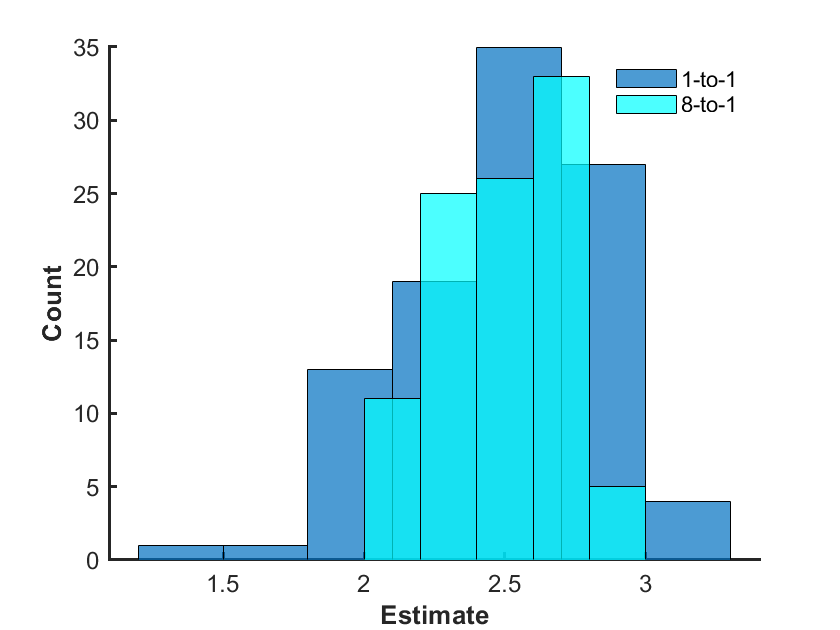
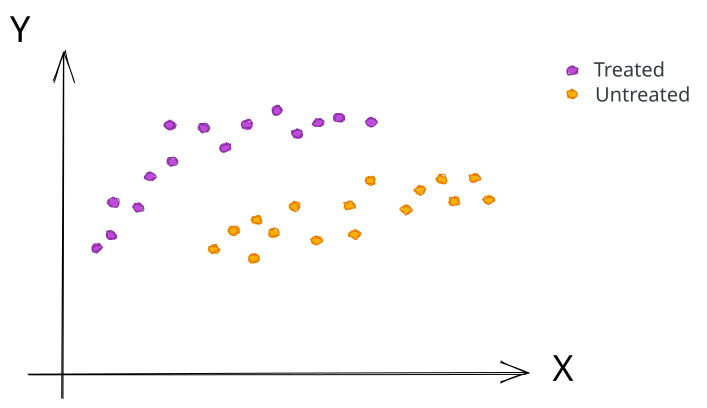

Let's contemplate our two estimation approaches so far.

On one hand, direct standardization avoids modeling assumptions about the conditional mean

$$E[Y|A=a,X]$$

but suffers from vanishingly small strata.

On the other, outcome regression avoids vanishingly small strata, but imposes modeling assumptions on the conditional mean.

Matching offers another way to estimate the causal contrast: compare outcomes for individuals with similar baseline covariates. It avoids specifying an outcome-regression model, but finding good matches can still be difficult when covariate combinations are sparse.


Learning objectives:

- Implement exact matching algorithms
- Implement inexact matching algorithms
- Propose ways to measure similarity between individuals
- Identify pros and cons of various matching algorithms
- Relate matching estimates to causal estimands (when possible)
- Recognize how matching can reveal problems with positivity


## Motivation

Consider the same set-up as the previous section:

* Variables$(X,A,Y)$
* Well-defined potential outcomes $Y(a)$ ($a=0,1$).
* Vector-valued $X$ satisfies backdoor criteria relative to $(A,Y)$.

We know, for example, then that

$$E[Y(a) | X=x ] = E[Y | A=a, X=x]$$

whenever $P(A=a | X=x) >0$.

In words: a person assigned $A=1$ is _exchangeable_ with a person assigned $A=0$ when they have identical $X=x$.

Let's look at exchangeability from a different angle.

Draw two samples independently - call them $Y^{(1)}$ and $Y^{(2)}$. The first is drawn from the distribution of $Y$ conditional on $X=x$ and $A=1$; the second from $Y$ conditional on $X=x$ and $A=0$.  Their expected difference is

$$
E\left[Y^{(1)}-Y^{(2)}\right]
=E\left[Y(1)-Y(0)\mid X=x\right].
$$

This is a statement about the mean difference, not the distribution of an individual's treatment effect. The two sampled outcomes belong to different individuals.

_This observation gives the idea behind matching:_

::: {.definition-box}
**Matching** is the process of matching individuals in one intervention condition with individuals in another intervention condition who have similar values of $X=x$.  Differences in outcomes between matched individuals are then used to estimate various causal estimands.
:::

Matching is not an exact process. One has an overwhelming number of questions to answer in order to perform matching:

* Match exactly on $X=x$?
* If not matching exactly, how to measure similarity?
* Focus on providing matches to a specific intervention group?
* Allow a person to be matched more than once?
* Allow a person to have more than 1 match?
* Drop some observations?

Each answer leads to different algorithms - we illustrate a few.  Regardless:

#### _The thing to keep in mind is that matching is a pre-processing step: outcome data should not be factored in. Instead, we are guided by the quality and amount of matches._

**References:**

* Abadie, A., & Imbens, G. W. (2006). [Large sample properties of matching estimators for average treatment effects](https://users.nber.org/~rdehejia/!@$AEM/Topic%2009%20Matching%20Advanced/Abadie_Imbens_2006.pdf). _econometrica_, _74_(1), 235-267.
* Greifer, N. (2022, May 18). Matching methods. Retrieved October 23, 2022, from [https://cran.r-project.org/web/packages/MatchIt/vignettes/matching-methods.html](https://cran.r-project.org/web/packages/MatchIt/vignettes/matching-methods.html)
* King, G., & Nielsen, R. (2019). [Why propensity scores should not be used for matching](https://www.cambridge.org/core/services/aop-cambridge-core/content/view/94DDE7ED8E2A796B693096EB714BE68B/S1047198719000111a.pdf/why-propensity-scores-should-not-be-used-for-matching.pdf). _Political Analysis_, _27_(4), 435-454.


## Exact matching

### Case 1: 1-to-1 exact matching

Our first algorithm is called 1-to-1 exact matching _with replacement_. We break down these qualifiers:

* _1-to-1_: only one person is matched to an individual
* _Exact:_  people are only matched if they have identical $X$
* _With replacement:_ a person can be matched as many times as needed

For exact matching, we often start by focusing on one intervention group, usually the treated. We then iterate through individuals in the focal group (in some order). For each individual, we pick one person in the other intervention group who has the exact same value as $X$.  Once we find a match, we take the sample average of the difference in outcomes between matched pairs.

The resulting algorithm is described as follows:

```text
// 1-1 exact matching with replacement

// Input arguments
Require Xi,Ai,Yi
Require focal group a (a=0 or a=1)

// Initialize
diff  = 0
count = 0

// Loop through people in focal group
for each individual i with Ai = a
    // Find possible matches
    J := { j : Xi = Xj & Aj = 1-a }
    
    // Check if match exists
    if ~isempty(J)
    
        // Update match count
        count := count + 1
    
        // Choose one at random to be match
        j ~ Uniform(J)
    
        // Add difference in outcomes to sum
        diff := diff + (Yi - Yj)
                
    end
end

// Sample average of difference
Return diff/count;
// For focal group a=0, negate this result to report treatment 1 minus 0.
```


<span class="example-label">Example 1.</span>

Let's revisit our smoking and weight gain example from the NHEFS data. Focus on the group that quit smoking.

<details class="lesson-question">

<summary>Q. Use exact matching to adjust for biological sex</summary>

**A.** We implement the algorithm (1-to-1, exact, with replacement) described above.  One run of the algorithm results in an estimated average weight gain of 2.05 kilograms.

</details>

<details class="lesson-question">

<summary>Q. Use exact matching to adjust for biological sex and education</summary>

**A.**  Repeating the algorithm (1-to-1, exact, with replacement), we recover an estimated average weight gain of 2.31 kilograms.

</details>

It is important to note that, since we are randomly choosing matches, we can get different answers on each run. In addition, our estimates might not reflect everyone from the group that did not quit smoking.

### Case 2: k-to-1, exact, with replacement

One small change would be to allow for more than one person to match to a given individual. In place of the outcome of the match in the 1-to-1 case, we put the sample average outcome of all k matches. In this case, the algorithm would be the same as above but with the following change:

```text
        Require k
        
        ...
        
        // Choose k individuals at random to be match
        matched_ave := 0
        for 1:k
        
           // Choose individual uniformly
           j ~ Uniform(J)
           
           // Update
           matched_ave := matched_ave + Yj/k
           
           // Remove individual from set
           J := J - { j };
        end
        // Add difference in outcomes to sum
        diff := diff + (Yi - matched_ave)
        
        ...
```


<span class="example-label">Example 1 (revisited).</span>

Consider the same setting as described above.

<details class="lesson-question">

<summary>Q. Use 8-to-1 exact matching to adjust for education and sex</summary>

**A.** We recover an estimate of 2.27 kilograms.

</details>

<details class="lesson-question">

<summary>Q. Provide empirical support that estimates are less variable for 8-to-1 exact matching than 1-to-1 exact matching in this example</summary>

**A.**  We can just repeat the matching process a number of times for each matching case and plot a histogram of the estimates.  After 70 iterations, we get a histogram like the following.

</details>

{width=700 fig-align="center"}

### Case 3: Variable exact matching

As opposed to 1-to-1 or k-to-1, it may be beneficial to allow individuals in an intervention group to match to a variable number of individuals in the opposite intervention group.

We illustrate this with an example.


<span class="example-label">Example 2.</span>

Below shows the number of samples with a certain $(X,A)$ combination.

|     | A=0 | A=1 |
| --- | --- | --- |
| X=0 | 10  | 20  |
| X=1 | 40  | 30  |
| X=2 | 80  | 10  |

<details class="lesson-question">

<summary>Q. How might you use variable matching with $A=1$ being the focal group?</summary>

**A.**  We might require that every person with $A=1$ is matched to at least one individual and at most eight individuals. Hence,

* Each of the 20 individuals with $(X,A)=(0,1)$ could be matched (with replacement) to 1 individual with $(X,A) = (0,0)$
* 20 of the 30 individuals with $(X,A)=(1,1)$ could each be matched (without replacement) to 1 individual with $(X,A)=(1,0)$; the remaining 10 could be matched (without replacement) to 2 individuals of the remaining unmatched individuals with $(X,A)=(1,0)$
* Each of the 10 individuals with $(X,A)=(2,1)$ could be matched (without replacement) to 8 individuals with $(X,A)=(2,0)$

</details>

### Case 4: Coarsened exact matching

Despite our efforts to improve upon direct standardization, exact matching runs into the exact same issue: vanishingly small strata. Some individuals might not have an exact match. This is especially troublesome when adjusting for continuous variables. 

There are two paths forward:

* Weaken our requirement of an exact match
* _Coarsen_ the variables: i.e. first clump variable values together before performing exact matching.

We illustrate this latter situation with an example.


<span class="example-label">Example 1 (revisited part deux).</span>

Consider the same setting as described above.

Divide age into the following categories:

* 1: 25-34 years
* 2: 35-44 years
* 3: 45-54 years
* 4: 55-64 years
* 5: 65-74 years

<details class="lesson-question">

<summary>Q. Apply 8-to-1 (coarsened) exact sampling to adjust for age, education, and sex</summary>

**A.**  One estimate we get is 2.53 kilograms.

</details>


## (Inexact) matching

### Case 3: nearest-neighbor matching

As alluded to, rather than coarsen $X$, we could simply match approximately on $X$.

This is accomplished by introducing a function $d$ to measure "similarity" or "distance" between values of $X$:

$$d: {\cal X} \times {\cal X} \mapsto [0, \infty)$$

where ${\cal X}$ is the domain of $X$. Individual $i$ could be matched to individual $j$ when $d(X^{(i)},X^{(j)})$ is sufficiently small.

Our 1-to-1 exact matching algorithm needs slight modification to allow for distance-based matching:

```text
    ...
    
    Require distance function d
    
    ...
    
    // Find closest match    
    j := argmin{ d(Xi,Xj) | i != j & Ai != Aj }
    
    // Add difference in outcomes to sum
    diff := diff + (Yi - Yj)
    
    
    ....
```

_But_ what function $d$ do we use?

There are several popular choices.  One is to use a function of the form:

$$d(x,y)=\sqrt{(x-y)'S^{-1}(x-y)}$$

for some positive-definite $S$.  Examples of $S$ could be

* The identity matrix
*   Sample covariance matrix:

    $$(S)_{ij} = E_N[ (X-E_N[X])(Y-E_N[Y])]$$
*   Diagonal matrix with sample variances:

    $$(S)_{ii} = E_N[ (X-E_N[X])^2]$$

In addition, it is also common to replace each entry $X$ after subtracting its mean or with its rank among the corresponding entries in $X^{(1)},\ldots,X^{(N)}$ before applying $d$.

Another popular choice for $d$ - which we will revisit in the next section - is propensity scores.


<span class="example-label">Example 1 (revisited part tres).</span>

Again we consider the smoking and weight gain example from the NHEFS dataset.

<details class="lesson-question">

<summary>Q. Use nearest-neighbor matching to adjust for age, education, and sex.  </summary>

**A.** Using

$$d(x,y)=\sqrt{(x-y)'S^{-1}(x-y)}$$

with $S$ as the sample covariance, we get an estimate of 3.53 kilograms.

</details>

### Case 4: optimal matching

If we did not allow for replacement, then nearest-neighbor matching can be considered greedy: in the sense we always choose the best match, regardless of what happens to subsequent matches. 

One consequence is the matching process can be sensitive to the order in which we match individuals.

Optimal matching overcomes this issue. The idea is to find an optimal matching scheme that minimizes the sum of the measures of "similarly/distance" over the matches, subject to various constraints on the matches.

Mathematically, we can let $D$ be the matrix of distances:

$$(D)_{ij} = d(i,j)$$

and $E$ be a matrix of zeros and ones for which

$$(E)_{ij} = \begin{cases} 1 & i \text{ is matched to } j \\ 0 & i \text{ is not matched to } j \end{cases}$$

We can thus try to solve

$$\min_{E} \sum_{i,j: A^{(i)} = 1, A^{(j)}=0} E_{ij} D_{ij}$$

subject to constraints on $E$.

Examples for constraints might be

*   (**Pair matching**) Ensure each individual in focal group has a match:

    $$\sum_{j : A^{(j)}=0} E_{ij} = 1$$

    for each treated individual $i$.

    and each individual in opposite group is matched only once:

    $$\sum_{i : A^{(i)}=1} E_{ij} \leq 1$$

    for each untreated individual $j$.

Or

*   (**Full matching**) Form matched sets containing either one treated individual and one or more untreated individuals, or one untreated individual and one or more treated individuals. Every retained individual belongs to one matched set. This requires additional constraints beyond the pair-matching example above.

<details class="lesson-question">

<summary>Q. What type of mathematical problem is optimal (either pair or full) matching?</summary>

**A.** It can be formulated as an integer linear program: minimize a linear sum of matching costs subject to linear constraints and integer-valued decisions about the matches. Specialized matching algorithms can also exploit the structure of this problem.

</details>

<span class="example-label">Example 1 (revisited part quatre).</span>

Again we consider the smoking and weight gain example from the NHEFS dataset.

<details class="lesson-question">

<summary>Q. Use optimal full matching to adjust for age, education, and sex.</summary>

**A.**  We used the same distance measure $d$ as we did in the last example. Through some serious work to set-up the integer linear program, we arrive at an estimate of  0.86 kilograms.

</details>

### What are we even estimating?

We can view k-to-1 matching with replacement as imputing on the unknown potential outcome:

$$\tilde{Y}^{(i)}(a) = \begin{cases} Y^{(i)} & A^{(i)}=a \\ \frac{1}{k}\sum_{j \in J(i)} Y^{(j)} & A^{(i)} \neq a \end{cases}$$

where $J(i)$ is the set of $k$ matches to individual $i$. 

We can estimate the ATE by taking the sample average of each (imputed) individual treatment effect:

$$E[Y(1)-Y(0)] \approx \frac1N \sum_{i} (\tilde{Y}^{(i)}(1) - \tilde{Y}^{(i)}(0) )$$

We can also estimate the average treatment effect among the treated (ATT) by taking the sample average of each (imputed) individual treatment effect _among the treated:_

$$E[Y(1)-Y(0)| A=1] \approx \frac1{|\{ i : A^{(i)}=1\}|} \sum_{i : A^{(i)}=1} (\tilde{Y}^{(i)}(1) - \tilde{Y}^{(i)}(0) )$$

In light of these observations, we see matching estimates the

* ATE when everyone is given a match
* ATT when the treated group is the focal group
* Average treatment among the untreated when the untreated group is the focal group

::: {.callout-note title="Technical note: mismatch between covariate values" collapse="true"}
Let $J(i)$ be the matches for individual $i$, all with treatment $a$, and suppose individual $i$ received the other treatment. Write $\mu(x,a)=E[Y\mid X=x,A=a]$. The average matched outcome can be decomposed as

$$
\frac{1}{|J(i)|}\sum_{j\in J(i)}Y_j
=\mu(X_i,a)
+\frac{1}{|J(i)|}\sum_{j\in J(i)}\{Y_j-\mu(X_j,a)\}
+\frac{1}{|J(i)|}\sum_{j\in J(i)}\{\mu(X_j,a)-\mu(X_i,a)\}.
$$

The second term averages outcome residuals. The third measures the discrepancy between the conditional means at the matched covariate values and the focal individual's covariates. With exact matching, the third term is zero. With approximate matching, it need not be zero. Smaller covariate distances help when the conditional mean changes smoothly with the covariates.
:::

## Practical considerations

### Positivity (revisited)

_What if we don't find a match for everyone in our focal group?_

Let's illustrate the consequences with examples.


<span class="example-label">Example 3.</span>

Consider the following data:

|     | A=0 | A=1 |
| --- | --- | --- |
| X=1 | 0   | 20  |
| X=2 | 20  | 30  |
| X=3 | 40  | 10  |

<details class="lesson-question">

<summary>Q.  Could we use exact matching to estimate the ATT?</summary>

**A.**  No! 

Individuals in the treated group A=1 with X=1 could not be matched exactly to an individual in the untreated group A=0.  They would have to be dropped from analysis.

</details>

<details class="lesson-question">

<summary>Q.  Could we use exact matching? If so, what would be estimating?</summary>

**A.**  We can still use exact matching with the treated group as the focal group.  Since individuals with X=1 are dropped from the analysis, we are estimating the ATT among treated individuals with $X\neq1$.

</details>


<span class="example-label">Example 4.</span>

Suppose your data, adjusting for continuous X, looks something like:

{width=700 fig-align="center" fig-alt="Illustration of limited treatment overlap across covariate values."}

<details class="lesson-question">

<summary>Q. Why might you be suspicious of an estimate of an ATE?</summary>

**A.**  At low X values, we only see treated individuals. At high X values, we only see untreated individuals. Therefore, we have limited information on what the ATE conditional on X being in one of these regions really is. 

Our only hope is to generalize our information on the ATE for middle values of X to extreme values of X.  (We learned on the previous subpage that bias is introduced with larger mismatch between X values.) It may be safer to simply drop the extreme X values from the analysis.  

</details>

#### _**Matching makes violations of positivity more apparent.**_


### Final considerations

On one hand, dropping ill-matched data can be a good thing - it helps prevent overgeneralization of conditional average treatment effects.

On the other, dropping ill-matched data can be bad - it reduces our sample size.

Therefore, before analyzing outcome data, you will want to try different matching strategies and evaluate quality of the matches vs. an effective sample size.
