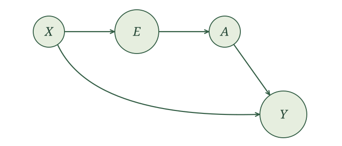
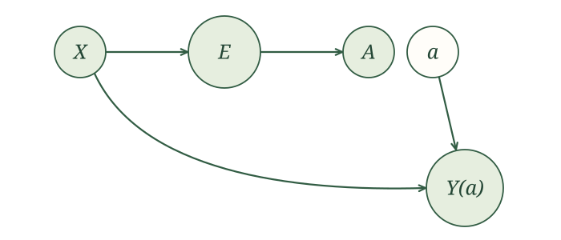

{width=700 fig-align="center" fig-alt="The familiar squirrel struggles to fit an enormous patient file into a tiny wallet, with one card marked 0.30 sticking out. Vintage paperback-style ink illustration."}

## Introduction

So far, we have adjusted for the full covariate vector $X$. But $X$ may contain dozens, hundreds, or even thousands of variables. How much of it do we actually need? Must we carry every covariate along, or can we compress the information that matters for adjustment into something much smaller?

Think about the RHC study. A patient's age, diagnosis, blood pressure, and laboratory results may all help explain whether they receive RHC, and a realistic analysis would include many more. Two patients can differ substantially on nearly every one of these covariates and still have exactly the same probability of receiving the procedure. Remarkably, that single number, the probability of treatment given covariates, can be enough for adjustment.

Take a binary exposure $A$, and start with our measured-confounding SCM,

$$
\begin{aligned}
X&\leftarrow f_X(\epsilon_X),\\
A&\leftarrow f_A(X,\epsilon_A),\\
Y&\leftarrow f_Y(A,X,\epsilon_Y),
\end{aligned}
$$

with independent noise terms. Our question is whether we can rewrite the assignment for $A$ using a summary of $X$.

## Propensity score

Consider each person's probability of receiving treatment.

::: {.definition-box}
The **propensity score** is the probability of receiving treatment conditional on the baseline covariates:

$$
e(X)=P(A=1\mid X).
$$

We write $E=e(X)$ for the variable that records this probability.
:::

Regardless of how many variables we collect in $X$, the propensity score is one number. Different covariate profiles can have exactly the same propensity score.

::: {.example-intro}
<span class="example-label">Example.</span> Suppose the propensity score for a hypothetical SCM is

$$
e(X)=0.10+0.001\,\text{age}+0.001\,\text{blood pressure},
$$

where $X = (\text{age},\text{blood pressure})$.
:::

For a 40-year-old patient with blood pressure 160, the probability of receiving treatment is

$$
e(40,160)=0.10+0.04+0.16=0.30.
$$

Now consider a 60-year-old patient with blood pressure 140. This patient is older but has lower blood pressure. Under our model, those differences offset one another:

$$
e(60,140)=0.10+0.06+0.14=0.30.
$$

Both patients have the same propensity-score value, $E=0.30$, despite having different values of both covariates.

This is dimension reduction. We started with two numbers describing each patient and summarized them with one. Knowing that the score is $0.30$ does not tell us which age and blood pressure produced it.

<details class="lesson-question">
<summary>A third patient is 50 years old. What blood pressure would give this patient the same propensity score, $E=0.30$? </summary>

A blood pressure of 150 gives the 50-year-old patient a propensity score of $0.30$.

Another possibility is a 70-year-old patient with blood pressure 130. In this model, increasing age by ten years and decreasing blood pressure by ten leaves the treatment probability unchanged.

These patients need not have the same covariates to have the same propensity score.

</details>

With more covariates, the reduction could be much larger: dozens of measurements summarized by one probability. 


## Identification with the propensity score

We have compressed covariates into a single number, the propensity score $E=e(X)$. Our goal is to show that the propensity score can take the place of the covariates in the identification formula. We will do this by constructing a treatment assignment that uses only $E$, then following the resulting SCM through to its potential outcomes.

First, add $E$ to the original SCM:

$$
\begin{aligned}
X&\leftarrow f_X(\epsilon_X),\\
E&\leftarrow e(X),\\
A&\leftarrow f_A(X,\epsilon_A),\\
Y&\leftarrow f_Y(A,X,\epsilon_Y).
\end{aligned}
$$

The original noise terms are independent. The assignment for $E$ simply calculates the propensity score from $X$. It requires no additional noise and leaves the original assignments unchanged.

Now consider another way to generate treatment. Because $A$ is binary, its conditional distribution is determined by its probability of being $1$. For patients with a given value of $X$, that probability is $e(X)$, which we have recorded in $E$.

Draw a new noise variable $U_A$ uniformly from $[0,1]$, independently of $\epsilon_X$ and $\epsilon_Y$. Assign treatment when this number is at most $E$, and assign no treatment otherwise. For example, when $E=0.30$, the first $30\%$ of the interval produces treatment and the remaining $70\%$ produces no treatment. This procedure gives the required treatment probability.

We write $A^*$ for the treatment generated by this new procedure. We also give the resulting outcome a new name, $Y^*$, because its assignment now receives $A^*$ as its treatment input. The full SCM is

$$
\begin{aligned}
X&\leftarrow f_X(\epsilon_X),\\
E&\leftarrow e(X),\\
A^*&\leftarrow
\begin{cases}
1,& U_A\leq E,\\
0,& U_A>E,
\end{cases}\\
Y^*&\leftarrow f_Y(A^*,X,\epsilon_Y).
\end{aligned}
$$

The variables $(X,E,A,Y)$ and $(X,E,A^*,Y^*)$ have the same joint distribution. To see why, fix a covariate value $X=x$. Both treatment assignments produce treatment with probability $e(x)$ and no treatment with probability $1-e(x)$. Both also use treatment noise that is independent of the outcome noise. Once the treatment value is supplied, the outcome is generated using the same function $f_Y$ and the same outcome-noise distribution.

Since these joint distributions agree, we will work with the new representation and write $A$ and $Y$ in place of $A^*$ and $Y^*$ from now on.

Its causal graph is

{width=700 fig-align="center" fig-alt="Causal graph of the new SCM. X points to E and Y. E points to A, and A points to Y."}

The treatment assignment now receives the information from $X$ through $E$. The outcome assignment still uses $X$ directly. Compressing the information used for treatment has not removed the covariates from the outcome assignment.

Next, define potential outcomes for an intervention on $A$ with value $a$. We use the same procedure as before: rename the variables and substitute $a$ wherever the intervened treatment would be used on the right-hand side. Causal irrelevance lets us simplify the baseline variables and the naturally generated treatment, giving $X(a)=X$, $E(a)=E$, and $A(a)=A$. The assignments become

$$
\begin{aligned}
X&\leftarrow f_X(\epsilon_X),\\
E&\leftarrow e(X),\\
A&\leftarrow
\begin{cases}
1,& U_A\leq E,\\
0,& U_A>E,
\end{cases}\\
Y(a)&\leftarrow f_Y(a,X,\epsilon_Y).
\end{aligned}
$$

We still generate the natural treatment $A$, but the outcome assignment now receives the fixed value $a$.

The outcome assignment under intervention is unchanged from the original SCM. It uses the same function, covariates, intervention value, and outcome noise. Thus, the new representation preserves the potential outcome we originally wanted to study.

We can now construct its SWIG:

{width=700 fig-align="center" fig-alt="SWIG of the new SCM after causal irrelevance. X points to E and Y of a. E points to natural treatment A. The separate fixed value a points to Y of a. A and a are adjacent circles with a gap."}

The arrow from the natural treatment to the outcome is gone. The fixed intervention value $a$ supplies that input instead. The remaining path between $A$ and $Y(a)$ runs through $E$ and $X$. Conditioning on $E$ blocks this path, so the global Markov property gives

$$
A\mathrel{\perp\!\!\!\perp}Y(a)\mid E.
$$

Among people with the same propensity score, learning their naturally generated treatment provides no additional information about their potential outcome. We have obtained conditional exchangeability using one number, even though $X$ may contain many covariates.

The rest follows the identification argument we used for outcome regression. Conditional exchangeability allows us to condition additionally on $A=a$ without changing the conditional mean of $Y(a)$. Among people with that treatment value, consistency then lets us use their observed outcome $Y$. In equations,

$$
\begin{aligned}
E\left[Y(a)\mid E\right]
&=E\left[Y(a)\mid E,A=a\right]\\
&=E\left[Y\mid E,A=a\right].
\end{aligned}
$$

Finally, average over the propensity score using iterated expectations. Since the new representation preserves both the potential outcome and the observed-data distribution, this identifies our original causal quantity.

::: {.proposition-box}
Under the measured-confounding SCM, with the relevant conditional means defined,

$$
E\left[Y(a)\right]
=E\left[E\left[Y\mid E,A=a\right]\right].
$$
:::

The inner mean describes the outcome at a particular propensity score and treatment value. The outer expectation averages these means over the propensity scores. This has the same form as our earlier identification result, with $E$ taking the place of $X$.

## Estimating the propensity score

We estimate $e(X)$ by treating the binary exposure $A$ as the response. As with outcome regression, we can count within covariate groups or fit a regression model.

Write $\hat e(x)$ for the estimated probability at covariates $x$. The `score` column in our data records $\hat E=\hat e(X)$, an estimate of the true propensity-score variable $E=e(X)$.

::: {.example-intro}
<span class="example-label">Example: Wildfire smoke and asthma</span>

Return to our 10,000 generated observations, with $X$ indicating unhealthy wildfire smoke, $A$ staying indoors, and $Y$ asthma symptoms. As before, assume the people are i.i.d.
:::

```{r}
#| label: prepare-wildfire-propensity
#| echo: false
set.seed(661)
n <- 10000
X <- rbinom(n, size = 1, prob = 0.5)
A <- rbinom(n, size = 1, prob = 0.4 + 0.2 * X)
Y <- rbinom(n, size = 1, prob = 0.3 + 0.2 * X - 0.1 * A)
wildfire_data <- data.frame(X, A, Y)

wildfire_counts <- data.frame(
  X = 0:1,
  Untreated = vapply(0:1, function(x) sum(X == x & A == 0), integer(1)),
  Treated = vapply(0:1, function(x) sum(X == x & A == 1), integer(1)),
  Total = vapply(0:1, function(x) sum(X == x), integer(1))
)
wildfire_counts$Score <- wildfire_counts$Treated / wildfire_counts$Total
wildfire_data$score <- wildfire_counts$Score[match(X, wildfire_counts$X)]
knitr::kable(wildfire_counts[, 1:4], row.names = FALSE)
```

For each value of $X$, estimate the probability of staying indoors by dividing the number who stayed indoors by the group total:

$$
\begin{aligned}
\hat e(0)&=\frac{`r wildfire_counts$Treated[1]`}{`r wildfire_counts$Total[1]`}\approx `r sprintf("%.2f", wildfire_counts$Score[1])`,\\
\hat e(1)&=\frac{`r wildfire_counts$Treated[2]`}{`r wildfire_counts$Total[2]`}\approx `r sprintf("%.2f", wildfire_counts$Score[2])`.
\end{aligned}
$$

Assign each person the score for their value of $X$. Add that score to our four combinations of $X$ and $A$:

```{r}
#| label: wildfire-person-propensity-table
#| echo: false
wildfire_people <- expand.grid(X = 0:1, A = 0:1)
wildfire_people <- wildfire_people[order(wildfire_people$X, wildfire_people$A), ]
wildfire_people$Score <- wildfire_counts$Score[
  match(wildfire_people$X, wildfire_counts$X)
]
knitr::kable(
  wildfire_people,
  col.names = c("$X$", "$A$", "$\\hat E$"),
  digits = 2, escape = FALSE, row.names = FALSE
)
```

People with the same $X$ receive the same score, whether or not they stayed indoors.

With more covariates or continuous covariates, we may have few observations at each combination. We can use logistic regression instead.

::: {.example-intro}
<span class="example-label">Example: Smoking and birth weight</span>

Use the same 189 births. Let $A$ indicate smoking during pregnancy, with $1$ for smoking and $0$ for not smoking. As in matching, collect maternal age and weight into $X$. Retain our i.i.d. and measured-confounding assumptions.
:::

Regress smoking on maternal age and weight. Each mother contributes her recorded covariates and smoking status. The fitted model estimates the probability of smoking for a given combination of age and weight:

```{r}
#| label: prepare-birthweight-propensity
#| include: false
birthwt_ps <- if (file.exists("data/birthwt.csv")) {
  read.csv("data/birthwt.csv")
} else {
  MASS::birthwt
}
rownames(birthwt_ps) <- NULL
```

```{r}
#| label: fit-birthweight-propensity
ps_fit <- glm(smoke ~ age + lwt, family = binomial(), data = birthwt_ps)
```

```{r}
#| label: add-birthweight-propensity
#| include: false
birthwt_ps$score <- predict(ps_fit, type = "response")
```

The fitted equation is

$$
\log\left[\frac{\hat e(X)}{1-\hat e(X)}\right]
\approx `r sprintf("%.2f", coef(ps_fit)[1])`
`r sprintf("%+.4f", coef(ps_fit)["age"])`\,\text{age}
`r sprintf("%+.4f", coef(ps_fit)["lwt"])`\,\text{weight}.
$$

Age is in years and weight in pounds. Plug the covariates of a 20-year-old mother weighing 120 pounds into the fitted model.

```{r}
#| label: predict-one-birthweight-propensity
#| include: false
person_120 <- data.frame(age = 20, lwt = 120)
predict(ps_fit, newdata = person_120)
person_120_score <- as.numeric(
  predict(ps_fit, newdata = person_120, type = "response")
)
person_120_score
```

The fitted log odds are approximately `r sprintf("%.2f", predict(ps_fit, newdata = person_120))`. Transforming back gives her estimated probability of smoking:

$$
\hat e(20,120)
\approx\frac{\exp\left(`r sprintf("%.2f", predict(ps_fit, newdata = person_120))`\right)}
{1+\exp\left(`r sprintf("%.2f", predict(ps_fit, newdata = person_120))`\right)}
\approx `r sprintf("%.2f", person_120_score)`.
$$

Repeat this calculation for each mother using her recorded age and weight. The $\hat E$ column contains her estimated probability of smoking. Here are the first four:

```{r}
#| label: birthweight-person-propensity-table
#| echo: false
demo_rows <- 1:4
knitr::kable(
  data.frame(
    Mother = demo_rows,
    Age = birthwt_ps$age[demo_rows],
    Weight = birthwt_ps$lwt[demo_rows],
    A = birthwt_ps$smoke[demo_rows],
    Score = birthwt_ps$score[demo_rows]
  ),
  col.names = c("Mother", "Age", "Weight", "$A$", "$\\hat E$"),
  digits = 2, escape = FALSE, row.names = FALSE
)
```


## Using the propensity score

We can use propensity scores for standardization, outcome regression, or matching. We will work through outcome regression and matching using the birth-weight data.

We now need the expected outcome at a given score and treatment value. Write this conditional mean as

$$
\mu(s,a)=E\left[Y\mid E=s,A=a\right].
$$

Here, $s$ is a particular numerical score, such as $0.41$, and $a$ is a treatment value. To recover the mean potential outcome, our identification result tells us to average these conditional means over the scores:

$$
E\left[Y(a)\right]=E\left[\mu(E,a)\right].
$$

In the data, we use $\hat E$ in place of the unknown $E$. For person $i$ with observed covariates $x_i$, the estimated score is the number $\hat e(x_i)$. We plug that number into the fitted outcome model at each treatment value, then average the predictions over people's estimated scores.

### Outcome regression

We have estimated each mother's probability of smoking. We can now use that probability in the outcome regression.

::: {.main-point}
Replace the original covariates $X$ with the estimated propensity score $\hat e(X)$ in the outcome regression. Then proceed as before: predict under each treatment value, keeping each person's score fixed, and average the predictions.
:::

::: {.example-intro}
<span class="example-label">Example: Smoking and birth weight</span>

Return to the 189 mothers in the birth-weight dataset. As in our matching analysis, collect maternal age and weight in $X$. We have estimated each mother's probability of smoking from these two covariates. Let $A$ indicate smoking during pregnancy and $Y$ be infant birth weight in grams.
:::

For these mothers, regress birth weight on the estimated score and smoking. The score summarizes age and weight, so those covariates enter the regression through the score. The fitted model describes mean birth weight at each score and smoking value:

```{r}
#| label: fit-score-birthweight-regression
birthwt_score_fit <- lm(bwt ~ score + smoke, data = birthwt_ps)
```

The fitted conditional mean is

$$
\hat\mu(s,a)
\approx `r sprintf("%.2f", coef(birthwt_score_fit)[1])`
-`r sprintf("%.2f", abs(coef(birthwt_score_fit)[2]))`s
-`r sprintf("%.2f", abs(coef(birthwt_score_fit)[3]))`a.
$$

Consider the 20-year-old mother weighing 120 pounds from our propensity-score calculation. Her estimated score is $\hat e(20,120)\approx `r sprintf("%.2f", person_120_score)`$. Keep that score fixed and substitute each smoking value. The prediction dataset `mother_score_120` contains two rows with the same score and smoking set to $1$ or $0$:

```{r}
#| label: prepare-score-birthweight-one-mother
#| include: false
mother_score_120 <- data.frame(
  score = rep(person_120_score, 2),
  smoke = c(1, 0)
)
```

```{r}
#| label: predict-score-birthweight-one-mother
birthwt_score_120 <- predict(birthwt_score_fit, newdata = mother_score_120)
```

These are the same substitutions we used with the original covariates:

$$
\begin{aligned}
\hat\mu\left(\hat e(20,120),1\right)
&\approx `r sprintf("%.2f", coef(birthwt_score_fit)[1])`
-`r sprintf("%.2f", abs(coef(birthwt_score_fit)[2]))`\hat e(20,120)
-`r sprintf("%.2f", abs(coef(birthwt_score_fit)[3]))`(1)
\approx `r sprintf("%.2f", birthwt_score_120[1])`,\\
\hat\mu\left(\hat e(20,120),0\right)
&\approx `r sprintf("%.2f", coef(birthwt_score_fit)[1])`
-`r sprintf("%.2f", abs(coef(birthwt_score_fit)[2]))`\hat e(20,120)
-`r sprintf("%.2f", abs(coef(birthwt_score_fit)[3]))`(0)
\approx `r sprintf("%.2f", birthwt_score_120[2])`.
\end{aligned}
$$

These estimate mean infant birth weights under smoking and not smoking for mothers with this score. By using the score in place of the original covariates, we give everyone with the same estimated score the same pair of predictions.

Repeat the operation for everyone. Keep each mother's score and change only the smoking value.

```{r}
#| label: predict-score-birthweight-everyone
#| include: false
birthwt_ps_under_1 <- birthwt_ps
birthwt_ps_under_1$smoke <- 1

birthwt_ps_under_0 <- birthwt_ps
birthwt_ps_under_0$smoke <- 0

birthwt_score_pred_1 <- predict(
  birthwt_score_fit, newdata = birthwt_ps_under_1
)
birthwt_score_pred_0 <- predict(
  birthwt_score_fit, newdata = birthwt_ps_under_0
)
```

Here are the predictions for the same first four mothers we used earlier. We retain their observed smoking status and infant birth weight for comparison. The last two columns give the predictions under smoking and not smoking, using each mother's same score in both calculations:

```{r}
#| label: show-score-birthweight-predictions
#| echo: false
birthwt_score_predictions <- data.frame(
  Age = birthwt_ps$age[demo_rows],
  Weight = birthwt_ps$lwt[demo_rows],
  A = birthwt_ps$smoke[demo_rows],
  Score = birthwt_ps$score[demo_rows],
  Y = birthwt_ps$bwt[demo_rows]
)
names(birthwt_score_predictions)[4] <- "$\\hat E$"
birthwt_score_predictions[["$\\hat\\mu(\\hat E,A)$"]] <-
  predict(birthwt_score_fit, newdata = birthwt_ps)[demo_rows]
birthwt_score_predictions[["$\\hat\\mu(\\hat E,1)$"]] <-
  birthwt_score_pred_1[demo_rows]
birthwt_score_predictions[["$\\hat\\mu(\\hat E,0)$"]] <-
  birthwt_score_pred_0[demo_rows]
knitr::kable(
  birthwt_score_predictions,
  digits = c(0, 0, 0, 2, 0, 2, 2, 2), escape = FALSE
)
```

For each treatment value, $\hat\mu(\hat E,a)$ is a function of the estimated score. Estimate its mean by averaging the predictions over all 189 mothers. Using everyone in both averages keeps the distribution of scores the same for the two smoking values.

```{r}
#| label: average-score-birthweight-predictions
#| include: false
birthwt_score_mean_1 <- mean(birthwt_score_pred_1)
birthwt_score_mean_0 <- mean(birthwt_score_pred_0)
birthwt_score_ate <- birthwt_score_mean_1 - birthwt_score_mean_0
```

This gives

$$
\begin{aligned}
E\left[Y(1)\right]&\approx `r sprintf("%.2f", birthwt_score_mean_1)`\text{ grams},\\
E\left[Y(0)\right]&\approx `r sprintf("%.2f", birthwt_score_mean_0)`\text{ grams},\\
\operatorname{ATE}&\approx `r sprintf("%.2f", birthwt_score_ate)`\text{ grams}.
\end{aligned}
$$

Under our working SCM and regression model, smoking lowers mean infant birth weight by an estimated `r sprintf("%.2f", -birthwt_score_ate)` grams. As before, the ATE equals the smoking coefficient because this is a linear model without treatment interactions.

::: {.example-intro}
<span class="example-label">Example: Smoking and low birth weight</span>

Now use `low` as the outcome, indicating infant birth weight below 2,500 grams. Keep the same estimated propensity scores and smoking variable.
:::

Fit logistic regression with low birth weight as the response. Because this outcome is either $0$ or $1$, its conditional mean is the probability of low birth weight. We keep smoking and the estimated score as the predictors:

```{r}
#| label: fit-score-low-birthweight-regression
birthwt_score_logistic_fit <- glm(
  low ~ score + smoke,
  family = binomial(),
  data = birthwt_ps
)
```

The fitted equation is on the log-odds scale:

$$
\operatorname{logit}\{\hat\mu(s,a)\}
\approx `r sprintf("%.2f", coef(birthwt_score_logistic_fit)[1])`
+`r sprintf("%.2f", coef(birthwt_score_logistic_fit)[2])`s
+`r sprintf("%.2f", coef(birthwt_score_logistic_fit)[3])`a.
$$

For our 20-year-old, 120-pound mother, substituting her score and $a=1$ gives fitted log odds of approximately `r sprintf("%.2f", predict(birthwt_score_logistic_fit, newdata = mother_score_120)[1])`. Transform back to obtain the probability:

$$
\hat\mu\left(\hat e(20,120),1\right)
\approx\frac{\exp(`r sprintf("%.2f", predict(birthwt_score_logistic_fit, newdata = mother_score_120)[1])`)}
{1+\exp(`r sprintf("%.2f", predict(birthwt_score_logistic_fit, newdata = mother_score_120)[1])`)}
\approx `r sprintf("%.2f", predict(birthwt_score_logistic_fit, newdata = mother_score_120, type = "response")[1])`.
$$

For the nonsmoking prediction, keep her score fixed and substitute $a=0$. Her score was calculated from her age and weight, which remain the same. We change the smoking input to the outcome model, giving

$$
\hat\mu\left(\hat e(20,120),0\right)
\approx\frac{\exp(`r sprintf("%.2f", predict(birthwt_score_logistic_fit, newdata = mother_score_120)[2])`)}
{1+\exp(`r sprintf("%.2f", predict(birthwt_score_logistic_fit, newdata = mother_score_120)[2])`)}
\approx `r sprintf("%.2f", predict(birthwt_score_logistic_fit, newdata = mother_score_120, type = "response")[2])`.
$$

Under our working model, these are estimated probabilities of low birth weight under smoking and not smoking for mothers with her score. Repeat the calculations for every mother.

```{r}
#| label: predict-score-low-birthweight-everyone
#| include: false
birthwt_score_risk_1 <- predict(
  birthwt_score_logistic_fit,
  newdata = birthwt_ps_under_1,
  type = "response"
)
birthwt_score_risk_0 <- predict(
  birthwt_score_logistic_fit,
  newdata = birthwt_ps_under_0,
  type = "response"
)
```

For the same four mothers, the estimated conditional means are now probabilities. Each mother's observed outcome is $0$ or $1$, while the prediction columns describe her estimated probability of low birth weight under each smoking value:

```{r}
#| label: show-score-low-birthweight-predictions
#| echo: false
birthwt_score_risks <- birthwt_score_predictions[, 1:4]
birthwt_score_risks$Y <- birthwt_ps$low[demo_rows]
birthwt_score_risks[["$\\hat\\mu(\\hat E,A)$"]] <- predict(
  birthwt_score_logistic_fit, newdata = birthwt_ps, type = "response"
)[demo_rows]
birthwt_score_risks[["$\\hat\\mu(\\hat E,1)$"]] <-
  birthwt_score_risk_1[demo_rows]
birthwt_score_risks[["$\\hat\\mu(\\hat E,0)$"]] <-
  birthwt_score_risk_0[demo_rows]
knitr::kable(
  birthwt_score_risks,
  digits = c(0, 0, 0, 2, 0, 2, 2, 2), escape = FALSE
)
```

Average each prediction column across all 189 mothers, then compare the two averages.

```{r}
#| label: average-score-low-birthweight-predictions
#| include: false
birthwt_score_low_mean_1 <- mean(birthwt_score_risk_1)
birthwt_score_low_mean_0 <- mean(birthwt_score_risk_0)

birthwt_score_low_ate <- birthwt_score_low_mean_1 - birthwt_score_low_mean_0
birthwt_score_low_rr <- birthwt_score_low_mean_1 / birthwt_score_low_mean_0
birthwt_score_low_or <-
  (birthwt_score_low_mean_1 / (1 - birthwt_score_low_mean_1)) /
  (birthwt_score_low_mean_0 / (1 - birthwt_score_low_mean_0))
```

The estimated risks are $E\left[Y(1)\right]\approx `r sprintf("%.2f", birthwt_score_low_mean_1)`$ and $E\left[Y(0)\right]\approx `r sprintf("%.2f", birthwt_score_low_mean_0)`$. Therefore,

$$
\begin{aligned}
\operatorname{ATE}
&=E\left[Y(1)\right]-E\left[Y(0)\right]
\approx `r sprintf("%.2f", birthwt_score_low_ate)`,\\
\text{Causal relative risk}
&=\frac{E\left[Y(1)\right]}{E\left[Y(0)\right]}
\approx `r sprintf("%.2f", birthwt_score_low_rr)`,\\
\text{Causal odds ratio}
&=\frac{E\left[Y(1)\right]/\left(1-E\left[Y(1)\right]\right)}
{E\left[Y(0)\right]/\left(1-E\left[Y(0)\right]\right)}
\approx `r sprintf("%.2f", birthwt_score_low_or)`.
\end{aligned}
$$

We estimate that smoking increases the risk of low birth weight by `r sprintf("%.1f", 100 * birthwt_score_low_ate)` percentage points. The risk is approximately `r sprintf("%.2f", birthwt_score_low_rr)` times as large under smoking, and the odds are approximately `r sprintf("%.2f", birthwt_score_low_or)` times as large.

### Matching

Matching uses a distance to decide which people are similar. Once we have estimated their treatment probabilities, we can measure that distance using the scores.

::: {.main-point}
Use the difference between estimated propensity scores as the distance between two people:

$$
d(x_i,x_j)=\left|\hat e(x_i)-\hat e(x_j)\right|.
$$

Find matches in the opposite exposure group using this distance. Then check balance in the original covariates and combine the outcome comparisons as before.
:::

::: {.example-intro}
<span class="example-label">Example: Smoking and birth weight</span>

Use the same 189 mothers, with smoking as $A$, infant birth weight as $Y$, and maternal age and weight collected in $X$. We will find one nonsmoking match for each mother who smoked to estimate the ATT, allowing a nonsmoker to be reused.
:::

```{r}
#| label: one-birthweight-propensity-match
#| echo: false
ps_example_smoker <- 4L
ps_eligible <- which(birthwt_ps$smoke == 0)
ps_example_match <- ps_eligible[which.min(abs(
  birthwt_ps$score[ps_eligible] - birthwt_ps$score[ps_example_smoker]
))]
```

Consider mother `r ps_example_smoker`, who smoked during pregnancy. She is `r birthwt_ps$age[ps_example_smoker]` years old and weighs `r birthwt_ps$lwt[ps_example_smoker]` pounds. Her estimated probability of smoking is `r sprintf("%.5f", birthwt_ps$score[ps_example_smoker])`.

We need a nonsmoking comparison. Search among the nonsmokers for the person whose estimated probability of smoking is closest to hers. This selects mother `r ps_example_match`:

```{r}
#| label: show-one-birthweight-propensity-match
#| echo: false
ps_example_rows <- c(ps_example_smoker, ps_example_match)
knitr::kable(
  data.frame(
    Mother = ps_example_rows,
    Age = birthwt_ps$age[ps_example_rows],
    Weight = birthwt_ps$lwt[ps_example_rows],
    Smoking = birthwt_ps$smoke[ps_example_rows],
    Score = birthwt_ps$score[ps_example_rows]
  ),
  col.names = c("Mother", "Age", "Weight", "Smoking", "Estimated propensity score"),
  digits = c(0, 0, 0, 0, 5), row.names = FALSE
)
```

Their ages and weights differ, but their estimated treatment probabilities are almost identical. We selected the match using the difference between those probabilities.

Mother `r ps_example_smoker`'s infant weighed `r birthwt_ps$bwt[ps_example_smoker]` grams. Her matched nonsmoker's infant weighed `r birthwt_ps$bwt[ps_example_match]` grams. Her own outcome supplies the smoking side of the comparison, and the matched nonsmoker supplies the nonsmoking side. Their difference is

$$
`r birthwt_ps$bwt[ps_example_smoker]`
-`r birthwt_ps$bwt[ps_example_match]`
=`r birthwt_ps$bwt[ps_example_smoker] - birthwt_ps$bwt[ps_example_match]`\text{ grams}.
$$

This is one noisy comparison of smoking versus not smoking. Repeat the procedure for each of the 74 mothers who smoked, then average their matched outcome differences. That average estimates the ATT.

In R, use the same MatchIt call as before, supplying our scores as the distance. This automates the search we just performed for mother 4, selecting a nonsmoking match for every smoker:

```{r}
#| label: match-birthweight-propensity
birthwt_ps_nearest <- MatchIt::matchit(
  smoke ~ age + lwt,
  data = birthwt_ps,
  method = "nearest",
  distance = birthwt_ps$score,
  estimand = "ATT",
  ratio = 1,
  replace = TRUE,
  m.order = "data"
)
```

`ratio = 1` requests one nonsmoking match per smoker, and `replace = TRUE` allows a nonsmoker to serve as a match more than once. For each selected pair, subtract the matched nonsmoker's outcome from the smoker's.

```{r}
#| label: calculate-score-matched-differences
#| include: false
smokers <- as.integer(rownames(birthwt_ps_nearest$match.matrix))
matches <- as.integer(birthwt_ps_nearest$match.matrix[, 1])
pair_differences <- birthwt_ps$bwt[smokers] - birthwt_ps$bwt[matches]
```

Here are the first four outcome comparisons, in grams:

```{r}
#| label: show-score-matched-differences
#| echo: false
ps_comparisons <- data.frame(
  Smoker = smokers,
  Match = matches,
  Smoker_outcome = birthwt_ps$bwt[smokers],
  Match_outcome = birthwt_ps$bwt[matches],
  Difference = pair_differences
)
knitr::kable(
  head(ps_comparisons, 4), row.names = FALSE,
  col.names = c("Smoker", "Match", "Smoker's outcome", "Match's outcome", "Difference")
)
```

The positive and negative outcome differences all contribute to the average. A reused nonsmoker appears in each comparison for which she was selected, so we have one difference per smoker. After checking covariate balance as described in the next subsection, take the sample mean of all 74 differences.

```{r}
#| label: estimate-score-matching-att
#| include: false
birthwt_ps_nearest_att <- mean(pair_differences)
```

This gives

$$
E\left[Y(1)-Y(0)\mid A=1\right]
\approx `r sprintf("%.2f", birthwt_ps_nearest_att)`\text{ grams}.
$$

Under our SCM, we estimate that smoking lowers mean infant birth weight by `r sprintf("%.2f", -birthwt_ps_nearest_att)` grams among the mothers who originally smoked.

## Balancing

Because the treatment assignment uses $X$ only through the propensity score $E$, its causal graph implies

$$
A\mathrel{\perp\!\!\!\perp}X\mid E.
$$

In words: among people with the same propensity score, the treated and untreated groups have the same distribution of measured covariates. We say the propensity score balances the covariates.

In practice, we never know the true score. We estimate it, and we compare people whose scores are close rather than identical. So we check whether balance actually holds in the original covariates, using the same calculations we used for matching.

::: {.example-intro}
<span class="example-label">Example: Checking balance in the birth-weight data</span>

Return to our nearest-neighbor pairs. Compare maternal age and weight between smokers and nonsmokers before and after matching.
:::

The plot compares covariate balance before and after matching. We selected matches using one score, but we check maternal age and weight separately. Values closer to zero indicate better balance; the line marks the usual $0.10$ guide.

```{r}
#| label: plot-birthweight-propensity-balance
#| echo: false
#| fig-width: 7
#| fig-height: 4
#| fig-alt: "Absolute standardized differences in maternal age and weight before and after propensity-score matching."
ps_nearest_balance <- cobalt::bal.tab(
  birthwt_ps_nearest, un = TRUE, s.d.denom = "pooled"
)

cobalt::love.plot(
  ps_nearest_balance,
  abs = TRUE,
  drop.distance = TRUE,
  thresholds = c(m = 0.10),
  var.names = c(age = "Maternal age", lwt = "Maternal weight"),
  sample.names = c("Before matching", "After matching")
)
```

Matching brings the standardized mean differences for both maternal age and weight closer to zero.

::: {.callout-note title="Technical note: propensity scores in practice" collapse="true"}
The balancing property is a theoretical result about the true propensity score. In practice, we must estimate that score and decide how to use it. Both choices affect the balance we achieve.

1. Estimating the score. We fitted logistic regression to describe smoking probabilities using maternal age and weight. The covariate balancing propensity score (CBPS) approach makes covariate balance part of estimating the model's coefficients [@imai_ratkovic_2014]. For our example, this would mean using conditions that bring weighted mean age and weight closer together between smokers and nonsmokers. The model can still be logistic regression, and the target remains $e(X)=P(A=1\mid X)$. 

2. Using the score for matching. Close propensity scores do not guarantee that our matched comparisons balance the original covariates. King and Nielsen [-@king2019matching] show that propensity-score matching can increase covariate imbalance and recommend other matching methods. Their critique gives us a reason to evaluate the actual comparisons we construct, rather than relying on closeness of the scores alone.
:::


Other summaries of $X$ can also balance the covariates. We call them *balancing scores.*

::: {.definition-box}
A variable $B=b(X)$ is a **balancing score** if we can represent the same joint distribution of $(X,B,A,Y)$ using an SCM of the form

$$
\begin{aligned}
X&\leftarrow f_X(\epsilon_X),\\
B&\leftarrow b(X),\\
A&\leftarrow g_A(B,U_A),\\
Y&\leftarrow f_Y(A,X,\epsilon_Y),
\end{aligned}
$$

where $\epsilon_X,U_A,\epsilon_Y$ are independent. 
:::

For example, $b(X)=X$ is a balancing score, as is $b(X)=e(X)$.

::: {.proposition-box}
If $b(X)$ is a balancing score, then there is a function $f$ such that

$$
e(X)=f(b(X))
$$

almost surely [@rosenbaum_rubin_1983].
:::

Knowing $b(X)$ therefore lets us calculate $e(X)$. A balancing score can retain more information, such as both the propensity score and age. This is the sense in which the propensity score is the smallest summary of $X$ that balances the covariates.

::: {.callout-note title="Technical note: why balancing scores retain the propensity score" collapse="true"}
For a binary exposure, $b(X)$ is a balancing score if and only if there is a function $f$ such that $e(X)=f(b(X))$ with probability one [@rosenbaum_rubin_1983].

First suppose $b(X)$ is a balancing score. In its SCM representation, $A$ uses only $b(X)$ and noise independent of $X$, giving $A\mathrel{\perp\!\!\!\perp}X\mid b(X)$. Since $b(X)$ is determined by $X$,

$$
\begin{aligned}
P(A=1\mid b(X))
&=P(A=1\mid X,b(X))\\
&=P(A=1\mid X)\\
&=e(X).
\end{aligned}
$$

The first equality uses balance. The left side is a function of $b(X)$, so it supplies the required function $f$.

Conversely, suppose $e(X)=f(b(X))$. By iterated expectations,

$$
\begin{aligned}
P(A=1\mid b(X))
&=E\left[P(A=1\mid X,b(X))\mid b(X)\right]\\
&=E\left[e(X)\mid b(X)\right]\\
&=e(X).
\end{aligned}
$$

The last equality holds because $b(X)$ determines $e(X)$. Also, $P(A=1\mid X,b(X))=e(X)$. Thus learning $X$ in addition to $b(X)$ does not change the conditional probability of $A=1$. Because $A$ is binary, the same holds for $A=0$. To obtain the SCM representation in our definition, draw $U_A$ uniformly from $[0,1]$, independently of the original covariate and outcome noise. Assign $A=1$ when $U_A\leq f(b(X))$ and $A=0$ otherwise. Retaining the original assignments for $X$ and $Y$ then gives the same joint distribution, since the treatment probability is still $e(X)$. Thus, $b(X)$ is a balancing score.

Taking $b(X)=e(X)$ proves that the propensity score is itself a balancing score. A transformation of $e(X)$ also balances if it retains enough information to recover $e(X)$; an arbitrary coarsening need not do so.
:::

::: {.callout-note title="Technical note: a parallel with prognostic scores" collapse="true"}
The propensity score summarizes how $X$ relates to treatment. A prognostic score instead summarizes how $X$ relates to a potential outcome. For example, a prognostic score for the untreated potential outcome is a function $r(X)$ such that

$$
Y(0)\mathrel{\perp\!\!\!\perp}X\mid r(X).
$$

Knowing $r(X)$ leaves no additional information in $X$ about the distribution of $Y(0)$. An outcome-regression mean $E\left[Y(0)\mid X\right]$ need not have this property: two covariate profiles can have the same mean and different outcome distributions. For a binary outcome, the mean determines the distribution, so this distinction disappears. Hansen [-@hansen2008prognostic] develops the prognostic-score approach.
:::

::: {.callout-warning title="Estimated scores and uncertainty"}
We estimated the propensity scores from our data. In another sample, the fitted scores would change, along with the outcome predictions or matches we construct from them. Standard errors and confidence intervals for our causal-effect estimates should account for this estimation step, using a method appropriate to the regression or matching procedure. Treating the estimated scores as known can give misleading measures of uncertainty [@abadie_imbens_2016].
:::
