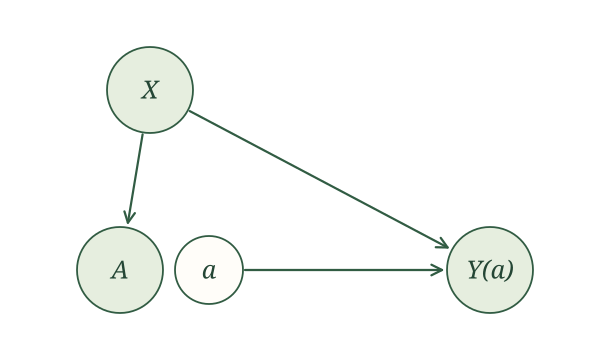

{width=700 fig-align="center" fig-alt="The familiar squirrel attaches a comically large weight to one acorn while other acorns carry small weights. Vintage paperback-style ink illustration."}

## Introduction

We have already identified $E\left[Y(a)\right]$ using outcome regression. Does that mean we should stop looking? Another expression for the same causal quantity might suggest another way to estimate it. We might prefer to model a different part of the data-generating process. Or we might find that the approaches work especially well together.

Propensity scores give us such an alternative. Instead of modeling the conditional outcome mean, we can estimate each person's probability of receiving their observed exposure. We then use those probabilities to weight their observed outcomes. Someone who received an exposure that was uncommon among people with their covariates receives more weight.

This is inverse probability weighting, or IPW. We will first see how the weighting works, then use our SCM and SWIG to establish why it answers our causal question. After that, we will combine weighting with outcome regression. The combination has a useful property that neither approach has on its own.

## Weighting a concrete example

::: {.example-intro}
Example.

Return to the NHEFS smoking and weight-gain example in [Propensity scores](03c-propensity-scores.qmd). Let $A=1$ mean quitting smoking, let $A=0$ mean not quitting, and let $Y$ be weight gain in kilograms. For now, collect only sex in $X$.

Here are the counts and mean outcomes we used before.

| Sex | Quit smoking | Did not quit | Mean weight gain among those who quit | Mean weight gain among those who did not quit |
| --- | ---: | ---: | ---: | ---: |
| Male | 220 | 542 | 4.83 | 2.00 |
| Female | 183 | 621 | 4.16 | 1.97 |
:::

There are $762$ men and $804$ women, for a total of $1566$ people. The estimated probabilities of quitting are

$$
\hat e(\text{male})=\frac{220}{762},
\qquad
\hat e(\text{female})=\frac{183}{804}.
$$

For each person, take the reciprocal of the estimated probability of receiving their observed exposure. This gives the following weights.

| Sex | Weight for someone who quit | Weight for someone who did not quit |
| --- | ---: | ---: |
| Male | $762/220\approx3.46$ | $762/542\approx1.41$ |
| Female | $804/183\approx4.39$ | $804/621\approx1.29$ |

For example, each of the $220$ men who quit receives weight $762/220$. Their weights add to $762$. The weights of the $542$ men who did not quit also add to $762$. The same operation gives a total weight of $804$ for women in each exposure group.

After weighting, both groups therefore have the same representation of sex as the full sample. That is the point of these weights. We are trying to remove differences in the measured covariates as an explanation for differences in the outcomes.

To estimate the mean weight gain under quitting, multiply each quitter's outcome by their weight, add, and divide by $1566$. Using the group means to carry out that calculation gives

$$
E\left[Y(1)\right]
\approx
\frac{(762/220)(220\times4.83)+(804/183)(183\times4.16)}{1566}.
$$

For the intervention under which people do not quit, the calculation is

$$
E\left[Y(0)\right]
\approx
\frac{(762/542)(542\times2.00)+(804/621)(621\times1.97)}{1566}.
$$

Subtracting the two expressions gives

$$
\begin{aligned}
E\left[Y(1)-Y(0)\right]
&\approx
\frac{762}{1566}(4.83-2.00)
+\frac{804}{1566}(4.16-1.97)\\
&\approx2.50\text{ kilograms}.
\end{aligned}
$$

This is the same answer we obtained by direct standardization. With a separate estimated propensity for every observed covariate combination, these calculations agree. We have rearranged the calculation, rather than changed the causal question.

This example adjusts only for sex. Interpreting the result causally requires an SCM in which sex is sufficient to account for the common causes of quitting and weight gain. The arithmetic cannot establish that this is an adequate causal model.

::: {.callout-note title="Technical note: why direct standardization and IPW agree here" collapse="true"}
Suppose $X$ takes finitely many values. Let $n_x$ be the number of people with $X=x$, and let $n_{xa}>0$ be the number with both $X=x$ and $A=a$. Write $\bar y_{xa}$ for their mean outcome.

The estimated exposure probability in that stratum is $n_{xa}/n_x$. Thus, the IPW contribution from that stratum is

$$
\frac{1}{n}
\frac{n_x}{n_{xa}}
\sum_{i:x_i=x,\,a_i=a}y_i
=\frac{n_x}{n}\bar y_{xa}.
$$

Summing over $x$ gives direct standardization. This equality uses the empirical exposure proportions within each stratum. It need not hold when we replace those proportions with probabilities from a restricted regression model.
:::

## Identification and estimation

We continue with the measured-confounding SCM from [Outcome regression](03a-outcome-regression.qmd), with independent noise terms:

$$
\begin{aligned}
X&\leftarrow f_X(\epsilon_X),\\
A&\leftarrow f_A(X,\epsilon_A),\\
Y&\leftarrow f_Y(X,A,\epsilon_Y).
\end{aligned}
$$

For an intervention value $a$, causal irrelevance gives $X(a)=X$ and $A(a)=A$. The resulting SWIG is the one we have already used.

{width=620 fig-align="center" fig-alt="The measured-confounding SWIG after causal irrelevance. X points to A and Y(a). The fixed intervention value a points to Y(a), with no arrow from random A to Y(a)."}

The global Markov property gives

$$
A\mathrel{\perp\!\!\!\perp}Y(a)\mid X.
$$

We are using a consequence of the same SCM, rather than adding a new exchangeability assumption. Consistency still tells us that $Y=Y(a)$ whenever $A=a$.

For a binary exposure, write $e(X)=P(A=1\mid X)$. More generally, for a discrete exposure, write

$$
p_a(X)=P(A=a\mid X).
$$

For binary $A$, $p_1(X)=e(X)$ and $p_0(X)=1-e(X)$. The notation $1_{A=a}$ is an indicator. It equals $1$ when $A=a$ and $0$ otherwise.

::: {.proposition-box}
**Identification by inverse probability weighting.** Under the SCM above, for a discrete exposure and an intervention value $a$ with $p_a(X)>0$ almost surely,

$$
E\left[Y(a)\right]
=E\left[\frac{1_{A=a}Y}{p_a(X)}\right],
$$

provided the outcome mean is defined.
:::

In the smoking example, this says

$$
E\left[Y(1)\right]
=E\left[\frac{AY}{e(X)}\right],
\qquad
E\left[Y(0)\right]
=E\left[\frac{(1-A)Y}{1-e(X)}\right].
$$

The indicators select the relevant exposure group, and the reciprocal probabilities supply the weights. These are the same intervention means we identified using outcome regression. We have another way to recover them from the observed-data distribution.

::: {.callout-note title="Technical note: proof of the IPW identity" collapse="true"}
Fix $a$ and abbreviate $p_a(X)$ by $p$. Consistency gives

$$
1_{A=a}Y=1_{A=a}Y(a).
$$

Conditional exchangeability from the SWIG then gives

$$
\begin{aligned}
E\left[\frac{1_{A=a}Y}{p}\mid X\right]
&=\frac{1}{p}E\left[1_{A=a}Y(a)\mid X\right]\\
&=\frac{1}{p}P(A=a\mid X)E\left[Y(a)\mid X\right]\\
&=E\left[Y(a)\mid X\right].
\end{aligned}
$$

Taking expectations and using iterated expectations completes the proof. Conditional positivity makes the division valid. For example, $E\left[|Y(a)|\right]<\infty$ ensures that the means in this argument are well defined.
:::

The estimation step follows the pattern we have used before. Estimate the unknown function, evaluate it for each person, and take a sample mean. If the observed values for person $i$ are $(x_i,a_i,y_i)$, then

$$
E\left[Y(1)\right]
\approx\frac{1}{n}\sum_{i=1}^n
\frac{a_i y_i}{\hat e(x_i)},
$$

and

$$
E\left[Y(0)\right]
\approx\frac{1}{n}\sum_{i=1}^n
\frac{(1-a_i)y_i}{1-\hat e(x_i)}.
$$

Subtract the estimated means to estimate the ATE. With a binary outcome, their ratio instead gives an estimated causal relative risk, provided the denominator is positive. We have changed how we estimate the intervention means, but we can combine them to form the same causal contrasts.

::: {.example-intro}
Example.

Return to smoking and weight gain, now collecting sex, education, and age in $X$. Estimate the probability of quitting using the logistic regression in [Propensity scores](03c-propensity-scores.qmd). Predict a quitting probability for each person. Someone who quit receives weight $1/\hat e(X)$; someone who did not receives weight $1/[1-\hat e(X)]$.
:::

Using these weights in the two sample means gives a reported ATE estimate of $2.98$ kilograms. Under the proposed measured-confounding SCM, this estimates the difference in mean weight gain under quitting versus not quitting, adjusting for sex, education, and age.

<!-- The 2.98 kg estimate is retained from the source textbook. It has not been refitted in this rewrite. -->

## Checking the weights

Estimating exposure probabilities does not guarantee that the resulting weights do what we want. Before comparing weighted outcomes, inspect the weights and check balance in the original covariates.

For example, calculate the weighted mean of age in each exposure group, just as we calculated weighted means of the outcome. Do the same for each measured covariate. Standardized mean differences and balance plots can summarize the comparisons, as they did for matching. With estimated propensities, weighted covariate balance will generally be approximate.

Also look for very large weights. If someone's estimated probability of receiving their observed exposure is $0.02$, their weight is $50$. Their outcome can then have a large influence on the estimated mean. Large weights can reflect limited overlap, a poorly fitting propensity model, or both. Neither an elaborate model nor normalization can create comparable people where the data contain none.

Conditional positivity is especially visible here because we divide by $p_a(X)$. The SCM describes which variables determine others; it does not guarantee that every exposure value is possible at every covariate profile. If people with certain covariates never receive an exposure, IPW cannot recover their mean outcome under that exposure from these data alone.

We can also calculate a normalized weighted mean. Instead of dividing the weighted outcome total by $n$, divide by the sum of the weights in that exposure group:

$$
E\left[Y(1)\right]
\approx
\frac{\sum_{i=1}^n a_i y_i/\hat e(x_i)}
{\sum_{i=1}^n a_i/\hat e(x_i)},
$$

$$
E\left[Y(0)\right]
\approx
\frac{\sum_{i=1}^n (1-a_i)y_i/[1-\hat e(x_i)]}
{\sum_{i=1}^n (1-a_i)/[1-\hat e(x_i)]}.
$$

These are normalized IPW estimators, also called Hájek estimators. They are ordinary weighted averages within each exposure group. They often behave better in finite samples, although they do not remove the influence of extreme relative weights. Normalizing weights is distinct from constructing stabilized weights, which introduce a numerator such as the marginal probability of the observed exposure.

In the sex-only example, each exposure group's weights already sum to $1566$. The original and normalized calculations therefore agree exactly. With probabilities from a fitted regression model, the sums need not equal $n$, so the two estimates can differ.

::: {.callout-note title="Technical note: what if the propensity model is wrong?" collapse="true"}
Write

$$
\mu_a(X)=E\left[Y\mid X,A=a\right],
\qquad p_a(X)=P(A=a\mid X).
$$

First consider a fixed positive function $q_a(X)$ that we use in place of $p_a(X)$. Iterated expectations give

$$
\begin{aligned}
E\left[\frac{1_{A=a}Y}{q_a(X)}\right]
&=E\left[\frac{p_a(X)\mu_a(X)}{q_a(X)}\right]\\
&=E\left[Y(a)\right]
+E\left[\mu_a(X)\frac{p_a(X)-q_a(X)}{q_a(X)}\right].
\end{aligned}
$$

Thus, a wrong exposure-probability function can change the target of the unnormalized weighted mean. If a fitted propensity model approaches $q_a$, and the corresponding sample averages converge to the expectation displayed above, that expression is the estimator's probability limit. When $q_a=p_a$, the extra term is zero.

The identity is stated for fixed functions deliberately. A fitted propensity score is random and may use the same observations being averaged. We cannot simply treat it as fixed to claim that a same-sample estimator is unbiased. Establishing consistency requires conditions on both the fitted function and the sample average. For finite-dimensional propensity models, a detailed treatment appears in Chapter 13 of @tsiatis_2006.
:::

## Augmented inverse probability weighting

Outcome regression estimates the conditional outcome mean. IPW uses estimated exposure probabilities. We do not have to choose between them. We can start with outcome predictions and then use weighting to correct their prediction errors.

For a concrete example, consider estimating mean weight gain under quitting. Suppose a person has predicted weight gain $\hat\mu(X,1)=5$ kilograms and estimated quitting probability $\hat e(X)=0.25$.

If that person quit and gained $7$ kilograms, their observed outcome exceeds the prediction by $7-5=2$ kilograms. Weight that error by $1/0.25$ and add it to the original prediction. Their contribution is

$$
5+\frac{1}{0.25}(7-5)=13.
$$

The contribution is not itself a prediction of this person's potential outcome. It combines a prediction with a weighted correction. A person who did not quit contributes their prediction under quitting, without a correction, because their observed outcome cannot reveal a prediction error under quitting.

More generally, to estimate $E\left[Y(a)\right]$, we do three things:

1. Predict $\hat\mu(x_i,a)$ for everyone.
2. For people with $a_i=a$, calculate their observed prediction error $y_i-\hat\mu(x_i,a)$ and weight it by $1/\hat p_a(x_i)$.
3. Add each person's correction to their prediction and average the contributions.

::: {.definition-box}
**Augmented inverse probability weighting.** The augmented inverse probability weighting (AIPW) estimator of $E\left[Y(a)\right]$ is the sample mean

$$
\frac{1}{n}\sum_{i=1}^n
\left\{
\hat\mu(x_i,a)
+\frac{1_{a_i=a}}{\hat p_a(x_i)}
\left[y_i-\hat\mu(x_i,a)\right]
\right\},
$$

where $\hat\mu(x,a)$ estimates $E\left[Y\mid X=x,A=a\right]$ and $\hat p_a(x)$ estimates $P(A=a\mid X=x)$.
:::

::: {.example-intro}
Example.

In the NHEFS example, use the fitted probabilities of quitting based on sex, education, and age. Also fit a linear regression for weight gain using quitting status, sex, education, and age, without interactions.
:::

For $a=1$, predict each person's weight gain under quitting, add the weighted prediction errors of those who quit, and average. For $a=0$, predict weight gain under not quitting, add the weighted prediction errors of those who did not quit, and average. Subtracting the resulting means gives a reported AIPW estimate of $3.02$ kilograms.

<!-- The 3.02 kg estimate is retained from the source textbook. The source describes the outcome regression incompletely; it must include exposure (or fit separate outcome models by exposure) to provide predictions under both interventions. The original analysis should be rerun before these model details are treated as a reproducible specification. -->

Why does this combination work? With the true conditional mean, the observed prediction error has mean zero within each exposure and covariate group. The correction then has mean zero too. With the true exposure probabilities, weighting can instead correct a wrong conditional-mean function. Either route can lead to the same intervention mean.

::: {.proposition-box}
**The augmented identification formula.** Under the measured-confounding SCM and the conditions for IPW identification, let $\mu_a(X)=E\left[Y\mid X,A=a\right]$. Then

$$
E\left[Y(a)\right]
=E\left[
\mu_a(X)
+\frac{1_{A=a}}{p_a(X)}\left\{Y-\mu_a(X)\right\}
\right].
$$
:::

::: {.callout-note title="Technical note: proof of the augmented identity" collapse="true"}
Conditioning on $X$ gives

$$
\begin{aligned}
E\left[
\frac{1_{A=a}}{p_a(X)}\{Y-\mu_a(X)\}\mid X
\right]
&=\frac{P(A=a\mid X)}{p_a(X)}
E\left[Y-\mu_a(X)\mid X,A=a\right]\\
&=0.
\end{aligned}
$$

Thus, the outer expectation of the correction is zero. The remaining term is $E\left[\mu_a(X)\right]$, which equals $E\left[Y(a)\right]$ by the identification result from outcome regression.
:::

This estimator is called doubly robust. Under the conditions that make the fitted functions and sample averages converge appropriately, it is consistent if the propensity model is correct or the outcome-mean model is correct. Both models may be correct, but both do not have to be correct for consistency.

This does not protect against a wrong SCM. If important common causes are missing from $X$, the exchangeability relationship supplied by our SWIG may fail, and neither model can restore it. Double robustness concerns the two statistical models we use after identification.

::: {.callout-note title="Technical note: the product of the two errors" collapse="true"}
Fix $a$. Write $\mu_a(X)=E\left[Y\mid X,A=a\right]$ and $p_a(X)=P(A=a\mid X)$. Consider fixed functions $m_a(X)$ and $q_a(X)>0$ in place of the true functions. The expected augmented contribution is

$$
\begin{aligned}
E\left[m_a(X)+\frac{1_{A=a}}{q_a(X)}\{Y-m_a(X)\}\right]
&=E\left[m_a(X)+\frac{p_a(X)}{q_a(X)}\{\mu_a(X)-m_a(X)\}\right]\\
&=E\left[Y(a)\right]
+E\left[
\{\mu_a(X)-m_a(X)\}
\frac{p_a(X)-q_a(X)}{q_a(X)}
\right].
\end{aligned}
$$

The first equality follows by conditioning on $X$. The second follows by adding and subtracting $\mu_a(X)$ and using $E\left[\mu_a(X)\right]=E\left[Y(a)\right]$.

The extra term is a product of an outcome-mean error and an exposure-probability error. It vanishes if $m_a=\mu_a$, or if $q_a=p_a$. It can also be small when both errors are small.

For estimated functions, suppose $\hat\mu(X,a)$ and $\hat p_a(X)$ approach limits $m_a(X)$ and $q_a(X)$, and the sample average approaches the expectation above. The same formula describes the probability limit of the AIPW estimator. These convergence statements require integrability, control of the denominators, and appropriate conditions on how the functions are fitted. They are not claims of exact unbiasedness for arbitrary models fitted to the same sample.

One useful approach is cross-fitting. Fit the functions using one part of the data and evaluate their augmented contributions in another part, repeating this across parts so that each observation contributes to the final average. This separates each evaluated observation from the data used to fit its predictions and helps establish the required convergence results.
:::

::: {.callout-note title="Technical note: comparing variances with the true functions" collapse="true"}
There is a useful variance comparison when the functions are known. It is distinct from a claim that any fitted AIPW estimator has lower variance than any fitted IPW estimator.

Fix $a$ and abbreviate $I=1_{A=a}$, $p=p_a(X)$, and $\mu=\mu_a(X)$. Define

$$
U=\mu+\frac{I}{p}(Y-\mu),
\qquad V=\frac{IY}{p},
\qquad \sigma_a^2(X)=\operatorname{Var}(Y\mid X,A=a).
$$

Both $U$ and $V$ have conditional mean $\mu$ given $X$. Their conditional variances are

$$
\operatorname{Var}(U\mid X)=\frac{\sigma_a^2(X)}{p}
$$

and

$$
\operatorname{Var}(V\mid X)
=\frac{\sigma_a^2(X)}{p}+\mu^2\left(\frac{1}{p}-1\right).
$$

For the first equality, the conditional second moment of $I(Y-\mu)/p$ is $p\sigma_a^2(X)/p^2$, and its conditional mean is zero. For the second, the conditional second moment of $IY/p$ is $\{\sigma_a^2(X)+\mu^2\}/p$; subtract the squared conditional mean $\mu^2$.

Provided the variances are finite, the law of total variance gives

$$
\operatorname{Var}(V)-\operatorname{Var}(U)
=E\left[\mu^2\left(\frac{1}{p}-1\right)\right]\geq0.
$$

Averaging independent copies divides each variance by $n$, preserving the comparison for estimators using the true functions. Estimating the functions changes the analysis and requires additional arguments.
:::

::: {.callout-note title="Technical note: targeted maximum likelihood estimation" collapse="true"}
There is another way to bring outcome regression and propensity scores together. Targeted maximum likelihood estimation (TMLE) starts with outcome predictions and then updates those predictions using information from the propensity score. The update targets the particular causal quantity being estimated. We then average the updated predictions under each intervention.

The connection to AIPW is that both approaches use a correction based on the same influence function. Their computations differ. AIPW adds a weighted correction to the final average; TMLE updates the outcome model before taking that average. Van der Laan and Rubin introduced the general targeted-estimation approach in @van_der_laan_rubin_2006.

<!-- TODO: Add a worked binary-outcome example, the targeted update, and its connection to the AIPW estimating equation. -->

A worked update and its connection to the AIPW formula will be developed here.
:::

::: {.callout-note title="Technical note: semiparametric efficiency" collapse="true"}
Once a causal quantity is identified, we can ask another question. How precise could an estimator be without imposing additional restrictions on the observed-data distribution?

Semiparametric efficiency supplies a benchmark for this question. For $E\left[Y(a)\right]$, the efficient influence function in the unrestricted observed-data model is

$$
\phi_a(X,A,Y)
=\mu_a(X)
+\frac{1_{A=a}}{p_a(X)}\{Y-\mu_a(X)\}
-E\left[Y(a)\right].
$$

It is the augmented contribution, centered at the target mean. Its variance gives the asymptotic variance bound for regular estimators; for a sample of size $n$, the corresponding variance scale is $\operatorname{Var}(\phi_a)/n$. For the ATE, the efficient influence function is $\phi_1-\phi_0$.

Under suitable conditions, an AIPW estimator attains this bound. Both fitted functions must be sufficiently accurate, with their errors converging fast enough in combination, and we need control of small exposure probabilities and finite variances. Cross-fitting helps accommodate flexible fitted models. Consistency of just one model is not, by itself, a guarantee of efficiency or valid usual standard errors.

Kennedy gives an accessible account of influence functions, efficiency, and the role of the product of the two estimation errors in @kennedy_2022.

<!-- TODO: Derive the influence function and efficiency bound, then give the error-rate conditions and an interval-estimation example. -->

The derivation and a worked standard-error calculation will be added here.
:::
