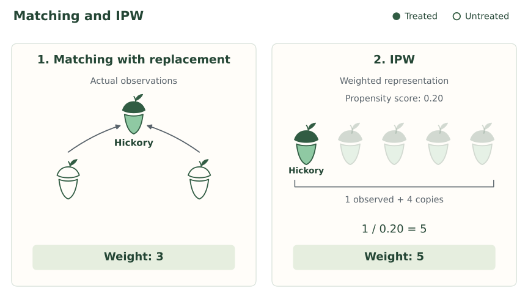

{width=700 fig-align="center" fig-alt="The familiar squirrel attaches a comically large weight to one acorn while other acorns carry small weights. Vintage paperback-style ink illustration."}

## Introduction


A causal effect can have more than one identification formula. We have already seen this. We first adjusted for the full covariate vector $X$, then found that we could adjust for the propensity score $e(X)$ instead. The causal question stayed the same. Only the expression we used to answer it changed.

Why should we care? Each identification formula suggests its own estimators, and those estimators trade off bias, noise, and computation differently. A different formula changes where the error can come from and how much noise we must tolerate to avoid it. So when we find a new identification formula, we gain a new set of estimators and a new set of tradeoffs to choose from. 

Let’s look for another one. 

Again, focus on a binary exposure $A$ and our measured-confounding SCM:

$$
\begin{aligned}
X&\leftarrow f_X(\epsilon_X),\\
A&\leftarrow f_A(X,\epsilon_A),\\
Y&\leftarrow f_Y(A,X,\epsilon_Y),
\end{aligned}
$$

with independent noise terms. 


## Weighting

Think about estimating $E[Y(1)]$ using 1:1 propensity-score
matching with replacement. Here are three people from a
larger dataset:

| Person | $A$ | $e(X)$ | $Y$ |
|---|---:|---:|---:|
| Hickory | 1 | 0.20 | 6 |
| Hazel | 0 | 0.20 | 2 |
| Willow | 0 | 0.20 | 4 |

Hickory received treatment, so he supplies his own outcome.
For each untreated person, we choose exactly one treated
person with a similar propensity score to supply a surrogate
outcome. Matching with replacement means the same treated
person can be chosen again for another untreated person.

Hazel and Willow have the same propensity score as Hickory.
Suppose we choose him as the match for each of them. Their
estimated outcomes under treatment 1 are then both six.
The completed matching estimates are:

| Person | $A$ | $e(X)$ | $Y$ | Treated match | $\hat\mu(X,1)$ |
|---|---:|---:|---:|---|---:|
| Hickory | 1 | 0.20 | 6 | n/a | 6 |
| Hazel | 0 | 0.20 | 2 | Hickory | 6 |
| Willow | 0 | 0.20 | 4 | Hickory | 6 |

Hickory supplies the estimated outcome under treatment for
himself, Hazel, and Willow. His outcome enters our average
three times:

$$
E[Y(1)]
\approx
\frac{6+6+6+\cdots}{1+1+1+\cdots}
=
\frac{3(6)+\cdots}{3+\cdots}.
$$

The dots represent the remaining people in the dataset.
Hickory's outcome contributes $3(6)$ to the numerator and weight
three to the denominator. More generally, each treated person's
outcome appears once for themselves, plus once for every
untreated person who uses them as a match. Untreated outcomes
receive weight zero. Writing

$$
w_i=
\begin{cases}
1+\text{number of times person }i\text{ is used as a match}, & a_i=1,\\
0, & a_i=0,
\end{cases}
$$

we can sum over everyone to write our matching estimate as
a weighted mean:

$$
E[Y(1)]
\approx
\frac{\sum_i w_i y_i}
{\sum_i w_i}.
$$

Do we have to find matches to get these weights? Could we
get them directly from the propensity scores?

Hickory's propensity score of 0.20 means a one-in-five
chance of receiving treatment. Over many people with this
score, we would see about four untreated people for every
treated person. This suggests giving each treated person
weight five: one for themselves and four for the untreated
people they represent. For a general propensity score,
the same reasoning gives

$$
1+\frac{1-e(X)}{e(X)}=\frac{1}{e(X)}.
$$

Another way to think about this is to follow Hickory.
He has probability 0.20 of receiving treatment, so his outcome
has probability 0.20 of entering our treated-outcome average.
Giving it weight five restores one person's representation
on average:

$$
0.20(5)+0.80(0)=1.
$$

More generally,

$$
e(X)\frac{1}{e(X)}+\{1-e(X)\}(0)=1.
$$


This is inverse probability weighting, or IPW. Matching
determined Hickory's weight by counting his uses as a
surrogate. IPW assigns him weight five directly from his
treatment probability.

{width=900 fig-align="center" fig-alt="Acorn icons represent individuals. Left: two outlined untreated acorns each choose the filled treated acorn, Hickory, as their single match with replacement, giving him weight 3. Right: Hickory and four faded copies show five units of representation at propensity score 0.20, giving weight 5. The faded copies represent additional weight, not additional observations."}


<details class="lesson-question">
<summary>Suppose a person has propensity score 0.05. Over many people with this score, how many untreated people would we see per treated person? What weight should a treated person receive? Check that this restores one person's representation on average.</summary>

We would see about 19 untreated people for every treated person.
Each treated person represents themselves plus 19 untreated
people on average, giving weight

$$
1+\frac{0.95}{0.05}=20=\frac{1}{0.05}.
$$

Following one person, their outcome receives weight $20$ if
they are treated and zero otherwise. Their average representation is

$$
0.05(20)+0.95(0)=1.
$$

</details>

<details class="lesson-question">
<summary>In a study of a depression treatment, suppose women are more likely than men to receive treatment at the same values of the other covariates. Compare a treated woman and a treated man whose other covariates agree. Without knowing their propensity scores, who should receive more weight?</summary>

The man. His propensity score is smaller, so his weight
$1/e(X)$ is larger. There are more untreated people per treated
person at his covariate values, so his outcome has to represent
more people.

</details>

## Identification

Our intuition was that the weight $1/e(X)$ lets each treated person stand in for everyone with their covariates, treated or not. Writing the weight as $A/e(X)$ (equal to $1/e(X)$ for treated people and zero for untreated people), the weighted contribution to the outcome is

$$
\frac{A}{e(X)} \times Y.
$$

What is its average among people with the same $X$? Holding covariates fixed, treatment and outcome still vary, so we split the average by treatment value and weight each piece by its probability:

$$
\begin{aligned}
E\left[\frac{YA}{e(X)}\Bigm| X\right]
&=E\left[\frac{YA}{e(X)}\Bigm| X,A=1\right]P(A=1\mid X)\\
&\quad+E\left[\frac{YA}{e(X)}\Bigm| X,A=0\right]P(A=0\mid X).
\end{aligned}
$$

By definition of the propensity score, $P(A=1\mid X)=e(X)$ and $P(A=0\mid X)=1-e(X).$ Also, $YA=Y$ when $A=1$ and $YA=0$ when $A=0$, so the untreated term vanishes:

$$
E\left[\frac{YA}{e(X)}\Bigm| X\right]
=
E\left[\frac{Y}{e(X)}\Bigm| X,A=1\right]e(X).
$$

Because $e(X)$ is constant once we condition on $X$, it comes out of the expectation and cancels:

$$
E\left[\frac{YA}{e(X)}\Bigm| X\right]
=\frac{1}{e(X)}\,E[Y\mid X,A=1]\,e(X)
=E[Y\mid X,A=1].
$$

This is the observed mean among treated people with covariates $X.$ Under our measured-confounding SCM,

$$
E[Y\mid X,A=1]=E[Y(1)\mid X].
$$

Combining the two results,

$$
E\left[\frac{YA}{e(X)}\Bigm| X\right]=E[Y(1)\mid X].
$$

The weighted outcome recovers the mean potential outcome under treatment at each value of $X$, including for people who were actually untreated.

So far we have held $X$ fixed. To get the overall mean, we average over the covariate distribution using iterated expectations:

$$
E\left[\frac{YA}{e(X)}\right]
=E\left[E\left[\frac{YA}{e(X)}\Bigm| X\right]\right]
=E\left[E[Y(1)\mid X]\right]
=E[Y(1)].
$$

For $E[Y(0)]$, reverse the roles. Untreated people supply the outcomes with weight $1/\{1-e(X)\}$, and treated people receive weight zero. Each untreated person represents themselves plus, on average, $e(X)/\{1-e(X)\}$ treated people, for a total weight of

$$
1+\frac{e(X)}{1-e(X)}=\frac{1}{1-e(X)}.
$$

Repeating the argument with $(1-A)/\{1-e(X)\}$ gives

$$
E\left[\frac{Y(1-A)}{1-e(X)}\right]=E[Y(0)].
$$

Both derivations divide by $e(X)$ or $1-e(X)$, so neither can be zero. This is the conditional positivity assumption from earlier. Collecting the two derivations, we can state the following result:

::: {.proposition-box}
Under the measured-confounding SCM, if $0<e(X)<1$ with probability one and the expectations below exist, then

$$
E[Y(1)]
=E\left[\frac{AY}{e(X)}\right],
$$

and

$$
E[Y(0)]
=E\left[\frac{(1-A)Y}{1-e(X)}\right].
$$
:::

::: {.callout-note title="Technical note: the proof for treatment 0" collapse="true"}
An untreated person receives weight $1/\{1-e(X)\}$, and a treated
person receives weight zero. We can write both cases as
$(1-A)/\{1-e(X)\}.$ Applying that weight to the outcome gives

$$
\frac{Y(1-A)}{1-e(X)}.
$$

What does this give us on average for people with the same
$X$? We want to calculate

$$
E\left[\frac{Y(1-A)}{1-e(X)}\Bigm|X\right].
$$

First, break the average into the two possible treatment values:

$$
\begin{aligned}
E\left[\frac{Y(1-A)}{1-e(X)}\Bigm|X\right]
&=E\left[\frac{Y(1-A)}{1-e(X)}\Bigm|X,A=0\right]P(A=0\mid X)\\
&\quad+E\left[\frac{Y(1-A)}{1-e(X)}\Bigm|X,A=1\right]P(A=1\mid X).
\end{aligned}
$$

Substitute $P(A=0\mid X)=1-e(X)$ and
$P(A=1\mid X)=e(X)$:

$$
\begin{aligned}
E\left[\frac{Y(1-A)}{1-e(X)}\Bigm|X\right]
&=E\left[\frac{Y(1-A)}{1-e(X)}\Bigm|X,A=0\right]\{1-e(X)\}\\
&\quad+E\left[\frac{Y(1-A)}{1-e(X)}\Bigm|X,A=1\right]e(X).
\end{aligned}
$$

When $A=0$, $Y(1-A)=Y.$ When $A=1$, $Y(1-A)=0.$ This leaves

$$
E\left[\frac{Y(1-A)}{1-e(X)}\Bigm|X\right]
=E\left[\frac{Y}{1-e(X)}\Bigm|X,A=0\right]\{1-e(X)\}.
$$

Since we are conditioning on $X$, $1-e(X)$ is fixed. Pull it
outside the conditional expectation and cancel:

$$
\begin{aligned}
E\left[\frac{Y(1-A)}{1-e(X)}\Bigm|X\right]
&=\frac{1}{1-e(X)}E[Y\mid X,A=0]\{1-e(X)\}\\
&=E[Y\mid X,A=0].
\end{aligned}
$$

Now use consistency. Among untreated people, $Y=Y(0)$, so

$$
E[Y\mid X,A=0]=E[Y(0)\mid X,A=0].
$$

Our measured-confounding SCM and the global Markov property
give $A\mathrel{\perp\!\!\!\perp}Y(0)\mid X.$ Therefore,

$$
E[Y(0)\mid X,A=0]=E[Y(0)\mid X].
$$

We have shown that

$$
E\left[\frac{Y(1-A)}{1-e(X)}\Bigm|X\right]=E[Y(0)\mid X].
$$

Only now do we average over $X$, using iterated expectations:

$$
\begin{aligned}
E\left[\frac{Y(1-A)}{1-e(X)}\right]
&=E\left[E\left[\frac{Y(1-A)}{1-e(X)}\Bigm|X\right]\right]\\
&=E\left[E[Y(0)\mid X]\right]\\
&=E[Y(0)].
\end{aligned}
$$
:::


## Estimating the effect

We have identified the intervention means. Now let's estimate
them from data, starting with a small example.


::: {.example-intro}
<span class="example-label">Example: Four people.</span>

Suppose we observe the following covariates, treatments, and
outcomes. The true propensity scores are supplied.

| Person | $X$ | $A$ | $Y$ | $e(X)$ |
|---|---:|---:|---:|---:|
| 1 | 0 | 1 | 6 | 0.25 |
| 2 | 0 | 0 | 2 | 0.25 |
| 3 | 1 | 1 | 10 | 0.75 |
| 4 | 1 | 0 | 4 | 0.75 |
:::

We need two sets of weights. To estimate the mean under
treatment 1, use $A/e(X).$ To estimate the mean under
treatment 0, use $(1-A)/\{1-e(X)\}.$ Each person supplies
an observed outcome under only one treatment value, so one
of their two weights will be zero.

Person 1 received treatment. His weight for estimating the mean
under treatment 1 is $1/0.25=4$, and his weight for estimating
the mean under treatment 0 is zero. Person 2 did not receive
treatment. Her weight for the first mean is zero, and her weight
for the second is $1/(1-0.25)=4/3.$ Repeating these calculations
for Persons 3 and 4 completes the table:

| Person | Weight for $Y(1)$: $A/e(X)$ | Weight for $Y(0)$: $(1-A)/\{1-e(X)\}$ |
|---|---:|---:|
| 1 | $1/0.25=4$ | $0/0.75=0$ |
| 2 | $0/0.25=0$ | $1/0.75=4/3$ |
| 3 | $1/0.75=4/3$ | $0/0.25=0$ |
| 4 | $0/0.75=0$ | $1/0.25=4$ |

For the mean under treatment 1, Persons 1 and 3 supply the
outcomes. Person 1's outcome receives weight four, while
Person 3's outcome receives weight $4/3.$ Multiply each outcome
by its weight, add, and divide by the total weight:

$$
E[Y(1)]
\approx\frac{4(6)+(4/3)(10)}{4+4/3}
=\frac{112/3}{16/3}
=7.
$$

For the mean under treatment 0, Persons 2 and 4 supply the
outcomes. This time their weights are $4/3$ and four,
respectively. The same weighted-mean calculation gives

$$
E[Y(0)]
\approx\frac{(4/3)(2)+4(4)}{4/3+4}
=\frac{56/3}{16/3}
=3.5.
$$

Subtract the estimated mean under treatment 0 from the estimated
mean under treatment 1:

$$
\operatorname{ATE}\approx7-3.5=3.5.
$$

The estimated effect of treatment is an increase of 3.5 outcome
units. We used the propensity scores to construct weights, then
calculated a weighted mean in each treatment group.

::: {.main-point}
To estimate the ATE using IPW:

1. Estimate each person's propensity score.
2. Compute two weights to each person, $A/\hat e(X)$ and $(1-A)/\{1-\hat e(X)\}.$
3. Calculate the weighted mean outcome separately for each set of weights

:::

The weighted means we just calculated are **normalized IPW
estimators**, also called **Hájek estimators** [@hajek_1971]. For $n$ people,
we can write the same calculations as

$$
E[Y(1)]
\approx\frac{\sum_{i=1}^n a_i y_i/\hat e(x_i)}
{\sum_{i=1}^n a_i/\hat e(x_i)},
\qquad
E[Y(0)]
\approx\frac{\sum_{i=1}^n (1-a_i)y_i/\{1-\hat e(x_i)\}}
{\sum_{i=1}^n (1-a_i)/\{1-\hat e(x_i)\}}.
$$


How do these denominators connect to the identification result?
The proposition gave us expectations of weighted outcomes.
The corresponding weights have expectation one at every $X$:

$$
\begin{aligned}
E\left[\frac{A}{e(X)}\Bigm|X\right]
&=\frac{E[A\mid X]}{e(X)}=1,\\
E\left[\frac{1-A}{1-e(X)}\Bigm|X\right]
&=\frac{E[1-A\mid X]}{1-e(X)}=1.
\end{aligned}
$$

Averaging over $X$ therefore still gives one. Writing out
that averaging with iterated expectations,

$$
E\left[\frac{A}{e(X)}\right]
=E\left[E\left[\frac{A}{e(X)}\Bigm|X\right]\right]
=1,
$$

and

$$
E\left[\frac{1-A}{1-e(X)}\right]
=E\left[E\left[\frac{1-A}{1-e(X)}\Bigm|X\right]\right]
=1.
$$

Dividing each identified weighted outcome expectation by its
expected weight leaves the intervention mean unchanged. This
connects the weighted means to the expressions in the proposition.
In our data, however, the mean weights need not be exactly one.
In the four-person example, each set of weights sums to $16/3$,
rather than four. Dividing by its own weight sum gives each
estimated intervention mean the form of a weighted average.

## A data example in R

::: {.example-intro}
<span class="example-label">Example: Smoking and birth weight.</span>

Return to the 189 births from the previous section. Let $A$ indicate smoking during pregnancy and let $Y$ be birth weight in grams. Collect maternal age and weight in $X$, using the same working SCM as before.
:::

```{r}
#| label: ipw-birthweight-propensity
#| include: false
birthwt_ipw <- if (file.exists("data/birthwt.csv")) {
  read.csv("data/birthwt.csv")
} else {
  MASS::birthwt
}
rownames(birthwt_ipw) <- NULL
ipw_ps_fit <- glm(smoke ~ age + lwt,
                  family = binomial(), data = birthwt_ipw)
```

Use the propensity model we fitted in the previous section:

$$
\log\left[\frac{\hat e(X)}{1-\hat e(X)}\right]
\approx `r sprintf("%.2f", coef(ipw_ps_fit)[1])`
`r sprintf("%+.4f", coef(ipw_ps_fit)["age"])`\,\text{age}
`r sprintf("%+.4f", coef(ipw_ps_fit)["lwt"])`\,\text{weight}.
$$

Age is in years and weight in pounds.

Both coefficients are negative: holding weight fixed, older
mothers have a lower estimated probability of smoking.
Holding age fixed, heavier mothers have a lower
estimated probability of smoking.

To estimate mean birth weight under smoking, we weight the
outcomes by $A/\hat e(X)$: mothers who smoked receive weight
$1/\hat e(X)$, and mothers who did not smoke receive weight zero.
Among mothers who smoked, older mothers'
outcomes receive more weight, holding maternal weight fixed.
Outcomes from heavier mothers receive more weight,
holding age fixed.

<details class="lesson-question">
<summary>To estimate mean birth weight under not smoking, we use outcomes from mothers who did not smoke. Holding the other covariate fixed, should older mothers' outcomes receive more or less weight? What about outcomes from heavier mothers?</summary>

The weight is $(1-A)/\{1-\hat e(X)\}$: mothers who did not
smoke receive weight $1/\{1-\hat e(X)\}$, and mothers who smoked
receive weight zero. Among mothers who did not smoke, older mothers have a higher
estimated probability of not smoking, so their outcomes
receive less weight in estimating mean birth weight under
not smoking. Heavier mothers have a higher estimated
probability of not smoking, so their outcomes receive less
weight in estimating that same mean.

</details>

Here are the first four mothers:

```{r}
#| label: ipw-birthweight-four-mothers
#| echo: false
knitr::kable(
  data.frame(
    Mother = 1:4,
    Age = birthwt_ipw$age[1:4],
    Weight = birthwt_ipw$lwt[1:4],
    A = birthwt_ipw$smoke[1:4]
  ),
  col.names = c("Mother", "Age", "Weight", "$A$"),
  escape = FALSE, row.names = FALSE
)
```

Mother 1 is 19 years old and weighs 182 pounds. Substitute
her covariates into the fitted model to get her estimated log odds:

$$
`r sprintf("%.4f", coef(ipw_ps_fit)[1])`
`r sprintf("%+.6f", coef(ipw_ps_fit)["age"])`(19)
`r sprintf("%+.6f", coef(ipw_ps_fit)["lwt"])`(182)
\approx -0.5136.
$$

Transform back to a probability:

$$
\hat e(19,182)
\approx\frac{\exp(-0.5136)}{1+\exp(-0.5136)}
\approx0.3743.
$$

She did not smoke, so her weight for estimating mean birth
weight under smoking is zero:

$$
\frac{0}{\hat e(19,182)}=0.
$$

Her weight for estimating mean birth weight under not smoking is

$$
\frac{1-0}{1-\hat e(19,182)}
\approx\frac{1}{1-0.3743}\approx1.60.
$$

Mother 3 is 20 years old and weighs 105 pounds. The same
substitution gives

$$
\hat e(20,105)
\approx\frac{\exp\{0.2320-0.014732(20)-0.002559(105)\}}
{1+\exp\{0.2320-0.014732(20)-0.002559(105)\}}
\approx0.4179.
$$

She smoked, so her weight for estimating mean birth weight
under smoking is

$$
\frac{1}{\hat e(20,105)}\approx\frac{1}{0.4179}\approx2.39.
$$

Her weight for estimating mean birth weight under not smoking is zero:

$$
\frac{1-1}{1-\hat e(20,105)}=0.
$$

Calculate the scores and weights for Mothers 2 and 4 in the
same way. In R, `predict()` calculates the scores. We then
calculate a separate set of weights for each intervention mean:

```{r}
#| label: ipw-birthweight-weights
birthwt_ipw$score <- predict(ipw_ps_fit, type = "response")
birthwt_ipw$weight1 <- with(birthwt_ipw, smoke / score)
birthwt_ipw$weight0 <- with(birthwt_ipw, (1 - smoke) / (1 - score))
```

The completed calculations for these four mothers are:

```{r}
#| label: ipw-birthweight-four-weights
#| echo: false
knitr::kable(
  data.frame(
    Mother = 1:4,
    A = birthwt_ipw$smoke[1:4],
    Score = birthwt_ipw$score[1:4],
    Weight1 = birthwt_ipw$weight1[1:4],
    Weight0 = birthwt_ipw$weight0[1:4]
  ),
  col.names = c("Mother", "$A$", "$\\hat e(X)$",
                "Weight for $Y(1)$", "Weight for $Y(0)$"),
  digits = c(0, 0, 4, 2, 2), escape = FALSE, row.names = FALSE
)
```

Use `weighted.mean()` with each set of weights. All 189 outcomes
appear in each call, but nonsmokers receive weight zero when
estimating the mean under smoking, and smokers receive weight
zero when estimating the mean under not smoking:

```{r}
#| label: ipw-birthweight-means
smoked <- birthwt_ipw$smoke == 1
ipw_mean1 <- with(birthwt_ipw,
  weighted.mean(bwt, weight1))
ipw_mean0 <- with(birthwt_ipw,
  weighted.mean(bwt, weight0))
ipw_ate <- ipw_mean1 - ipw_mean0
c(mean1 = ipw_mean1, mean0 = ipw_mean0, ATE = ipw_ate)
```

The estimated mean birth weights are `r sprintf("%.2f", ipw_mean1)` grams under smoking and `r sprintf("%.2f", ipw_mean0)` grams under not smoking. Their difference is `r sprintf("%.2f", ipw_ate)` grams. Under our working SCM, smoking lowers mean birth weight by an estimated `r sprintf("%.2f", -ipw_ate)` grams.

```{r}
#| label: ipw-compare-score-regression
#| include: false
ipw_compare1 <- ipw_compare0 <- birthwt_ipw
ipw_compare1$smoke <- 1
ipw_compare0$smoke <- 0
ipw_score_regression <- lm(bwt ~ score + smoke, data = birthwt_ipw)
ipw_score_regression_ate <- mean(
  predict(ipw_score_regression, newdata = ipw_compare1) -
  predict(ipw_score_regression, newdata = ipw_compare0)
)
```

How does this compare with our earlier estimate? In
[Propensity scores](03c-propensity-scores.qmd), outcome regression
using the score and smoking gave an estimated decrease of
`r sprintf("%.2f", -ipw_score_regression_ate)` grams. The estimates are reasonably close. 

::: {.example-intro}
<span class="example-label">Example: Smoking and low birth weight.</span>

Now let $Y=1$ indicate infant birth weight below 2,500 grams
and $Y=0$ otherwise, using the variable `low`. We keep the
same mothers, smoking variable, and covariates.
:::

Our weights depend on treatment and covariates, so they stay
the same when we change the outcome. Replace `bwt` by `low`
in the two weighted means. Because the outcome is binary,
each weighted mean estimates a risk:

```{r}
#| label: ipw-low-birthweight-risks
ipw_low_mean1 <- with(birthwt_ipw, weighted.mean(low, weight1))
ipw_low_mean0 <- with(birthwt_ipw, weighted.mean(low, weight0))
ipw_low_ate <- ipw_low_mean1 - ipw_low_mean0
ipw_low_rr <- ipw_low_mean1 / ipw_low_mean0
ipw_low_or <- (ipw_low_mean1 / (1 - ipw_low_mean1)) /
  (ipw_low_mean0 / (1 - ipw_low_mean0))
c(risk1 = ipw_low_mean1, risk0 = ipw_low_mean0,
  ATE = ipw_low_ate, relative_risk = ipw_low_rr, odds_ratio = ipw_low_or)
```

For the risk under smoking, nonsmokers still receive weight
zero. For the risk under not smoking, smokers receive weight
zero. Under our working SCM, the estimated risk of low birth
weight is `r sprintf("%.1f", 100 * ipw_low_mean1)`% under smoking
and `r sprintf("%.1f", 100 * ipw_low_mean0)`% under not smoking.
Smoking therefore increases the risk by an estimated
`r sprintf("%.1f", 100 * ipw_low_ate)` percentage points. The
estimated causal relative risk is `r sprintf("%.2f", ipw_low_rr)`,
and the causal odds ratio is `r sprintf("%.2f", ipw_low_or)`.

```{r}
#| label: ipw-compare-score-low-birthweight
#| include: false
ipw_score_low_regression <- glm(low ~ score + smoke,
  family = binomial(), data = birthwt_ipw)
ipw_score_low_ate <- mean(
  predict(ipw_score_low_regression, newdata = ipw_compare1, type = "response") -
  predict(ipw_score_low_regression, newdata = ipw_compare0, type = "response")
)
```

In the previous section, logistic outcome regression using
the score and smoking gave an estimated risk increase of
`r sprintf("%.1f", 100 * ipw_score_low_ate)` percentage points.
IPW gives `r sprintf("%.1f", 100 * ipw_low_ate)` percentage
points. Again, these are two estimates of the same causal
contrast, obtained using different estimators.

## Things to think about in practice

We have computed an estimate. Now look at the comparisons
behind it and how much information supports them.

### Positivity

Our identification argument required conditional positivity:
both treatment values must have positive probability given
the covariates, $0<e(X)<1$. Do our data support the comparisons
that this assumption requires? This question matters for
propensity-score matching, adjustment, and weighting.

Look at the distribution of estimated propensity scores,
separately for treated and untreated people. Two warning
signs are worth looking for:

1. **Scores close to zero or one.** A score of 0.001 means
   treatment is very unlikely at those covariate values.
   Over many people with that score, we would expect about
   999 untreated people per treated person. A score of 0.999
   reverses the problem: untreated outcomes are scarce.
   At these scores, a few outcomes supply most of the
   comparison under one treatment value.
2. **Regions with little or no overlap between the groups.**
   Are there score ranges containing treated people but few
   or no untreated people, or the reverse? We lack observed
   comparisons in those regions.

@westreich_etal_2011 explicitly connect non-overlapping
propensity-score distributions to possible nonpositivity.

For our birth-weight example, plot the estimated scores for
mothers who smoked and mothers who did not:

```{r}
#| label: ipw-birthweight-overlap
#| fig-width: 7
#| fig-height: 4
#| fig-alt: "Density histograms of estimated smoking probabilities for mothers who smoked and mothers who did not, using common bins."
ipw_bins <- seq(0, 1, length.out = 21)
ipw_hist0 <- hist(birthwt_ipw$score[!smoked], breaks = ipw_bins, plot = FALSE)
ipw_hist1 <- hist(birthwt_ipw$score[smoked], breaks = ipw_bins, plot = FALSE)
ipw_ylim <- c(0, 1.1 * max(ipw_hist0$density, ipw_hist1$density))
plot(ipw_hist0, freq = FALSE, col = NA, border = "grey40",
     ylim = ipw_ylim, xlab = "Estimated propensity score",
     main = "Smoking probabilities by observed smoking status")
plot(ipw_hist1, freq = FALSE, col = NA, border = "steelblue", add = TRUE)
legend("topright", c("Did not smoke", "Smoked"),
       col = c("grey40", "steelblue"), lty = 1, bty = "n")
```

Here, the scores in both groups range from about 0.31 to 0.44.
The fitted scores are away from zero and one, and both groups
are represented across a similar range.

If warning signs appear, inspect the original covariates to
identify the combinations behind them. Is one treatment
impossible for those people, or simply rare in our sample?
Restricting the analysis to a region with both treatment
groups defines the causal effect for the people in that region.

### Balance

The positivity checks ask whether we have observations to compare.
Balance asks whether weighting has made the covariate
distributions similar between treatment groups. Check the
original covariates, just as we did after matching.

Use `cobalt`, as in the matching sections, to compare balance
for the same 189 mothers across our methods. We will compare
matching directly on age and maternal weight, propensity-score
matching, full matching, and IPW.

The labels show each method's target: ATT for nearest-neighbor
matching and ATE for full matching and IPW. Use the original
pooled standard deviation for each covariate throughout to
put all the comparisons on the same scale.

```{r}
#| label: ipw-prepare-balance-comparison
#| include: false
birthwt_nearest <- MatchIt::matchit(
  smoke ~ age + lwt, data = birthwt_ipw,
  method = "nearest", distance = "mahalanobis", estimand = "ATT",
  ratio = 1, replace = TRUE, m.order = "data"
)
birthwt_ps_nearest <- MatchIt::matchit(
  smoke ~ age + lwt, data = birthwt_ipw,
  method = "nearest", distance = birthwt_ipw$score, estimand = "ATT",
  ratio = 1, replace = TRUE, m.order = "data"
)
birthwt_full <- MatchIt::matchit(
  smoke ~ age + lwt, data = birthwt_ipw,
  method = "full", distance = "mahalanobis", estimand = "ATE"
)
```

Collect the matching weights from the earlier analyses.
For the IPW balance check, `cobalt` uses one weight per mother:
`weight1 + weight0` gives her nonzero weight for her observed
treatment group. The intervention-mean calculations above
use their separate sets of weights, including zeros.

```{r}
#| label: ipw-birthweight-balance
ipw_comparison_weights <- data.frame(
  Matching = birthwt_nearest$weights,
  PS_matching = birthwt_ps_nearest$weights,
  Full_matching = birthwt_full$weights,
  IPW = birthwt_ipw$weight1 + birthwt_ipw$weight0
)
ipw_balance <- cobalt::bal.tab(
  smoke ~ age + lwt, data = birthwt_ipw,
  weights = ipw_comparison_weights,
  un = TRUE, s.d.denom = "pooled"
)
```

Here are the absolute standardized mean differences. Values
closer to zero indicate closer balance in that covariate's mean:

```{r}
#| label: ipw-birthweight-balance-comparison-table
#| echo: false
ipw_balance_table <- data.frame(
  Covariate = c("Maternal age", "Maternal weight"),
  abs(ipw_balance$Balance[, c("Diff.Un", "Diff.Matching",
    "Diff.PS_matching", "Diff.Full_matching", "Diff.IPW")])
)
knitr::kable(ipw_balance_table,
  col.names = c("Covariate", "Before", "Matching (ATT)",
    "PS matching (ATT)", "Full matching (ATE)", "IPW (ATE)"),
  digits = 3, row.names = FALSE)
```

A single balance plot displays the same comparisons. The line
at 0.10 is the common guide we used earlier:

```{r}
#| label: ipw-birthweight-balance-comparison-plot
#| echo: false
#| fig-width: 8
#| fig-height: 4.5
#| fig-alt: "Absolute standardized mean differences in maternal age and weight before adjustment and after covariate matching, propensity-score matching, full matching, and IPW, with ATT and ATE targets labeled."
cobalt::love.plot(
  ipw_balance, abs = TRUE,
  thresholds = c(m = 0.10),
  var.names = c(age = "Maternal age", lwt = "Maternal weight"),
  sample.names = c("Before adjustment", "Matching (ATT)",
    "PS matching (ATT)", "Full matching (ATE)", "IPW (ATE)"),
  colors = c("#59636b", "#315c43", "#bd8442", "#6588a6", "#913e57"),
  shapes = c(16, 17, 15, 18, 19),
  position = "bottom", wrap = 24
) + ggplot2::guides(
  colour = ggplot2::guide_legend(nrow = 2, byrow = TRUE),
  shape = ggplot2::guide_legend(nrow = 2, byrow = TRUE)
)
```

All four methods bring these mean differences closer to zero.
IPW gives the closest mean-age balance, while propensity-score
matching gives the closest mean-weight balance. Also compare
spread and relevant nonlinear features or interactions.

If balance remains poor, revisit the propensity model.
Perhaps the relationship with age bends, or the association
with maternal weight differs by age. Revise the model and
check balance again.

Evaluate the propensity model through the weighted comparison
it produces. Classification accuracy measures how well the
model separates treated from untreated people; balance measures
how closely the weighted covariate distributions agree.
@brookhart_2006 discuss why selecting variables for a propensity
model differs from selecting them solely to predict treatment.

### Large weights

Even with overlap, some outcomes may receive much more
weight than others. For a mother who smoked, her weight
when estimating mean birth weight under smoking is
$1/\hat e(X)$:

| Estimated propensity score | Weight under smoking, if she smoked |
|---:|---:|
| 0.50 | 2 |
| 0.05 | 20 |
| 0.001 | 1,000 |

A mother who did not smoke still receives weight zero for
this mean. For the mean under not smoking, the large weights
arise among nonsmokers with scores close to one: a score of
0.999 gives weight $1/(1-0.999)=1000$.

Consider a different sample with four mothers who smoked.
Their infants weigh 2,500, 3,000, 3,500, and 2,000 grams.
Suppose their weights for estimating the mean under smoking
are 2, 2, 2, and 1,000. The weighted mean is

$$
\frac{2(2500)+2(3000)+2(3500)+1000(2000)}{2+2+2+1000}
=\frac{2018000}{1006}\approx2006\text{ grams}.
$$

The last infant's outcome carries about 99.4% of the total
weight, so the weighted mean is almost that one infant's
birth weight.

One response is to cap the weights. Cap the last weight at
20 and repeat the calculation:

$$
\frac{2(2500)+2(3000)+2(3500)+20(2000)}{2+2+2+20}
=\frac{58000}{26}\approx2231\text{ grams}.
$$

The last outcome has less influence, and the estimate
changes. Capping changes the weighting formula, so we trade
possible bias for reduced variability.

In our actual birth-weight data, inspect the nonzero weights
for each intervention mean:

```{r}
#| label: ipw-birthweight-weight-summary
summary(birthwt_ipw$weight1[smoked])
summary(birthwt_ipw$weight0[!smoked])
```

The largest is about `r sprintf("%.2f", max(birthwt_ipw$weight1, birthwt_ipw$weight0))`.

We can limit weights by truncating propensity scores before
constructing them. For example, replacing scores below 0.05
by 0.05 and above 0.95 by 0.95 caps each nonzero weight at 20:

```{r}
#| label: ipw-birthweight-truncation
bounded_score <- pmin(pmax(birthwt_ipw$score, 0.05), 0.95)
bounded_weight1 <- birthwt_ipw$smoke / bounded_score
bounded_weight0 <- (1 - birthwt_ipw$smoke) / (1 - bounded_score)
bounded_ate <- with(birthwt_ipw,
  weighted.mean(bwt, bounded_weight1) -
  weighted.mean(bwt, bounded_weight0))
c(original_ATE = ipw_ate, bounded_ATE = bounded_ate)
```

No scores in our example cross these bounds, so the estimate
is unchanged. When truncation does change weights, check how
both the estimate and covariate balance change. Repeat the
`cobalt` balance check using `bounded_weight1 + bounded_weight0`. Report the
bounds used. @cole_hernan_2008 work through these choices.

<details class="lesson-question">
<summary>Would stabilized weights solve the domination in our four-infant example? Suppose 30% of mothers smoked, and multiply every weight for estimating the mean under smoking by 0.30.</summary>

The weights become 0.6, 0.6, 0.6, and 300. Both the weighted
outcome total and the weight sum are multiplied by 0.30, so

$$
\frac{0.30\{2(2500)+2(3000)+2(3500)+1000(2000)\}}
{0.30\{2+2+2+1000\}}
=\frac{2018000}{1006}\approx2006\text{ grams}.
$$

The last infant still carries 99.4% of the total weight.
Multiplying by the marginal treatment probability gives
**stabilized weights**. For the mean under not smoking, the
corresponding factor is 0.70. Each constant cancels in its
own weighted mean, so the two estimated intervention means
and the ATE stay the same.

</details>

### Choosing a denominator

We introduced IPW using weighted means, also called Hájek
estimators. The **Horvitz–Thompson estimator** is another widely
used choice [@horvitz_thompson_1952]. It divides the weighted
outcome total by $n$, the number of people in the sample,
including those with weight zero.

Return to treatment 1 in our four-person example. The
Horvitz–Thompson calculation gives

$$
\frac{4(6)+(4/3)(10)}{4}=\frac{28}{3}\approx9.33.
$$

The Hájek calculation uses the same numerator but divides by
the weight sum:

$$
\frac{4(6)+(4/3)(10)}{4+4/3}=7.
$$

Why choose one over the other? When the true treatment
probabilities are known, the Horvitz–Thompson estimator is
unbiased: it directly averages the weighted contributions
from our identification result. The Hájek estimator divides
by a weight sum that varies across samples. That ratio can
introduce finite-sample bias, but normalization can also
reduce variability from sample to sample.

The tradeoff concerns mean squared error:

$$
\operatorname{MSE}=\operatorname{Variance}+\operatorname{Bias}^2.
$$

A reduction in variance can outweigh the squared bias introduced
by normalization. Estimating the propensity scores introduces
another source of error into both procedures. Neither method
universally minimizes MSE.
@datta_polson_2026 discuss these estimators and their tradeoffs.

We can also combine the denominator choices.
@khan_ugander_2023 study **adaptive normalization**, using a
denominator that combines $n$ and the sum of weights, with
the combination chosen from the data to reduce variance.
Their approach connects the two estimators and extends to
ATE estimation. We will continue using Hájek weighted means
in our worked examples.

### Uncertainty

As with our earlier propensity-score analyses, there are two
sources of sampling uncertainty to account for. We estimated
the propensity scores, so another sample would give different
weights. We also used sampled outcomes to estimate the
intervention means. These two steps use the same people;
their uncertainties are connected.

A bootstrap repeats both steps. Sample 189 mothers with
replacement, keeping each mother's covariates, smoking status,
and outcome together. Refit the propensity model, construct
new weights, and calculate the difference of weighted means.
Repeat this procedure to obtain a collection of estimates.

```{r}
#| label: ipw-birthweight-bootstrap
set.seed(661)
ipw_boot <- replicate(1000, {
  boot_rows <- sample.int(nrow(birthwt_ipw), replace = TRUE)
  boot_data <- birthwt_ipw[boot_rows, ]
  boot_fit <- glm(smoke ~ age + lwt,
    family = binomial(), data = boot_data)
  boot_score <- predict(boot_fit, type = "response")
  boot_weight1 <- boot_data$smoke / boot_score
  boot_weight0 <- (1 - boot_data$smoke) / (1 - boot_score)
  c(
    grams = weighted.mean(boot_data$bwt, boot_weight1) -
      weighted.mean(boot_data$bwt, boot_weight0),
    risk_difference = weighted.mean(boot_data$low, boot_weight1) -
      weighted.mean(boot_data$low, boot_weight0)
  )
})
```

The standard deviation of these estimates gives a bootstrap
standard error. Their 2.5th and 97.5th percentiles give a
percentile 95% confidence interval:

```{r}
#| label: ipw-birthweight-bootstrap-summary
ipw_boot_summary <- data.frame(
  Contrast = c("Mean difference (grams)", "Risk difference"),
  Estimate = c(ipw_ate, ipw_low_ate),
  SE = apply(ipw_boot, 1, sd),
  Lower = apply(ipw_boot, 1, quantile, probs = 0.025),
  Upper = apply(ipw_boot, 1, quantile, probs = 0.975)
)
knitr::kable(ipw_boot_summary, digits = c(0, 3, 3, 3, 3), row.names = FALSE)
```

@austin_2022 examines bootstrap uncertainty estimates for
propensity weighting with continuous and binary outcomes.

Next, we combine outcome regression and weighting in [Robust estimators](03e-robust-estimators.qmd).
