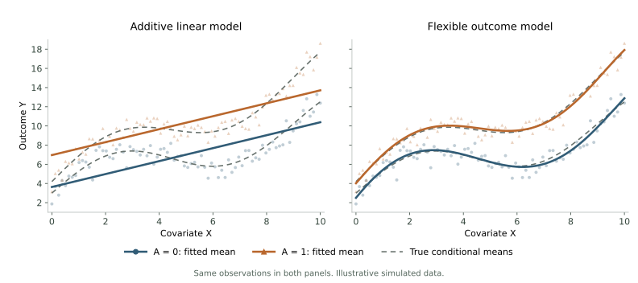
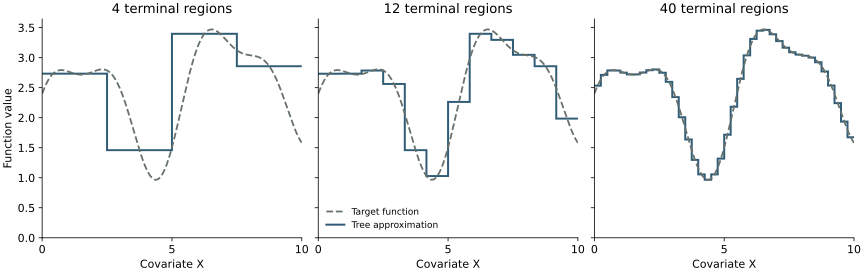
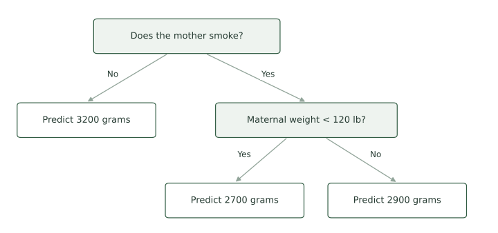
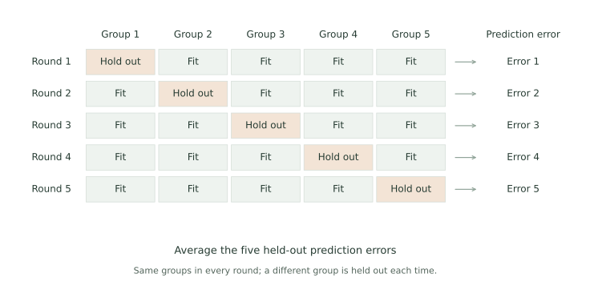

{width=700 fig-align="center" fig-alt="The familiar detective squirrel holds a straight ruler against a curved branch, inspecting the gap between them. Acorns sit nearby. Vintage sepia pen-and-ink illustration."}

## Introduction 

Getting the models right is central to getting a good causal estimate. We have worked carefully to identify causal effects and express them in terms of the observed-data distribution. But those expressions involve functions we do not know: the conditional outcome mean $\mu(x,a)$ and the propensity score $e(x)$. We use fitted functions $\hat\mu(x,a)$ and $\hat e(x)$ in their place. Those hats matter: errors in these fitted functions can introduce bias into our causal estimates.

Our birth-weight analysis shows where these errors can enter. We used maternal age and weight to predict smoking, and smoking, age, and weight to predict infant birth weight. Logistic regression and linear regression made these calculations convenient, but they also imposed restrictions. Our additive linear outcome model says that another pound of maternal weight has the same association with mean birth weight at every age and smoking value. It also says that the smoking difference does not depend on either covariate. These restrictions come from our model, not our SCM.

Careful causal reasoning does not protect us from these modeling errors. We can identify the right confounders and use IPW to adjust for them, yet still obtain a badly biased estimate if our propensity model poorly describes treatment probabilities. The same problem arises in outcome regression when our model poorly describes the conditional mean. Getting the estimation strategy right is only part of the work.

We will consider two ways to address this problem. First, we will combine outcome regression and weighting through AIPW, examining how errors in the two fitted functions affect the estimate. Then we will use more flexible models to relax the restrictions we have imposed, working through BART as an outcome model.

## Where modeling bias enters

Outcome regression and IPW each depend on estimating a particular function well. Before combining them, consider what happens when each function is wrong. We will focus on $E[Y(1)]$; the same reasoning applies to $E[Y(0)]$.

To isolate the modeling error, hold the fitted functions fixed and average over new observations from the same working SCM. Recall that $\mu(X,1)=E[Y\mid X,A=1]$ and, under our SCM, $E[\mu(X,1)]=E[Y(1)]$.

### Outcome regression

Outcome regression averages predictions under treatment. If the predictions are systematically too high or too low, their average carries that error into our estimate. The difference between the average fitted prediction and the intervention mean is

$$
E[\hat\mu(X,1)]-E[Y(1)]
=
E[\hat\mu(X,1)-\mu(X,1)].
$$

For example, if our fitted outcome function underpredicts the conditional mean by two units at every covariate value, averaging those predictions also underestimates $E[Y(1)]$ by two units. If the outcome function is correct, this modeling bias is zero.

### IPW

IPW uses the propensity model to decide how much representation each observed outcome receives. If the fitted scores give the wrong weights, some covariate profiles receive too much representation and others too little.

For this bias calculation, use the Horvitz–Thompson form of IPW: divide the weighted outcome total by $n$, rather than by the sum of the weights. Its average contribution is

$$
E\left[\frac{AY}{\hat e(X)}\right]
=
E\left[\frac{e(X)}{\hat e(X)}\mu(X,1)\right].
$$

The factor $e(X)/\hat e(X)$ shows the distortion. If the propensity function is correct, this factor is one at every covariate value, and the expression reduces to $E[\mu(X,1)]=E[Y(1)]$.

Subtract the intervention mean and collect the terms multiplying $\mu(X,1)$:

$$
\begin{aligned}
E\left[\frac{AY}{\hat e(X)}\right]-E[Y(1)]
&=E\left[\left\{\frac{e(X)}{\hat e(X)}-1\right\}\mu(X,1)\right]\\
&=E\left[\frac{e(X)-\hat e(X)}{\hat e(X)}\mu(X,1)\right].
\end{aligned}
$$

The bias depends on the propensity error $e(X)-\hat e(X)$, divided by the fitted score and multiplied by the conditional outcome mean. If we underestimate a group's treatment probability, we give its treated outcomes too much weight. If we overestimate it, we give them too little. Getting the propensity function right makes this error zero.

::: {.main-point}
Outcome regression gets the right intervention mean when its outcome function is correct. IPW gets the right intervention mean when its propensity function is correct. We call these procedures **singly robust**: each relies on getting one particular model right.
:::

## Double robustness

Can we combine outcome regression and IPW? Our idea is to start with the outcome prediction and add a weighted prediction error. We want the resulting contribution to recover the conditional mean on average within each covariate profile:

$$
E[Y\mid X,A=1]
\approx
\hat\mu(X,1)
+\frac{A}{\hat e(X)}\{Y-\hat\mu(X,1)\}.
$$

The right-hand side is a contribution from one person. What happens to its average if one of our fitted functions is correct?

### If the outcome function is correct

Suppose $\hat\mu(X,1)=\mu(X,1)$. Among treated people at a given $X$, the prediction errors average to zero. Untreated people contribute zero to the correction because $A=0$. Thus the average correction is

$$
\begin{aligned}
E\left[\frac{A}{\hat e(X)}\{Y-\mu(X,1)\}\Bigm|X\right]
&=\frac{e(X)}{\hat e(X)}
E[Y-\mu(X,1)\mid X,A=1]\\
&=\frac{e(X)}{\hat e(X)}\{\mu(X,1)-\mu(X,1)\}\\
&=0.
\end{aligned}
$$

The fitted propensity score depends only on $X$, so it changes the size of the errors without changing their zero average within that covariate profile. Adding the correction therefore leaves the correct conditional mean unchanged:

$$
E\left[\mu(X,1)+\frac{A}{\hat e(X)}\{Y-\mu(X,1)\}\Bigm|X\right]
=\mu(X,1).
$$

This works even if the propensity function is wrong.

### If the propensity function is correct

Now suppose $\hat e(X)=e(X)$, while the outcome function may be wrong. At a given $X$, the treated people occur with probability $e(X)$. Their average prediction error is $\mu(X,1)-\hat\mu(X,1)$. Weighting by its reciprocal cancels that treatment probability:

$$
\begin{aligned}
E\left[\frac{A}{e(X)}\{Y-\hat\mu(X,1)\}\Bigm|X\right]
&=\frac{e(X)}{e(X)}\{\mu(X,1)-\hat\mu(X,1)\}\\
&=\mu(X,1)-\hat\mu(X,1).
\end{aligned}
$$

The correction supplies exactly the difference between the true conditional mean and our fitted prediction. Add it to the starting prediction:

$$
\hat\mu(X,1)+\{\mu(X,1)-\hat\mu(X,1)\}
=\mu(X,1).
$$

Either way, the conditional average of our contribution is $\mu(X,1)$. Averaging over $X$ then gives $E[Y(1)]$ under our working SCM. The same argument applies to $E[Y(0)]$, using $1-A$ and $1-\hat e(X)$ in the correction.

::: {.main-point}
This is **double robustness**: the contribution averages to the correct intervention mean if either the outcome function or the propensity function is correct.
:::

### When both functions are wrong

What happens when neither function is correct? We can calculate the remaining bias. At a given $X$, the treated people still occur with probability $e(X)$, but we now weight their errors by $1/\hat e(X)$. The conditional average of the contribution is

$$
E\left[\hat\mu(X,1)+\frac{A}{\hat e(X)}\{Y-\hat\mu(X,1)\}\Bigm|X\right]
=
\hat\mu(X,1)+\frac{e(X)}{\hat e(X)}\{\mu(X,1)-\hat\mu(X,1)\}.
$$

Subtract the true conditional mean and collect the outcome-model errors:

$$
\begin{aligned}
&\hat\mu(X,1)+\frac{e(X)}{\hat e(X)}\{\mu(X,1)-\hat\mu(X,1)\}-\mu(X,1)\\
&\quad=\{\hat\mu(X,1)-\mu(X,1)\}
\left\{1-\frac{e(X)}{\hat e(X)}\right\}\\
&\quad=\{\hat\mu(X,1)-\mu(X,1)\}
\frac{\hat e(X)-e(X)}{\hat e(X)}.
\end{aligned}
$$

Finally, average over $X$. Since $E[\mu(X,1)]=E[Y(1)]$, the bias is

$$
\begin{aligned}
&E\left[\hat\mu(X,1)+\frac{A}{\hat e(X)}\{Y-\hat\mu(X,1)\}\right]-E[Y(1)]\\
&\quad=
E\left[
\underbrace{\{\hat\mu(X,1)-\mu(X,1)\}}_{\text{outcome-mean error}}
\underbrace{\frac{\hat e(X)-e(X)}{\hat e(X)}}_{\text{relative propensity error}}
\right].
\end{aligned}
$$

The name *double robustness* can be misleading. It emphasizes the cases in which one function is exactly right. It is tempting to dismiss that benefit: "All models are wrong, so why should I care?" But the bias expression tells us something more useful. The two errors multiply. If the outcome-mean error is $0.10$ and the relative propensity error is $0.10$, their product is $0.01$. Neither model is exactly right, yet the remaining error is smaller than either error on its own.

::: {.main-point}
The sweet spot is estimating both functions well. Two small modeling errors multiply to give an even smaller remaining error. We do not need either function to be exact to benefit from their combination.
:::

The propensity error here is relative to the fitted score: $(\hat e(X)-e(X))/\hat e(X)$. The product argument concerns this relative error, together with the outcome-mean error [@kennedy_2022].

## Computing the AIPW estimate

The sample procedure follows the contribution we just studied. Predict each person's outcome under each treatment value, add their weighted prediction error where that outcome is observed, and average the resulting contributions. This is **augmented inverse probability weighting**, or **AIPW**.

### A four-person example

Return to the four people from the IPW example. Suppose our fitted propensity model gives the same score values, and our fitted outcome model is

$$
\hat\mu(x,a)=3+2x+4a.
$$

| Person | $X$ | $A$ | $Y$ | $\hat e(X)$ |
|---|---:|---:|---:|---:|
| Hickory | 0 | 1 | 6 | 0.25 |
| Hazel | 0 | 0 | 2 | 0.25 |
| Willow | 1 | 1 | 10 | 0.75 |
| Chestnut | 1 | 0 | 4 | 0.75 |

First estimate the mean under treatment 1. Substituting $a=1$ into the outcome model gives predictions $7,7,9,9$. Hickory received treatment, so his prediction error is $6-7=-1$. His weight is $1/0.25=4$, giving a correction of $4(-1)=-4$ and a final contribution of $7-4=3$. Hazel did not receive treatment, so her correction under treatment 1 is zero and her contribution remains $7$.

Repeat this calculation for everyone:

| Person | Prediction under 1 | Weight $A/\hat e(X)$ | Weighted correction | Contribution |
|---|---:|---:|---:|---:|
| Hickory | 7 | 4 | $4(6-7)=-4$ | 3 |
| Hazel | 7 | 0 | 0 | 7 |
| Willow | 9 | $4/3$ | $(4/3)(10-9)=4/3$ | $31/3$ |
| Chestnut | 9 | 0 | 0 | 9 |

Average the contributions over all four people:

$$
E[Y(1)]\approx\frac{3+7+31/3+9}{4}
=\frac{22}{3}\approx7.33.
$$

For the mean under treatment 0, substitute $a=0$ to get predictions $3,3,5,5$. The untreated people now supply the corrections, using weights $(1-A)/(1-\hat e(X))$:

| Person | Prediction under 0 | Weight $(1-A)/(1-\hat e(X))$ | Weighted correction | Contribution |
|---|---:|---:|---:|---:|
| Hickory | 3 | 0 | 0 | 3 |
| Hazel | 3 | $4/3$ | $(4/3)(2-3)=-4/3$ | $5/3$ |
| Willow | 5 | 0 | 0 | 5 |
| Chestnut | 5 | 4 | $4(4-5)=-4$ | 1 |

Again, average over all four people:

$$
E[Y(0)]\approx\frac{3+5/3+5+1}{4}
=\frac83\approx2.67.
$$

The ATE is approximately $22/3-8/3=14/3\approx4.67$ outcome units. Compare the three calculations:

| Method | Mean under 1 | Mean under 0 | ATE |
|---|---:|---:|---:|
| Outcome regression | 8.00 | 4.00 | 4.00 |
| IPW, using weighted means | 7.00 | 3.50 | 3.50 |
| AIPW | 7.33 | 2.67 | 4.67 |

Outcome regression averages the predictions. IPW uses weighted observed outcomes. AIPW averages the predictions plus weighted corrections. All three estimates target the same ATE.

For $n$ people, the AIPW calculation can be written as follows.

::: {.definition-box}
The **augmented inverse probability weighting (AIPW) estimates** of the intervention means are

$$
E[Y(1)]\approx\frac1n\sum_{i=1}^n
\left[\hat\mu(x_i,1)+\frac{a_i}{\hat e(x_i)}\{y_i-\hat\mu(x_i,1)\}\right]
$$

and

$$
E[Y(0)]\approx\frac1n\sum_{i=1}^n
\left[\hat\mu(x_i,0)+\frac{1-a_i}{1-\hat e(x_i)}\{y_i-\hat\mu(x_i,0)\}\right].
$$
:::

Subtract the two estimated means to estimate the ATE. Both the prediction total and the weighted correction total are divided by $n$, as in our worked example. This is the standard AIPW form described in Technical Point 13.2 of @hernan_robins_2020.

### Smoking and birth weight

Return to the 189 mothers in the birth-weight dataset. Use the logistic propensity model from the IPW section and an additive linear outcome model with smoking, maternal age, and maternal weight.

```{r}
#| label: prepare-aipw-birthweight
#| include: false
birthwt_ipw <- if (file.exists("data/birthwt.csv")) {
  read.csv("data/birthwt.csv")
} else {
  MASS::birthwt
}
rownames(birthwt_ipw) <- NULL
ipw_ps_fit <- glm(smoke ~ age + lwt,
                  family = binomial(), data = birthwt_ipw)
birthwt_ipw$score <- predict(ipw_ps_fit, type = "response")
birthwt_ipw$weight1 <- with(birthwt_ipw, smoke / score)
birthwt_ipw$weight0 <- with(birthwt_ipw, (1 - smoke) / (1 - score))
ipw_ate <- with(birthwt_ipw,
  weighted.mean(bwt, weight1) - weighted.mean(bwt, weight0))
```

Fit an outcome regression using smoking, maternal age, and maternal weight, then predict birth weight under each smoking value:

```{r}
#| label: aipw-birthweight-outcome
ipw_outcome_fit <- lm(bwt ~ smoke + age + lwt, data = birthwt_ipw)
birthwt_under1 <- birthwt_under0 <- birthwt_ipw
birthwt_under1$smoke <- 1
birthwt_under0$smoke <- 0
birthwt_mu1 <- predict(ipw_outcome_fit, newdata = birthwt_under1)
birthwt_mu0 <- predict(ipw_outcome_fit, newdata = birthwt_under0)
```

Add the residual corrections and average:

```{r}
#| label: aipw-birthweight-estimate
birthwt_A <- birthwt_ipw$smoke
birthwt_Y <- birthwt_ipw$bwt
birthwt_e <- birthwt_ipw$score
birthwt_aug1 <- birthwt_mu1 + birthwt_A / birthwt_e * (birthwt_Y - birthwt_mu1)
birthwt_aug0 <- birthwt_mu0 + (1 - birthwt_A) / (1 - birthwt_e) *
  (birthwt_Y - birthwt_mu0)
birthwt_aipw <- mean(birthwt_aug1 - birthwt_aug0)
c(mean1 = mean(birthwt_aug1), mean0 = mean(birthwt_aug0), ATE = birthwt_aipw)
```

Compare the intervention means and ATEs from the three methods:

```{r}
#| label: compare-aipw-birthweight
birthwt_method_comparison <- data.frame(
  Method = c("Outcome regression", "IPW (weighted means)", "AIPW"),
  Mean_under_1 = c(mean(birthwt_mu1),
    weighted.mean(birthwt_Y, birthwt_ipw$weight1), mean(birthwt_aug1)),
  Mean_under_0 = c(mean(birthwt_mu0),
    weighted.mean(birthwt_Y, birthwt_ipw$weight0), mean(birthwt_aug0))
)
birthwt_method_comparison$ATE <- with(birthwt_method_comparison,
  Mean_under_1 - Mean_under_0)
knitr::kable(birthwt_method_comparison, digits = 2,
  col.names = c("Method", "Mean under smoking", "Mean under no smoking", "ATE"))
```

Under our working SCM, AIPW estimates that smoking lowers mean infant birth weight by `r sprintf("%.2f", -birthwt_aipw)` grams. Outcome regression gives a decrease of `r sprintf("%.2f", -mean(birthwt_mu1 - birthwt_mu0))` grams, and normalized IPW gives a decrease of `r sprintf("%.2f", -ipw_ate)` grams. The data and causal target are the same; the estimation procedures differ.

::: {.callout-note title="Optional: targeted maximum likelihood estimation (TMLE)" collapse="true"}
**Targeted maximum likelihood estimation (TMLE)** also combines outcome regression and propensity scores. It uses the propensity scores to update the initial outcome model, then averages the updated predictions under each treatment value. The update targets the intervention mean we want to estimate. TMLE has the same double-robustness property, with remaining bias involving the product of the propensity error and the updated outcome-model error. For binary outcomes, a logistic update keeps the predictions between zero and one, so their averages are probabilities [@van_der_laan_rubin_2006].
:::

The product-of-errors argument gives us a reason to estimate both functions well. We turn next to flexible modeling, focusing on the outcome function.

## Flexible outcome models

Double robustness still gives us a reason to work hard on the models. The remaining bias depends on errors in both $\hat\mu$ and $\hat e$. Improving either function can help; estimating both well gives us the benefit of multiplying two small errors. Combining two models does not finish the modeling work.

A good outcome model can be more valuable than combining two mediocre models. In the 2016 Atlantic Causal Inference Conference competition, methods that flexibly modeled the conditional outcome mean performed especially well. This included BART approaches that modeled the outcome without a propensity model. A central lesson was the importance of estimating the outcome function well [@dorie_etal_2019]. We will focus on that task here.

What does flexibility look like? Consider an illustrative dataset with one covariate $X$ and binary treatment $A$. In the picture below, the dots and triangles are observed outcomes, and the dashed curves are the true conditional means. The relationship bends as $X$ changes, and the difference between the treatment groups also changes with $X$.

{width=900 fig-align="center" fig-alt="Two panels show identical simulated outcomes for treatment values zero and one. Dashed gray curves show the true nonlinear conditional means. In the left panel, fitted parallel straight lines miss the bends and impose a constant treatment difference. In the right panel, flexible fitted curves closely follow both true means and allow the treatment difference to vary with X."}

Both models use the same observations and variables. The additive linear model on the left fits two parallel straight lines. It misses the bends and forces the predicted treatment difference to be the same at every $X$. The flexible model on the right uses polynomial terms to fit a separate curve for each treatment group. It can follow the bends and allow the treatment difference to vary. Changing the model family changes how closely we can approximate $\mu(x,a)$.

::: {.main-point}
**Flexible modeling** uses models that can capture a wide range of relationships, including bends, thresholds, and interactions. The aim is to approximate the relationship in the data without requiring a particular shape in advance.
:::

The motivating idea is **universal approximation**: a sufficiently rich family can approximate a broad class of functions arbitrarily closely. The relationship might curve, change direction, jump at a threshold, or depend on combinations of variables. We want models that can represent those possibilities.

There are many ways to do this. Splines join smooth pieces; regression trees divide the predictor space into regions; random forests average many trees; boosting builds a prediction through successive adjustments; neural networks combine layers of transformations; and BART adds together trees using a Bayesian model. Flexible modeling is a broad strategy, with many different tools.

These methods can estimate the outcome mean $\mu$, the propensity score $e$, or both. Their fitted functions can enter the same averaging and AIPW calculations we have already used. We will focus on the outcome mean and work through BART. Regression trees give us a concrete way to see how a model can approximate different relationships.

### Regression tree

A regression tree builds a function from flat pieces. In one covariate, each split divides the covariate values into intervals, and each interval receives a predicted mean. Those pieces can follow a curve even though each individual piece is flat.

{width=900 fig-align="center" fig-alt="Three panels show the same curved target function with regression-tree approximations using 4, 12, and 40 intervals. The flat steps follow the target increasingly closely."}

The dashed curve is the function we want to approximate. Each solid step is the prediction in one terminal region of a tree. The panels use progressively narrower intervals, so the steps follow the curve more closely. We do not need the target to be a straight line, a quadratic, or even to keep moving in the same direction. For a continuous function on a bounded interval, sufficiently fine steps can approximate it as closely as we want. With several covariates, trees divide the predictor space into regions in the same way.

This picture shows what trees can represent. We will return later to how we choose a fitted tree from finite data.

Suppose we want to predict birth weight from smoking, maternal age, and maternal weight. One possible prediction rule is:

1. If the mother does not smoke, predict 3200 grams.
2. If she smokes and weighs less than 120 pounds, predict 2700 grams.
3. If she smokes and weighs at least 120 pounds, predict 2900 grams.

{width=800 fig-align="center" fig-alt="Decision tree: Does the mother smoke? No leads to a prediction of 3200 grams. Yes leads to a maternal weight below 120 pounds decision. Weight below 120 pounds leads to 2700 grams; weight at least 120 pounds leads to 2900 grams."}

These numbers are made up to illustrate the rule. A 25-year-old nonsmoker weighing 110 pounds receives a prediction of 3200 grams. Change her smoking value to 1 and leave her age and weight alone. Now the prediction is 2700 grams. The predicted smoking difference is

$$
2700-3200=-500\text{ grams}.
$$

For a mother weighing 140 pounds, the same operation gives

$$
2900-3200=-300\text{ grams}.
$$

The rule allows the smoking difference to depend on maternal weight. It does not use age, even though age was available. A fitted tree chooses which variables to split on, where to split them, and the predicted value at the end of each path.

::: {.definition-box}
A **regression tree** partitions the predictor space through a sequence of splits and assigns a constant predicted mean to each resulting region.
:::

For example, our rule partitions mothers into three regions: nonsmokers, smokers weighing less than 120 pounds, and smokers weighing at least 120 pounds. The predicted means are 3200, 2700, and 2900 grams.

One tree gives a fairly rough prediction surface. Everyone in the same region receives exactly the same prediction, and crossing a boundary can produce a large jump. We can build a much more flexible surface by adding together many trees.

### Bayesian additive regression trees

Imagine a second tree that contributes 50 grams for mothers younger than 25 and $-50$ grams for mothers aged 25 or older. Add its contribution to the first tree's prediction. Our 25-year-old nonsmoker weighing 110 pounds now receives a prediction of $3200-50=3150$ grams. Under smoking, her prediction becomes $2700-50=2650$ grams. Further trees can make further adjustments.

Bayesian additive regression trees, or BART, uses this sum-of-trees idea, with a prior that favors small trees and limits the contribution of each tree. Many modest contributions together can describe a complicated conditional mean [@chipman_george_mcculloch_2010].

::: {.definition-box}
**Bayesian additive regression trees (BART)** models a regression function as a sum of trees,

$$
\mu(x,a)=\sum_{j=1}^{J}g_j(x,a),
$$

with prior distributions that regularize the trees and their predictions.
:::

For our two-tree example, $g_1$ supplies the smoking-and-weight prediction and $g_2$ supplies the age adjustment. Their sum is the predicted mean. In a fitted BART model, the data inform both the splits and the contributions, and we average predictions over draws from their posterior distribution.

We will use BART to estimate $\mu(x,a)=E[Y\mid X=x,A=a]$, then predict each person's outcome under each treatment value and average. Hill [-@hill_2011] developed this use of BART for causal inference.


Return to the 189 mothers in the birth-weight dataset. Let $A$ indicate smoking during pregnancy, $Y$ be infant birth weight in grams, and $X$ collect maternal age and weight. We retain the working measured-confounding SCM from the preceding sections.

```{r}
#| label: prepare-bart-birthweight
#| include: false
birthwt_flexible <- if (file.exists("data/birthwt.csv")) {
  read.csv("data/birthwt.csv")
} else {
  MASS::birthwt
}
bart_predictors <- birthwt_flexible[, c("age", "lwt", "smoke")]
set.seed(661)
```

As before, predict birth weight twice for each mother: once under smoking and once under no smoking. Keep her age and weight fixed.

```{r}
#| label: prepare-bart-interventions
bart_under_1 <- bart_predictors
bart_under_1$smoke <- 1

bart_under_0 <- bart_predictors
bart_under_0$smoke <- 0

bart_test <- rbind(bart_under_1, bart_under_0)
```

Fit BART using the recorded smoking values, ages, weights, and birth weights. Use the fitted model to predict outcomes under the two smoking values:

```{r}
#| label: fit-bart-birthweight
birthwt_bart <- dbarts::bart(
  nskip = 500,
  verbose = FALSE,
  x.train = bart_predictors,
  y.train = birthwt_flexible$bwt,
  x.test = bart_test
)
```

The supplied predictors determine which variables BART can use. The fitted function comes from the trees it learns: which variables to split on, where to split them, and what each terminal region predicts. BART averages the sums of trees over posterior draws to produce $\hat\mu(x,a)$. We show the resulting predictions below.

Store the predictions under smoking and no smoking separately:

```{r}
#| label: predict-bart-interventions
bart_n <- nrow(birthwt_flexible)
bart_mu_1 <- birthwt_bart$yhat.test.mean[seq_len(bart_n)]
bart_mu_0 <- birthwt_bart$yhat.test.mean[bart_n + seq_len(bart_n)]
```

The first four mothers receive the following predictions:

```{r}
#| label: inspect-bart-predictions
#| echo: false
bart_prediction_table <- data.frame(
  Age = birthwt_flexible$age,
  Weight = birthwt_flexible$lwt,
  Smoking = birthwt_flexible$smoke,
  Observed_birth_weight = birthwt_flexible$bwt,
  Predicted_under_1 = bart_mu_1,
  Predicted_under_0 = bart_mu_0,
  Difference = bart_mu_1 - bart_mu_0
)
knitr::kable(head(bart_prediction_table, 4), digits = 1,
  col.names = c("Age", "Weight (lb)", "Smoking", "Birth weight (g)",
    "Under 1", "Under 0", "Difference"))
```

The predictions can differ from mother to mother under both smoking values. The smoking difference can differ too. We did not have to specify a smoking-by-age interaction or choose a polynomial for maternal weight before fitting the model.

Now average, just as we did for outcome regression:

```{r}
#| label: average-bart-predictions
bart_mean_1 <- mean(bart_mu_1)
bart_mean_0 <- mean(bart_mu_0)
bart_ate <- bart_mean_1 - bart_mean_0

round(c(
  Mean_under_smoking = bart_mean_1,
  Mean_under_nonsmoking = bart_mean_0,
  ATE = bart_ate
), 1)
```

Under our working SCM, smoking changes mean infant birth weight by an estimated `r sprintf("%.1f", bart_ate)` grams. Changing the regression method did not change the identification formula or the averaging operation. It changed how we estimated the conditional mean inside it.

Compare these estimates with the additive linear outcome model using the same predictors:

```{r}
#| label: compare-bart-linear
#| echo: false
birthwt_linear <- lm(bwt ~ age + lwt + smoke, data = birthwt_flexible)
linear_mu_1 <- predict(birthwt_linear, newdata = bart_under_1)
linear_mu_0 <- predict(birthwt_linear, newdata = bart_under_0)

bart_linear_comparison <- data.frame(
  Method = c("Linear regression", "BART"),
  Mean_under_1 = c(mean(linear_mu_1), bart_mean_1),
  Mean_under_0 = c(mean(linear_mu_0), bart_mean_0)
)
bart_linear_comparison$ATE <- with(bart_linear_comparison,
  Mean_under_1 - Mean_under_0)
knitr::kable(bart_linear_comparison, digits = 1,
  col.names = c("Method", "Mean under smoking", "Mean under no smoking", "ATE"))
```

The estimates need not agree. A difference tells us that the modeling choices affect this analysis; it does not tell us which estimate is closer to the causal effect.

### Choosing how much flexibility to use

BART is one way to learn a conditional mean. A neural network can do the same job: receive covariates and treatment, learn a prediction function, then predict at the treatment values of interest. The causal calculation still asks us to average those predictions. The choice of prediction method is an estimation decision.

A flexible method can also fit noise. Regularization limits how freely it adapts to the observed outcomes. To assess prediction, hold out observations or use cross-validation: fit using some observations, then predict outcomes for observations that were not used to fit the model. For continuous birth weight, compare those predictions with the recorded outcomes using a measure such as mean squared error. Training error alone rewards fitting the observations already seen.

For example, in five-fold cross-validation, randomly divide the observations into five groups. Fit the model using four groups, then predict the outcomes in the held-out group and measure the prediction error. Repeat with a different group held out each time. Each observation contributes to the assessment through a prediction made without using that observation to fit the model.

{width=850 fig-align="center" fig-alt="Five-fold cross-validation shown as five rounds across the same five groups of observations. Each round fits the model using four groups and holds out the remaining group for prediction and scoring. The held-out group rotates from Group 1 through Group 5. Average the five held-out prediction errors."}

Average the held-out errors to assess prediction. To choose how much flexibility to use, compare candidate settings using the same groups and select the setting with the smallest cross-validation error. Then fit the selected model using all the observations.

Good prediction on held-out observations is useful evidence about a fitted model. We still need support for the intervention predictions: a method cannot learn the smoking outcomes of a covariate group represented only by nonsmokers from observations in that group. And the common causes in $X$ still come from our causal model. BART learns a regression function from the variables we supply; deciding which variables belong there remains our responsibility.
