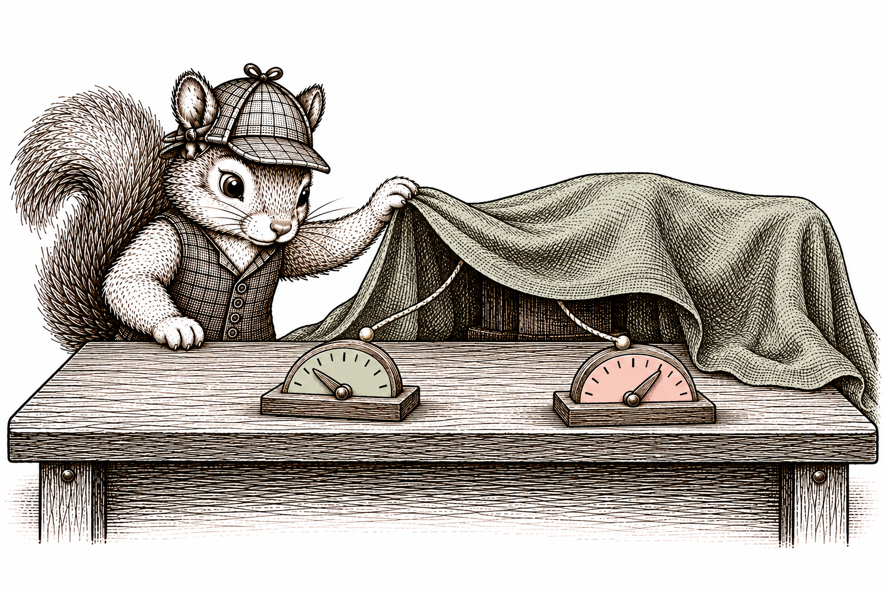
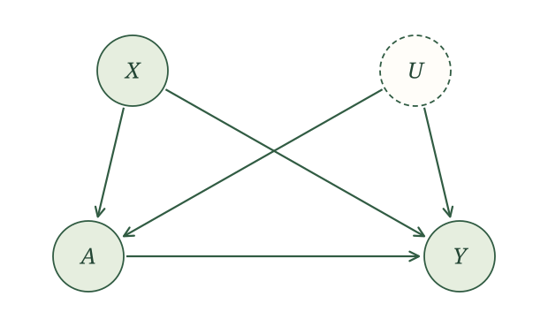
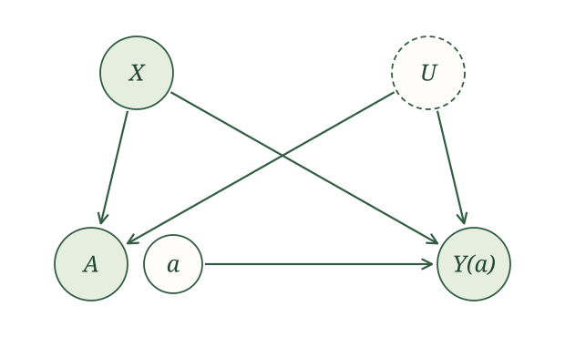
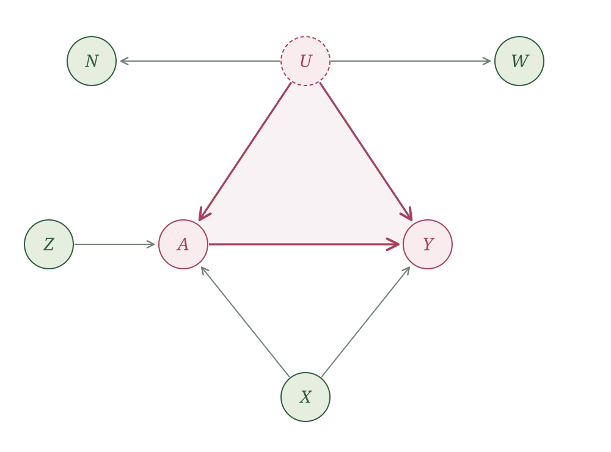

{width=700 fig-align="center" fig-alt="A detective squirrel in a checked cap and waistcoat investigates a draped mechanism with strings leading to two indicators, suggesting an unseen common cause. Vintage sepia pen-and-ink illustration."}

## Introduction

In the last section, we collected the common causes of $A$ and $Y$ in $X$ and said all of them were measured. Of course, that is not always the case. In observational studies, it is very common for something to influence both $A$ and $Y$ that we just did not measure. (And it is suspicious if a paper never mentions this.) When a common cause is missing from our data, we call this [unmeasured confounding]{.glossary-term}.

The RHC study fits this too. Age, sex, diagnosis, blood pressure, heart rate, creatinine, and white blood cell count are in our data. But the physician deciding whether to place a catheter sees much more. They see how the patient looks at the bedside, how quickly the patient is getting worse, and what the family wants. Some of that likely influences both the decision to use RHC and whether the patient survives, and none of it is in $X$. This specific case of unmeasured confounding, where the reasons a doctor gives a treatment also affect the outcome, is called [confounding by indication]{.glossary-term}.

To represent this, we add an unmeasured variable $U$ to our causal assumptions. The SCM is

$$
\begin{aligned}
X&\leftarrow f_X(\epsilon_X),\\
U&\leftarrow f_U(\epsilon_U),\\
A&\leftarrow f_A(X,U,\epsilon_A),\\
Y&\leftarrow f_Y(X,U,A,\epsilon_Y),
\end{aligned}
$$

with independent noise terms. As a reminder of what this commits us to, the variability in $A$ and $Y$ that $X$ and $U$ do not explain is independent, so once we account for $U$ there is nothing else driving both. $U$ is not one mysterious quantity. It stands for everything unmeasured that influences both $A$ and $Y$. ($U$ and $X$ could also be related, but we can leave that out.)

The corresponding causal graph is

{width=620 fig-align="center" fig-alt="The unmeasured-confounding causal graph. X points to A and Y. An unmeasured U points to A and Y. A points to Y."}

For an intervention on $A$ with value $a$, the potential-outcome assignments are

$$
\begin{aligned}
X(a)&\leftarrow f_X(\epsilon_X),\\
U(a)&\leftarrow f_U(\epsilon_U),\\
A(a)&\leftarrow f_A(X(a),U(a),\epsilon_A),\\
Y(a)&\leftarrow f_Y(X(a),U(a),a,\epsilon_Y).
\end{aligned}
$$

After causal irrelevance, their SWIG is

{width=620 fig-align="center" fig-alt="The unmeasured-confounding SWIG after causal irrelevance. X and U each point to A and Y(a). Fixed a points to Y(a). The random A and fixed a are separate nearby circles."}

Our target has not changed. We still want $E[Y(1)]$ and $E[Y(0)]$, because the ATE, the causal relative risk, and the causal odds ratio can all be built from them. What has changed is what the data can tell us. Under measured confounding, comparing treated and untreated people with the same $X$ was a fair comparison. Now two people with the same $X$ can still differ on $U$, and $U$ is tied to both who gets treated and how they do. Adding more variables to $X$ does not help, since $U$ is the part we cannot collect.

So what can we say about $E[Y(a)]$ when we cannot condition on all the common causes?

## How to show an effect is not identifiable

::: {.example-intro}
Staying indoors during wildfire smoke

Return to our wildfire-smoke example. Let $A=1$ indicate that a person stays indoors and $Y=1$ indicate that they experience an asthma exacerbation later that day. We want to know the effect of staying indoors on the risk of an exacerbation.
:::

To keep things simple, we ignore any measured confounders $X$ and pretend we only observe $A$ and $Y$. Our worry is an unmeasured common cause $U$. **Even with an infinite amount of data, all we could learn from $A$ and $Y$ is their joint distribution, the probabilities $P(A=a,Y=y)$.** Suppose those probabilities are

|       | $Y=0$ | $Y=1$ |
|-------|------:|------:|
| $A=0$ | 0.40  | 0.10  |
| $A=1$ | 0.10  | 0.40  |

The probability of staying indoors is $0.50$. Among those who stay indoors, the risk of an exacerbation is

$$
P(Y=1\mid A=1)=\frac{0.40}{0.50}=0.80.
$$

Among those who do not, it is

$$
P(Y=1\mid A=0)=\frac{0.10}{0.50}=0.20.
$$

The observed risk is much higher among people who stay indoors. The question is how much of that difference is caused by staying indoors. Let's build two different worlds that both produce this table.

### Two worlds

Each world is an SCM. We use Bernoulli assignments to make the data-generating steps explicit. Each random assignment uses its own independent noise; the displayed probabilities determine how the variables depend on one another.

**Case 1. Staying indoors increases the risk of an exacerbation.** In this world, $U$ has no influence. Half of people stay indoors, independently of $U$. Someone who goes outside has a $0.20$ risk of an exacerbation, while someone who stays indoors has a $0.80$ risk. The SCM is

$$
\begin{aligned}
U&\leftarrow f_U(\epsilon_U),\\
A&\leftarrow \operatorname{Bernoulli}(0.50),\\
Y&\leftarrow \operatorname{Bernoulli}(0.20+0.60A).
\end{aligned}
$$

The noise used for each Bernoulli assignment is independent of $\epsilon_U$ and of the noise used for the other assignment.

**Case 2. The difference comes from underlying asthma severity.** Here $U=1$ means severe asthma and $U=0$ means mild asthma. Half have severe asthma. People with severe asthma stay indoors, while people with mild asthma do not. The risk of an exacerbation depends on severity, and staying indoors itself has no effect. The SCM is

$$
\begin{aligned}
U&\leftarrow \operatorname{Bernoulli}(0.50),\\
A&\leftarrow U,\\
Y&\leftarrow \operatorname{Bernoulli}(0.20+0.60U).
\end{aligned}
$$

The two Bernoulli assignments use independent noise terms.

Both worlds satisfy our causal assumptions. Those assumptions let $U$ influence $A$ and $Y$, and let $A$ influence $Y$, but they do not require any of these influences to be present. An assignment is allowed to ignore a parent. In Case 1, $U$ is ignored. In Case 2, the outcome ignores $A$.

### The observed probabilities

In Case 1, the assignments give $P(A=1)=0.50$ and

$$
P(Y=1\mid A=a)=0.20+0.60a.
$$

In Case 2, $A=U$ and $P(U=1)=0.50$, so $P(A=1)=0.50$. Conditioning on $A=a$ fixes $U=a$, giving

$$
P(Y=1\mid A=a)=0.20+0.60a.
$$

Thus both SCMs give the following joint probabilities:

$$
\begin{aligned}
P(A=0,Y=0)&=0.50(0.80)=0.40,\\
P(A=0,Y=1)&=0.50(0.20)=0.10,\\
P(A=1,Y=0)&=0.50(0.20)=0.10,\\
P(A=1,Y=1)&=0.50(0.80)=0.40.
\end{aligned}
$$

**Both SCMs reproduce exactly the observed table above.** Two worlds with very different causal structures look identical in the data.

### The causal effect in each world

Now we ask what would happen if we set treatment to $a$.

**Case 1.** The outcome assignment uses $A$. Substituting $a$ gives

$$
Y(a)\leftarrow\operatorname{Bernoulli}(0.20+0.60a).
$$

The expectation of a Bernoulli variable is its success probability, so

$$
E[Y(a)]=0.20+0.60a.
$$

In particular,

$$
\begin{aligned}
E[Y(1)]&=P(Y=1\mid A=1)=0.80,\\
E[Y(0)]&=P(Y=1\mid A=0)=0.20.
\end{aligned}
$$

The average treatment effect is

$$
E[Y(1)]-E[Y(0)]=0.80-0.20=0.60.
$$

**Case 2.** The outcome assignment uses $U$, not $A$. An intervention on treatment leaves severity unchanged, so

$$
Y(a)\leftarrow\operatorname{Bernoulli}(0.20+0.60U).
$$

For any $a$, we average over the two severity groups:

$$
\begin{aligned}
E[Y(a)]
&=E[E[Y(a)\mid U]]\\
&=0.50(0.20)+0.50(0.80)\\
&=0.50.
\end{aligned}
$$

Thus $E[Y(1)]=E[Y(0)]=0.50$, and the average treatment effect is zero.

| | $E[Y(1)]$ | $E[Y(0)]$ | ATE |
|---|---:|---:|---:|
| Case 1 | 0.80 | 0.20 | $0.60$ |
| Case 2 | 0.50 | 0.50 | $0.00$ |

Both cases produce exactly the same observed table, yet one says staying indoors increases the risk by $0.60$ and the other says it does nothing. Since the data cannot tell these worlds apart, no analysis of $A$ and $Y$ alone can tell us which one we are in. This is **non-identification from the SCM alone**: the stated SCM assumptions and the joint distribution of the observed variables do not determine a unique value of the causal effect.

::: {.main-point}
To show that a causal effect cannot be identified under a set of assumptions, find two SCMs that satisfy those assumptions and give the same joint distribution of the observed variables, but different values of the causal effect.
:::

## Non-identification under unmeasured confounding

Our wildfire example used two observed variables. Now return to the more general setup, where we also measure covariates $X$:

$$
\begin{aligned}
X&\leftarrow f_X(\epsilon_X),\\
U&\leftarrow f_U(\epsilon_U),\\
A&\leftarrow f_A(X,U,\epsilon_A),\\
Y&\leftarrow f_Y(X,U,A,\epsilon_Y),
\end{aligned}
$$

with independent noise terms. Only $X$, $A$, and $Y$ are observed.

Suppose this SCM describes how our data are generated. Can we construct another SCM that gives exactly the same observed distribution but a different causal effect?

The freedom comes from what we do not observe. We do not know what $U$ contains, so another explanation can introduce a different unmeasured variable. Here, we introduce $U^*$ as an unmeasured variable that replaces $\epsilon_A$ in the treatment assignment. We will also use $U^*$ in the outcome assignment to reconstruct the treatment value generated by that assignment.

Let $\epsilon_{U^*}$ be a new noise term with the same distribution as $\epsilon_A$. It is independent of the other noise terms. Define the new SCM by

$$
\begin{aligned}
X&\leftarrow f_X(\epsilon_X),\\
U&\leftarrow f_U(\epsilon_U),\\
U^*&\leftarrow \epsilon_{U^*},\\
A&\leftarrow f_A(X,U,U^*),\\
Y&\leftarrow f_Y\!\left(X,U,f_A(X,U,U^*),\epsilon_Y\right).
\end{aligned}
$$

The noise terms $\epsilon_X$, $\epsilon_U$, $\epsilon_{U^*}$, and $\epsilon_Y$ are independent.

First, check what we observe. The assignments for $X$ and $U$ are unchanged. In the treatment assignment, we replaced the original treatment noise with an independent variable having the same distribution. This gives the same joint distribution of $X,U,A$.

Now look at the outcome assignment. The expression inside it,

$$
f_A(X,U,U^*),
$$

is exactly the value assigned to $A$. The outcome is therefore generated using the same inputs as before, with the same joint distribution. **The new SCM produces exactly the same observed distribution of $X,A,Y$ as the original SCM.**

What changes under intervention? In the original SCM, substituting $a$ for the treatment argument gives

$$
Y(a)\leftarrow f_Y(X(a),U(a),a,\epsilon_Y).
$$

In the new SCM, the outcome assignment does not use $A$. It uses the value generated from $X$, $U$, and $U^*$ instead. Renaming the variables gives

$$
Y(a)\leftarrow
f_Y\!\left(X(a),U(a),
f_A(X(a),U(a),U^*(a)),\epsilon_Y\right).
$$

There is no treatment argument to replace. In this new SCM, $Y(a)$ has the same distribution as $Y$ for any treatment value $a$.

Consider the causal quantities we have already used. In the new SCM, both intervention means equal the observed mean, so the ATE is

$$
E[Y(1)]-E[Y(0)]=E[Y]-E[Y]=0.
$$

If the original SCM has a nonzero ATE, we have two SCMs with the same observed distribution but different ATEs. The ATE is therefore not identifiable.

For a binary outcome, the causal relative risk and causal odds ratio in the new SCM are both one, when defined:

$$
\frac{E[Y(1)]}{E[Y(0)]}=1,
\qquad
\frac{E[Y(1)]/[1-E[Y(1)]]}{E[Y(0)]/[1-E[Y(0)]]}=1.
$$

Whenever the original SCM gives a causal relative risk or causal odds ratio different from one, the two SCMs disagree on that causal quantity despite agreeing on the observed distribution. That quantity is therefore not identifiable either.

### Would a larger SCM help?

Perhaps the problem is that we have not included the right variables. We could build a more complicated SCM, with measured covariates, an instrument, and negative control exposures and outcomes. For example, consider this causal graph:

{width=950 fig-align="center" fig-alt="A larger causal graph. Z is an instrument pointing to A. X points to A and Y. Unmeasured U points to A, Y, a negative control exposure N, and a negative control outcome W. The direct arrow from A to Y remains."}

We have added an instrument, proxies for $U$ in the form of negative controls, and measured covariates. We could add many more measured covariates. But the highlighted triangle remains: $A$ can affect $Y$ directly, and they have an unmeasured common cause.

These additions do not, by themselves, identify the intervention distribution. Pearl showed that this obstruction persists even inside a larger graph. He called it a *bow pattern*: a direct causal arrow from treatment to outcome together with unmeasured confounding between them [@pearl1995diagrams, Section 5.1].

::: {.proposition-box}
**Proposition.** If the causal graph contains both a direct arrow from $A$ to $Y$ and an unmeasured common cause of $A$ and $Y$, the distribution of $Y(a)$ is not identifiable from the SCM alone. This remains true when this structure is part of a larger causal graph [@pearl1995diagrams, Section 5.1].
:::

Here, “from the SCM alone” means from its stated structure and independence assumptions, without additional restrictions on the assignment functions or noise distributions.

This brings us back to Fisher's objection about smoking and lung cancer. The same observations could support two explanations: smoking causes lung cancer, or an unmeasured common cause explains the association. We have now made that ambiguity precise. Different SCMs can agree on everything we observe while giving different causal effects.

::: {.main-point}
Our SCM alone is not going to save us. As long as this unmeasured confounding remains, adding more measured variables to the graph will not save us either. We need something more to get past non-identification.
:::

::: {.callout-note title="Optional technical note: Pearl's general non-identification result" collapse="true"}
Planned: a technical proof of the general non-identification result for larger causal graphs [@pearl1995diagrams, Section 5.1].
:::
