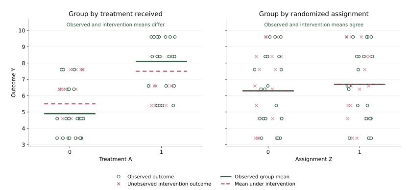

{width=700 fig-align="center" fig-alt="The detective squirrel sits in an open-backed wooden armchair with space for its tail, receiving an IV infusion from a bag labeled IV solution. Vintage sepia pen-and-ink illustration."}

## Introduction

We ended the last section with a problem: adding another measured variable is not, by itself, going to save us from unmeasured confounding. And yet people often resort to a type of variable called an instrument. An instrument is a variable that pushes people toward or away from treatment but does not otherwise affect the outcome. The hope is that it gives us variation in treatment that the unmeasured confounders did not produce.

But an instrument is still just a variable. It sits in the data and in the SCM like any other. Even if we fully justify that a variable is an instrument, that alone does not get us out of the problem. It is going to take more than the SCM.

So that is what we set out to figure out. We describe the instrumental-variable setting and the causal effect we want. Then we ask what else we have to assume to identify it.

::: {.main-point}
An instrument alone does not identify the causal effect. Even with an instrument, we still need more assumptions to identify the causal quantities we want.
:::

## Our working SCM

Let $A$ be treatment, $Y$ the outcome, $X$ measured confounders, and $U$ unmeasured confounders. We add an observed variable $Z$, our proposed instrument. Our working SCM is

$$
\begin{aligned}
X&\leftarrow f_X(\epsilon_X),\\
U&\leftarrow f_U(\epsilon_U),\\
Z&\leftarrow f_Z(X,\epsilon_Z),\\
A&\leftarrow f_A(X,U,Z,\epsilon_A),\\
Y&\leftarrow f_Y(X,U,A,\epsilon_Y),
\end{aligned}
$$

where the noise terms $\epsilon_X$, $\epsilon_U$, $\epsilon_Z$, $\epsilon_A$, and $\epsilon_Y$ are independent. We observe $X$, $Z$, $A$, and $Y$, but not $U$.

The corresponding causal graph is

{width=700 fig-align="center" fig-alt="Instrumental-variable causal graph. X points to Z, A, and Y. U points to A and Y. Z points to A, and A points to Y. There is no arrow from Z directly to Y or from U to Z."}

Why would we want a variable like $Z$? Think about where variation in treatment comes from. In our graph, people end up with different values of $A$ for two kinds of reasons. Some of it comes from $U$, which is also tied to the outcome, and that is the problem. Some of it comes from $Z$. Now suppose $Z$ is something like a coin flip that nudges people toward treatment, for example an alert that was sent to some people and not others. The alert does not know anything about $U$, and it does not affect $Y$ except by changing $A$. So when people who got the nudge end up treated more often than people who did not, that extra treatment is not coming from $U$. It is variation in treatment the unmeasured confounders did not produce, and that is the variation we hope to learn from.

All of that depends on one thing. The nudge has to actually move treatment. If $Z$ does nothing to $A$, there is no extra variation to learn from. We call this assumption [treatment relevance]{.glossary-term}.

::: {.assumption-box}
**Treatment relevance.** The distribution of $A$ given $X$ differs across values of $Z$.
:::

This connects to an idea from earlier. We called the intervened value $a$ irrelevant to a variable when it did not enter that variable’s potential-outcome assignment. Relevance is the opposite. We want $Z$ to matter for $A$. But it is not enough for $Z$ to appear in the assignment for $A$, because an assignment can include $Z$ and still ignore it in practice. What we need is that different values of $Z$ lead to different treatment distributions among people with the same $X$.

::: {.definition-box}
**Instrumental variable.** Consider treatment $A$, outcome $Y$, measured confounders $X$, and unmeasured confounders $U$. An observed variable $Z$ is an instrument for the effect of $A$ on $Y$ relative to $X$ if the SCM including $Z$ has these three properties:

- $Z$ the distribution of $A$ given $X$ differs across values of $Z$.
- All common causes of $Z$ and $Y$ are accounted for by $X$.
- Every directed path from $Z$ to $Y$ passes through $A$.
:::

## Potential outcomes
Consider intervening on both treatment and instrument, setting them to $a$ and $z$. Let $Y(a,z)$ be the outcome under that joint intervention. The potential-outcome SCM is

$$
\begin{aligned}
X(a,z)&\leftarrow f_X(\epsilon_X),\\
U(a,z)&\leftarrow f_U(\epsilon_U),\\
Z(a,z)&\leftarrow f_Z(X(a,z),\epsilon_Z),\\
A(a,z)&\leftarrow f_A(X(a,z),U(a,z),z,\epsilon_A),\\
Y(a,z)&\leftarrow f_Y(X(a,z),U(a,z),a,\epsilon_Y).
\end{aligned}
$$

We keep the original noise terms. Before simplifying any labels, the SWIG is

{width=700 fig-align="center" fig-alt="Joint-intervention SWIG before causal irrelevance. The random nodes are X(a,z), U(a,z), Z(a,z), A(a,z), and Y(a,z). Fixed z points to A(a,z), and fixed a points to Y(a,z)."}

Now look at which random variables are not descendants of the fixed intervention values. Neither $X(a,z)$, $U(a,z)$, nor $Z(a,z)$ is a descendant of fixed $a$ or fixed $z$, so causal irrelevance lets us drop both arguments from their labels. The random treatment $A(a,z)$ is a descendant of fixed $z$ but not fixed $a$, so it can be written as $A(z)$. The outcome $Y(a,z)$ is a descendant of fixed $a$ but not fixed $z$, so it can be written as $Y(a)$. Thus,

$$
\begin{aligned}
X(a,z)&=X,\\
U(a,z)&=U,\\
Z(a,z)&=Z,\\
A(a,z)&=A(z),\\
Y(a,z)&=Y(a).
\end{aligned}
$$

The simplified SWIG is

{width=700 fig-align="center" fig-alt="Joint-intervention SWIG after causal irrelevance. The labels are X, U, Z, A(z), and Y(a). Fixed z points to A(z), and fixed a points to Y(a). The graph's arrows are unchanged."}

### What follows about the instrument

Our good old rules have already given us two useful observations about the potential outcomes. In the SWIG, $Z$ is connected to $A(z)$ and $Y(a)$ only through $X$. Conditioning on $X$ blocks those paths, so the global Markov property tells us that $Z$ is independent of the potential treatments and outcomes given $X$. This property gets a name: [instrument independence]{.glossary-term}.

We also used causal irrelevance to see that, once treatment is fixed, changing the instrument leaves the outcome unchanged. That is what $Y(a,z)=Y(a)$ says. This property is called the [exclusion restriction]{.glossary-term}.

These observations are important enough that, in the potential-outcome tradition, people usually start by stating them as assumptions. We prefer to let the SCM do the talking. We specify how the variables are generated, then use the global Markov property and causal irrelevance to tell us what follows. Together with treatment relevance, this gives us the familiar instrumental-variable properties.

::: {.proposition-box}
**Properties of an instrument.** An instrument satisfies

- **Relevance:** the distribution of $A$ given $X$ differs across values of $Z$.
- **Instrument independence:** $Z\mathrel{\perp\!\!\!\perp}(A(z),Y(a))\mid X$ for all $a$ and $z$.
- **Exclusion restriction:** $Y(a,z)=Y(a)$.
:::

## Where instruments come from

::: {.example-intro}
Treatment assignment and treatment received

In a randomized trial, let $Z$ be assigned treatment, $A$ treatment actually received, and $Y$ the outcome. A person assigned treatment may not take it, and a person assigned control may obtain it elsewhere. We want the effect of receiving treatment, rather than the effect of being assigned treatment.
:::

Noncompliance makes treatment received an observational exposure even within a randomized trial. Random assignment gives us a reason to believe that $Z$ does not share causes with the outcome. Assignment should also change the probability of receiving treatment. But we still need to argue that assignment affects the outcome only through treatment received. For example, if assignment changes follow-up care or expectations in ways not captured by $A$, that restriction may fail.

The effect of assignment itself is the intention-to-treat effect. Randomization identifies that effect. Using assignment as an instrument to learn about treatment received requires the instrumental-variable assumptions and the additional assumptions we will develop below.

::: {.example-intro}
Randomized encouragement

Suppose we randomize an invitation, reminder, or recommendation intended to encourage treatment. Let $Z$ indicate encouragement, $A$ treatment uptake, and $Y$ the outcome.
:::

Treatment assignment is a strong form of encouragement, but encouragement can take other forms. Examples include gift cards, vouchers, and recommendations. Randomizing encouragement helps justify the absence of common causes of $Z$ and $Y$. It does not establish that encouragement has no other effect on the outcome. A cash incentive, for example, could affect health through the money itself as well as through treatment uptake.

{width=850 fig-align="center" fig-alt="Two squirrels illustrate encouragement. On the left, a delighted squirrel wears a silly acorn hat and accepts money. On the right, a squirrel offered no payment looks with consternation at the same hat on a stool. Vintage sepia pen-and-ink illustration."}

::: {.example-intro}
Genetic variants and Mendelian randomization

A genetic variant can sometimes serve as an instrument. Let $Z$ be the genetic variant, $A$ the exposure it influences, and $Y$ a later health outcome. Using a variant this way is called Mendelian randomization.
:::

Why would a gene work as an instrument? Genes are handed down at conception, so they are not chosen by the person, and they are not shaped by the person’s later diet, income, or habits. That makes a variant look like a nudge that was assigned by nature. If the variant also changes the exposure, then people who carry it and people who do not differ in the exposure for reasons that have nothing to do with the unmeasured confounders.

Here is a real example. Lower HDL cholesterol is associated with higher heart-disease risk, so it looks like low HDL might cause heart disease. But people with low HDL also differ in diet, exercise, and many other ways we may not measure. Frikke-Schmidt and colleagues instead looked at variants in the ABCA1 gene that lower HDL cholesterol [@frikkeschmidt2008abca1]. Here $Z$ is carrying the variant, $A$ is HDL cholesterol, and $Y$ is ischemic heart disease. If low HDL itself caused heart disease, carriers should have had more of it. They did not. That suggests the observed association between HDL and heart disease was not simply the causal effect of HDL.

A genetic instrument still needs the same causal argument as any other. The variant must change the exposure, which is treatment relevance. We must also justify the missing arrows. A variant can affect several biological processes, so it might change the outcome through a route other than the exposure we picked, and that would break the exclusion restriction. Genetic ancestry can also be linked to environmental causes of the outcome, which would break instrument independence. So being a gene does not make a variable an instrument. We still have to argue for it.

::: {.example-intro}
Distance and prescribing preferences

In observational health-care data, proposed instruments include distance to a treatment facility and a clinician's tendency to prescribe one treatment rather than another.
:::

For distance, the proposed story is that living closer makes treatment more likely. We then need to ask whether location also reflects income, access to other care, or other causes of the outcome. For prescribing preference, we need to ask whether patients are effectively assigned to clinicians independently of their health risks, and whether clinicians differ in other aspects of care that affect the outcome. An association with treatment is only one part of either argument.

## The effect we want to estimate

Return to an encouragement trial with binary encouragement $Z$ and binary treatment $A$. Some people take treatment only if encouraged. We want the average effect of receiving treatment among these people. We can describe that group using the potential treatments $A(z=0)$ and $A(z=1)$ we have just introduced.

### Who are the compliers?

Someone who takes treatment only when encouraged has $A(z=0)=0$ and $A(z=1)=1$. Someone who would take treatment either way has $A(z=0)=A(z=1)=1$. The two potential treatments give four possible responses:

| Response to encouragement | $A(z=0)$ | $A(z=1)$ |
|---|---:|---:|
| Always-taker | 1 | 1 |
| Never-taker | 0 | 0 |
| Complier | 0 | 1 |
| Defier | 1 | 0 |

These responses refer to the particular instrument we chose. A person could respond to one encouragement but not another. We observe only the treatment received under the actual instrument value, so we do not generally observe which response type a person has.

Causal irrelevance gave $Y(a,z)=Y(a)$, so the treatment contrast is $Y(a=1)-Y(a=0)$ regardless of the instrument value. We can now average that contrast among compliers to state our target effect.

::: {.definition-box}
**Complier average causal effect (CACE).** For binary treatment and instrument, the average treatment effect among compliers is

$$
E[Y(a=1)-Y(a=0)\mid A(z=1)=1,A(z=0)=0].
$$
:::

In the encouragement trial, this is the average effect of receiving treatment among people who would take it if encouraged and would not take it without encouragement. It is also called the *local average treatment effect* (LATE) [@imbensangrist1994late]. Defining this target does not yet identify it; we next ask which additional assumption lets us estimate it.

## Identifying the complier effect

The usual IV estimand, also called the Wald estimand, is the ratio of the outcome difference between instrument groups to their treatment-uptake difference. Start with a binary instrument $Z$ and binary treatment $A$. For these calculations, take $X$ to be constant, so the instrumental-variable assumptions hold without conditioning on measured covariates. We will bring $X$ back when we discuss regression.

### The problem

In the trial example, we can compare people who received treatment with people who did not. But treatment received is influenced by $U$, so the observed difference

$$
E[Y\mid A=1]-E[Y\mid A=0]
$$

does not generally equal the average treatment effect

$$
E[Y(1)]-E[Y(0)].
$$

Assignment is different. Under assignment $z$, treatment received is $A(z)$. The exclusion restriction gives $Y(a,z)=Y(a)$, so the outcome under that assignment is $Y(A(z))$.

Because assignment is independent of the other causes in our SCM, consistency and independence give

$$
E[Y\mid Z=z]=E[Y(A(z))].
$$

Thus the observed difference between assignment groups identifies the effect of assignment:

$$
E[Y\mid Z=1]-E[Y\mid Z=0]
=E[Y(A(1))-Y(A(0))].
$$

{width=950 fig-align="center" fig-alt="Two illustrative panels distinguish observed outcomes from unobserved potential outcomes. Grouping by treatment gives observed means different from the intervention means. Grouping by randomized assignment gives observed means equal to the means under each assignment intervention."}

The left panel shows why comparing treatment groups can mislead us. The people who receive treatment differ from those who do not, so their observed means differ from the means we would obtain by intervening on treatment. In the right panel, assignment is independent of the other causes, so the assignment-group means recover the means under interventions on assignment. We still need to connect the effect of assignment to the effect of treatment received.

### Monotonicity

To identify the CACE, assume that encouragement never makes someone less likely to take treatment. It can change a person's decision from no treatment to treatment, or leave the decision unchanged.

::: {.assumption-box}
**Monotonicity.** Changing the instrument from zero to one never decreases anyone's treatment:

$$
A(1)\geq A(0).
$$
:::

For example, an invitation can persuade someone to take treatment or leave their decision unchanged, but cannot make someone who would otherwise take treatment refuse it. In terms of the response types above, there are no defiers.

To see how this identifies the CACE, first write the outcome under assignment $z$ as

$$
Y(A(z))=Y(0)+A(z)\{Y(1)-Y(0)\}.
$$

Subtract the two assignment outcomes and take expectations:

$$
\begin{aligned}
E[Y\mid Z=1]-E[Y\mid Z=0]
&=E[Y(A(1))-Y(A(0))]\\
&=E[\{A(1)-A(0)\}\{Y(1)-Y(0)\}].
\end{aligned}
$$

Always-takers and never-takers have $A(1)-A(0)=0$, so they contribute zero. Monotonicity removes defiers. Only compliers remain:

$$
\begin{aligned}
E[Y\mid Z=1]-E[Y\mid Z=0]
&=P(A(1)=1,A(0)=0)\\
&\quad\times E[Y(1)-Y(0)\mid A(1)=1,A(0)=0].
\end{aligned}
$$

The treatment-uptake difference identifies the probability of being a complier. The instrument's independence from the potential treatments and consistency give

$$
\begin{aligned}
E[A\mid Z=1]-E[A\mid Z=0]
&=E[A(1)-A(0)]\\
&=P(A(1)=1,A(0)=0).
\end{aligned}
$$

Dividing the outcome difference by the treatment-uptake difference cancels this probability.

::: {.proposition-box}
**Proposition.** Under the instrumental-variable assumptions and monotonicity, the usual IV estimand identifies the complier average treatment effect:

$$
E[Y(1)-Y(0)\mid A(1)=1,A(0)=0]
=\frac{E[Y\mid Z=1]-E[Y\mid Z=0]}
{E[A\mid Z=1]-E[A\mid Z=0]}.
$$
:::

The numerator is the outcome difference between instrument groups. The denominator is the probability of being a complier. Their ratio identifies the average treatment effect among compliers, our CACE.

### Treatment homogeneity: a different target

Under a different assumption, the same ratio identifies the average treatment effect among the treated. Return to a trial with assignment $Z$, treatment received $A$, and a binary outcome $Y$. The following table gives counts of people in each group. Here $Z=1$ labels the arm with lower treatment uptake. Reversing the assignment labels makes both differences change sign, leaving their ratio unchanged.

::: {.example-intro}
Assignment and treatment received

| Assignment $Z$ | Treatment received $A$ | Number with $Y=0$ | Number with $Y=1$ |
|---|---|---:|---:|
| 0 | 0 | 10 | 40 |
| 0 | 1 | 40 | 10 |
| 1 | 0 | 30 | 30 |
| 1 | 1 | 20 | 10 |
:::

The estimated outcome risks in the assignment groups are

$$
\begin{aligned}
\widehat E[Y\mid Z=1]&=\frac{30+10}{90}=\frac49,\\
\widehat E[Y\mid Z=0]&=\frac{40+10}{100}=\frac12.
\end{aligned}
$$

The estimated probabilities of receiving treatment are

$$
\begin{aligned}
\widehat E[A\mid Z=1]&=\frac{20+10}{90}=\frac13,\\
\widehat E[A\mid Z=0]&=\frac{40+10}{100}=\frac12.
\end{aligned}
$$

We can compute the ratio of the outcome difference to the treatment-uptake difference:

$$
\frac{\widehat E[Y\mid Z=1]-\widehat E[Y\mid Z=0]}
{\widehat E[A\mid Z=1]-\widehat E[A\mid Z=0]}
=\frac{4/9-1/2}{1/3-1/2}
=\frac13.
$$

This is the same ratio used to estimate the CACE under monotonicity. We can instead give it an ATT interpretation through a homogeneity assumption.

For binary treatment, consistency lets us write

$$
Y=Y(0)+A\{Y(1)-Y(0)\}.
$$

Take expectations within an assignment group. Because $A$ is zero or one, only treated people contribute to the second term:

$$
\begin{aligned}
E[Y\mid Z=z]
&=E[Y(0)\mid Z=z]
  +E[A\{Y(1)-Y(0)\}\mid Z=z]\\
&=E[Y(0)\mid Z=z]
  +P(A=1\mid Z=z)E[Y(1)-Y(0)\mid A=1,Z=z]\\
&=E[Y(0)]
  +E[A\mid Z=z]E[Y(1)-Y(0)\mid A=1,Z=z].
\end{aligned}
$$

The last line uses the instrument assumption that $Y(0)$ is independent of $Z$. The remaining unknown is the average treatment effect among treated people within each assignment group. Suppose this average is the same in both groups.

::: {.assumption-box}
**Effect homogeneity among the treated.** The average treatment effect among treated people does not depend on the instrument value:

$$
E[Y(1)-Y(0)\mid A=1,Z=z]
=E[Y(1)-Y(0)\mid A=1],
\qquad z\in\{0,1\}.
$$
:::

In the trial example, this says that people who receive treatment in one assignment arm have the same average treatment effect as people who receive treatment in the other arm. It does not say that everyone has the same individual treatment effect.

Write this common average as $\tau=E[Y(1)-Y(0)\mid A=1]$. Then

$$
\begin{aligned}
E[Y\mid Z=1]&=E[Y(0)]+\tau E[A\mid Z=1],\\
E[Y\mid Z=0]&=E[Y(0)]+\tau E[A\mid Z=0].
\end{aligned}
$$

Subtracting cancels the baseline mean:

$$
E[Y\mid Z=1]-E[Y\mid Z=0]
=\tau\{E[A\mid Z=1]-E[A\mid Z=0]\}.
$$

The treatment-uptake difference is nonzero by instrument relevance. Dividing by that difference identifies $\tau$.

::: {.proposition-box}
**Proposition.** Under the instrumental-variable assumptions and effect homogeneity among the treated, the usual IV estimand identifies the average treatment effect among the treated:

$$
E[Y(1)-Y(0)\mid A=1]
=\frac{E[Y\mid Z=1]-E[Y\mid Z=0]}
{E[A\mid Z=1]-E[A\mid Z=0]}.
$$
:::

Under this assumption, our trial estimate of $1/3$ is an estimated increase of about 33 percentage points in outcome risk among those who receive treatment.

Why does a weak instrument cause problems?

The denominator is the difference in treatment uptake between instrument groups. If that difference is small, the estimate divides by a number close to zero. Sampling error in either difference can then produce a large change in the ratio. A small instrument–outcome association arising through an invalid pathway can also become a large error in the estimated treatment effect [@bound1995weak].

## Linear regression

### Connecting IV to regression

We can calculate the usual IV estimator from differences in sample means, or obtain the same estimate through two regressions. Start with the relation we derived under effect homogeneity among the treated:

$$
E[Y\mid Z]=E[Y(0)]+\tau E[A\mid Z].
$$

Write $\beta_0=E[Y(0)]$ and $\beta_1=\tau$. For binary $Z$, the two instrument-group treatment means can always be written as a line:

$$
E[A\mid Z]=\alpha_0+\alpha_1Z,
$$

where

$$
\alpha_0=E[A\mid Z=0],
\qquad
\alpha_1=E[A\mid Z=1]-E[A\mid Z=0].
$$

Substituting this expression into the outcome relation gives

$$
\begin{aligned}
E[Y\mid Z]
&=\beta_0+\beta_1(\alpha_0+\alpha_1Z)\\
&=(\beta_0+\beta_1\alpha_0)+\beta_1\alpha_1Z.
\end{aligned}
$$

The slope from regressing $A$ on $Z$ is $\alpha_1$. The slope from regressing $Y$ on $Z$ is $\beta_1\alpha_1$. Their ratio is therefore

$$
\frac{E[Y\mid Z=1]-E[Y\mid Z=0]}
{E[A\mid Z=1]-E[A\mid Z=0]}
=\frac{\beta_1\alpha_1}{\alpha_1}
=\beta_1.
$$

We can recover the same ratio in two stages.

**Stage 1.** Fit a linear regression of $A$ on $Z$, including an intercept. For each person, calculate

$$
\widehat A_i=\widehat\alpha_0+\widehat\alpha_1Z_i.
$$

**Stage 2.** Fit a linear regression of $Y$ on $\widehat A$, again including an intercept. The slope is the two-stage least-squares estimate $\widehat\beta_1$.

To see why this equals the ratio of sample differences, write $\bar A_z$ and $\bar Y_z$ for the sample means within instrument group $z$. The first stage assigns $\widehat A_i=\bar A_z$ to each person with $Z_i=z$. The second-stage slope is therefore

$$
\widehat\beta_1
=\frac{\bar Y_1-\bar Y_0}{\bar A_1-\bar A_0}.
$$

For the trial table, this gives $(4/9-1/2)/(1/3-1/2)=1/3$, just as before. This equality of the point estimates is algebraic. Whether we interpret the estimate as an ATT or a complier effect depends on the causal assumptions.

### Two-stage regression

Two-stage least squares extends to multiple instruments, measured covariates, and continuous treatment. Let $Z$ now be a vector of instruments, $X$ a vector of measured covariates, and $A$ a scalar treatment.

The procedure is similar, but include $X$ in both stages.

**Stage 1.** Regress $A$ on $Z$ and $X$:

$$
E[A\mid X,Z]=\alpha_0+\alpha_1^{\mathsf T}Z+\alpha_2^{\mathsf T}X.
$$

Use the fitted regression to calculate each person's predicted treatment:

$$
\widehat A_i
=\widehat\alpha_0+\widehat\alpha_1^{\mathsf T}Z_i
+\widehat\alpha_2^{\mathsf T}X_i.
$$

**Stage 2.** Regress $Y$ on $\widehat A$ and $X$. The coefficient on $\widehat A$ is the two-stage least-squares estimate $\widehat\beta_1$. An IV fitting routine also computes the appropriate standard errors for this estimator.

The causal interpretation requires more than the two regression fits. For example, suppose the first-stage mean above is correctly specified and the outcome follows the structural model

$$
Y(a)=\beta_0+\beta_1a+\beta_2^{\mathsf T}X+R,
$$

where $E[R\mid X,Z]=0$. Here $R$ can contain unmeasured causes of treatment and outcome, so it can be associated with $A$. The model assumes that changing treatment by one unit adds $\beta_1$ to the outcome, regardless of $X$ or $R$.

By consistency,

$$
Y=\beta_0+\beta_1A+\beta_2^{\mathsf T}X+R.
$$

Taking conditional expectations gives

$$
\begin{aligned}
E[Y\mid X,Z]
&=\beta_0+\beta_1E[A\mid X,Z]
  +\beta_2^{\mathsf T}X+E[R\mid X,Z]\\
&=\beta_0+\beta_1E[A\mid X,Z]+\beta_2^{\mathsf T}X.
\end{aligned}
$$

This is the relation used by the second stage. The instruments must predict treatment beyond what $X$ predicts, so their contribution lets us separate the treatment coefficient from the covariate coefficients.

Under this structural model, the causal contrast is

$$
\begin{aligned}
E[Y(a)-Y(0)\mid X]
&=E[\beta_1a\mid X]\\
&=\beta_1a.
\end{aligned}
$$

The coefficient has a causal interpretation because of the structural and instrument assumptions. Two-stage regression estimates that coefficient; fitting two regressions does not establish those assumptions.

### Nonlinear regression

The derivation above uses a linear outcome relation. For a nonlinear outcome model, replacing treatment with its first-stage prediction generally changes the argument. Terza, Basu, and Rathouz compare that approach with including first-stage residuals in the outcome model, a control-function approach we will return to later [@terza2008residual].

## Justifying an instrument is difficult

Before using any of these methods, we have to justify the instrument. This is often the hardest part of the analysis. A variable can have an appealing name—random assignment, prescribing preference, genetic variant—and still fail the assumptions needed for the question we are asking.

There are useful checks. We can examine whether $Z$ is associated with $A$ given $X$ and how much treatment variation it explains. We can compare measured pretreatment characteristics across instrument values. We can also look for associations with outcomes that the treatment cannot plausibly affect. These checks can expose problems. Passing them does not establish the absence of unmeasured common causes or alternative routes from $Z$ to $Y$.

Unverifiable assumptions are not unusual in causal inference. What worries me is how badly an analysis can mislead us when we treat an instrument as a guarantee. An invalid instrument can give a confident answer to the wrong scientific question. A weak instrument can also produce a badly behaved estimate even when the sample looks large. These problems show up in real data.

### Education, earnings, and weak instruments

Quarter of birth has been used as an instrument for years of education. The proposed mechanism combines school-entry rules with compulsory-schooling laws: birth timing can affect how much schooling someone completes before being allowed to leave. The outcome is later earnings.

Bound, Jaeger, and Baker reexamined this application using U.S. Census data. They found that weak relationships between the instruments and schooling could produce substantial finite-sample bias despite the large sample. They also showed how weak instruments can magnify small violations of the instrument assumptions [@bound1995weak]. Birth timing and school rules provide a story for why the instrument predicts schooling; that story does not protect the resulting estimate from these problems.

### Schooling, body size, and inherited characteristics

Sanderson and colleagues deliberately applied genetic instruments to negative control outcomes in UK Biobank. Their analyses produced apparent effects of years of schooling on natural hair colour and tanning ability, and of body mass index on tanning ability. Schooling does not change the hair colour someone inherited. The authors used these results to reveal possible bias from genetic ancestry and related structure in the data [@sanderson2021negative].

The mechanism matters: genetic ancestry can influence the frequencies of the variants used as instruments, inherited pigmentation, and the social or environmental factors associated with schooling or body size. The genetic variants can therefore carry associations that do not represent the causal effect of the exposure. Several commonly used sensitivity methods also retained these apparent effects. Running more instrumental-variable methods did not make the causal story correct.

### Prescribing preference and exaggerated clinical effects

Boef and colleagues used routine-care data from 476 cardiac-surgery patients to study preoperative corticosteroids, using physician preference as the instrument. The outcomes included ventilation time, lengths of stay, and postoperative complications. The estimated effects were in the same direction as a large randomized trial, but were much larger and had very wide confidence intervals [@boef2014preference].

Here the authors identified a practical failure of precision even with a strong, plausible instrument. A dramatic point estimate is easy to turn into a dramatic clinical claim; the data may support much less certainty. Instrument strength, instrument validity, and useful precision are separate issues.

::: {.main-point}
Finding a variable related to treatment is easy compared with justifying an instrument. We need a credible account of how it was generated and every way it could affect the outcome. The label “instrumental variable” does not protect a scientific conclusion from bad assumptions.
:::
