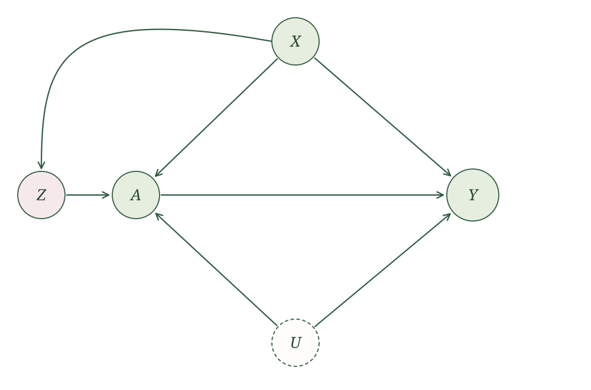
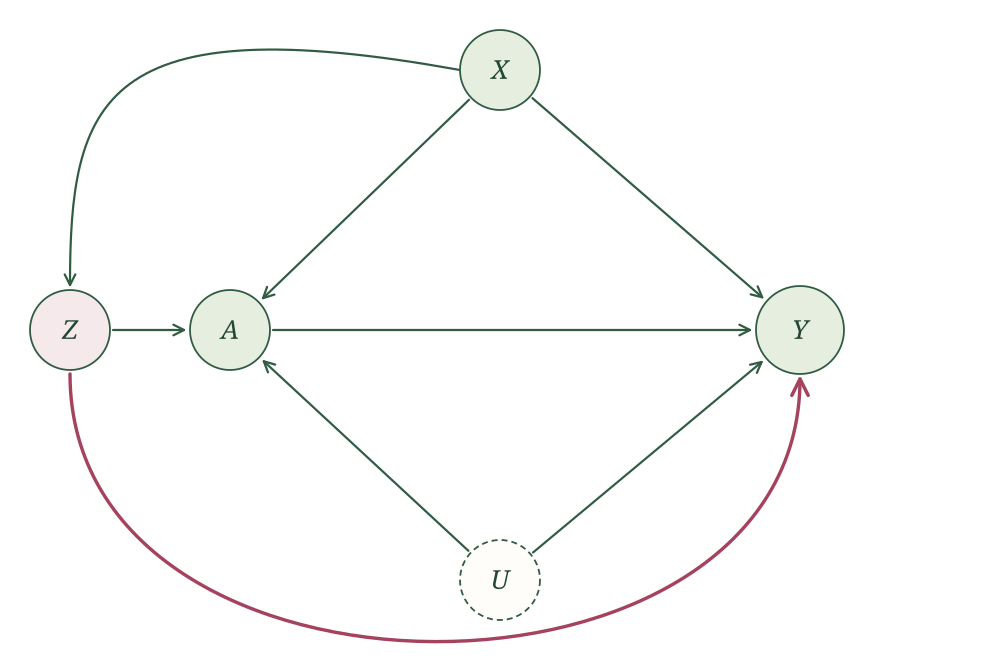
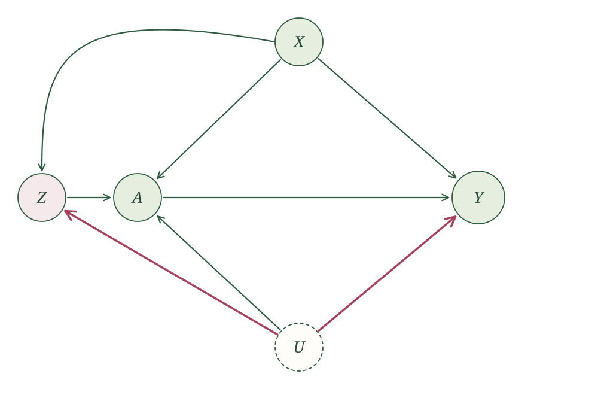
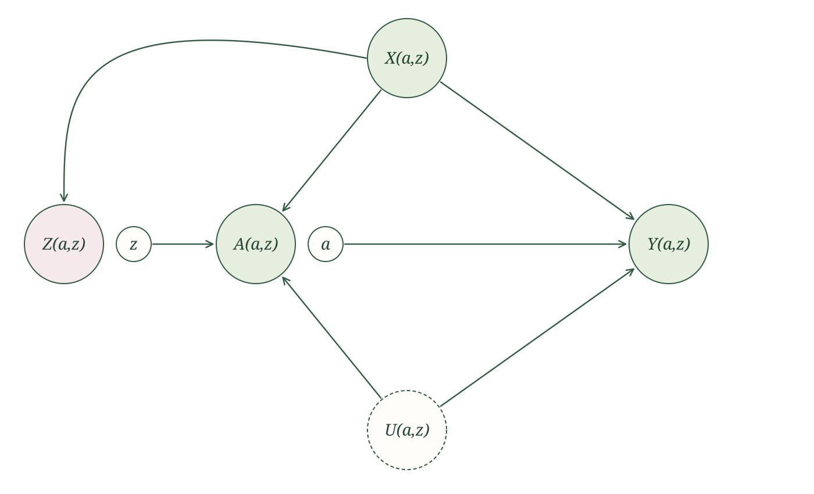
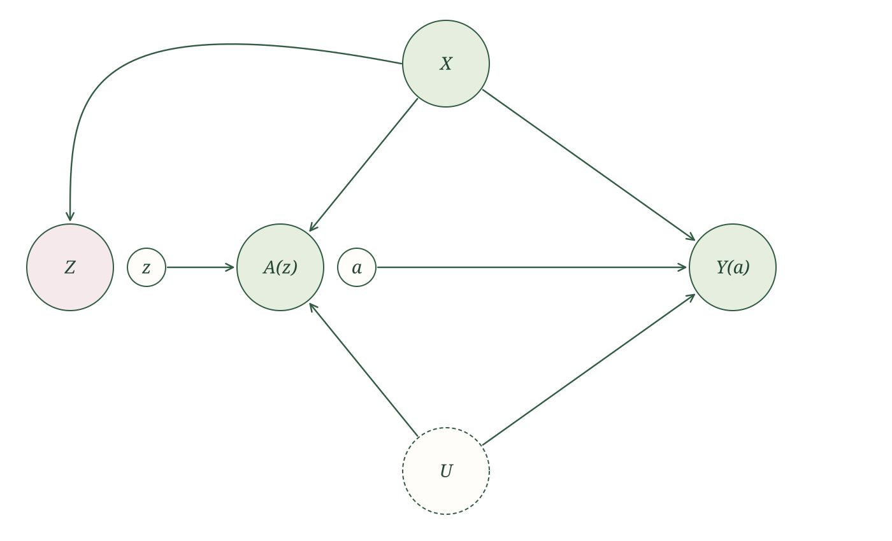
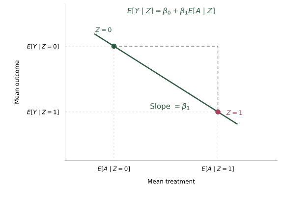
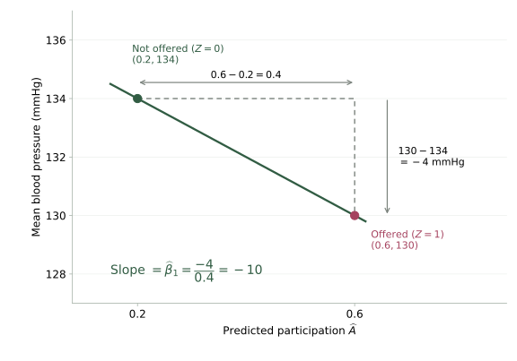
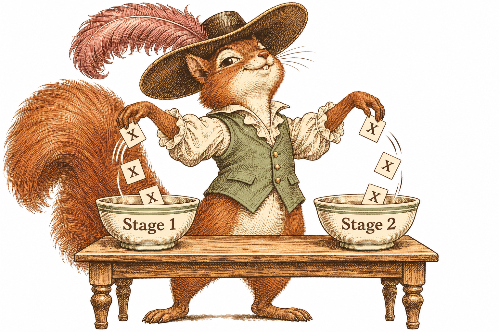

{width=700 fig-align="center" fig-alt="The detective squirrel sits in an open-backed wooden armchair with space for its tail, receiving an IV infusion from a bag labeled IV solution. Vintage sepia pen-and-ink illustration."}

## Introduction

We ended the last section with a problem: adding another measured variable is not, by itself, going to save us from unmeasured confounding. And yet people often resort to a type of variable called an instrument. An instrument is a variable that pushes people toward or away from treatment but does not otherwise affect the outcome. The hope is that it gives us variation in treatment that the unmeasured confounders did not produce.

But an instrument is still just a variable. It sits in the data and in the SCM like any other. Even if we fully justify that a variable is an instrument, that alone does not get us out of the problem. It is going to take more than the SCM.

So that is what we set out to figure out. We describe the instrumental-variable setting and the causal effect we want. Then we ask what else we have to assume to identify it.

::: {.main-point}
An instrument alone does not identify the causal effect. Even with an instrument, we still need more assumptions to identify the causal quantities we want.
:::

## Our working SCM

Let $A$ be treatment, $Y$ the outcome, $X$ measured confounders, and $U$ unmeasured confounders. Start with the causal graph from the last section:

{width=620 fig-align="center" fig-alt="The original unmeasured-confounding graph. X and unmeasured U each point to A and Y, and A points to Y."}

We can account for $X$, but treatment and outcome still share the unmeasured cause $U$. We now look for a variable $Z$ that influences treatment for reasons unrelated to $U$, once $X$ is given. We also want its influence on the outcome to pass entirely through treatment.

We express the expanded story with the SCM

$$
\begin{aligned}
X&\leftarrow f_X(\epsilon_X),\\
U&\leftarrow f_U(\epsilon_U),\\
Z&\leftarrow f_Z(X,\epsilon_Z),\\
A&\leftarrow f_A(X,U,Z,\epsilon_A),\\
Y&\leftarrow f_Y(X,U,A,\epsilon_Y),
\end{aligned}
$$

where the noise terms $\epsilon_X$, $\epsilon_U$, $\epsilon_Z$, $\epsilon_A$, and $\epsilon_Y$ are independent. We observe $X$, $Z$, $A$, and $Y$, but not $U$.

The corresponding causal graph is

{width=700 fig-align="center" fig-alt="Instrumental-variable causal graph. X points to Z, A, and Y. U points to A and Y. Z points to A, and A points to Y. There is no arrow from Z directly to Y or from U to Z."}

Why would we want a variable like $Z$? Think about where variation in treatment comes from. In our graph, people end up with different values of $A$ for two kinds of reasons. Some of it comes from $U$, which is also tied to the outcome, and that is the problem. Some of it comes from $Z$. Now suppose $Z$ is something like a coin flip that nudges people toward treatment, for example an alert that was sent to some people and not others. The alert does not know anything about $U$, and it does not affect $Y$ except by changing $A$. So when people who got the nudge end up treated more often than people who did not, that extra treatment is not coming from $U$. It is variation in treatment the unmeasured confounders did not produce, and that is the variation we hope to learn from.

All of that depends on one thing. The nudge has to actually move treatment. If $Z$ does nothing to $A$, there is no extra variation to learn from. We call this assumption [treatment relevance]{.glossary-term}.

::: {.assumption-box}
**Treatment relevance.** The conditional distribution of $A$ given $X$ and $Z$ depends on $Z$.
:::

This connects to an idea from earlier. We called the intervened value $a$ irrelevant to a variable when it did not enter that variable’s potential-outcome assignment. Relevance is the opposite. We want $Z$ to matter for $A$. But it is not enough for $Z$ to appear in the assignment for $A$, because an assignment can include $Z$ and still ignore it in practice. What we need is that different values of $Z$ lead to different treatment distributions among people with the same $X$.

There are two ways this story could go wrong. Consider each separately, keeping the other assignments and independent noise terms as in our working SCM.

**Another causal route to the outcome.** Suppose the outcome assignment also uses $Z$:

$$
Y\leftarrow f_Y(X,U,A,Z,\epsilon_Y).
$$

Now $Z$ can change $Y$ without changing treatment. The added arrow, highlighted below, gives a directed path from $Z$ to $Y$ that does not pass through $A$.

{width=700 fig-align="center" fig-alt="The working instrumental-variable graph with an added direct arrow from Z to Y, highlighted in rose. This arrow provides a causal route from Z to Y that bypasses A."}

**An unmeasured common cause.** Instead, return to the original outcome assignment and suppose that $U$ also enters the assignment for $Z$:

$$
Z\leftarrow f_Z(X,U,\epsilon_Z).
$$

Now $U$ influences both $Z$ and $Y$. The highlighted path $Z\leftarrow U\rightarrow Y$ goes through neither $A$ nor $X$, so accounting for $X$ does not block it. Differences in outcome between values of $Z$ could reflect this unmeasured common cause.

{width=700 fig-align="center" fig-alt="The working instrumental-variable graph with an added arrow from U to Z. The path Z back to U and then to Y is highlighted in rose, showing an unmeasured common cause of Z and Y that is not blocked by X."}

Our working SCM leaves out both of these possibilities. Let us now use it to see what follows about the potential outcomes.

## Potential outcomes
Consider intervening on both treatment and instrument, setting them to $a$ and $z$. Let $Y(a,z)$ be the outcome under that joint intervention.

We will keep the intervention variable explicit when we insert numerical values. For example, $Y(a=1)$ is the outcome when we intervene on treatment, while $Y(z=1)$ is the outcome when we intervene on the instrument and let treatment respond. Writing just $Y(1)$ would hide which intervention we mean. Likewise, $Y(a=1,z=0)$ specifies an intervention on both variables.

The potential-outcome SCM is

$$
\begin{aligned}
X(a,z)&\leftarrow f_X(\epsilon_X),\\
U(a,z)&\leftarrow f_U(\epsilon_U),\\
Z(a,z)&\leftarrow f_Z(X(a,z),\epsilon_Z),\\
A(a,z)&\leftarrow f_A(X(a,z),U(a,z),z,\epsilon_A),\\
Y(a,z)&\leftarrow f_Y(X(a,z),U(a,z),a,\epsilon_Y).
\end{aligned}
$$

We keep the original noise terms. Before simplifying any labels, the SWIG is

{width=700 fig-align="center" fig-alt="Joint-intervention SWIG before causal irrelevance. The random nodes are X(a,z), U(a,z), Z(a,z), A(a,z), and Y(a,z). Fixed z points to A(a,z), and fixed a points to Y(a,z)."}

Now look at which random variables are not descendants of the fixed intervention values. Neither $X(a,z)$, $U(a,z)$, nor $Z(a,z)$ is a descendant of fixed $a$ or fixed $z$, so causal irrelevance lets us drop both arguments from their labels. The random treatment $A(a,z)$ is a descendant of fixed $z$ but not fixed $a$, so it can be written as $A(z)$. The outcome $Y(a,z)$ is a descendant of fixed $a$ but not fixed $z$, so it can be written as $Y(a)$. Thus,

$$
\begin{aligned}
X(a,z)&=X,\\
U(a,z)&=U,\\
Z(a,z)&=Z,\\
A(a,z)&=A(z),\\
Y(a,z)&=Y(a).
\end{aligned}
$$

The simplified SWIG is

{width=700 fig-align="center" fig-alt="Joint-intervention SWIG after causal irrelevance. The labels are X, U, Z, A(z), and Y(a). Fixed z points to A(z), and fixed a points to Y(a). The graph's arrows are unchanged."}

### What follows about the instrument

Our good old rules have already given us two useful observations about the potential outcomes. In the SWIG, $Z$ is connected to $A(z)$ and $Y(a)$ only through $X$. Conditioning on $X$ blocks those paths, so the global Markov property tells us that $Z$ is independent of the potential treatments and outcomes given $X$. This property gets a name: [instrument independence]{.glossary-term}.

We also used causal irrelevance to see that, once treatment is fixed, changing the instrument leaves the outcome unchanged. That is what $Y(a,z)=Y(a)$ says. This property is called the [exclusion restriction]{.glossary-term}.

These observations are important enough that, in the potential-outcome tradition, people usually start by stating them as assumptions. We prefer to let the SCM do the talking. We specify how the variables are generated, then use the global Markov property and causal irrelevance to tell us what follows. Together with treatment relevance, this gives us the familiar instrumental-variable properties.

::: {.definition-box}
**Instrumental variable.** An observed variable $Z$ is an instrument for the effect of $A$ on $Y$, relative to $X$, if it satisfies these three properties under the SCM:

- **Relevance:** the conditional distribution of $A$ given $X$ and $Z$ depends on $Z$.
- **Instrument independence:** $Z\mathrel{\perp\!\!\!\perp}(A(z),Y(a))\mid X$ for all $a$ and $z$.
- **Exclusion restriction:** $Y(a,z)=Y(a)$.
:::

## Where instruments come from

::: {.example-intro}
Treatment assignment and treatment received

Suppose a randomized trial compares a new medication with no medication. Let $Z$ be assigned treatment, $A$ treatment actually received, and $Y$ the outcome. Some people assigned medication never take it, and some assigned control obtain it elsewhere. What effect does the trial tell us about?
:::

Most trial reports emphasize an **intention-to-treat (ITT) analysis**. People are compared according to their assignment, whether or not they follow it. This estimates the effect of being assigned treatment, with the treatment uptake that actually occurs in the trial. Randomization identifies this effect.

But a patient deciding whether to take the medication may want to know what happens when they actually take it. This motivates the **per-protocol effect**: what would the effect have been if everyone had followed their assigned treatment protocol? In this simple trial, that means comparing taking the medication as specified with taking no medication [@hernanrobins2017perprotocol].

The distinction matters when people do not follow their assignments. The ITT effect reflects both what the medication does and whether assignment gets people to take it. The per-protocol question concerns what happens when the protocol is followed. Simply comparing those who took the medication with those who did not does not preserve randomization: the reasons people take treatment can also affect their outcomes.

This is where assignment becomes a candidate instrument. Because $Z$ is randomized, it has no common causes with the outcome. We also expect assignment to change treatment uptake: people assigned medication should be more likely to take it than people assigned control. Finally, the intended story is that assignment affects health through the medication people actually receive. We hope the effect of assignment passes through $A$.

These are the three instrument properties in a concrete setting. We can use randomized assignment as $Z$ to learn about the effect of treatment received, $A$. 

::: {.example-intro}
Randomized encouragement

Suppose a community offers an exercise program that anyone can join. We randomly choose some people to receive an offer of a gift card if they participate. Let $Z$ indicate receiving the offer, $A$ participation in the program, and $Y$ blood pressure at the end of the study.
:::

This is a recommender trial. We randomize an encouragement or incentive to take the intervention, and people still decide whether to take it. Someone offered the gift card may decline the program, and someone not offered it may join anyway. The hope is that the incentive brings in people who would not otherwise participate.

The randomized trial above fits the same idea: treatment assignment pushes people toward receiving treatment. Here, we deliberately create that push through an incentive. It could also be an invitation, a reminder, a recommendation, or help arranging an appointment.

Why do this? People who choose an exercise program may differ in motivation, health, and other causes of blood pressure. Randomizing the offer gives $Z$ no common causes with the outcome, and we expect the offer to increase participation. Our proposed story is that the offer changes blood pressure by getting people into the program. We can then use the randomized offer as an instrument to learn about the effect of participation.

{width=850 fig-align="center" fig-alt="Two squirrels illustrate encouragement. On the left, a delighted squirrel wears a silly acorn hat and accepts money. On the right, a squirrel offered no payment looks with consternation at the same hat on a stool. Vintage sepia pen-and-ink illustration."}

::: {.example-intro}
Genetic variants and Mendelian randomization

A genetic variant can sometimes serve as an instrument. Let $Z$ be the genetic variant, $A$ the exposure it influences, and $Y$ a later health outcome. Using a variant this way is called Mendelian randomization.
:::

Why would a gene work as an instrument? Genes are handed down at conception, so they are not chosen by the person, and they are not shaped by the person’s later diet, income, or habits. That makes a variant look like a nudge that was assigned by nature. If the variant also changes the exposure, then people who carry it and people who do not carry it might differ in the exposure for reasons that have nothing to do with the unmeasured confounders.

Here is a real example. Lower HDL cholesterol is associated with higher heart-disease risk, so it looks like low HDL might cause heart disease. But people with low HDL also differ in diet, exercise, and many other ways we may not measure. Frikke-Schmidt and colleagues instead looked at variants in the ABCA1 gene that lower HDL cholesterol [@frikkeschmidt2008abca1]. Here $Z$ is carrying the variant, $A$ is HDL cholesterol, and $Y$ is ischemic heart disease. If low HDL itself caused heart disease, carriers should have had more of it. They did not. That suggests the observed association between HDL and heart disease was not simply the causal effect of HDL.

## The effect we want to estimate

Return to the exercise-program example. Let $Z=1$ mean someone is offered the gift card and $A=1$ mean they participate. We now take both $A$ and $Z$ to be binary; the outcome $Y$ need not be binary.

### How people respond to encouragement

Think about each person's decision in two situations: without the gift-card offer and with it. Would they join the program in each situation? Their two potential treatments describe those decisions:

- $A(z=0)$ is whether they would participate without the offer.
- $A(z=1)$ is whether they would participate with the offer.

Each decision is either yes or no, so there are four possible patterns:

| What the person would do | $A(z=0)$ | $A(z=1)$ | Name |
|---|---:|---:|---|
| Join with or without the offer | 1 | 1 | Always-taker |
| Not join in either situation | 0 | 0 | Never-taker |
| Join only with the offer | 0 | 1 | Complier |
| Join only without the offer | 1 | 0 | Defier |

The names describe how each person responds to the encouragement. *Always-takers* always take the intervention, and *never-takers* never do. *Compliers* go along with the encouragement: they participate when offered the incentive and do not participate without it. *Defiers* respond in the opposite direction: they participate without the offer but decline when offered the incentive.

These are two possible decisions for the same person. We observe only the decision under the offer they actually receive, so we do not generally know which response type a person has.

We focus on compliers because we have to: under the assumptions we will use, this is the group whose average treatment effect we can identify. The instrument does not give us enough information to identify the ATE or ATT.

To see why, think about whose participation the gift-card offer can change. Always-takers participate either way, and never-takers do not participate either way. Only compliers and defiers change their participation in response to the offer. Because the offer affects the outcome only through participation, only these two groups can contribute to the outcome difference between the offer groups.

### Monotonicity

That leaves compliers and defiers. The instrument moves their treatment in opposite directions, so the outcome difference between instrument groups mixes their treatment effects. To isolate the effect among compliers, we need an additional assumption.

::: {.assumption-box}
**Monotonicity.** For every person,

$$
A(z=1)\geq A(z=0).
$$
:::

In our exercise-program example, offering the gift card can persuade someone to participate or leave their decision unchanged. It cannot make someone who would otherwise participate decide against it. In other words, there are no defiers.

This is an additional restriction on how people respond to the instrument; it does not follow from our causal graph. Someone might resent the incentive or interpret it as a sign that the program is unpleasant, so we need to consider whether this assumption is reasonable.

With this assumption, the only people whose treatment the instrument changes are compliers. This is why we focus on their average treatment effect: it is what these assumptions allow us to identify.

Causal irrelevance gave $Y(a,z)=Y(a)$, so the treatment contrast is $Y(a=1)-Y(a=0)$ regardless of the instrument value. We can now average that contrast among compliers to state our target effect.

We will use $\text{compliers}$ to denote the event that a person would participate with the offer but not without it:

$$
\text{compliers}=\{A(z=1)=1,\ A(z=0)=0\}.
$$

Thus, $P(\text{compliers})$ is the probability that a person is a complier, and conditioning on $\text{compliers}$ means averaging among people in this group.

::: {.definition-box}
**Complier average causal effect (CACE).** For binary treatment and instrument, the average treatment effect among compliers is

$$
E[Y(a=1)-Y(a=0)\mid\text{compliers}].
$$
:::

In the encouragement trial, this is the average effect of receiving treatment among people who would take it if encouraged and would not take it without encouragement. It is also called the *local average treatment effect* (LATE) [@imbensangrist1994late]. We can now show how the instrumental-variable assumptions and monotonicity let us identify this effect.

## Identifying the complier effect

The usual IV estimand, also called the Wald estimand, is the ratio of the outcome difference between instrument groups to their treatment-uptake difference. Start with a binary instrument $Z$ and binary treatment $A$. For these calculations, take $X$ to be constant, so the instrumental-variable assumptions hold without conditioning on measured covariates. We will bring $X$ back when we discuss regression.

The ratio is

$$
\frac{E[Y\mid Z=1]-E[Y\mid Z=0]}
{E[A\mid Z=1]-E[A\mid Z=0]}.
$$

::: {.example-intro}
The gift-card offer and blood pressure

Suppose our exercise-program study gives the following results. Treatment $A=1$ means participation, and $Y$ is systolic blood pressure measured in mmHg.

| Gift-card offer | Probability of participation | Mean blood pressure |
|---|---:|---:|
| Offered ($Z=1$) | 0.6 | 130 |
| Not offered ($Z=0$) | 0.2 | 134 |
:::

The offer groups differ in average blood pressure by $130-134=-4$ mmHg. They differ in participation by $0.6-0.2=0.4$. Dividing gives

$$
\begin{aligned}
\widehat{\text{CACE}}
&=\frac{130-134}{0.6-0.2}\\
&=\frac{-4}{0.4}\\
&=-10\text{ mmHg}.
\end{aligned}
$$

Under our working SCM, treatment relevance, and monotonicity, we interpret this as an estimated 10 mmHg reduction in blood pressure from participating in the program among compliers: people who would participate only if offered the gift card.

The offer changes participation for only some people. The outcome difference of $-4$ mmHg is therefore smaller in magnitude than the estimated effect of participation among those people. Dividing by the participation difference accounts for this.

We can compare average outcomes between people offered the gift card and people not offered it. But how does that comparison tell us about the effect of participating in the program among compliers?

To see the connection, we will write the observed outcome separately for each offer group, then compare their averages.

### Why the ratio identifies the CACE

When $Z=1$, the treatment received is $A(z=1)$. By consistency and exclusion restriction,

$$
\begin{aligned}
Y&=Y(a=0)\\
&\quad+A(z=1)\{Y(a=1)-Y(a=0)\}.
\end{aligned}
$$

When $Z=0$, the treatment received is $A(z=0)$, so

$$
\begin{aligned}
Y&=Y(a=0)\\
&\quad+A(z=0)\{Y(a=1)-Y(a=0)\}.
\end{aligned}
$$

In each expression, treatment received determines which potential outcome we observe: $Y(a=0)$ if treatment is zero, and $Y(a=1)$ if treatment is one.

First, take the average outcome among people offered the gift card. Substituting the expression for their outcomes and using linearity of expectation gives

$$
\begin{aligned}
E[Y\mid Z=1]
&=E[Y(a=0)\mid Z=1]\\
&\quad+E\big[A(z=1)\{Y(a=1)-Y(a=0)\}\mid Z=1\big].
\end{aligned}
$$

Instrument independence tells us that conditioning on $Z$ does not change the joint distribution of the potential treatments and outcomes. We can therefore remove the conditioning on the right:

$$
\begin{aligned}
E[Y\mid Z=1]
&=E[Y(a=0)]\\
&\quad+E\big[A(z=1)\{Y(a=1)-Y(a=0)\}\big].
\end{aligned}
$$

The same steps for people not offered the gift card give

$$
\begin{aligned}
E[Y\mid Z=0]
&=E[Y(a=0)]\\
&\quad+E\big[A(z=0)\{Y(a=1)-Y(a=0)\}\big].
\end{aligned}
$$

Subtract these two expressions. The $E[Y(a=0)]$ terms cancel, leaving

$$
\begin{aligned}
&E[Y\mid Z=1]-E[Y\mid Z=0]\\
&\quad=E\big[A(z=1)\{Y(a=1)-Y(a=0)\}\big]\\
&\qquad-E\big[A(z=0)\{Y(a=1)-Y(a=0)\}\big]\\
&\quad=E\big[\{A(z=1)-A(z=0)\}\\
&\hspace{5em}\times\{Y(a=1)-Y(a=0)\}\big].
\end{aligned}
$$

Under monotonicity, $A(z=1)-A(z=0)$ is one for compliers and zero for everyone else. The product inside this expectation is therefore the treatment effect for compliers and zero for everyone else. Averaging over these two groups gives

$$
\begin{aligned}
&E[Y\mid Z=1]-E[Y\mid Z=0]\\
&\quad=P(\text{compliers})\\
&\qquad\times E[Y(a=1)-Y(a=0)\mid\text{compliers}]\\
&\qquad+P(\text{not compliers})\times 0\\
&\quad=P(\text{compliers})\times\text{CACE}.
\end{aligned}
$$

We have recovered the CACE multiplied by the probability of being a complier. To recover the CACE itself, we need to find that probability.

Think again about how the offer changes participation. Under monotonicity, it changes participation from zero to one for compliers and leaves everyone else's participation unchanged. So the difference in participation between the offer groups tells us the probability of being a complier. To show this, consistency first gives

$$
\begin{aligned}
E[A\mid Z=1]&=E[A(z=1)\mid Z=1],\\
E[A\mid Z=0]&=E[A(z=0)\mid Z=0].
\end{aligned}
$$

Instrument independence lets us remove the conditioning on the right:

$$
\begin{aligned}
E[A\mid Z=1]&=E[A(z=1)],\\
E[A\mid Z=0]&=E[A(z=0)].
\end{aligned}
$$

Subtracting and using monotonicity gives

$$
\begin{aligned}
&E[A\mid Z=1]-E[A\mid Z=0]\\
&\quad=E[A(z=1)]-E[A(z=0)]\\
&\quad=E[A(z=1)-A(z=0)]\\
&\quad=1\times P(\text{compliers})\\
&\qquad+0\times P(\text{not compliers})\\
&\quad=P(\text{compliers}).
\end{aligned}
$$

We now have both pieces: the outcome difference is the probability of being a complier times the CACE, and the treatment difference is that same probability. Dividing the first by the second gives

$$
\begin{aligned}
&\frac{E[Y\mid Z=1]-E[Y\mid Z=0]}
{E[A\mid Z=1]-E[A\mid Z=0]}\\
&\quad=\frac{P(\text{compliers})\times\text{CACE}}
{P(\text{compliers})}\\
&\quad=\text{CACE}.
\end{aligned}
$$

Treatment relevance guarantees that some people change their participation in response to the offer, so we are dividing by a positive probability.

::: {.proposition-box}
**Proposition.** Under our working SCM, with the additional assumptions of treatment relevance and monotonicity, the usual IV estimand identifies the complier average causal effect:

$$
\begin{aligned}
\text{CACE}
&=E[Y(a=1)-Y(a=0)\mid\text{compliers}]\\
&=\frac{E[Y\mid Z=1]-E[Y\mid Z=0]}
{E[A\mid Z=1]-E[A\mid Z=0]}.
\end{aligned}
$$
:::

Optional technical note: effect homogeneity instead of monotonicity

There is another way to justify the same IV ratio, using effect homogeneity instead of monotonicity. Here the target is the ATT. This assumption can be harder to justify: people who take treatment when encouraged can differ from people who take it without encouragement, yet we require their average treatment effects to agree.

Return to a trial with assignment $Z$, treatment received $A$, and a binary outcome $Y$. The following table gives counts of people in each group. Here $Z=1$ labels the arm with lower treatment uptake. Reversing the assignment labels makes both differences change sign, leaving their ratio unchanged.

::: {.example-intro}
Assignment and treatment received

| Assignment $Z$ | Treatment received $A$ | Number with $Y=0$ | Number with $Y=1$ |
|---|---|---:|---:|
| 0 | 0 | 10 | 40 |
| 0 | 1 | 40 | 10 |
| 1 | 0 | 30 | 30 |
| 1 | 1 | 20 | 10 |
:::

The estimated outcome risks in the assignment groups are

$$
\begin{aligned}
\widehat E[Y\mid Z=1]&=\frac{30+10}{90}=\frac49,\\
\widehat E[Y\mid Z=0]&=\frac{40+10}{100}=\frac12.
\end{aligned}
$$

The estimated probabilities of receiving treatment are

$$
\begin{aligned}
\widehat E[A\mid Z=1]&=\frac{20+10}{90}=\frac13,\\
\widehat E[A\mid Z=0]&=\frac{40+10}{100}=\frac12.
\end{aligned}
$$

We can compute the ratio of the outcome difference to the treatment-uptake difference:

$$
\frac{\widehat E[Y\mid Z=1]-\widehat E[Y\mid Z=0]}
{\widehat E[A\mid Z=1]-\widehat E[A\mid Z=0]}
=\frac{4/9-1/2}{1/3-1/2}
=\frac13.
$$

This is the same ratio used to estimate the CACE under monotonicity. We can instead give it an ATT interpretation through the assumption below.

As in the CACE argument, keep $A$ and $Z$ binary and take $X$ to be constant. Consistency and exclusion restriction give

$$
\begin{aligned}
Y&=Y(a=0)\\
&\quad+A\{Y(a=1)-Y(a=0)\}.
\end{aligned}
$$

Within either offer group, only people with $A=1$ contribute to the second term. Instrument independence also lets us replace $E[Y(a=0)\mid Z=z]$ with $E[Y(a=0)]$. Thus,

$$
\begin{aligned}
E[Y\mid Z=z]
&=E[Y(a=0)]\\
&\quad+P(A=1\mid Z=z)\\
&\qquad\times E[Y(a=1)-Y(a=0)\mid A=1,Z=z].
\end{aligned}
$$

We now add a restriction on the last average.

::: {.assumption-box}
**Effect homogeneity among the treated.** For each $z\in\{0,1\}$,

$$
\begin{aligned}
&E[Y(a=1)-Y(a=0)\mid A=1,Z=z]\\
&\quad=E[Y(a=1)-Y(a=0)\mid A=1].
\end{aligned}
$$
:::

This says that treated people in the two offer groups have the same average treatment effect. It does not require everyone to have the same individual effect. Write this common average as $\text{ATT}$. Since $A$ is binary, $P(A=1\mid Z=z)=E[A\mid Z=z]$, giving

$$
\begin{aligned}
E[Y\mid Z=1]
&=E[Y(a=0)]+\text{ATT}\times E[A\mid Z=1],\\
E[Y\mid Z=0]
&=E[Y(a=0)]+\text{ATT}\times E[A\mid Z=0].
\end{aligned}
$$

Subtracting cancels the baseline mean:

$$
\begin{aligned}
&E[Y\mid Z=1]-E[Y\mid Z=0]\\
&\quad=\text{ATT}\times\{E[A\mid Z=1]-E[A\mid Z=0]\}.
\end{aligned}
$$

Treatment relevance makes the treatment difference nonzero. Dividing by it gives

$$
\text{ATT}
=\frac{E[Y\mid Z=1]-E[Y\mid Z=0]}
{E[A\mid Z=1]-E[A\mid Z=0]}.
$$

Thus, under our working SCM, treatment relevance, and effect homogeneity among the treated, the same ratio identifies the ATT. Under monotonicity, it identifies the CACE. The additional assumption determines the interpretation. For the table above, the ATT interpretation gives an estimated increase of about 33 percentage points in outcome risk among those who receive treatment.

## Two-stage least squares (2SLS)

### The saturated case

Continue with binary $A$ and $Z$ and constant $X$. Think about $E[Y\mid Z]$. Because $Z$ is binary, it takes only two values: $E[Y\mid Z=0]$ and $E[Y\mid Z=1]$. Likewise, $E[A\mid Z]$ takes only two values: $E[A\mid Z=0]$ and $E[A\mid Z=1]$.

Pair the treatment and outcome means within each offer group. This gives two points:

$$
\begin{aligned}
&\big(E[A\mid Z=0],\,E[Y\mid Z=0]\big),\\
&\big(E[A\mid Z=1],\,E[Y\mid Z=1]\big).
\end{aligned}
$$

Treatment relevance ensures that the two treatment means differ. We can therefore draw exactly one line through these points:

$$
E[Y\mid Z]=\beta_0+\beta_1E[A\mid Z].
$$

This relationship is *saturated*: the intercept and slope let us fit both points exactly.

{width=740 fig-align="center" fig-alt="A line connects two theoretical points. For Z equals zero, the horizontal coordinate is E[A given Z equals zero] and the vertical coordinate is E[Y given Z equals zero]. The second point has the corresponding conditional means for Z equals one. The line is labeled E[Y given Z] equals beta zero plus beta one times E[A given Z], with slope beta one."}

Now look at the slope. It is the difference in average outcome divided by the difference in average treatment:

$$
\beta_1
=\frac{E[Y\mid Z=1]-E[Y\mid Z=0]}
{E[A\mid Z=1]-E[A\mid Z=0]}.
$$

This is our Wald estimand! Under our working SCM, treatment relevance, and monotonicity, the slope is the CACE.

This illuminates a strategy for estimating the CACE: first estimate each person's mean treatment given their offer group, then regress the outcome on those predictions.

**Stage 1.** Fit a linear regression of $A$ on $Z$, including an intercept:

$$
E[A\mid Z]=\alpha_0+\alpha_1Z.
$$

Because $Z$ is binary, this regression is also saturated: its intercept and slope can reproduce both instrument-group treatment means. For each person, calculate the predicted treatment:

$$
\widehat A=\widehat\alpha_0+\widehat\alpha_1Z.
$$

The prediction is the average participation in that person's offer group. It need not be zero or one, even though actual participation is binary.

**Stage 2.** Fit a linear regression of $Y$ on the estimated mean treatment $\widehat A$, including an intercept. The slope $\widehat\beta_1$ is the *two-stage least-squares* (2SLS, also written TSLS) estimate of the CACE.

Return to the gift-card example. The first stage predicts participation of 0.2 without the offer and 0.6 with it. The second stage fits a line through the corresponding mean blood pressures, 134 and 130 mmHg:

{width=740 fig-align="center" fig-alt="The numerical example shows a line through predicted participation 0.2 and mean blood pressure 134 without the gift-card offer, and predicted participation 0.6 and mean blood pressure 130 with it. A dashed triangle shows a horizontal change of 0.4 and a vertical change of minus 4 mmHg, giving an estimated slope of minus 10 mmHg."}

$$
\begin{aligned}
\widehat\beta_1
&=\frac{130-134}{0.6-0.2}\\
&=-10\text{ mmHg}.
\end{aligned}
$$

This is exactly the estimate we obtained from the sample Wald ratio. Use an IV fitting routine to compute the appropriate standard errors for the two-stage estimator.

### With covariates

So far, we have shown that 2SLS estimates the CACE when $A$ and $Z$ are binary and $X$ is constant. What happens when we have measured covariates?

A tempting move is to add $X$ to both regressions. For the exercise program, we could include age and baseline blood pressure when predicting participation, and include them again when regressing blood pressure on predicted participation. This is standard practice, and researchers routinely run 2SLS with covariates this way [@blandhol2022tsls].

{width=650 fig-align="center" fig-alt="A supremely confident squirrel in a feathered cavalier hat casually tosses cards labeled X into two bowls labeled Stage 1 and Stage 2."}

But our CACE result does not automatically carry over. The earlier argument assumed there were no covariates, so it never showed that adding them preserves the complier-effect interpretation. We can fit the two regressions and get a coefficient. What we do not yet know is whether that coefficient is a causal effect among compliers, or something else.

Let us first describe the procedure, then ask when we can give it a complier-effect interpretation. Throughout, we keep $A$ and $Z$ binary.

**Stage 1.** Fit a linear regression of participation $A$ on the offer $Z$ and covariates $X$, including an intercept. Calculate each person's predicted participation:

$$
\begin{aligned}
\widehat A
&=\widehat\alpha_0+\widehat\alpha_1Z\\
&\quad+\widehat\alpha_2^{\mathsf T}X.
\end{aligned}
$$

**Stage 2.** Fit a linear regression of blood pressure $Y$ on $\widehat A$ and the same covariates $X$, including an intercept. The coefficient on $\widehat A$ is the 2SLS treatment estimate.

Standard IV software performs both stages and computes the appropriate standard errors. The same procedure is also used with continuous treatments or several instruments, although we will keep binary treatment and one binary instrument when discussing the CACE.

We can always compute these regressions when the required variation is present. But what does the treatment coefficient estimate? Including $X$ in both stages does not, by itself, extend our earlier CACE interpretation.

### When does the coefficient describe complier effects?

Blandhol and colleagues show that adding covariates to 2SLS does not generally preserve a CACE interpretation—not even an interpretation as a nonnegatively weighted average of complier effects [@blandhol2022tsls]. Our working SCM, treatment relevance, and monotonicity are not enough to justify that interpretation after this generalization.

An additional condition concerns how the included covariates predict the instrument: their best linear prediction must equal the instrument's actual conditional mean. A saturated covariate specification guarantees this condition. A simpler specification can also satisfy it, but it need not. Even when the condition holds, the coefficient generally represents a weighted complier effect rather than the overall CACE.

Optional technical note: when adjusted 2SLS describes complier effects

**Planned expansion.** Following Blandhol and colleagues, we will explain why adjusting for $X$ in both regression stages brings in the population linear prediction $L[Z\mid X]$, even though we do not explicitly regress $Z$ on $X$. Their *rich covariates* condition is

$$
L[Z\mid X]=E[Z\mid X].
$$

The planned argument will connect this condition to the 2SLS coefficient and explain when that coefficient is a weighted complier effect or the overall CACE.

## Justifying an instrument is difficult

Before using any of these methods, we have to justify the instrument. This is often the hardest part of the analysis. A variable can have an appealing name—random assignment, prescribing preference, genetic variant—and still fail the assumptions needed for the question we are asking.

### Revisiting the examples

**Treatment assignment.** We still need to argue that assignment affects the outcome only through treatment received. Learning an assignment can change expectations and produce a placebo effect even without taking the assigned treatment. Assignment can also change follow-up care. If these routes affect the outcome without passing through $A$, they violate the exclusion restriction.

**Randomized encouragement.** Randomizing encouragement does not establish that it has no other effect on the outcome. A cash incentive, for example, could affect health through the money itself as well as through treatment uptake.

**Genetic variants.** A genetic instrument still needs the same causal argument as any other. The variant must change the exposure, which is treatment relevance. We must also justify the missing arrows. A variant can affect several biological processes, so it might change the outcome through a route other than the exposure we picked, and that would break the exclusion restriction. Genetic ancestry can also be linked to environmental causes of the outcome, which would break instrument independence. So being a gene does not make a variable an instrument. We still have to argue for it.

There are useful checks. We can examine whether $Z$ is associated with $A$ given $X$ and how much treatment variation it explains. We can compare measured pretreatment characteristics across instrument values. We can also look for associations with outcomes that the treatment cannot plausibly affect. These checks can expose problems. Passing them does not establish the absence of unmeasured common causes or alternative routes from $Z$ to $Y$.

Unverifiable assumptions are not unusual in causal inference. What worries us is how badly an analysis can mislead us when we treat an instrument as a guarantee. An invalid instrument can give a confident answer to the wrong scientific question. A weak instrument can also produce a badly behaved estimate even when the sample looks large. These problems show up in real data.

Why does a weak instrument cause problems?

The denominator is the difference in treatment uptake between instrument groups. If that difference is small, the estimate divides by a number close to zero. Sampling error in either difference can then produce a large change in the ratio. A small instrument–outcome association arising through an invalid pathway can also become a large error in the estimated treatment effect [@bound1995weak].

### Education, earnings, and weak instruments

Quarter of birth has been used as an instrument for years of education. The proposed mechanism combines school-entry rules with compulsory-schooling laws: birth timing can affect how much schooling someone completes before being allowed to leave. The outcome is later earnings.

Bound, Jaeger, and Baker reexamined this application using U.S. Census data. They found that weak relationships between the instruments and schooling could produce substantial finite-sample bias despite the large sample. They also showed how weak instruments can magnify small violations of the instrument assumptions [@bound1995weak]. Birth timing and school rules provide a story for why the instrument predicts schooling; that story does not protect the resulting estimate from these problems.

### Schooling, body size, and inherited characteristics

Sanderson and colleagues deliberately applied genetic instruments to negative control outcomes in UK Biobank. Their analyses produced apparent effects of years of schooling on natural hair colour and tanning ability, and of body mass index on tanning ability. Schooling does not change the hair colour someone inherited. The authors used these results to reveal possible bias from genetic ancestry and related structure in the data [@sanderson2021negative].

The mechanism matters: genetic ancestry can influence the frequencies of the variants used as instruments, inherited pigmentation, and the social or environmental factors associated with schooling or body size. The genetic variants can therefore carry associations that do not represent the causal effect of the exposure. Several commonly used sensitivity methods also retained these apparent effects. Running more instrumental-variable methods did not make the causal story correct.

### Prescribing preference and exaggerated clinical effects

Boef and colleagues used routine-care data from 476 cardiac-surgery patients to study preoperative corticosteroids, using physician preference as the instrument. The outcomes included ventilation time, lengths of stay, and postoperative complications. The estimated effects were in the same direction as a large randomized trial, but were much larger and had very wide confidence intervals [@boef2014preference].

Here the authors identified a practical failure of precision even with a strong, plausible instrument. A dramatic point estimate is easy to turn into a dramatic clinical claim; the data may support much less certainty. Instrument strength, instrument validity, and useful precision are separate issues.

::: {.main-point}
Finding a variable related to treatment is easy compared with justifying an instrument. We need a credible account of how it was generated and every way it could affect the outcome. The label “instrumental variable” does not protect a scientific conclusion from bad assumptions.
:::
