{width=700 fig-align="center" fig-alt="Two squirrels in checked caps and waistcoats sit at a testing desk. Their test papers have grades of 79 and 80 in the upper-right corners from their perspective. The squirrel with 79 looks disappointed; the squirrel with 80 smiles and wears an acorn-shaped merit medal. Vintage pen-and-ink illustration."}

## Introduction

We now tackle unmeasured confounding another way. This approach requires something special about how treatment is assigned: crossing a known threshold changes which treatment a person receives. We look for a setting where people just above and just below that threshold are comparable, so that treatment near the threshold is "just as if it were randomized."

Suppose students receive a merit award when their test score reaches a specified cutoff. We want to know whether receiving the award affects their later academic outcomes. Comparing all award recipients with all nonrecipients would mix the effect of the award with differences in academic preparation, motivation, and other characteristics we may not measure. But students who barely qualify might provide a useful comparison with students who barely miss out. This was the setting in which Donald Thistlethwaite and Donald Campbell introduced regression discontinuity in 1960 [@thistlethwaite1960regression]: using a test-score cutoff to study the effects of merit awards.

But this brings us to a problem we have mostly kept in the background. Our earlier adjustment formulas required the conditional expectations to be defined. Here, the test score determines treatment: at or above the cutoff, there are no untreated students, and below it, there are no treated students. What would it mean to average the observed outcomes of untreated students at a score where every student receives the award? There is no such group to average over. The conditional expectation for that treatment and score is not defined by the observed-data distribution.

We cannot ignore that problem. To learn about the treatment effect, we will have to connect what we observe on one side of the cutoff to what we observe on the other. Let us first describe the setup, then work through how to make that connection. Our main reference is Lee and Lemieux's review, *Regression Discontinuity Designs in Economics* [@lee2010regression]. It is a definitive guide to the design, its interpretation, and its practical implementation. 

## Formal description of the problem

::: {.example-intro}
<span class="example-label">Split flow in the emergency department</span>

Consider the emergency-department setting studied by David Gomez and colleagues [@davidgomez2024splitflow]. Under traditional patient flow, a nurse performs triage. Under a split flow model, a physician performs triage and can initiate care earlier. We want to know whether split flow changes a patient's length of stay.
:::

Let $A=1$ indicate split flow, let $A=0$ indicate traditional flow, and let $Y$ be length of stay. Let $X$ collect measured patient characteristics, such as age and chief complaint. Let $U$ collect characteristics we do not measure, such as aspects of illness severity and complexity. Both $X$ and $U$ can influence which patient-flow model a patient encounters and how long their care takes. Before using anything special about this emergency department, we are back in the unmeasured-confounding setting:

$$
\begin{aligned}
X&\leftarrow f_X(\epsilon_X),\\
U&\leftarrow f_U(\epsilon_U),\\
A&\leftarrow f_A(X,U,\epsilon_A),\\
Y&\leftarrow f_Y(X,U,A,\epsilon_Y),
\end{aligned}
$$

where the noise terms are independent. We observe $X$, $A$, and $Y$, but not $U$. Accounting for $X$ does not block the path $A\leftarrow U\rightarrow Y$. We are in trouble for exactly the reason described in the unmeasured-confounding section.

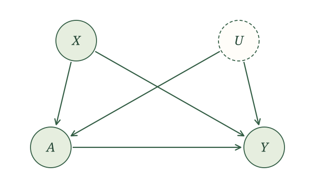{width=620 fig-align="center" fig-alt="X and unmeasured U each cause treatment A and outcome Y. A also causes Y. Conditioning on X leaves unmeasured confounding through U."}

This emergency department has an additional feature. Split flow begins at a specified time each day. Focus on a period around that start time, before split flow can end. Every patient arriving before the start receives traditional flow, and every patient arriving at or after the start receives split flow.

Now let $R$ be arrival time and let $c$ be the time split flow begins. Arrival time is called the **running variable**. Treatment is determined by whether it crosses the cutoff:

$$
A=
\begin{cases}
0,&R<c,\\[0.3em]
1,&R\geq c.
\end{cases}
$$

Patients arriving before $c$ receive traditional flow, and patients arriving at or after $c$ receive split flow. The assignment rule changes abruptly at the cutoff.

Measured and unmeasured patient characteristics can influence both when patients arrive and their outcomes. Arrival time determines which patient-flow model they receive. Our expanded SCM is

$$
\begin{aligned}
X&\leftarrow f_X(\epsilon_X),\\
U&\leftarrow f_U(\epsilon_U),\\
R&\leftarrow f_R(X,U,\epsilon_R),\\
A&\leftarrow
\begin{cases}
0,&R<c,\\
1,&R\geq c,
\end{cases}\\[0.6em]
Y&\leftarrow f_Y(X,U,A,\epsilon_Y),
\end{aligned}
$$

where the noise terms are independent. We observe $X$, $R$, $A$, and $Y$, but not $U$. The corresponding causal graph is

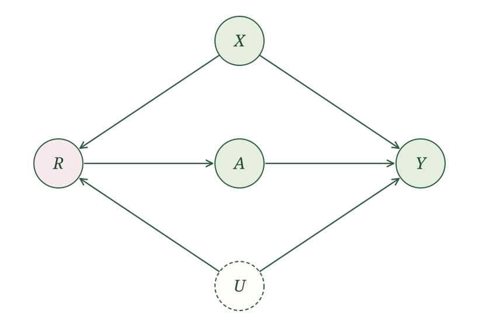{width=700 fig-align="center" fig-alt="Causal graph for treatment assignment through a cutoff. X and unmeasured U each point to R and Y. R points to A, and A points to Y."}

The arrows into $R$ preserve the original story: measured and unmeasured patient characteristics help determine when a patient arrives. Their influence on treatment now passes through $R$, because arrival time determines the patient-flow model.

### Are the conditional expectations defined?

Consider an intervention that sets the patient-flow model to $a$. After causal irrelevance, the relevant potential-outcome assignments are

$$
\begin{aligned}
X&\leftarrow f_X(\epsilon_X),\\
U&\leftarrow f_U(\epsilon_U),\\
R&\leftarrow f_R(X,U,\epsilon_R),\\
A&\leftarrow
\begin{cases}
0,&R<c,\\
1,&R\geq c,
\end{cases}\\[0.6em]
Y(a)&\leftarrow f_Y(X,U,a,\epsilon_Y).
\end{aligned}
$$

The resulting SWIG shows the random treatment $A$ separately from the fixed intervention value $a$. We shade $R$ to indicate conditioning:

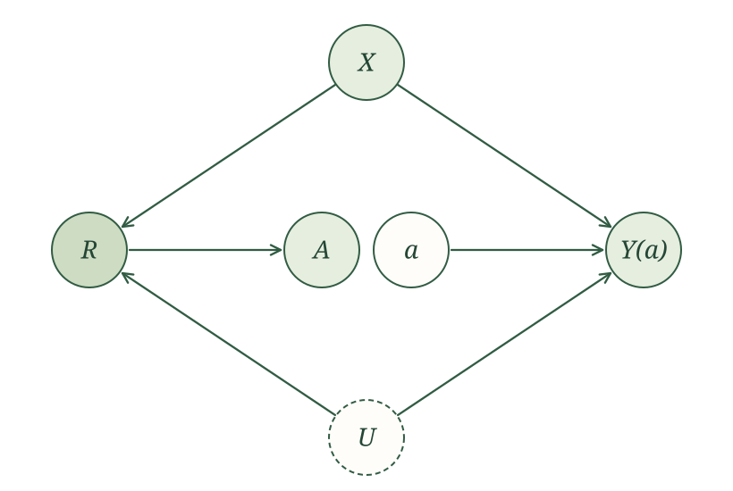{width=700 fig-align="center" fig-alt="SWIG with X and U pointing to R and Y(a), R pointing to A, and fixed a pointing to Y(a). R is shaded to indicate conditioning. Random A has no outgoing arrow."}

Every path from $A$ to $Y(a)$ passes through $R$. Conditioning on $R$ blocks those paths. The global Markov property therefore gives

$$
A\mathrel{\perp\!\!\!\perp}Y(a)\mid R.
$$

Thus, at each arrival time $r$, treatment is conditionally exchangeable. This sounds promising, but it is nearly automatic: once we know $R=r$, the threshold rule already tells us the value of $A$. There is no remaining randomness in treatment.

That is also why the usual adjustment argument fails. We would like to use conditional exchangeability and consistency to write

$$
E[Y(a)\mid R=r]=E[Y\mid R=r,A=a].
$$

But the expression on the right must be defined. Consider an arrival time before split flow begins, such as ten minutes before $c$. Every patient arriving then receives traditional flow. We can take their mean observed outcome, giving

$$
E[Y\mid R=r,A=0],\qquad r<c.
$$

What about $E[Y\mid R=r,A=1]$ at that same arrival time? There are no patients who arrive then and receive split flow. There is no observed treatment group whose outcomes we can average. This conditional expectation is not defined by the observed-data distribution.

Now take an arrival time after split flow begins, such as ten minutes after $c$. Every patient arriving then receives split flow. We can take their mean observed outcome, giving

$$
E[Y\mid R=r,A=1],\qquad r\geq c.
$$

But $E[Y\mid R=r,A=0]$ is not defined by the observed-data distribution there: no patients arriving at that time receive traditional flow.

This is a feature of the assignment rule, not a shortage of observations in our sample. Collecting more data under the same rule will never produce either missing treatment group. The difficulty is also different from conditioning on an exact value of a continuous arrival time. We can learn a mean curve from observations near $r$ on its observed side; the missing treatment group is absent throughout that side of the cutoff.

Without $R$, conditioning on the measured characteristics $X$ leaves the path through $U$ open, so the SCM does not give us conditional exchangeability. With $R$, we have conditional exchangeability, but one of the two conditional outcome expectations we need is not defined at each arrival time. We need a different way to connect the two sides.

## Identification at the cutoff

Start with what the data let us see. Define the observed mean outcome as a function of arrival time:

$$
m(r)=E[Y\mid R=r].
$$

We can estimate this function on both sides of the cutoff. In an RD plot, arrival time goes on the horizontal axis and mean time to disposition goes on the vertical axis. We are looking for a jump at $c$.

By the **jump at the cutoff**, we mean the mean outcome just above the cutoff minus the mean outcome just below it. We follow each curve toward the cutoff and compare the heights they approach.

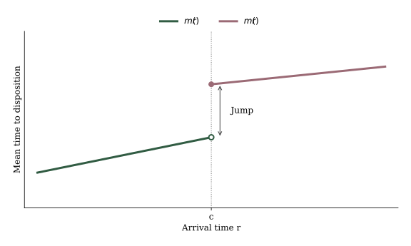{width=700 fig-align="center" fig-alt="Regression-discontinuity plot. Mean outcome changes smoothly with the running variable on each side of cutoff c, with a vertical jump between the two curves at the cutoff."}

This schematic picture illustrates the name **regression discontinuity**: we study a possible discontinuity in the regression function $E[Y\mid R=r]$ at the treatment cutoff. The outcome curve need not actually jump; a zero jump is also a possible result. This particular design is called a **sharp regression discontinuity** because treatment assignment is a deterministic function of the running variable: the probability of treatment jumps from zero to one at $c$. Later, we will consider **fuzzy regression discontinuity**, where crossing the cutoff changes the probability of treatment without determining treatment perfectly. That setting will connect regression discontinuity back to instrumental variables.

To see what that jump tells us about treatment effects, define the two mean potential-outcome functions

$$
m_0(r)=E[Y(0)\mid R=r]
$$

and

$$
m_1(r)=E[Y(1)\mid R=r].
$$

These describe mean time to disposition under traditional flow and split flow, respectively, among patients arriving at time $r$. We never observe both functions at the same arrival time. Consistency tells us which part of each function we do observe.

First consider arrival times below the cutoff. If $r<c$, the threshold rule gives $A=0$. Consistency then gives $Y=Y(0)$, so

$$
\begin{aligned}
m(r)
&=E[Y\mid R=r]\\
&=E[Y(0)\mid R=r]\\
&=m_0(r),\qquad r<c.
\end{aligned}
$$

Thus, to the left of the cutoff, the observed curve lines up with the mean potential outcome under traditional flow.

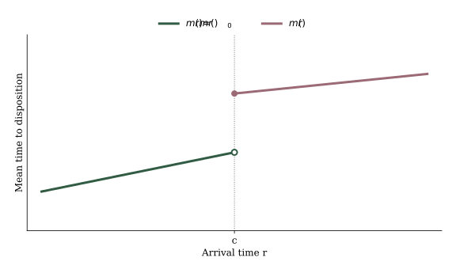{width=700 fig-align="center" fig-alt="The observed outcome curve to the left of c is labeled m(r) = m_0(r). The right-hand curve remains labeled m(r)."}

Now consider arrival times at or above the cutoff. If $r\geq c$, the threshold rule gives $A=1$. Consistency gives $Y=Y(1)$, so

$$
\begin{aligned}
m(r)
&=E[Y\mid R=r]\\
&=E[Y(1)\mid R=r]\\
&=m_1(r),\qquad r\geq c.
\end{aligned}
$$

Thus, to the right of the cutoff, the observed curve lines up with the mean potential outcome under split flow.

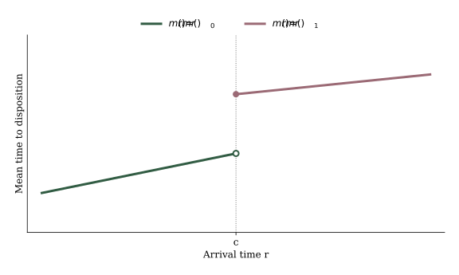{width=700 fig-align="center" fig-alt="With the same axes and curves as the previous plot, the left side is labeled m(r) = m_0(r), and the right side is now labeled m(r) = m_1(r)."}

To the left of $c$, the observed outcomes give us $m_0(r)$, while to the right they give us $m_1(r)$. The missing treatment groups prevent us from recovering both curves at the same arrival time by adjustment. What if we could extrapolate each observed piece to the cutoff? We need an assumption that makes this extrapolation legitimate.

::: {.assumption-box}
**Continuity at the cutoff.** For each $a\in\{0,1\}$, the function

$$
r\longmapsto E[Y(a)\mid R=r]
$$

is continuous at $r=c$.
:::

Continuity allows mean potential outcomes to change with arrival time as the mix of patients changes. It requires that, under either fixed patient-flow model, these means have no jump at $c$. This remains an additional assumption about the distribution of patient characteristics near the cutoff.

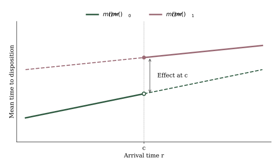{width=700 fig-align="center" fig-alt="The same observed curves, with dashed illustrative continuations of each potential-outcome mean onto its unobserved side. Each continuation meets its observed curve continuously at c. The vertical difference at c is the treatment effect."}

The solid portions are the means connected to the observed data by consistency. The dashed portions illustrate possible continuous extensions onto the unobserved sides; continuity does not identify those entire extensions. It connects the heights approached from either side to the potential-outcome means at the cutoff.

::: {.callout-note title="Optional technical note: local randomization" collapse="true"}
An alternative approach assumes that assignment behaves like a randomized experiment within a specified window around the cutoff. Conditional on being in that window, crossing the cutoff is assumed independent of the relevant potential outcomes, with a treatment probability strictly between zero and one. This is a stronger, finite-window comparison than continuity of the mean potential outcomes at a single cutoff. It motivates comparisons of means and randomization inference within that window.

Lee and Lemieux also explain how imprecise control over the running variable, together with regularity conditions, can yield local randomization in the limit [@lee2010regression]. That limiting argument should not be confused with exact random assignment throughout an arbitrarily chosen bandwidth. Under our continuity approach, increasing a bandwidth can introduce bias even when continuity at the cutoff holds.
:::

Apply the assumption first to traditional flow. Because $m_0(r)$ is continuous at $c$,

$$
\begin{aligned}
E[Y(0)\mid R=c]&=m_0(c)\\
&=\text{mean outcome just below }c.
\end{aligned}
$$

Now apply it to split flow. Because $m_1(r)$ is continuous at $c$,

$$
\begin{aligned}
E[Y(1)\mid R=c]&=m_1(c)\\
&=\text{mean outcome just above }c.
\end{aligned}
$$

Subtracting identifies the average treatment effect at the cutoff:

$$
\begin{aligned}
E[Y(1)-Y(0)\mid R=c]
&=\text{mean outcome just above }c\\
&\quad-\text{mean outcome just below }c.
\end{aligned}
$$

::: {.proposition-box}
**Identification in a sharp regression discontinuity design.** Suppose treatment follows the threshold rule above, consistency holds, the mean potential-outcome functions $E[Y(a)\mid R=r]$ are continuous at $c$ for $a=0,1$, and the distribution of $R$ has support approaching $c$ from both sides. Then the average treatment effect at the cutoff is identified by the jump in the observed conditional mean:

$$
\begin{aligned}
E[Y(1)-Y(0)\mid R=c]
&=\text{jump at the cutoff in }E[Y\mid R=r].
\end{aligned}
$$
:::

::: {.callout-note title="Optional notation: limits at the cutoff" collapse="true"}
The height approached by $E[Y\mid R=r]$ as $r$ moves toward $c$ from above is written $\lim_{r\downarrow c}E[Y\mid R=r]$. Approaching from below is written $\lim_{r\uparrow c}E[Y\mid R=r]$. Thus the jump is

$$
\begin{aligned}
&\text{jump at the cutoff in }E[Y\mid R=r]\\
&\quad=\lim_{r\downarrow c}E[Y\mid R=r]\\
&\qquad-\lim_{r\uparrow c}E[Y\mid R=r].
\end{aligned}
$$
:::

The threshold rule, consistency, and continuity work together. The threshold tells us which potential-outcome curve is observed on each side. Consistency connects that curve to the observed outcome. Continuity carries each curve to the cutoff, where their difference is the causal effect we want.

### The effect we have identified

The derivation gives us the average treatment effect among patients arriving at the start of split flow:

$$
\tau(c)=E[Y(1)-Y(0)\mid R=c].
$$

This is a **local average treatment effect**, local to the running-variable cutoff. In our sharp design, it compares mean time to disposition under split flow and traditional flow at that arrival time. The effect several hours later may be different because a different mix of patients arrives then.

Our argument carries the two observed mean curves to the cutoff. It gives us no corresponding comparison at other arrival times, where one treatment group is still missing. Identifying the population ATE, $E[Y(1)-Y(0)]$, would require additional assumptions about those unobserved outcomes.

As with the complier effect in the IV section, the design identifies a more specific effect than the population ATE we might have wanted. Here, local refers to arrival time at the cutoff. In IV, the complier effect concerns people whose treatment responds to the instrument. Fuzzy RD will involve both restrictions.

## Where running variables come from

The running variable comes from the rule that assigns treatment. Here are several settings where such a rule can give us a comparison near a cutoff.

::: {.example-intro}
<span class="example-label">Test scores and course placement</span>

Suppose a college requires students scoring below 80 on a placement test to take developmental mathematics. Students scoring 80 or higher can enter the next mathematics course directly. Does developmental mathematics improve later academic performance?
:::

The running variable is the placement score, and the cutoff is 80. Treatment is taking developmental mathematics; an outcome might be credits completed in the following year. Students with very different scores probably differ in preparation, motivation, and other causes of later performance. Our proposed comparison uses students scoring just below and just above 80. We need a reason to believe that their mean potential outcomes would be continuous through that score. The assignment rule also runs in the opposite direction from our earlier notation: here students below the cutoff receive treatment. We would subtract the mean outcome just above 80 from the mean outcome just below 80 to estimate the effect of developmental mathematics.

::: {.example-intro}
<span class="example-label">Age and program eligibility</span>

Suppose a community begins offering a transportation service when residents turn 70. We want to know whether access to the service increases attendance at medical appointments.
:::

The running variable is age, recorded finely enough to compare residents just before and just after their seventieth birthday. Treatment is access to the service, and the outcome is appointment attendance. Health and mobility may change with age, but we hope their influence on attendance changes continuously through 70. A difficulty would arise if another benefit also began at that birthday and affected attendance. We would then have to explain which part of the outcome change could be attributed to transportation access. If access follows the age rule exactly, its assignment is sharp. Actual use of the service may follow a fuzzy rule because some eligible residents never use it.

::: {.example-intro}
<span class="example-label">Close elections</span>

Suppose we want to know whether winning an election helps a party in a later election. Parties that win by large margins may already have advantages that also predict their future vote share.
:::

The running variable is the party's victory margin, and the cutoff is zero. Treatment is winning the current election; the outcome is its later vote share. A party barely winning and a party barely losing have nearly the same current electoral support, while the election result changes abruptly between them. The RD argument asks whether their mean potential outcomes under a win or a loss are continuous through a zero margin. The Senate data below give us an example of this setting [@cattaneo2015randomization].

::: {.example-intro}
<span class="example-label">Clinical risk scores</span>

Suppose a clinic recommends a preventive treatment when a patient's risk score reaches 20. We want to know whether the treatment reduces later hospitalization.
:::

The running variable is the risk score, and the cutoff is 20. Higher scores may predict worse outcomes even without treatment. The comparison near 20 therefore relies on mean potential outcomes changing continuously through the threshold. We also need to know what the clinic actually does at 20. If it starts treatment for everyone above the cutoff, assignment is sharp. If it changes a recommendation and patients or physicians can decline, treatment receipt may instead follow a fuzzy RD design. We return to that distinction at the end of the section.

Our emergency-department example uses time in a similar way: split flow starts at a known arrival-time cutoff. In every application, the assignment rule and the meaning of treatment determine which comparison we can make.

## Estimation

### Read the effect from a picture

Start with an idealized regression function rather than noisy observations. Treatment changes from zero to one at $c=0$. Use the grid to read the mean outcomes just below and just above the cutoff. What is the effect at the cutoff, assuming continuity of the potential-outcome means?

The cutoff comes from the treatment rule; we do not choose it by searching for the largest outcome jump. What we will choose during estimation is how wide a window to use around that given cutoff.

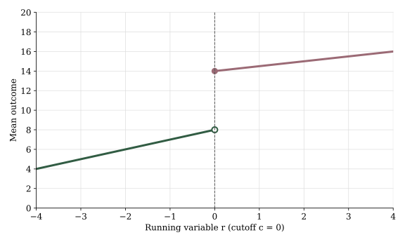{width=700 fig-align="center" fig-alt="Gridded plot with running variable from minus four to four and mean outcome from zero to twenty. The left curve approaches eight at zero; the right curve approaches fourteen."}

Approaching from the left gives 8. Approaching from the right gives 14. The identified effect is therefore

$$
\tau(0)=14-8=6.
$$

We read both curves at the cutoff. Comparing their heights at different running-variable values would include the change along each curve as well as the treatment effect.

Now try the same operation yourself. Use the grid below to read the mean outcomes just above and just below the cutoff, then subtract in the same order: treated minus untreated.

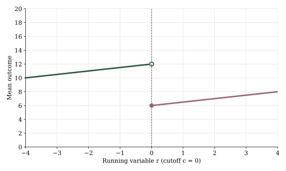{width=700 fig-align="center" fig-alt="Second gridded plot on the same scale. Treatment begins at zero. The reader is asked to estimate the jump between the two curves."}

<details>
<summary>Check your answer</summary>

The untreated mean approaches 12 and the treated mean approaches 6. The effect at the cutoff is $6-12=-6$. A downward jump is a negative treatment effect.

</details>

### Read the effect from observed data

Now consider actual observations from the public [Senate-election dataset distributed with rdrobust](https://github.com/rdpackages/rdrobust/blob/main/R/rdrobust_senate.csv). The running variable is the Democratic victory margin in an election, measured in percentage points, and the cutoff is zero. Treatment is a Democratic victory. The outcome is the later Democratic vote share recorded in the dataset. These data come from the application of Cattaneo, Frandsen, and Titiunik [@cattaneo2015randomization]; the [dataset documentation](https://raw.githubusercontent.com/rdpackages/rdrobust/main/R/rdrobust/man/rdrobust_RDsenate.Rd) labels the outcome as vote share at election $t+2$.

The following table contains the eight observations closest to the cutoff with both variables observed. Values are rounded for display; calculations use the original values.

| Election year | Victory margin $R$ | Later vote share $Y$ |
|---:|---:|---:|
| 1954 | -0.19 | 43.2 |
| 1944 | -0.12 | 53.6 |
| 1974 | -0.08 | 29.0 |
| 1964 | 0.04 | 57.6 |
| 2000 | 0.09 | 56.9 |
| 1998 | 0.10 | 61.1 |
| 2002 | 0.16 | 62.5 |
| 1962 | 0.23 | 56.8 |

Using only these rows, estimate the jump by subtracting the mean outcome below zero from the mean outcome above zero. These observations contain sampling noise, so the difference of nearby sample means is an estimate of the jump at the cutoff.

<details>
<summary>Check your calculation</summary>

The three elections below zero have mean outcome 41.9. The five above zero have mean outcome 59.0. The estimated jump is approximately

$$
59.0-41.9=17.1
$$

percentage points. With only eight observations, this is a noisy estimate. We will use more observations in the next calculation.

</details>

### Local regression

Nearby averages treat the mean curve as approximately flat within each side's window. Regression lets the curve slope. Choose a bandwidth $h$, keep observations with $c-h\leq R<c$ on the left and $c\leq R\leq c+h$ on the right, and fit a separate line to each side. Predict both lines at $R=c$, then subtract the left prediction from the right prediction.

Center the predictor at the cutoff. Our two fitted lines are

$$
\begin{aligned}
\hat m_0(r)&=\hat\alpha_0+\hat\beta_0(r-c),\\
&\qquad c-h\leq r<c,\\[0.8em]
\hat m_1(r)&=\hat\alpha_1+\hat\beta_1(r-c),\\
&\qquad c\leq r\leq c+h.
\end{aligned}
$$

At $r=c$, both slope terms are zero, giving

$$
\hat\tau(c)=\hat\alpha_1-\hat\alpha_0.
$$

For a concrete fixed-bandwidth analysis, use $h=10$ percentage points in the Senate data. Give every retained observation equal weight and fit ordinary least squares separately on each side.

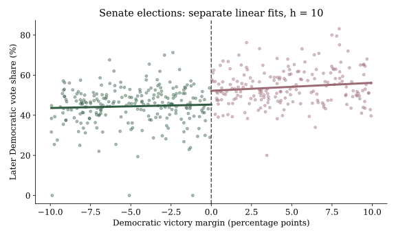{width=700 fig-align="center" fig-alt="Actual Senate-election observations within ten percentage points of the cutoff, with separate least-squares lines on each side extended to zero."}

Of the 1,297 observations with both variables recorded, this window retains 245 below zero and 206 above zero. The fitted outcome means at zero are

$$
\hat m_0(0)=45.3,\qquad \hat m_1(0)=52.2.
$$

The estimated effect is therefore

$$
\hat\tau(0)=52.2-45.3=6.9
$$

percentage points in later Democratic vote share.

This is a teaching estimate for a fixed, specified bandwidth. Its causal interpretation still depends on the RD assumptions. The later vote-share effect for close elections need not describe the effect of winning an election by a large margin.

```{r}
#| eval: false
senate <- read.csv("data/rd-senate.csv")
senate <- subset(senate, is.finite(margin) & is.finite(vote))
h <- 10
left <- subset(senate, margin >= -h & margin < 0)
right <- subset(senate, margin >= 0 & margin <= h)
fit0 <- lm(vote ~ margin, data = left)
fit1 <- lm(vote ~ margin, data = right)
mu0 <- predict(fit0, newdata = data.frame(margin = 0))
mu1 <- predict(fit1, newdata = data.frame(margin = 0))
c(untreated = mu0, treated = mu1, effect = mu1 - mu0)
```

## What can make an RD design invalid

Continuity is not guaranteed by the threshold rule. Patients deliberately timing their arrivals around the start of split flow could make the patients on the two sides systematically different. We should also investigate changes outside our working SCM, such as a staffing change occurring exactly when split flow begins. That would introduce another route from arrival time to the outcome.

For a concrete example, suppose additional staffing would reduce mean time to disposition from 100 to 90 minutes even if traditional flow continued. Split flow then reduces it by another 10 minutes, to 80. The observed drop at the cutoff is $80-100=-20$ minutes. Attributing all 20 minutes to split flow would combine its effect with the staffing change. Under traditional flow alone, mean time to disposition would already have jumped at that time, violating our continuity assumption.

Now consider the placement test. If students can obtain an extra point through an appeal, those who appeal successfully may differ in persistence, resources, or knowledge of the process. Students just above 80 could then differ systematically from those just below it. We need to investigate how scores were produced, whether they can be changed, and which test attempts enter the dataset.

## Practical considerations

### Check the running variable

We cannot observe $U$, so we cannot directly verify continuity of the potential-outcome means. We can look for consequences we would expect if the design were credible. Start with the distribution of the running variable: does it show suspicious bunching around the cutoff?

Suppose students scoring below 80 must take developmental mathematics, but can appeal their placement score. If successful appeals move scores from just below 80 to exactly 80, we might see unusually few scores just below the cutoff and a pileup at 80. Students able to obtain those changes may differ in resources or persistence from students who remain below the cutoff.

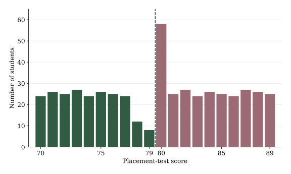{width=700 fig-align="center" fig-alt="Illustrative bar chart of placement-test scores from 70 to 89. Counts are fairly similar away from 80, fall at scores 78 and 79, and spike at 80. A dashed line marks the eligibility threshold at 79.5, separating scores below 80 from scores at least 80."}

This illustrative pattern would prompt us to investigate how scores were assigned and revised. Rounding, retesting, and selective recording can also produce unusual patterns. A pileup deserves investigation; its absence does not establish the RD assumptions.

### Check measured covariates

Measured pretreatment characteristics should also change smoothly through the cutoff. For example, group nearby placement scores and plot the percentage of students who are women in each group:

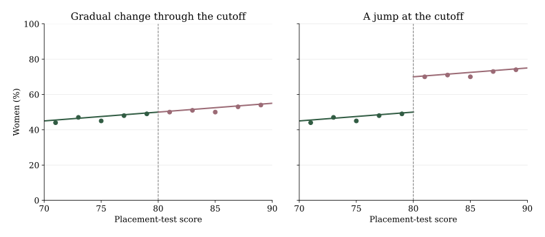{width=850 fig-align="center" fig-alt="Two illustrative covariate-balance plots with identical axes. The left shows the percentage of women changing gradually through a placement-score cutoff of 80. The right shows an abrupt increase from about 50 percent to about 70 percent at 80. Points summarize illustrative score groups, and lines show the corresponding trends."}

These plots are illustrative. The left panel shows a gradual change; the right shows a jump from about 50 percent to 70 percent women. Course assignment cannot cause this pretreatment difference, so we should investigate who appears on each side.

In the placement-test example, a gender or first-generation imbalance led us to revisit the recorded scores: we had only second attempts. Differences in who retakes the test can change the composition of that sample. We need the first-attempt scores and retake rule to reconstruct the placement process. Similar checks apply to prior coursework and other baseline characteristics. Sampling noise can produce apparent jumps, and passing these checks does not establish continuity of the potential-outcome means.

### Bandwidth and the bias–variance tradeoff

The bandwidth determines how far from the cutoff we look when estimating the jump. In the Senate data, widening the window gives us more elections:

| Bandwidth $h$ (percentage points) | Below the cutoff | Above the cutoff |
|---:|---:|---:|
| 5 | 128 | 117 |
| 10 | 245 | 206 |
| 20 | 389 | 346 |

Increasing $h$ from 5 to 20 nearly triples the number of observations. But our identification argument concerns the effect at the cutoff. Continuity justifies approaching that point from either side; it does not guarantee that a line fitted to elections 20 percentage points away will predict well at zero. Using a wider window requires a good approximation to the mean curve over that larger range.

To see the consequences, generate data where the true effect is known. In each simulated dataset, generate 400 observations with $R$ uniform on $[-4,4]$, treatment determined by the zero cutoff, and

$$
\begin{aligned}
Y(0)&=10+R+0.4R^2+\epsilon,\\
Y(1)&=14+R+1.2R^2+\epsilon,
\end{aligned}
$$

where $\epsilon$ is independent normal noise with mean zero and standard deviation 2. The true effect at zero is $14-10=4$. The curves are continuous, but their curvature differs. Fit separate local lines at each bandwidth and repeat the entire experiment 4,000 times.

The bias is the mean estimate minus 4; the variance is the sample variance of the 4,000 estimates. MSE denotes mean squared error.

| $h$ | Mean estimate | Bias | Variance | MSE |
|---:|---:|---:|---:|---:|
| 0.5 | 3.97 | -0.03 | 1.44 | 1.44 |
| 1 | 3.88 | -0.12 | 0.67 | 0.69 |
| 2 | 3.48 | -0.52 | 0.33 | 0.61 |
| 4 | 1.86 | -2.14 | 0.23 | 4.79 |

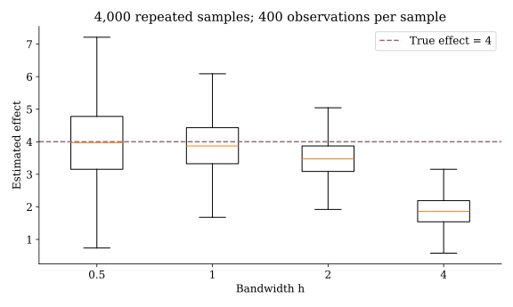{width=700 fig-align="center" fig-alt="Boxplots of 4,000 local-linear estimates for bandwidths 0.5, 1, 2, and 4. Estimates become less variable with wider bandwidths but shift below the known true effect of four, especially at bandwidth four."}

At $h=0.5$, the estimates are centered near 4 but spread widely. At $h=4$, they are tightly concentrated around the wrong value. Straight lines approximate these curved functions poorly over such a wide window. This is the bandwidth's **bias–variance tradeoff**: narrower windows give a better local approximation but fewer observations; wider windows give more observations but may fit the curve poorly near the cutoff. Here, $h=2$ has the smallest mean squared error among the four choices.

### Model flexibility

Within a chosen bandwidth, we still have to choose how to fit the outcome curve. A straight line can miss curvature; a more flexible model can follow it, but can also follow sampling noise. The figure below uses eight simulated observations from a straight mean curve, $E[Y\mid R=r]=8+r$, with a little noise. All eight observations are below the cutoff. A straight line approximately follows them. A degree-seven polynomial passes through every point, reducing its training error to essentially zero.

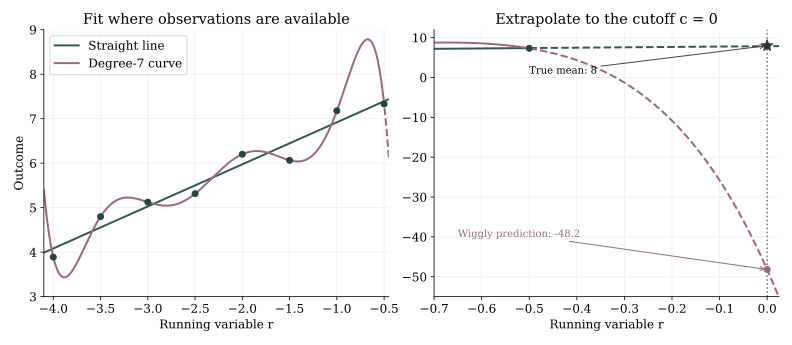{width=850 fig-align="center" fig-alt="Two panels compare a straight line and a degree-seven polynomial fitted to eight observations below zero. The polynomial passes through all observations but bends wildly when extended to zero, predicting minus 48.2 instead of the true mean of eight. The straight line predicts 7.9. Dashed lines indicate extrapolation."}

The left panel shows how well the curves fit the observations. The right panel extends them to the cutoff, using a different vertical scale so the failed prediction is visible. The straight line predicts 7.9, close to the true mean of 8. The polynomial predicts -48.2. Its training mean squared error is essentially zero, compared with 0.05 for the straight line, but its extrapolation is terrible. It has used its extra flexibility to fit the noise. This is an illustrative construction, not a result from the Senate data.

This matters in RD because our estimate compares predictions at a boundary. Choosing a model because it has the smallest training error or largest $R^2$ can reward the very wiggles that make those predictions unstable. Continuity alone does not protect us: both fitted curves are continuous. We need to assess predictions on observations excluded from fitting, and to make that assessment resemble the boundary prediction we need.

Model flexibility brings its own bias–variance tradeoff. A rigid model can systematically miss the mean curve. A very flexible model may change sharply when a few observations change, making its prediction at the cutoff variable. Increasing flexibility therefore needs to be evaluated through predictions beyond the observations used to fit the model.

### Cross-validation

We have two choices to assess: the bandwidth and the fitted model. Cross-validation evaluates their predictions using outcomes left out of fitting. Here we hold the model fixed as a local line and compare bandwidths. Lee and Lemieux describe a boundary-oriented leave-one-out procedure for this purpose in Section 4.3.1, pp. 321–324 [@lee2010regression]. For an observation below the cutoff, leave its outcome out and fit a line using observations immediately to its left. For an observation above the cutoff, use observations immediately to its right. Predict the omitted outcome at its running-variable value. This makes each prediction a boundary prediction, like the prediction we ultimately need at the cutoff.

For example, to predict an omitted election with margin $r_i=-2$ using $h=10$, fit on margins from $-12$ up to, but excluding, $-2$. To predict one with margin $r_i=2$, fit on margins greater than 2 through 12. Both fits stay on the appropriate side of zero. For each bandwidth, average the squared prediction errors over the same set of held-out observations:

$$
\operatorname{CV}(h)=\frac{1}{n_{\mathrm{val}}}
\sum_{i\in\mathcal V}\left\{Y_i-\hat m_{-i,h}(R_i)\right\}^2.
$$

Here are the results for the Senate data, using all 245 complete observations with margins between -5 and 5 as the validation set. The training observations for each prediction can extend outside that validation window.

| Candidate bandwidth | Mean squared held-out error |
|---:|---:|
| 5 | 86.24 |
| 10 | 87.51 |
| 15 | 85.81 |
| 20 | 85.08 |
| 30 | 85.11 |

Among these candidates, the criterion chooses $h=20$. The scores at 20 and 30 are almost tied. This criterion evaluates boundary prediction, not the unknown causal-effect error directly, so its minimizer is guidance rather than proof of an optimal causal estimate. We should still inspect the plots and report sensitivity across reasonable bandwidths. Plotting-bin widths and regression bandwidths are also separate choices.

Multiple bandwidths are a sensitivity analysis, not a contest in which we select the one that produces the preferred answer. If estimates change sharply across nearby choices, that instability is part of what the data tell us.

The numerical tables and teaching figures can be reproduced with `python3 rd-examples.py`. The fixed-bandwidth R calculation above uses the same saved data.

## Fuzzy regression discontinuity

::: {.example-intro}
<span class="example-label">A risk-score recommendation</span>

Suppose a clinic recommends treatment when a patient's risk score reaches 20. Some patients above 20 decline treatment, and some below 20 receive it anyway. Let $A$ indicate receiving treatment and $Y$ be a symptom score at follow-up.
:::

Let $R$ be the risk score and $Z$ indicate eligibility for the recommendation. The cutoff determines $Z$, but only changes the probability of receiving treatment. This is a **fuzzy regression discontinuity** design.

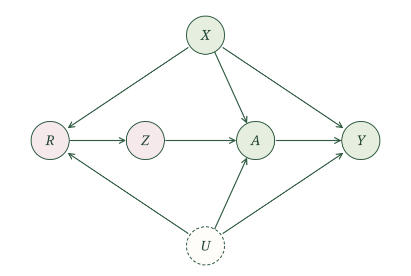{width=700 fig-align="center" fig-alt="Fuzzy RD causal graph. X and unmeasured U each point to R, A, and Y. R points to eligibility Z. Z points to treatment A, and A points to outcome Y."}

The graph resembles our IV setup: eligibility $Z$ encourages treatment, while $X$ and $U$ influence treatment and outcome. Eligibility is determined by $R$, which shares measured and unmeasured causes with $Y$. As in sharp RD, continuity at the cutoff supplies the comparison we need. Eligibility affects the outcome through treatment.

Use the IV notation $A(z)$ for treatment under eligibility $z$ and $Y(a)$ for the outcome under treatment $a$. We require consistency, monotonicity $A(z=1)\geq A(z=0)$, a nonzero treatment jump, and support approaching 20 from both sides. In addition, for $z=0,1$, the functions

$$
\begin{aligned}
r&\longmapsto E[A(z)\mid R=r],\\[0.4em]
r&\longmapsto E[Y(A(z))\mid R=r]
\end{aligned}
$$

must be continuous at 20. Here $Y(A(z))$ is the outcome when treatment responds to eligibility $z$. Under these assumptions, the IV argument applies to the comparisons just above and just below the cutoff. Write the two jumps as

$$
\begin{aligned}
\Delta_Y&=\text{jump at 20 in mean outcome},\\[0.5em]
\Delta_A&=\text{jump at 20 in treatment uptake}.
\end{aligned}
$$

Then

$$
\begin{aligned}
&E[Y(1)-Y(0)\mid\text{compliers},R=20]\\[0.4em]
&\qquad=\frac{\Delta_Y}{\Delta_A}\\[0.5em]
&\qquad=\frac{\text{Jump at the cutoff in mean outcome}}
{\text{Jump at the cutoff in treatment uptake}}.
\end{aligned}
$$

Compliers are patients who take treatment only when eligible for the recommendation. The ratio identifies their average treatment effect at the cutoff [@lee2010regression].

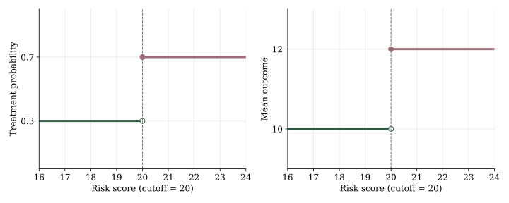{width=800 fig-align="center" fig-alt="Two illustrative plots at the same cutoff. Treatment probability jumps from 0.3 to 0.7 and mean outcome from 10 to 12."}

In this picture, the ratio is

$$
\frac{12-10}{0.7-0.3}=\frac{2}{0.4}=5.
$$

Treatment increases mean symptom score by 5 units among compliers at the cutoff. In sharp RD, the treatment jump is one, so the ratio reduces to the outcome jump.

## Difference-in-differences

::: {.callout-note title="Planned extension"}
This sketch will be developed with an SCM, a precise causal target and parallel-trends assumption, an identification argument, and worked examples.
:::

Another way to study an intervention uses changes over time. Suppose one emergency department introduces split flow while a comparison department continues traditional flow. We measure mean time to disposition in both departments before and after the change. The illustrative picture below shows how the comparison works.

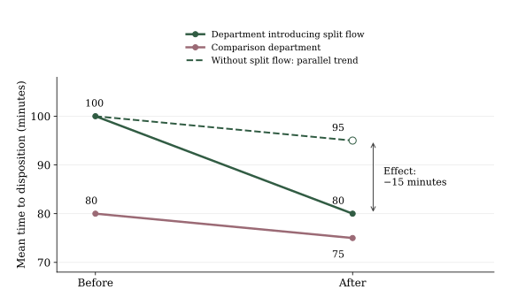{width=700 fig-align="center" fig-alt="Before-and-after mean outcomes in two departments. The department introducing split flow falls from 100 to 80 minutes, and the comparison department falls from 80 to 75. A dashed counterfactual carries the five-minute comparison decline to the first department, predicting 95 minutes without split flow. The effect is 80 minus 95, or minus 15 minutes."}

The department introducing split flow improves by 20 minutes; the comparison department improves by 5. Subtracting the two changes gives the **difference-in-differences** estimate:

$$
(80-100)-(75-80)=-20-(-5)=-15\text{ minutes}.
$$

The dashed line shows the key assumption: without split flow, the first department would also have improved by 5 minutes, reaching 95. This is **parallel trends**. It allows stable differences between departments while requiring their untreated mean outcomes to change by the same amount. A staffing improvement confined to the department introducing split flow could violate it.

DiD offers another approach to unmeasured confounding when we observe an affected group and a comparison group before and after a policy or operational change.

