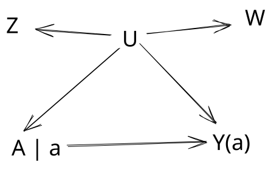

<!-- Imported from the previous GitBook: other-considerations/proxy-variables.md. Prose and equations retained; headings, callout syntax, and image paths adapted for Quarto. -->

## Control functions

*[Placeholder: The previous GitBook contained only a heading for this topic.]*

## Proxy variables

When there is unmeasured confounding, one can identify $$E[Y(a)]$$ with the help of _proxies_ for the unmeasured confounder, i.e. noisy measurements of the unmeasured confounder.

\------

<mark style="background-color:purple;">**Example 1 (revisited).**</mark>&#x20;

Let's revisit the epidemiology problem referred to as _confounding by indication_, whereby healthcare providers have information about a patient's underlying health that is not captured in the data.&#x20;

Q. What might be some <em>proxy</em> variables for unmeasured health U?

**A.**  Well, the variables will certainly depend on the context.  But broadly, we can think of any information on a patient's health that the care provider might collect to inform their treatment decision. Examples include

* Vitals (e.g., blood pressure, temperature)
* Lab results (e.g., lipid profile, A1C, protein levels)
* Imaging results (e.g., cloudiness in lung x-ray)

\------

The simplest case may be when two variables $$Z$$ and $$W$$can have a direct causal impact on the unmeasured variable $$U$$ (i.e. $$Z \rightarrow U$$ and $$W \rightarrow U$$) but not on any other variables.&#x20;

We update our SWIG to look like:

_How exactly does a proxy variable help?_

It starts with backdoor adjustment:

$$E[g( Y(a)) ] = E[ E[ g(Y) | A=a, U] ]$$​

**And an assumption** **about variables taking on a finite number of values.**

This means that

$$E[Y(a)] = \sum_y y P( Y(a)=y)$$

with&#x20;

$$P(Y(a)=y) = \sum_{u} P( Y = y | U=u,A=a)P(U=u)$$.

The right-hand side is expressed in terms of $$U$$ which we do not measure, but remarkably, we can remove $$U$$​ from the expression.  It requires manipulating two applications of law of iterated expectation:

*   $$P(W=w | Z=z, A=a)$$

    $$= \sum_u P(W=w | U=u) P( U=u | Z=z, A=a)$$​
*   $$P(Y=y | Z=z)$$​

    $$=\sum_u P(Y=y | U=u, A=a) P(U=u | Z=z, A=a)$$​

We can then re-write $$P(Y(a)=y)$$ into

$$\sum_{z,w} P (Y=y | Z=z, A=a) (\mathbb{B}^{-1})_{zw} P(W=w)$$​,

provided $$\mathbb{B}$$ is invertible where $$\mathbb{B}$$​ is the matrix whose entries are given by&#x20;

$$(\mathbb{B})_{wz} = P( W=w | Z=z , A = a).$$&#x20;

Notice that the above expression does not involve $$U$$​.&#x20;

::: {.callout-warning}
**Technical note.**  The argument involves matrix manipulations and may not be particularly illuminating, but we repeat it here.&#x20;

The two expressions we recover from the law of iterated expectations are expressed in matrix form as

$$\mathbb{B} = \mathbb{C} \mathbb{D}$$&#x20;

​where ​

* $$(\mathbb{C})_{wu} = P( W=w | U=u )$$​
* $$(\mathbb{D})_{uz} = P( U=u | Z=z, A=a )$$

and

$$\mathbb{E} = \mathbb{F} \mathbb{D}$$​

where

* $$(\mathbb{E})_{yz} = P( Y=y | Z=z, A=x )$$
* $$(\mathbb{F})_{yu} = P( Y=y | U=u, A=x )$$​.

Matrix algebra then gives&#x20;

$$\mathbb{F} = \mathbb{E} \mathbb{D}^{-1} = \mathbb{E} \mathbb{B}^{-1}\mathbb{C}$$.

Entry-wise, this expression becomes

$$P( Y = y | U= u, A=a )$$​

$$= \sum_{wz} P( Y=y | Z=z, A=a ) ( \mathbb{B}^{-1} )_{z w} P( W=w | U=u )$$​

and summing over $$u$$​ leaves the desired result

$$P(Y(a)=y)$$

$$= \sum_u P( Y=y | U=u, A=a ) P(U=u)$$​

$$= \sum_{uwz} P( Y=y | Z=z, A=a ) ( \mathbb{B}^{-1} )_{z w} P( W=w | U=u )P(U=u)$$​

$$= \sum_{wz} P( Y=y | Z=z, A=a ) ( \mathbb{B}^{-1} )_{z w} P( W=w)$$.&#x20;
:::

\------

<mark style="background-color:purple;">**Example 2.**</mark>&#x20;

Consider the simplest case when all variables are binary.

Q. <strong>Use proxy variables</strong> Z <strong>and</strong> W <strong>to i</strong>dentify E[Y(a)]

**A.** In the binary case, we can make simplifications. First,&#x20;

$$E[Y(a)] = P( Y(a)= 1 )$$​

$$= \sum_{wz} P( Y=1 | Z=z, A=a) (\mathbb{B}^{-1})_{zw} P(W=w)$$

Since most of our expressions condition on $$A=a$$​, we will suppress this dependence by replacing $$P$$​ with $$P_a$$​ in an effort to simplify notation.&#x20;

Second, we note that

$$\mathbb{B} = \begin{bmatrix} 1-P_a(W=1 | Z=0) & 1-P_a(W=1 | Z=1) \\ P_a(W=1 | Z=0) & P_a(W=1 | Z=1)\end{bmatrix}$$​

&#x20;so that

$$\mathbb{B}^{-1} = \frac{1}{|\mathbb{B}|} \begin{bmatrix} P_a(W=1 | Z=1) & P_a(W=1 | Z=1)-1 \\ -P_a(W=1 | Z=0) & 1-P_a(W=1 | Z=0)\end{bmatrix}$$where

$$| \mathbb{B} | =P_a(W=1 | Z=1) - P_a(W=1|Z=0)$$

Therefore,&#x20;

$$= \sum_{wz} P( Y=1 | Z=z, A=a) (\mathbb{B}^{-1})_{zw} P(W=w)$$​

$$= P_a( Y=1 | Z=0) \frac{P_a(W=1|Z=1)-P_a(W=1)}{P_a(W=1 | Z=1) - P_a(W=1|Z=0)}$$

$$+P_a( Y=1 | Z=1)\frac{P_a(W=1)-P_a(W=1|Z=0)}{P_a(W=1 | Z=1) - P_a(W=1|Z=0)}$$.

&#x20;**References**

* Kuroki, M., & Pearl, J. (2014). [Measurement bias and effect restoration in causal inference. ](https://academic.oup.com/biomet/article/101/2/423/194920)_Biometrika_, _101_(2), 423-437.
* Miao, W., Geng, Z., & Tchetgen Tchetgen, E. J. (2018). [Identifying causal effects with proxy variables of an unmeasured confounder](https://academic.oup.com/biomet/article/105/4/987/5073056). _Biometrika_, _105_(4), 987-993.
