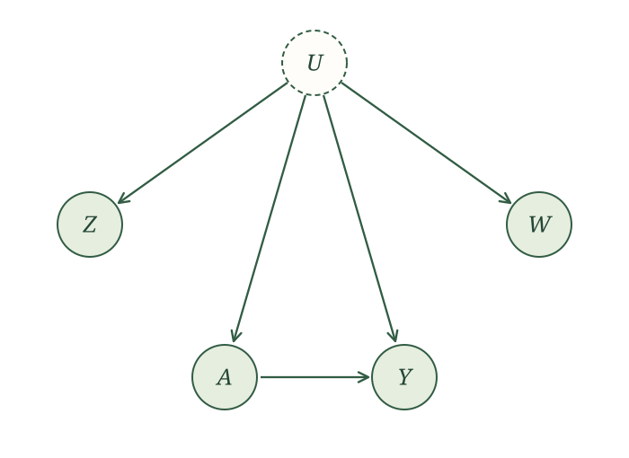

::: {.callout-note title="Planned expansion"}
We plan to develop proxy-variable and control-function approaches to unmeasured confounding. The proxy-variable material below is retained from the earlier GitBook and has been adapted to the format of this text. This section is supplementary reading rather than a scheduled lecture.
:::

## Control functions

*[Planned: introduce control functions through a worked example, then describe the additional assumptions they require. The earlier GitBook contained only a heading for this topic.]*

## Proxy variables

A **proxy** provides information about a variable we do not observe directly. In some settings, two proxies for an unmeasured confounder can help identify $E[Y(a)]$. We need restrictions on how the proxies are generated and enough information in their relationship; simply measuring two related variables is not sufficient [@kuroki2014measurement; @miao2018proxy].

::: {.example-intro}
Information about underlying health

Return to confounding by indication. A physician sees aspects of a patient's underlying health that influence both treatment and outcome, but are missing from our data. What measurements might give us information about that unmeasured health?
:::

Vital signs, laboratory results, and imaging findings are possible candidates. Which measurements can serve as proxies depends on their causal relationships with treatment, outcome, and the unmeasured health characteristics.

For a simple setup, suppose the unmeasured variable $U$ influences two observed proxies, $Z$ and $W$, as well as treatment $A$ and outcome $Y$. The proxies have no additional causes shared with each other, treatment, or outcome. The corresponding causal graph is

{width=620 fig-align="center" fig-alt="Unmeasured U points to observed proxies Z and W, treatment A, and outcome Y. A also points to Y."}

If we observed $U$, our usual adjustment argument would give

$$
E[Y(a)]=E\big[E[Y\mid U,A=a]\big],
$$

when the conditional expectations are defined. We will use the proxy relationships to remove $U$ from that expression.

For this finite-variable example, assume $U$, $Z$, and $W$ each have $k$ possible values, and $Y$ has finitely many values. Then

$$
\begin{aligned}
E[Y(a)]&=\sum_y y\,P(Y(a)=y),\\[0.4em]
P(Y(a)=y)&=\sum_u P(Y=y\mid U=u,A=a)P(U=u).
\end{aligned}
$$

The graph gives two useful applications of the law of iterated expectations:

$$
\begin{aligned}
&P(W=w\mid Z=z,A=a)\\
&\quad=\sum_u P(W=w\mid U=u)\\
&\qquad\qquad\times P(U=u\mid Z=z,A=a),
\end{aligned}
$$

and

$$
\begin{aligned}
&P(Y=y\mid Z=z,A=a)\\
&\quad=\sum_u P(Y=y\mid U=u,A=a)\\
&\qquad\qquad\times P(U=u\mid Z=z,A=a).
\end{aligned}
$$

Both expressions use the same conditional distribution of $U$ given $Z$ and $A$. We can combine them using matrix algebra. Define the $k$-by-$k$ matrix $B_a$ by

$$
(B_a)_{wz}=P(W=w\mid Z=z,A=a).
$$

If $B_a$ is invertible, the resulting identification formula is

$$
\begin{aligned}
P(Y(a)=y)
&=\sum_{z,w}P(Y=y\mid Z=z,A=a)\\
&\qquad\times(B_a^{-1})_{zw}\,P(W=w).
\end{aligned}
$$

Every quantity on the right involves observed variables. The invertibility condition supplies the extra restriction needed for this calculation [@miao2018proxy].

::: {.callout-note title="Optional technical note: the matrix calculation" collapse="true"}
Define four matrices:

$$
\begin{aligned}
C_{wu}&=P(W=w\mid U=u),\\
(D_a)_{uz}&=P(U=u\mid Z=z,A=a),\\
(E_a)_{yz}&=P(Y=y\mid Z=z,A=a),\\
(F_a)_{yu}&=P(Y=y\mid U=u,A=a).
\end{aligned}
$$

The two iterated-expectation identities become

$$
B_a=CD_a,\qquad E_a=F_aD_a.
$$

Because $B_a$ is invertible and $C$ and $D_a$ are square, both factors are invertible. Therefore,

$$
F_a=E_aD_a^{-1}=E_aB_a^{-1}C.
$$

Let $p_U$ and $p_W$ be the column vectors of marginal probabilities for $U$ and $W$. Since $p_W=Cp_U$,

$$
F_ap_U=E_aB_a^{-1}Cp_U=E_aB_a^{-1}p_W.
$$

The left side gives the intervention probabilities $P(Y(a)=y)$. Reading off row $y$ on the right gives the identification formula above.
:::

::: {.example-intro}
Binary proxies

Suppose $U$, $Z$, $W$, and $Y$ are all binary. How does the matrix formula simplify?
:::

Because $Y$ is binary, $E[Y(a)]=P(Y(a)=1)$. To keep the calculation readable, write

$$
\begin{aligned}
q_z&=P(W=1\mid Z=z,A=a),\\
r_z&=P(Y=1\mid Z=z,A=a),\\
p&=P(W=1).
\end{aligned}
$$

The first two quantities depend on the chosen treatment value $a$; $p$ is the marginal probability of $W=1$. Then

$$
B_a=
\begin{bmatrix}
1-q_0&1-q_1\\
q_0&q_1
\end{bmatrix},
$$

with determinant $q_1-q_0$. If $q_1\ne q_0$, its inverse is

$$
B_a^{-1}=
\frac{1}{q_1-q_0}
\begin{bmatrix}
q_1&q_1-1\\
-q_0&1-q_0
\end{bmatrix}.
$$

Substituting into the identification formula gives

$$
\begin{aligned}
E[Y(a)]
&=r_0\frac{q_1-p}{q_1-q_0}\\[0.4em]
&\quad+r_1\frac{p-q_0}{q_1-q_0}.
\end{aligned}
$$

The calculation requires the proxies to remain associated within treatment groups: $q_1$ and $q_0$ must differ. When they are close, the small denominator can also make estimation unstable.
