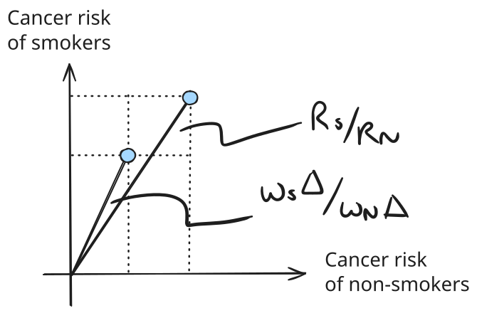
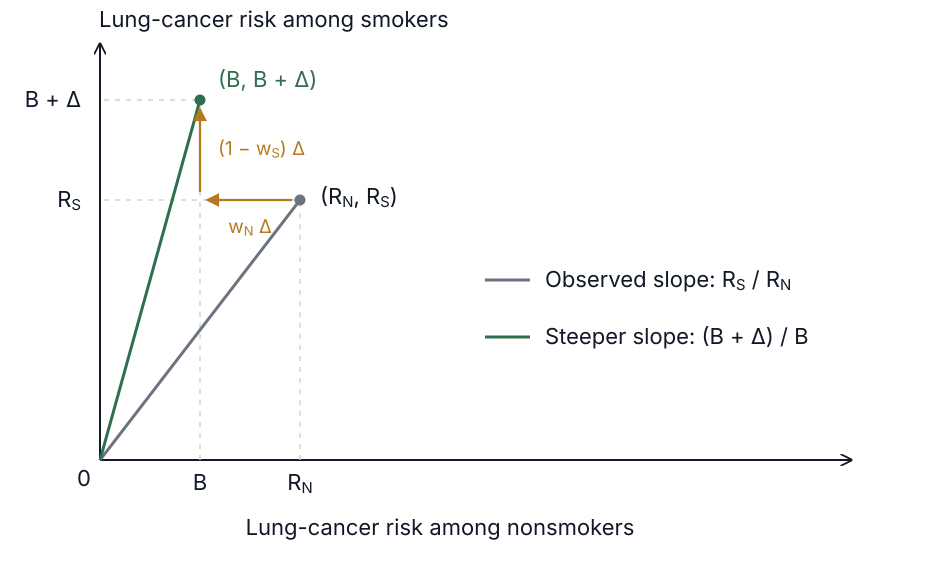
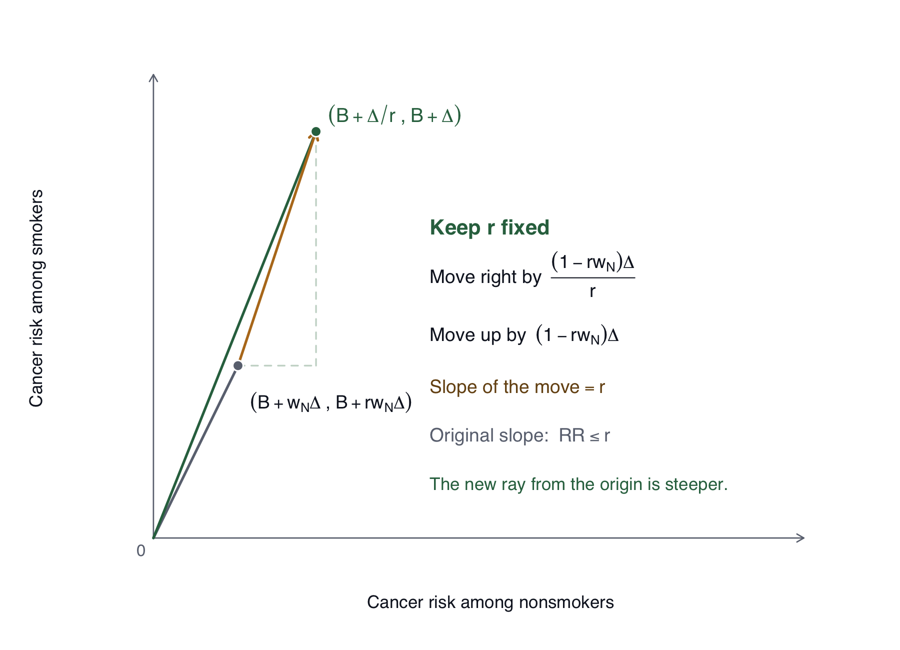
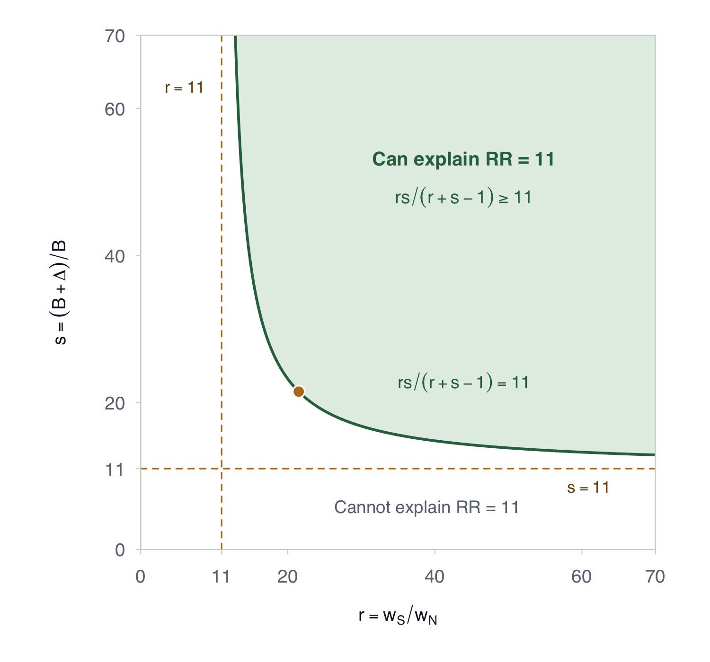

<!-- Working adaptation of the prior GitBook's sensitivity-analyses/vanderweele material and Cornfield recap. Originals are preserved in instructor-planning/archive/sensitivity-gitbook. -->

## Introduction

What if we cannot deal with unmeasured confounding? Suppose we have adjusted for every common cause we measured, but others remain unmeasured, and we have no suitable instrument or discontinuity to help. How much can we still say?

This brings us back to the question we faced at the beginning of the book. Fisher proposed that an unmeasured genotype could explain the association between smoking and lung cancer. Cornfield took that explanation seriously and asked what the world would have to look like for it to work. We can do the same thing here. Suppose, for the moment, that smoking has no causal effect at all. How much work would the genotype have to do to explain what we observed? [@cornfield_smoking_2009]

## Returning to Cornfield

Let us return to the setup we used then. Everyone faces some background risk of lung cancer, and carrying the genotype adds to that risk. We will keep the same notation:

- $B$: lung-cancer risk without the genotype;
- $\Delta$: extra risk from carrying the genotype;
- $w_S$: prevalence of the genotype among smokers;
- $w_N$: prevalence of the genotype among nonsmokers.

The genotype increases cancer risk and is more common among smokers. We also need our risks and prevalences to stay within their possible ranges:

$$
\begin{gathered}
B>0,\qquad \Delta>0,\qquad B+\Delta\leq1,\\
0<w_N<w_S\leq1.
\end{gathered}
$$

Under Fisher's explanation, smoking itself does nothing. The difference between the groups comes entirely from how many people carry the genotype. Their cancer risks are therefore

$$
\begin{aligned}
R_S&=B+w_S\Delta,\\
R_N&=B+w_N\Delta.
\end{aligned}
$$

### The confounder-exposure relation

Remember how we represented these risks in a picture. We put nonsmokers' risk on the horizontal axis and smokers' risk on the vertical axis, giving the point $(R_N,R_S)$. The line from the origin to that point has slope $RR$. Then we removed the common background risk. Subtracting $B$ from both coordinates moved the point left and down, leaving $(w_N\Delta,w_S\Delta)$.

{width=70% fig-align="center" fig-alt="Original Cornfield construction. Removing B from both coordinates moves the observed risk point down and left. The new line from the origin is steeper, bounding the observed relative risk by w_S/w_N."}

The picture showed that removing the background risk made the line from the origin steeper. Comparing the two slopes gave us our first bound:

$$
\begin{aligned}
RR&=\frac{B+w_S\Delta}{B+w_N\Delta}\\[0.4em]
&\leq\frac{w_S\Delta}{w_N\Delta}\\[0.4em]
&=\frac{w_S}{w_N}.
\end{aligned}
$$

If $RR=11$, the genotype must be at least 11 times as prevalent among smokers as among nonsmokers to explain the entire association. This condition concerns the exposure–confounder relationship.

### The confounder-outcome relation

So far, we have asked how much more common the genotype must be among smokers. But it also has to do something to cancer risk. A genotype that barely changes cancer risk cannot explain an elevenfold difference, however unevenly it is distributed.

To see the other constraint, imagine separating the genotype groups as much as possible: no nonsmoker carries it, and every smoker does. The point would then be $(B,B+\Delta)$. Starting from our observed point, we get there by moving left and up:

$$
\begin{aligned}
B+w_N\Delta-w_N\Delta&=B,\\
B+w_S\Delta+(1-w_S)\Delta&=B+\Delta.
\end{aligned}
$$

{width=85% fig-align="center" fig-alt="Second Cornfield construction. Moving left and up from (B+w_N Delta,B+w_S Delta) to (B,B+Delta) gives a steeper line from the origin."}

The new point is above and to the left of the observed point, giving the other bound:

$$
RR
=\frac{B+w_S\Delta}{B+w_N\Delta}
\leq\frac{B+\Delta}{B}.
$$

If $RR=11$, lung-cancer risk must be at least 11 times as high among people with the genotype as among people without it to explain the entire association. This condition concerns the outcome–confounder relationship.

## Put the Cornfield conditions together

Let

$$
r=\frac{w_S}{w_N},
\qquad
s=\frac{B+\Delta}{B}.
$$

Here $r$ is the relative prevalence of the genotype among smokers versus nonsmokers: the exposure–confounder relationship. The quantity $s$ is the relative risk of cancer among people with versus without the genotype: the outcome–confounder relationship.

There are two relationships doing the work here. The genotype has to be unevenly distributed between smokers and nonsmokers, and it has to change cancer risk. Our two bounds each tell us something about one side of that story. But each also lets the other side do as much work as it needs to.

We can see this by asking what would have to happen for the observed relative risk to reach either bound exactly.

For the first condition, setting $RR=r$ gives

$$
\begin{aligned}
\frac{B+w_S\Delta}{B+w_N\Delta}
&=\frac{w_S\Delta}{w_N\Delta},\\
w_N(B+w_S\Delta)&=w_S(B+w_N\Delta),\\
B(w_S-w_N)&=0.
\end{aligned}
$$

Since the genotype is more common among smokers, the last line forces $B=0$. That would mean someone without the genotype has no lung-cancer risk at all. The genotype–cancer relationship would then have to be infinitely strong:

$$
s=\frac{B+\Delta}{B}=\infty.
$$

If we keep that relationship finite, the observed relative risk stays below $r$.

For the second condition, setting $RR=s$ gives

$$
\frac{B+w_S\Delta}{B+w_N\Delta}
=\frac{B+\Delta}{B}.
$$

Here we run into a different extreme. To make the ratio on the left as large as the one on the right, its numerator has to reach $B+\Delta$ and its denominator has to fall to $B$. That means

$$
w_S=1,
\qquad
w_N=0.
$$

Every smoker would have to carry the genotype, and no nonsmoker could carry it. Now the genotype–smoking relationship would have to be infinitely strong:

$$
r=\frac{w_S}{w_N}=\infty.
$$

Reaching one Cornfield bound asks an enormous amount of the other relationship.

This is why we should consider the two relationships together. We can make one strength approach the observed relative risk by letting the other become arbitrarily large. But what if we are willing to entertain only finite strengths for both? We should be able to say more.

## Fix the strengths and bound the relative risk

Up to now, we have started with the observed relative risk and asked what it demands of the genotype. Let us turn that around. Suppose someone tells us how strongly the genotype is related to smoking and to cancer. We will hold those two strengths fixed and ask how large an observed association they could possibly produce, still assuming that smoking has no effect.

Start with the prevalence ratio $r$. If it stays fixed, increasing the genotype's prevalence among smokers also requires increasing it among nonsmokers. We have to move the two prevalences together. Writing $w_S=rw_N$, our observed point becomes

$$
(B+w_N\Delta,\;B+rw_N\Delta).
$$

The picture shows what happens as we increase the genotype's prevalence while keeping this ratio fixed, stopping when every smoker carries it. Our point moves up and to the right.

{width=100% fig-align="center" fig-alt="Fixed-r construction. The observed point (B+w_N Delta,B+r w_N Delta) moves up and right along a line of slope r to (B+Delta/r,B+Delta). Because the original ray has slope RR no greater than r, the new ray from the origin is steeper. The horizontal and vertical increments are shown."}

Look at the direction of the move. We go up $r$ times as much as we go right, so the move itself has slope $r$. Our first Cornfield condition tells us that this is steeper than the original line from the origin. Following that direction therefore makes the line from the origin steeper too. We stop when every smoker carries the genotype; if that was already true, we simply stay where we started.

Let us check that move algebraically. We add

$$
\begin{aligned}
\text{Right:}&\qquad\frac{(1-rw_N)\Delta}{r},\\[0.6em]
\text{Up:}&\qquad(1-rw_N)\Delta.
\end{aligned}
$$

We can move this far because $rw_N=w_S\leq1$. Let us check where the move takes us, one coordinate at a time. For the horizontal coordinate,

$$
\begin{aligned}
&B+w_N\Delta+\frac{(1-rw_N)\Delta}{r}\\[0.4em]
&\quad=B+w_N\Delta+\frac{\Delta}{r}-w_N\Delta\\[0.4em]
&\quad=B+\frac{\Delta}{r}.
\end{aligned}
$$

For the vertical coordinate,

$$
\begin{aligned}
&B+rw_N\Delta+(1-rw_N)\Delta\\[0.4em]
&\quad=B+rw_N\Delta+\Delta-rw_N\Delta\\[0.4em]
&\quad=B+\Delta.
\end{aligned}
$$

This confirms the new point shown in the picture, $(B+\Delta/r,B+\Delta)$. Comparing the slopes of the two lines from the origin gives

$$
RR\leq\frac{B+\Delta}{B+\Delta/r}
=\frac{(B+\Delta)r}{Br+\Delta}.
$$

We have kept the prevalence ratio fixed, and now we can bring in the genotype's relationship with cancer. The definition of $s$ lets us express both cancer risks in terms of the background risk:

$$
B+\Delta=sB,
\qquad
\Delta=(s-1)B.
$$

Substituting these into the bound and canceling $B$ gives

$$
\begin{aligned}
RR
&\leq\frac{sBr}{Br+(s-1)B}\\[0.4em]
&=\frac{sr}{r+s-1}.
\end{aligned}
$$

::: {.callout-note title="Proposition: the joint Cornfield bound"}
Suppose smoking has no causal effect and

$$
\begin{aligned}
R_S&=B+w_S\Delta,\\
R_N&=B+w_N\Delta,
\end{aligned}
$$

where $B>0$, $\Delta>0$, $B+\Delta\leq1$, and $0<w_N\leq w_S\leq1$. Define

$$
r=\frac{w_S}{w_N},
\qquad
s=\frac{B+\Delta}{B}.
$$

Then

$$
RR=\frac{R_S}{R_N}\leq\frac{sr}{s+r-1}.
$$
:::

We have found the most that a genotype with these two strengths can do. To reach the bound, every smoker must carry it, and a fraction $1/r$ of nonsmokers must carry it too. Other prevalences, with the same ratio, produce a smaller association.

Let us try a few numbers.

::: {.example-intro}
<span class="example-label">Example.</span> Suppose the genotype quadruples cancer risk and is three times as common among smokers. Then $s=4$ and $r=3$.
:::

The largest relative risk it could explain is

$$
RR\leq\frac{4\times3}{4+3-1}=\frac{12}{6}=2.
$$

Those relationships could explain a doubling of risk. Even in the most favorable configuration, though, they could not explain an elevenfold difference.

::: {.example-intro}
<span class="example-label">Example.</span> Give the genotype more work to do: let it increase cancer risk eightfold and be ten times as common among smokers. Now $s=8$ and $r=10$.
:::

The bound becomes

$$
RR\leq\frac{8\times10}{8+10-1}
=\frac{80}{17}\approx4.71.
$$

We are getting a larger association, but still nowhere near 11.

::: {.example-intro}
<span class="example-label">Example.</span> Suppose the genotype is 22 times as common among smokers and increases cancer risk by a factor of 22. Now $r=s=22$.
:::

This gives

$$
\begin{aligned}
RR&\leq\frac{22\times22}{22+22-1}\\[0.4em]
&=\frac{484}{43}\approx11.26.
\end{aligned}
$$

If the observed relative risk is $11$, only the last pair could explain it among these three possibilities. The first two pairs cannot produce an association that large, even in their most favorable configuration.

<details>
<summary>Could strengths of $r=15$ and $s=30$ explain an observed relative risk of 11 entirely through confounding?</summary>

The largest relative risk they can produce is

$$
\frac{15\times30}{15+30-1}=\frac{450}{44}\approx10.23.
$$

No. Both strengths exceed 11, so they pass the separate Cornfield conditions, but together they are still too weak.

</details>

## Which strengths could explain a relative risk of 11?

The joint bound recovers the separate conditions at the extremes:

$$
\begin{aligned}
\lim_{s\to\infty}\frac{sr}{s+r-1}&=r,\\[0.6em]
\lim_{r\to\infty}\frac{sr}{s+r-1}&=s.
\end{aligned}
$$

There are also plenty of possibilities between these extremes. We just saw that strengths of 22 for both relationships can produce an observed relative risk of 11. To find all the pairs that could do it, we ask whether their largest possible relative risk reaches 11:

$$
\frac{sr}{s+r-1}\geq11.
$$

The curve below marks equality. Pairs on the curve can just reach 11; pairs in the shaded region can reach at least 11. Pairs outside that region cannot explain the association completely under the null model.

{width=90% fig-align="center" fig-alt="Plot of sr/(s+r-1)=11. The curve has vertical asymptote r=11 and horizontal asymptote s=11, both dashed. The feasible region above and to the right is shaded green. A single unlabeled gold point lies on the curve where r=s, approximately (21.5,21.5)."}

Solving the boundary equation for $s$ gives

$$
s=\frac{11(r-1)}{r-11},
\qquad r>11.
$$

As $r$ approaches 11 from above, the required $s$ grows without bound. As $r$ grows without bound, the required $s$ approaches 11. These are the two asymptotes. Between them, there is a tradeoff: strengthening one relationship permits a weaker value of the other.

## The E-value

There is something special about the marked point. It gives us the smallest that the two relationships can jointly be while still explaining a relative risk of 11. More precisely, it makes the **larger of the two strengths as small as possible**.

Look at the curve to the left of that point. There, $s$ is the larger strength. Moving along the curve toward the marked point brings $s$ down, while $r$ rises to meet it. To the right of the point, $r$ is the larger strength. Moving back toward the point brings $r$ down, while $s$ rises to meet it. Either way, we make the larger strength smaller until we reach the marked point.

So let us call the marked point $(E,E)$. Since it lies on the curve for a relative risk of 11, it must satisfy

$$
\begin{aligned}
\frac{E^2}{2E-1}&=11,\\
E^2&=22E-11,\\
E^2-22E+11&=0.
\end{aligned}
$$

The quadratic formula gives

$$
\begin{aligned}
E
&=\frac{22+\sqrt{22^2-4(11)}}{2}\\[0.4em]
&=11+\sqrt{11^2-11}\\[0.4em]
&\approx21.5.
\end{aligned}
$$

The genotype would need to be **at least 21.5 times more prevalent among smokers than among nonsmokers, or increase the risk of cancer by at least 21.5 times**, to explain away the relative risk of 11 entirely as confounding.

At least one of those relationships has to be that strong. If one is weaker, the other has to be stronger to make up for it, as the curve shows.

We used the larger root of the quadratic because both relationship strengths are at least one. The point is approximately $(21.5,21.5)$.

More generally, replace 11 by an observed relative risk $RR\geq1$. The equation for the marked point becomes $E^2-2RR\,E+RR=0$, giving the following definition [@vanderweele2017evalue].

::: {.definition-box}
For a relative risk $RR\geq1$, the **E-value** is

$$
\text{E-value}=RR+\sqrt{RR^2-RR}.
$$

It is the smallest possible value of the larger of the exposure–confounder and outcome–confounder association strengths that could explain the relative risk entirely through confounding.
:::

::: {.example-intro}
<span class="example-label">Example.</span> For $RR=11$,

$$
\text{E-value}=11+\sqrt{110}\approx21.5.
$$

The genotype must be at least 21.5 times more prevalent among smokers or increase cancer risk by at least 21.5 times to explain the association entirely through confounding.
:::

Our derivation used a binary genotype and a complete null explanation. Ding and VanderWeele's general bound allows multiple unmeasured confounders and quantifies partial attenuation as well [@ding2016sensitivity].

::: {.callout-note title="Technical note: the general bound" collapse="true"}
Here is the general setup. Let $A$ and $Y$ be binary, and let $U$ collect the unmeasured confounders. Assume consistency, conditional exchangeability given $(X,U)$, and positivity for the comparisons below. For discrete $U$, write the outcome risk at a given exposure and covariate level as

$$
q_a(u,x)=P(Y=1\mid A=a,U=u,X=x).
$$

The two association strengths are

$$
RR_{AU}(x)
=\max_u\frac{P(U=u\mid A=1,X=x)}{P(U=u\mid A=0,X=x)}
$$

and

$$
RR_{UY}(x)
=\max_a\frac{\max_u q_a(u,x)}{\min_u q_a(u,x)}.
$$

The first compares the distribution of $U$ across exposure groups. The second compares outcome risks across levels of $U$, holding exposure and measured covariates fixed. Neither quantity requires $U$ to be a single binary variable.

The causal relative risk within this stratum is

$$
RR_{\mathrm{causal}}(x)=\frac{P(Y(1)=1\mid X=x)}{P(Y(0)=1\mid X=x)}.
$$

The bound is

$$
RR_{\mathrm{causal}}(x)
\geq\frac{RR_{\mathrm{obs}}(x)}{\mathcal{B}(x)},
$$

where

$$
\mathcal{B}(x)
=\frac{RR_{AU}(x)RR_{UY}(x)}{RR_{AU}(x)+RR_{UY}(x)-1}.
$$

For the calculations that follow, keep $x$ fixed and suppress it in the notation. Applying these ideas to an adjusted study estimate requires association strengths conditional on the measured covariates and a bound appropriate to the reported estimand. An arbitrary regression coefficient is not automatically a marginal causal risk ratio.


For example, if the observed relative risk is $2$ and both sensitivity parameters are at most $2$, then $\mathcal{B}\leq4/3$. The general bound gives $RR_{\mathrm{causal}}\geq2/(4/3)=1.5$. This is a lower bound under the specified limits on confounding, rather than an identified causal effect.
:::

## Using E-values in a study

Now let us use this in an actual study. We need to know which groups are being compared, what the outcome is, and which common causes the analysis has already adjusted for. Once we have the reported risk ratio, calculating the E-value is straightforward. The more interesting part is deciding what to make of it: could the common causes that remain unmeasured plausibly have relationships this strong?

::: {.example-intro}
<span class="example-label">Infant feeding and respiratory death.</span>

Victora and colleagues studied infant deaths from infectious diseases in Brazil. In the example used by VanderWeele and Ding, the reported relative risk of death from respiratory infection was $3.9$, with a 95% confidence interval of $[1.8,8.7]$, comparing formula-only feeding with exclusive breastfeeding. Adjustment included infant age, birth weight, social status, maternal education, and family income; maternal smoking remained a concern [@victora1987breastfeeding; @vanderweele2017evalue]. This was a case-control study of a rare outcome; we follow the E-value paper in treating the reported association as a risk ratio for this calculation. The rare-outcome approximation concerns outcome frequency in the source population, rather than the proportion of cases in the case-control sample [@linden2020evalue].
:::

First, calculate the E-value for the point estimate:

$$
\begin{aligned}
E(3.9)
&=3.9+\sqrt{3.9(3.9-1)}\\
&=3.9+\sqrt{11.31}\\
&\approx7.26.
\end{aligned}
$$

An unmeasured confounder would need to be at least $7.26$ times more prevalent in the formula-only group than in the exclusively breastfed group, or increase the risk of respiratory death by at least $7.26$ times, to explain away the reported relative risk entirely as confounding. These relationships concern what remains after adjustment for the measured covariates. As in the smoking example, this is a requirement on at least one relationship; the two must still satisfy the joint bound.

We could write up this calculation as follows. The reporting passages below are our sensitivity analyses of the published estimates, rather than quotations from the studies.

> The adjusted relative risk for respiratory death comparing formula-only feeding with exclusive breastfeeding was 3.9 (95% CI: 1.8–8.7). The E-value for the point estimate was 7.26. To explain away this relative risk entirely as confounding, an unmeasured confounder would need to be at least 7.26 times more prevalent in the formula-only group or increase respiratory-death risk by at least 7.26 times. These relationships would have to remain after adjustment for age, birth weight, social status, maternal education, and family income.

The number alone does not establish that residual confounding is implausible. For example, we would want evidence about how strongly maternal smoking differs across feeding groups and how strongly it predicts respiratory death after the measured adjustment. We would compare those two strengths with the joint bound, rather than treating $7.26$ as a universal cutoff for a credible study.

::: {.example-intro}
<span class="example-label">Pre-pregnancy BMI and cesarean delivery.</span>

Hamra and colleagues analyzed the Pregnancy, Infection, and Nutrition study. Their AIC-weighted model averages gave a relative risk of $1.62$ (95% CI: $1.09$–$2.39$) for cesarean delivery comparing women classified as obese with women classified as normal weight. The corresponding estimate for overweight versus normal weight was $1.33$ (95% CI: $0.86$–$2.03$). The candidate adjustment sets shared maternal age, education, and race, and differed in their inclusion of hypertension, gestational weight gain, height, and pre-eclampsia/eclampsia [@hamra2015averaging].
:::

Applying the same calculation to these reported risk-ratio estimates gives

$$
\begin{aligned}
E(1.62)&=1.62+\sqrt{1.62(1.62-1)}\approx2.62,\\
E(1.33)&=1.33+\sqrt{1.33(1.33-1)}\approx1.99.
\end{aligned}
$$

For the obesity comparison, a short reporting sentence would be:

> The model-averaged risk ratio for cesarean delivery was 1.62 (95% CI: 1.09–2.39), with a point-estimate E-value of 2.62. To explain away this relative risk entirely as confounding, an unmeasured confounder would need to be at least 2.62 times more prevalent in the obesity group than in the normal-weight group, or increase cesarean-delivery risk by at least 2.62 times, after the measured adjustment.

These calculations address residual confounding under the reported analyses. They do not settle whether the candidate adjustment sets, model averaging, or other analysis choices were appropriate.

## Accounting for uncertainty

So far, we have asked how much confounding it would take to explain away the point estimate. But we do not know that estimate precisely. A study might report a large relative risk while still being compatible with a much smaller one. It is therefore useful to ask a second question: how much confounding would it take for the confidence interval to include one? [@vanderweele2017evalue]

Return to the respiratory-death estimate of $3.9$, with interval $[1.8,8.7]$. As we move the interval toward one, its lower endpoint reaches one first. We therefore calculate the E-value for $1.8$:

$$
\begin{aligned}
E(1.8)
&=1.8+\sqrt{1.8(1.8-1)}\\
&=1.8+\sqrt{1.44}\\
&=3.
\end{aligned}
$$

We can see the difference using the joint bound. For this calculation, take $r=3$ and $s=3$. Then

$$
\mathcal{B}=\frac{3\times3}{3+3-1}=1.8.
$$

At this sensitivity bound, dividing the reported estimate and interval endpoints by $1.8$ gives

$$
\frac{3.9}{1.8}\approx2.17,
$$

with interval endpoints

$$
\left[\frac{1.8}{1.8},\frac{8.7}{1.8}\right]
\approx[1,4.83].
$$

The lower confidence limit has reached one, even though the point estimate remains above one. This is a sensitivity calculation at a specified bias bound, not an estimate of the actual confounding or an identified causal effect.

We can now extend the write-up:

> The E-values were 7.26 for the point estimate and 3.00 for the confidence limit nearest the null. For unmeasured confounding to move the confidence interval to include one, the confounder would need to be at least 3.00 times more prevalent in the formula-only group or increase respiratory-death risk by at least 3.00 times, after the measured adjustment. For the point estimate to reach one, the corresponding requirement is 7.26.

For the cesarean-delivery obesity comparison, the relevant endpoint is $1.09$:

$$
E(1.09)=1.09+\sqrt{1.09(1.09-1)}\approx1.40.
$$

We would report E-values of $2.62$ for the point estimate and $1.40$ for the confidence limit. These answer different questions, and reporting both makes the distinction explicit.

The overweight comparison already has a confidence interval containing one: $[0.86,2.03]$. We do not need any unmeasured confounding to move that interval to include the null—it is already there. In this situation, we will report the point-estimate E-value, but omit the confidence-limit E-value and say that the interval already includes one. The usual mathematical convention assigns the confidence-limit E-value a value of $1$ [@vanderweele2017evalue]; our reporting choice is to leave it out.

| Published comparison | Reported risk ratio (95% CI) | Point-estimate E-value | Confidence-limit E-value |
|---|---|---:|---:|
| Formula only vs. exclusive breastfeeding; respiratory death | $3.90\;[1.80,8.70]$ | 7.26 | 3.00 |
| Obesity vs. normal weight; cesarean delivery | $1.62\;[1.09,2.39]$ | 2.62 | 1.40 |
| Overweight vs. normal weight; cesarean delivery | $1.33\;[0.86,2.03]$ | 1.99 | Not reported: CI includes 1 |

An E-value for a confidence limit is not a confidence interval for the E-value. It measures how much confounding would be needed for a different target: moving the study's interval to include the null.

## When the comparison is flipped

We have been working with relative risks above one. A study could just as easily report the comparison the other way around, giving a relative risk below one. We would like our conclusion about confounding to survive that change in wording. To use the same calculation, we reverse the exposure comparison first.

Consider the respiratory-death study again, this time comparing exclusive breastfeeding with formula-only feeding. We are using the same result, with its numerator and denominator exchanged:

$$
\begin{aligned}
RR_{\text{reversed}}
&=\frac1{RR_{\text{original}}}\\[0.4em]
&=\frac1{3.9}\\[0.4em]
&\approx0.256.
\end{aligned}
$$

Taking reciprocals reverses the order of the interval endpoints:

$$
\begin{aligned}
[L,U]&=[1.8,8.7],\\[0.4em]
\left[\frac1U,\frac1L\right]
&=\left[\frac1{8.7},\frac1{1.8}\right]\\[0.4em]
&\approx[0.115,0.556].
\end{aligned}
$$

For the point-estimate E-value, first invert the protective risk ratio, then apply the formula:

$$
\begin{aligned}
R^*&=\frac1{1/3.9}=3.9,\\
E(R^*)&=3.9+\sqrt{3.9(3.9-1)}\approx7.26.
\end{aligned}
$$

For the confidence-limit E-value, the **upper** endpoint is now nearest one. Invert that endpoint before applying the formula:

$$
\begin{aligned}
U&=\frac1{1.8},\\
\frac1U&=1.8,\\
E(1/U)&=1.8+\sqrt{1.8(1.8-1)}=3.
\end{aligned}
$$

Both E-values are unchanged. Reversing the comparison changes how we describe the association, but not how much confounding is needed to move it to the null. We used the unrounded reciprocals in these calculations.

A write-up in the protective direction would be:

> Comparing exclusive breastfeeding with formula-only feeding, the adjusted relative risk for respiratory death was 0.256 (95% CI: 0.115–0.556). The E-values were 7.26 for the point estimate and 3.00 for the upper confidence limit. To explain away the point estimate entirely as confounding, an unmeasured confounder would need to be at least 7.26 times more prevalent in the formula-only group or increase respiratory-death risk by at least 7.26 times, after the measured adjustment. To move the confidence interval to include one, the corresponding requirement is 3.00.

We reversed the **exposure comparison**. Replacing the outcome $Y$ by $1-Y$ would generally give a different risk ratio, rather than its reciprocal.

For a risk ratio $R$ and confidence interval $[L,U]$, the practical rule is [@linden2020evalue]:

| Reported result | Point-estimate calculation | Confidence-limit calculation |
|---|---|---|
| $R>1$ and $L>1$ | $E(R)$ | $E(L)$ |
| $R<1$ and $U<1$ | $E(1/R)$ | $E(1/U)$ |
| Interval includes one | Use $E(R)$ or $E(1/R)$ according to direction | Do not report; state that the CI includes 1 |

## Calculating and reporting in practice

The following R code reproduces the examples. It accepts a risk ratio and its confidence limits, handles protective associations, and returns the E-values for reporting. It returns `NA` for the confidence-limit E-value when the interval includes one, following our reporting choice.

```{r}
#| eval: false
evalue_rr <- function(rr, lower, upper) {
  E <- function(r) {
    r <- max(r, 1 / r)
    r + sqrt(r * (r - 1))
  }
  limit_evalue <- if (lower <= 1 && upper >= 1) {
    NA_real_
  } else if (upper < 1) {
    E(upper)
  } else {
    E(lower)
  }
  c(point = E(rr), confidence_limit = limit_evalue)
}

rbind(
  respiratory_death = evalue_rr(3.9, 1.8, 8.7),
  cesarean_obesity = evalue_rr(1.62, 1.09, 2.39),
  cesarean_overweight = evalue_rr(1.33, 0.86, 2.03),
  respiratory_death_reversed = evalue_rr(1 / 3.9, 1 / 8.7, 1 / 1.8)
)
```

In a report, give the exposure comparison, outcome, adjusted estimate and interval, and the point-estimate E-value. Add the confidence-limit E-value when the interval excludes one; otherwise, state that the interval already includes one. Explain what the two E-values target, and describe the measured adjustment so readers know what confounding would have to remain. Then discuss specific missing common causes and whether their joint strengths could plausibly reach the required bound.

An E-value does not quantify the confounding actually present. A large value does not establish causality, and a small value does not establish that an effect is absent. The calculation also leaves selection bias, measurement error, and other threats to be assessed separately.

Extensions cover odds ratios, hazard ratios, and standardized mean differences for continuous outcomes. VanderWeele and Ding give conversions and worked examples in their supplementary material; Linden, Mathur, and VanderWeele describe the calculations for each effect measure in Sections 2.2–2.4 [@vanderweele2017evalue; @linden2020evalue]. These calculations require additional assumptions or approximations, including attention to whether a binary outcome is rare or common. We have worked on the risk-ratio scale; identify the reported effect measure before choosing the E-value calculation.
