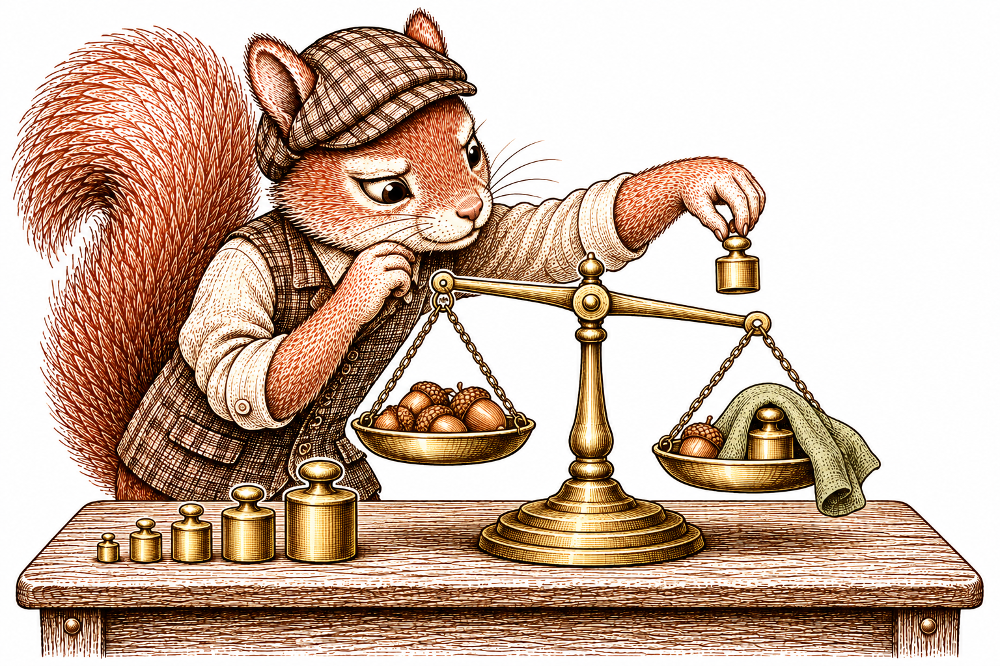
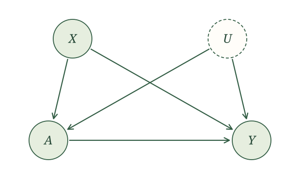
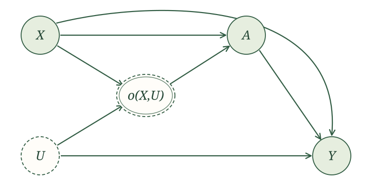
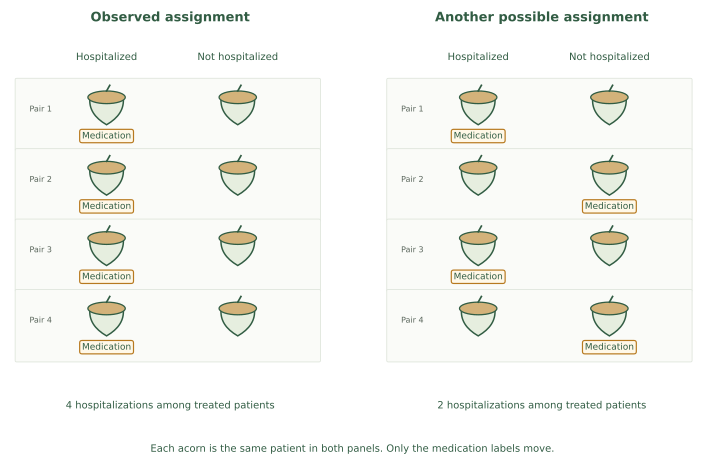

{width=700 fig-align="center" fig-alt="A squirrel adds a brass weight to an acorn balance, testing when it tips. Part of the load is concealed by a cloth, and progressively larger weights wait on the workbench. Vintage pen-and-ink illustration."}

<!-- Working adaptation of the prior GitBook's sensitivity-analyses/rosenbaum material. Originals, figures, and material awaiting further review are preserved in instructor-planning/archive/sensitivity-gitbook. -->

## Introduction

We still face the same unmeasured-confounding problem. Measured characteristics $X$ and unmeasured characteristics $U$ influence both treatment $A$ and outcome $Y.$ We have no instrument, discontinuity, or other way to address the missing common causes directly.

{width=620 fig-align="center" fig-alt="X and unmeasured U each point to treatment A and outcome Y. A also points to Y."}

The E-value gave us one answer. Suppose you study childhood asthma among children living near major roads. You have detailed residential histories and adjust for recorded family characteristics, but you do not know whether anyone smokes in the home. Comparing children near major roads with those farther away, you report an adjusted relative risk of 2, with a 95% confidence interval from 1.5 to 2.7.

Calculate the E-value for the point estimate:

$$2+\sqrt{2^2-2}\approx3.41.$$

Put it in your report, and Bob’s your uncle.

Now suppose your rival studies warehouse injuries among night-shift and day-shift workers. They have detailed job histories but no information about sleep or alcohol use. Their adjusted relative risk is also 2, with a 95% confidence interval from 1.5 to 2.7. Their E-value?

$$2+\sqrt{2^2-2}\approx3.41.$$

Put it in the report. Bob’s your uncle?

These are very different studies, with different exposures, outcomes, and missing common causes, yet they get exactly the same E-value. The calculation uses only the relative risk. Nothing else about the study enters.

That convenience can make us lazy. Reporting the number can take the place of thinking about how confounding might actually operate in our study. The formula has done its job. Judging whether the required confounding is plausible is still up to us [@poole2020evalue].

Rosenbaum’s $\Gamma$-sensitivity analysis works differently. It brings the treatment assignments and outcomes in our data into the calculation. We ask how unmeasured characteristics could influence who receives treatment, then check whether that selection could explain the result we observed [@rosenbaum2002observational]. We will build the idea from a simple example, first with equal treatment chances and then allowing unmeasured characteristics to influence treatment.

## A simple setting

Start with four patients and no measured or unmeasured common causes of treatment and outcome. Let $A=1$ indicate receiving medication and $Y=1$ indicate hospitalization within six months. We observe:

| Patient | Treatment $A$ | Hospitalization $Y$ |
|:---|:---:|:---:|
| Acorn | 1 | 1 |
| Birch | 1 | 1 |
| Chestnut | 0 | 0 |
| Hazel | 0 | 0 |

Both patients who received medication were hospitalized, while neither untreated patient was. We want to know whether medication affects hospitalization. We will approach this through a hypothesis test: ask whether our observed pattern would be unusual if medication changed no patient’s outcome. That no-effect hypothesis is the sharp null:

$$
H_0:Y(1)=Y(0)
\qquad\text{for every patient}.
$$

It tells us that each patient's unobserved potential outcome equals their observed outcome. We can therefore complete the table under the null:

| Patient | Observed $A$ | Observed $Y$ | $Y(0)$ | $Y(1)$ |
|:---|:---:|:---:|:---:|:---:|
| Acorn | 1 | 1 | 1 | 1 |
| Birch | 1 | 1 | 1 | 1 |
| Chestnut | 0 | 0 | 0 | 0 |
| Hazel | 0 | 0 | 0 | 0 |

Acorn and Birch would be hospitalized whether or not they received medication. Chestnut and Hazel would stay out either way. This is stronger than a zero average effect, which could hide benefits for some patients and harms for others.

::: {.main-point}
The sharp null fills in the missing potential outcomes: we know each patient’s outcome under either treatment.
:::

To measure the pattern we are testing, use the number of hospitalizations among treated patients as our test statistic:

$$
T=\text{number of treated patients hospitalized}.
$$

We observed $T=2.$ We are looking for increased hospitalization among treated patients. Ideally, we would simply calculate how often two or more treated patients would be hospitalized under the sharp null. But that calculation requires a probability model for the outcomes and treatment assignments, including quantities we do not know.

The useful idea, going back to Fisher and carried into Rosenbaum's sensitivity analysis, is to calculate a conditional p-value instead. We condition on the full set of potential outcomes, which the sharp null lets us complete from the observed outcomes. We also condition on exactly two patients receiving treatment. We then ask how often a different selection of those two patients would give at least as many treated hospitalizations as we observed.

Writing $M$ for the number treated, our conditional one-sided p-value is

$$
\begin{gathered}
P_{H_0}\bigl(T\geq2\mid M=2,\\
\text{completed potential outcomes}\bigr).
\end{gathered}
$$

Conditioning on the potential outcomes lets us calculate the statistic under every treatment assignment without specifying an outcome distribution. Conditioning on the treatment count will remove the unknown common treatment probability. 

::: {.callout-note title="Optional technical note: conditional validity" collapse="true"}

Potential outcomes remain random variables in our SCM. Let $\mathbf Y(0)$ and $\mathbf Y(1)$ denote the full vectors of potential outcomes for all patients, and collect the quantities we condition on as

$$
\mathcal F=
\bigl(\mathbf Y(0),\mathbf Y(1),\mathbf X,\mathbf U\bigr).
$$

Let $M$ record the number treated, or the treatment counts within groups when we condition separately within levels of $X.$ Conditioning on $\mathcal F$ means considering its realized values, not assuming these variables are nonrandom.

The sharp null and consistency make both full potential-outcome vectors equal to the observed outcome vector. The conditional assignment law must still be supplied by the SCM. Independent assignment noise and outcome noise imply that, conditional on the full covariate vectors, learning the potential-outcome vectors does not further change the assignment probabilities. We then condition that assignment law on $M.$

Suppose the resulting test has conditional rejection probability at most $\alpha$ under every model satisfying the null:

$$
P(\text{reject}\mid\mathcal F,M)\leq\alpha
\qquad\text{almost surely}.
$$

Iterated expectation gives unconditional error control:

$$
\begin{aligned}
P(\text{reject})
&=E\!\left[P(\text{reject}\mid\mathcal F,M)\right]\\
&\leq\alpha.
\end{aligned}
$$

Thus we can establish validity conditionally and average over the conditioning variables. We must use the correct conditional assignment law; conditioning does not in general preserve the original assignment probabilities. Branson and Bind develop assignment-based tests with unequal treatment probabilities and prove conditional validity in Theorem 3.2 and Appendix 6.2 [@branson2019randomization].

When that law is unknown but satisfies the sensitivity bound, the largest p-value over the allowed laws is at least the p-value under the true law. Rejecting only when this upper bound is at most $\alpha$ retains error control.

:::

To calculate this probability, first consider the chance of the particular treatment arrangement we observed.

Let $p=P(A=1)$ be the common probability of receiving medication, with $0<p<1.$ Assume treatment assignments are independent across patients. The probability that Acorn and Birch receive medication while Chestnut and Hazel do not is

$$
p\times p\times(1-p)\times(1-p)=p^2(1-p)^2.
$$

To judge whether our observed arrangement is unusual, we need to compare it with other arrangements that could have occurred. Suppose Acorn and Chestnut had received medication instead. Under the sharp null, changing who receives medication leaves each patient’s hospitalization outcome unchanged:

| Patient | Alternative treatment $A$ | Hospitalization $Y$ |
|:---|:---:|:---:|
| Acorn | 1 | 1 |
| Birch | 0 | 1 |
| Chestnut | 1 | 0 |
| Hazel | 0 | 0 |

Now one treated patient was hospitalized, and one untreated patient was hospitalized. The probability of this particular treatment selection is

$$
p\times(1-p)\times p\times(1-p)=p^2(1-p)^2.
$$

It has the same probability as the observed selection. These are just two possibilities. Keeping the treatment count at two, we can list every pair of patients who could have received medication. There are six such pairs. Under the sharp null, each patient’s outcome is known, so we can calculate the treated hospitalization count for every selection:

| Treated patients | Hospitalized<br>among treated | Assignment<br>probability |
|:---|:---:|:---:|
| Acorn and Birch (observed) | 2 | $p^2(1-p)^2$ |
| Acorn and Chestnut | 1 | $p^2(1-p)^2$ |
| Acorn and Hazel | 1 | $p^2(1-p)^2$ |
| Birch and Chestnut | 1 | $p^2(1-p)^2$ |
| Birch and Hazel | 1 | $p^2(1-p)^2$ |
| Chestnut and Hazel | 0 | $p^2(1-p)^2$ |

All six selections have the same probability, and only one gives two hospitalizations among treated patients. Conditional on two patients receiving treatment, and under the sharp null, the probability of a count at least as large as ours is therefore

$$
\frac{p^2(1-p)^2}{6p^2(1-p)^2}=\frac16 \approx 0.17.
$$

Our one-sided p-value is therefore about 0.17. If medication affected no one and each patient independently received treatment with the same probability $p,$ then, among assignments with exactly two treated patients, about 17% would give two or more treated hospitalizations. Our observed pattern is not particularly unusual under that explanation. This calculation is Fisher’s exact test.

The sharp null let us calculate outcomes under every assignment. The treatment model gave those assignments their probabilities. Conditioning on the observed treatment count removed the unknown $p.$

## When symptoms affect treatment

Return to the same four patients. Now suppose symptom severity $U$ influences both receiving medication and later hospitalization. Let $U=1$ mean severe symptoms and $U=0$ mean symptoms are not severe. For this calculation, suppose we know each patient's severity and the treatment probability given it:

$$
e(U)=P(A=1\mid U).
$$

Patients with severe symptoms receive medication with probability $2/3,$ while those without severe symptoms receive it with probability $1/2.$ Thus,

$$
e(U)=
\begin{cases}
1/2,&U=0,\\
2/3,&U=1.
\end{cases}
$$

Add severity and these probabilities to the observed arrangement:

| Patient | Severity<br>$U$ | Treatment<br>$A$ | Hospitalized<br>$Y$ | Treatment chance<br>$e(U)$ |
|:---|:---:|:---:|:---:|:---:|
| Acorn | 1 | 1 | 1 | $2/3$ |
| Birch | 1 | 1 | 1 | $2/3$ |
| Chestnut | 0 | 0 | 0 | $1/2$ |
| Hazel | 0 | 0 | 0 | $1/2$ |

There are still two treated hospitalizations and none among untreated patients. We use the same sharp null: medication changes no patient's outcome. The completed potential-outcome table from the previous example therefore still applies.

To assess how unusual the observed arrangement is, first calculate its treatment-assignment probability. Assume assignments are independent conditional on the patients' severity. Acorn and Birch receive medication, while Chestnut and Hazel do not, giving

$$
\frac23\times\frac23\times\left(1-\frac12\right)
\times\left(1-\frac12\right)=\frac19.
$$

Consider the same alternative as before: Acorn and Chestnut receive medication. Their severity stays the same, and under the sharp null their hospitalization outcomes stay the same too:

| Patient | Severity<br>$U$ | Alternative<br>$A$ | Hospitalized<br>$Y$ | Treatment chance<br>$e(U)$ |
|:---|:---:|:---:|:---:|:---:|
| Acorn | 1 | 1 | 1 | $2/3$ |
| Birch | 1 | 0 | 1 | $2/3$ |
| Chestnut | 0 | 1 | 0 | $1/2$ |
| Hazel | 0 | 0 | 0 | $1/2$ |

This gives one treated hospitalization. The probability of this treatment selection is

$$
\frac23\times\left(1-\frac23\right)\times\frac12
\times\left(1-\frac12\right)=\frac1{18}.
$$

Previously, these two selections had the same probability. Now the observed selection is twice as likely as the alternative. The six possible selections with exactly two treated patients have probabilities:

| Treated patients | Hospitalized<br>among treated | Assignment<br>probability |
|:---|:---:|:---:|
| Acorn and Birch (observed) | 2 | $1/9$ |
| Acorn and Chestnut | 1 | $1/18$ |
| Acorn and Hazel | 1 | $1/18$ |
| Birch and Chestnut | 1 | $1/18$ |
| Birch and Hazel | 1 | $1/18$ |
| Chestnut and Hazel | 0 | $1/36$ |

We again condition on exactly two patients receiving medication. The probability of that event is the sum of the six assignment probabilities:

$$
\frac19+4\left(\frac1{18}\right)+\frac1{36}=\frac{13}{36}.
$$

Divide each assignment probability by $13/36$ to obtain its probability given that exactly two patients received medication:

| Treated patients | Assignment<br>probability | Given two<br>treated |
|:---|:---:|:---:|
| Acorn and Birch | $1/9$ | $4/13$ |
| Acorn and Chestnut | $1/18$ | $2/13$ |
| Acorn and Hazel | $1/18$ | $2/13$ |
| Birch and Chestnut | $1/18$ | $2/13$ |
| Birch and Hazel | $1/18$ | $2/13$ |
| Chestnut and Hazel | $1/36$ | $1/13$ |

Only the Acorn–Birch selection gives two treated hospitalizations. Its conditional probability, and hence our one-sided p-value, is

$$
\frac4{13}\approx0.31.
$$

Under the sharp null and this severity-dependent treatment model, a result at least as extreme as ours occurs about 31% of the time, conditional on two receiving medication. Previously, with independent assignments sharing a common probability $p,$ it occurred about 17% of the time. The outcomes and observed treatment labels are unchanged. Selection toward patients who would be hospitalized has made the observed arrangement more likely under no medication effect.

Now consider a different possibility for the unmeasured severity. Keep every observed treatment and hospitalization unchanged, but suppose Chestnut and Hazel have severe symptoms and Acorn and Birch do not. The treatment model is unchanged: severe symptoms increase the probability of medication from one half to two thirds.

| Patient | Severity<br>$U$ | Observed<br>$A$ | Observed<br>$Y$ | Treatment chance<br>$e(U)$ |
|:---|:---:|:---:|:---:|:---:|
| Acorn | 0 | 1 | 1 | $1/2$ |
| Birch | 0 | 1 | 1 | $1/2$ |
| Chestnut | 1 | 0 | 0 | $2/3$ |
| Hazel | 1 | 0 | 0 | $2/3$ |

The probability of the observed treatment selection is now

$$
\frac12\times\frac12\times\left(1-\frac23\right)
\times\left(1-\frac23\right)=\frac1{36}.
$$

Each mixed pair still has assignment probability $1/18,$ while the Chestnut–Hazel selection now has probability $1/9.$ The probability of exactly two treated patients remains

$$
\frac1{36}+4\left(\frac1{18}\right)+\frac19=\frac{13}{36}.
$$

Only the observed selection gives two treated hospitalizations. Conditional on two patients receiving medication, its probability is

$$
\frac{1/36}{13/36}=\frac1{13}\approx0.08.
$$

Compare the three treatment-selection scenarios:

| Treatment selection based on unmeasured severity | One-sided<br>p-value |
|:---|:---:|
| Treatment probability does not depend on severity | $1/6\approx0.17$ |
| Severe symptoms increase treatment odds; Acorn and Birch have severe symptoms | $4/13\approx0.31$ |
| Severe symptoms increase treatment odds; Chestnut and Hazel have severe symptoms | $1/13\approx0.08$ |

::: {.main-point}
How unusual our finding looks depends on treatment selection. The same observed records gave different p-values under our three scenarios.
:::

The sharp null determines the outcomes under alternative assignments; the selection mechanism determines how likely those assignments are.

With four patients, we can enumerate every assignment. In a larger study, we could draw assignments using their conditional probabilities and calculate the fraction producing a result at least as large as ours. That is Monte Carlo simulation of the same test.

## When treatment probabilities are unknown

We calculated three different p-values from the same observed records by supplying different information about symptom severity. Claims data do not give us that information. We observe who received medication and who was hospitalized, but not each patient's severity. To see what we need from that missing information, rewrite each treated patient's probability as

$$
e(U)=\frac{e(U)}{1-e(U)}\,[1-e(U)].
$$

The ratio is the odds of treatment for someone with severity $U:$

$$
\frac{e(U)}{1-e(U)}.
$$

This rewrite gives every patient a factor of $1-e(U)$ in an assignment probability, whether they receive medication or not. A treated patient also contributes their treatment odds. The product of all four patients' $1-e(U)$ factors is therefore common to every assignment. It cancels when we condition on exactly two patients receiving medication, leaving only the products of the treated patients' odds.

In our severity example, these odds are

$$
\begin{aligned}
U=1:&\qquad \frac{e(1)}{1-e(1)}=\frac{2/3}{1/3}=2,\\[0.4em]
U=0:&\qquad \frac{e(0)}{1-e(0)}=\frac{1/2}{1/2}=1.
\end{aligned}
$$

Return to the first severity scenario, in which Acorn and Birch have severe symptoms and Chestnut and Hazel do not. We can see the cancellation directly.

For the observed assignment, Acorn and Birch receive medication while Chestnut and Hazel do not. Its probability is

$$
\frac23\times\frac23\times\frac12\times\frac12.
$$

Rewrite each treated patient's probability as their treatment odds multiplied by their probability of remaining untreated:

$$
\frac23=2\times\frac13.
$$

Substituting this for Acorn and Birch gives

$$
\begin{aligned}
&P(\text{Acorn and Birch treated})\\[0.3em]
&\quad=\left(2\times\frac13\right)
       \left(2\times\frac13\right)\frac12\frac12\\[0.4em]
&\quad=(2\times2)
       \left(\frac13\frac13\frac12\frac12\right).
\end{aligned}
$$

The first parentheses contain the treated patients' odds. The second contain every patient's probability of remaining untreated: one third for Acorn, one third for Birch, and one half each for Chestnut and Hazel. Their product is $1/36,$ giving assignment probability $4/36=1/9.$

For a different assignment, the treated patients' odds change, but that second product stays the same. This is the common factor that cancels when we calculate the conditional assignment probabilities.

For Acorn and Chestnut, the corresponding calculation is

$$
\begin{gathered}
P(\text{Acorn and Chestnut treated})\\[0.3em]
=(2\times1)\frac1{36}=\frac1{18}.
\end{gathered}
$$

For Chestnut and Hazel, it is

$$
\begin{gathered}
P(\text{Chestnut and Hazel treated})\\[0.3em]
=(1\times1)\frac1{36}=\frac1{36}.
\end{gathered}
$$

The factor $1/36$ cancels when we condition on two treated patients. The products of the treated patients' odds remain:

| Treated patients | Product of<br>treatment odds | Given two<br>treated |
|:---|:---:|:---:|
| Acorn and Birch | $2\times2=4$ | $4/13$ |
| Acorn and Chestnut | $2\times1=2$ | $2/13$ |
| Acorn and Hazel | $2\times1=2$ | $2/13$ |
| Birch and Chestnut | $2\times1=2$ | $2/13$ |
| Birch and Hazel | $2\times1=2$ | $2/13$ |
| Chestnut and Hazel | $1\times1=1$ | $1/13$ |

The denominator 13 is the sum of these six products. Replacing Chestnut with Birch in a treated pair doubles its conditional probability, because Birch has twice Chestnut's treatment odds. Selecting both Acorn and Birch gives four times the probability of selecting both Chestnut and Hazel: each replacement contributes an odds ratio of two.

This is how unmeasured selection enters the calculation. Differences in treatment odds change the relative probabilities of the arrangements, even after we condition on how many patients received treatment.

We can make the same calculation for all three scenarios. In the first, everyone has the same odds, so every pair has the same product; divide by that common product to write each as one. In the two severity scenarios, treatment odds are two for severe patients and one for the others:

| Treated patients | No severity<br>difference | Acorn and<br>Birch severe | Chestnut and<br>Hazel severe |
|:---|:---:|:---:|:---:|
| Acorn and Birch | $1$ | $4$ | $1$ |
| Acorn and Chestnut | $1$ | $2$ | $2$ |
| Acorn and Hazel | $1$ | $2$ | $2$ |
| Birch and Chestnut | $1$ | $2$ | $2$ |
| Birch and Hazel | $1$ | $2$ | $2$ |
| Chestnut and Hazel | $1$ | $1$ | $4$ |
| Sum | $6$ | $13$ | $13$ |

Divide each entry by its column's sum to obtain its conditional assignment probability. Only the Acorn–Birch selection gives two treated hospitalizations, so the first row gives our three p-values: $1/6,$ $4/13,$ and $1/13.$

::: {.main-point}
We need each patient's treatment odds, not $U$ itself. After conditioning on the number treated, the common factor cancels; products of the treated patients' odds determine the assignment probabilities.
:::

::: {.callout-note title="Optional technical note: treatment odds as a balancing score" collapse="true"}

The missing information $U$ could include detailed symptom histories, social support, and much more. Yet its role in treatment assignment can be summarized by the single number $o(X,U).$ Treatment odds determine the full propensity score:

$$
e(X,U)=\frac{o(X,U)}{1+o(X,U)}.
$$

By our [balancing-score proposition](03c-propensity-scores.qmd#balancing-score-characterization), treatment odds form a balancing score for $X$ and $U.$ Under exchangeability given $X$ and $U,$ adjusting for treatment odds is enough; we may also retain $X:$

$$
Y(a)\perp\!\!\!\perp A\mid X,o(X,U).
$$

The corresponding causal graph is

{width=700 fig-align="center" fig-alt="X and U determine treatment odds o(X,U). X and the treatment odds point to A. X, U, and A point to Y."}

Its SCM is

$$
\begin{aligned}
X&\leftarrow f_X(\epsilon_X),\\
U&\leftarrow f_U(\epsilon_U),\\
O&\leftarrow o(X,U),\\
A&\leftarrow f_A(X,O,\epsilon_A),\\
Y&\leftarrow f_Y(X,U,A,\epsilon_Y).
\end{aligned}
$$

Here $O=o(X,U)$ records treatment odds. The noise terms are independent, and the treatment assignment reproduces the full treatment probability using these odds. This balancing-score connection is not needed to calculate the conditional assignment probabilities.

:::

## Bounding treatment selection

But we do not know each patient's treatment odds either. We can instead ask how different those odds could be, then consider the treatment selection that makes our finding least unusual under the sharp null.

In both severity scenarios, one patient's treatment odds are at most twice another's. We describe this with a sensitivity bound, $\Gamma=2.$ Both scenarios satisfy the same bound, although they give different p-values. The bound allows either arrangement of severity, along with other treatment mechanisms whose odds differ by no more than a factor of two. We will look for the worst-case selection among the possibilities it allows. With no difference in treatment odds, $\Gamma=1$ suffices.

To define the bound generally, allow measured characteristics $X$ as well. For example, claims may record prior hospitalization. Compare patients with the same recorded characteristics. Their treatment probability is

$$
e(X,U)=P(A=1\mid X,U),
$$

and their treatment odds are

$$
o(X,U)=\frac{e(X,U)}{1-e(X,U)}.
$$

For each $X,$ let $o_{\min}(X)$ be the smallest treatment odds as $U$ varies.

::: {.definition-box}
A **sensitivity bound $\Gamma\geq1$** means that anyone's treatment odds are at most $\Gamma$ times those of any other person with the same measured confounders $X:$

$$
\frac{o(X,U)}{o_{\min}(X)}\leq\Gamma
\qquad\text{for every }X,U.
$$
:::

::: {.callout-note title="Optional technical note: why compare with the smallest odds?" collapse="true"}

For two people with the same $X,$ the second person's treatment odds are at least $o_{\min}(X).$ Therefore,

$$
\frac{o(X,U)}{o(X,U')}
\leq\frac{o(X,U)}{o_{\min}(X)}
\leq\Gamma.
$$

Conversely, if the comparison holds for every pair, it holds when we compare anyone with a person having the smallest odds. Thus the definition bounds every pairwise treatment odds ratio within each value of $X.$

If the smallest odds are not attained, use the infimum over the relevant values of $U.$ The same equivalence holds by taking values approaching that infimum. A finite bound assumes positive treatment odds with a positive infimum within each group.

:::

Our four-patient example has no $X,$ so the comparison applies to all four patients. We write their odds as $o(U).$

Both severity scenarios satisfy $\Gamma=2.$ At $\Gamma=1,$ patients with the same $X$ have equal treatment odds. In our example without $X,$ this gives the Fisher calculation. Larger values allow more selection into treatment due to unmeasured characteristics.

::: {.main-point}
We do not know each person's treatment odds either. A sensitivity bound $\Gamma$ limits how much those odds could differ among people with the same $X.$
:::

This describes the relationship in the direction of our causal story, $U\rightarrow A:$ how much can the unmeasured characteristic influence treatment? Our E-value calculation instead described how the distribution of $U$ differed between treated and untreated people.

## The worst-case scenario

Choose a sensitivity bound $\Gamma$ and return to our four patients. Number the patients $i=1,2,3,4$ in the order Acorn, Birch, Chestnut, and Hazel. Let $U_i$ be patient $i$’s unmeasured severity and $o_i=o(U_i)$ their treatment odds. The bound requires

$$
\frac{o_i}{\min(o_1,o_2,o_3,o_4)}\leq\Gamma
\qquad\text{for each patient }i.
$$

Assume treatment assignments are independent given the patients' unmeasured characteristics. As we showed earlier, an assignment probability is the product of the treated patients' odds times a common constant. Here that constant is

$$
c=\prod_{i=1}^4[1-e(U_i)].
$$

The six possibilities are

| Treated patients | Assignment probability |
|:---|:---:|
| Acorn and Birch | $o_1o_2c$ |
| Acorn and Chestnut | $o_1o_3c$ |
| Acorn and Hazel | $o_1o_4c$ |
| Birch and Chestnut | $o_2o_3c$ |
| Birch and Hazel | $o_2o_4c$ |
| Chestnut and Hazel | $o_3o_4c$ |

Only the first gives two treated hospitalizations. Conditional on two patients receiving medication and the completed potential outcomes, the one-sided p-value is therefore

$$
\begin{aligned}
p&=\frac{o_1o_2c}
{c(o_1o_2+o_1o_3+o_1o_4+o_2o_3+o_2o_4+o_3o_4)}\\[0.5em]
&=\frac{o_1o_2}
{o_1o_2+o_1o_3+o_1o_4+o_2o_3+o_2o_4+o_3o_4}.
\end{aligned}
$$

We still have many possible p-values because we do not know the four odds. To be conservative, take the largest p-value among odds satisfying our bound. This makes the observed finding as easy as possible to explain without a treatment effect.

In this example, the largest p-value occurs when Acorn and Birch have the highest allowed odds and Chestnut and Hazel have the lowest. We can write such a choice as

$$
o_1=o_2=\Gamma t,\qquad o_3=o_4=t,
\qquad t>0.
$$

Substituting gives

$$
\begin{aligned}
p_{\max}(\Gamma)
&=\frac{\Gamma^2t^2}{\Gamma^2t^2+4\Gamma t^2+t^2}\\[0.5em]
&=\frac{\Gamma^2}{\Gamma^2+4\Gamma+1}.
\end{aligned}
$$

The common scale $t$ cancels, so we do not need to know the actual smallest treatment odds. Setting $t=1$ gives the convenient choice $o_1=o_2=\Gamma$ and $o_3=o_4=1.$ At $\Gamma=2,$

$$
p_{\max}(2)=\frac4{4+8+1}=\frac4{13}\approx0.31.
$$

This is our first severity scenario: Acorn and Birch have severe symptoms, which double their treatment odds. Among all treatment mechanisms allowed by $\Gamma=2,$ this scenario makes our observed pattern least unusual under the sharp null.

::: {.main-point}
Worst-case selection makes our finding as unsurprising as possible under the sharp null, while staying within the bound $\Gamma.$
:::

## The general procedure

With measured characteristics $X,$ we do the same calculation while keeping the number treated fixed within every group sharing the same $X.$ Treatment odds may differ across these groups; the bound $\Gamma$ compares people within a group.

Assume assignments are independent given measured and unmeasured characteristics. Conditional on the completed potential outcomes and the treatment counts within each group, an arrangement’s probability is proportional to the product of its treated patients’ odds. Let $i$ label patients, with $X_i$ and $U_i$ denoting patient $i$’s measured and unmeasured characteristics and $A_i$ their treatment in the arrangement under consideration. The product is

$$
\prod_{i:A_i=1}o(X_i,U_i).
$$

Divide each product by the sum over all arrangements with the required counts to obtain its conditional probability. Multiplying everyone's odds within a group by the same positive number does not change these probabilities: every arrangement treats the same number in that group, so the common scale cancels. For computation, we may set the smallest odds in each group to one without knowing their actual value.

::: {.callout-note title="Procedure: sensitivity analysis for an upper-tail test"}

1. Fix outcomes under the sharp null.
2. Consider treatment arrangements preserving the number treated within each $X.$
3. Choose $\Gamma.$ For possible treatment odds satisfying $\Gamma,$ calculate how likely each arrangement is and how often it gives a result at least as large as ours.
4. Take the largest p-value.
5. Increase $\Gamma$ until it reaches $0.05.$

:::

Larger $\Gamma$ allows stronger treatment selection due to unmeasured confounding. The largest p-value cannot decrease as we enlarge that set of possibilities. We ask how much selection we must allow before the observed result is no longer unusual under the sharp null.

Our four-patient example already has a p-value of about $0.17$ at $\Gamma=1,$ so it has no statistically significant finding to begin with. To see how we would interpret a sensitivity analysis when there is evidence to assess, consider the following hypothetical larger study.

::: {.example-box}
A larger claims study examines whether starting the same medication increases hospitalization within six months. Researchers account for prior hospitalization and other recorded characteristics. Their one-sided sensitivity analysis gives:

| Sensitivity bound $\Gamma$ | Largest p-value |
|---:|---:|
| 1 | $0.006$ |
| 1.25 | $0.021$ |
| 1.5 | $0.051$ |
| 2 | $0.152$ |

At $\Gamma=1,$ treatment odds are equal among patients with the same recorded characteristics, and the finding is statistically significant at the 5% level. At $\Gamma=1.25,$ even the largest allowed p-value remains below $0.05.$

At $\Gamma=1.5,$ the largest p-value exceeds $0.05.$ Allowing unmeasured characteristics to make one patient's treatment odds up to 1.5 times another's, among people with the same recorded characteristics, permits a treatment mechanism under which the finding is no longer statistically significant. The threshold lies between $1.25$ and $1.5;$ a finer search would locate it more closely.

We could report: “The finding remained statistically significant when unmeasured confounding allowed treatment odds to differ by up to 25% among patients with the same recorded characteristics. Allowing a 50% difference raised the largest one-sided p-value to 0.051.”
:::

<details class="lesson-question">
<summary>A claims study examines whether knee replacement increases opioid use six months later. After accounting for age and recorded diagnoses, the largest one-sided p-values are 0.008 at $\Gamma=1,$ 0.032 at $\Gamma=2,$ and 0.074 at $\Gamma=3.$ Using a 5% significance level, what can you say about the finding's sensitivity to unmeasured treatment selection?</summary>

The finding remains statistically significant for every treatment mechanism allowed by $\Gamma=2.$ Even if unmeasured characteristics make one patient's odds of knee replacement up to twice another's among people with the same age and recorded diagnoses, the largest p-value is $0.032.$

Allowing a threefold difference permits a mechanism under which the finding is no longer statistically significant: the largest p-value is $0.074.$ The threshold lies between two and three. This does not show that such treatment selection occurred, or that knee replacement has no effect; it describes how much selection could remove the statistical evidence against the sharp null.

</details>

For exact grouping, $X$ must have repeated values, as with discrete characteristics. With continuous measurements, we often construct comparable groups by matching. Exact calculations assume people within a group have the same $X;$ approximate matches can leave measured differences.

Enumerating arrangements and finding the worst-case odds can be computationally demanding. Much of the work on sensitivity analysis develops ways to make these calculations feasible or identifies settings with simple formulas. Matched pairs give one such setting: condition on one treated patient in each pair, and only two treatment arrangements remain per pair.

## DRAFT: matched patients

This section still needs revision. 

### Comparing matched patients

With measured characteristics $X,$ the bound compares patients with the same recorded values. For example, we can compare patients with the same prior hospitalization history.

Form pairs with the same measured characteristics $X,$ one treated patient and one untreated patient in each pair. We condition on one patient receiving treatment in every pair. The following calculation assumes exact agreement on $X.$

{width=850 fig-align="center" fig-alt="Four pairs of acorn patients, each with one hospitalized and one nonhospitalized patient. Treatment labels move within pairs while outcomes and the treatment count in each pair stay fixed."}

Within one pair, label the patients 1 and 2 and write their treatment odds as $o_1$ and $o_2.$ Conditional on one receiving treatment, the probability that it is the first patient is

$$
\frac{o_1}{o_1+o_2}.
$$

For example, odds of two and one give probability $2/(2+1)=2/3.$ Under the sensitivity bound, neither patient's odds can exceed $\Gamma$ times the other's. The largest conditional probability is therefore $\Gamma/(\Gamma+1),$ and the smallest is $1/(1+\Gamma).$ Writing that probability as $p,$

$$
\frac1{1+\Gamma}\leq p\leq\frac\Gamma{1+\Gamma}.
$$

At $\Gamma=1,$ either patient has a one-half chance. At $\Gamma=2,$ the chance can range from one third to two thirds.

Now bring the outcome back into the story. Each patient either was or was not hospitalized within six months. Our pairs fall into four groups:

| Treated patient's outcome | Untreated patient's outcome | Number of pairs |
|:---|:---|---:|
| Hospitalized | Hospitalized | $a$ |
| Not hospitalized | Hospitalized | $b$ |
| Hospitalized | Not hospitalized | $c$ |
| Not hospitalized | Not hospitalized | $d$ |

A pair in which both patients were hospitalized contributes equally to the treated and untreated hospitalization counts. A pair in which neither was hospitalized contributes nothing to either count. Switching treatment labels within these pairs leaves the comparison unchanged.

The pairs with different outcomes are the ones that matter. In $c$ pairs, the treated patient was hospitalized; in $b$ pairs, the untreated patient was hospitalized. The treated group therefore has $c-b$ more hospitalizations. Once the number of pairs with different outcomes is fixed, a larger $c$ means a larger treated–untreated difference.

Under the sharp null, changing who received medication would not change who was hospitalized. We can therefore hold these outcomes fixed and ask: how often would alternative treatment assignments put the treatment label on the hospitalized patient in at least $c$ of these pairs?

Call the count under an alternative assignment $C.$ At $\Gamma=1,$ either patient in each pair is equally likely to receive treatment. Assuming independent assignments across pairs, the count follows

$$
C\sim\operatorname{Binomial}(b+c,1/2).
$$

The probability $P(C\geq c)$ tells us how often we would see at least as many hospitalizations in treated patients as we actually observed. This is the one-sided p-value for the direction of increased hospitalization.

What changes when we allow unmeasured differences to influence treatment? To make our observed excess of hospitalizations easier to explain without a medication effect, make the hospitalized patient more likely to receive treatment in every pair with different outcomes. Give that patient $\Gamma$ times the other patient’s treatment odds. The chance of assigning treatment to the hospitalized patient is then $\Gamma/(1+\Gamma).$

This is the worst case for our evidence: it pushes the treatment label toward the patients who would be hospitalized anyway. Reversing the odds pushes the labels away from those patients and gives the smallest p-value. The resulting bounds are

$$
\begin{aligned}
p_-(\Gamma)
&=P\!\left\{\operatorname{Binomial}\!\left(b+c,\frac1{1+\Gamma}\right)\geq c\right\},\\[0.5em]
p_+(\Gamma)
&=P\!\left\{\operatorname{Binomial}\!\left(b+c,\frac\Gamma{1+\Gamma}\right)\geq c\right\}.
\end{aligned}
$$

These binomial probabilities give the p-value bounds directly. They carry out the same calculation as the simulation procedure: condition on treatment counts, vary the allowed treatment odds, and find the extreme probabilities.

For an application, consider the smoking and lung-cancer example from our earlier GitBook. Here $A=1$ denotes heavy smoking, $Y=1$ denotes death from lung cancer, and $X$ contains the characteristics used to form the pairs. Each pair contains one exposed and one unexposed person with the same $X.$ Among pairs with different outcomes, the counts are

| Exposed person's outcome | Unexposed person's outcome | Number of pairs |
|:---|:---|---:|
| Died of lung cancer | Did not die of lung cancer | $c=110$ |
| Did not die of lung cancer | Died of lung cancer | $b=12$ |

Thus $b+c=122,$ and the observed count is $c=110.$ Here the unmeasured characteristics influence who smokes. We ask whether that selection could explain the observed deaths even if smoking affected no one’s outcome. The calculation we just developed gives bounds on $P(C\geq110),$ the probability that alternative assignments put the smoking label on the person who died in at least 110 pairs.

Here are the resulting upper bounds:

| $\Gamma$ | Upper bound on the one-sided p-value |
|---:|---:|
| 1 | $< .001$ |
| 2 | $< .001$ |
| 3 | $< .001$ |
| 4 | $0.00196$ |
| 5 | $0.0232$ |
| 6 | $0.0969$ |

At $\Gamma=5,$ even the largest p-value allowed by the model remains below $0.05.$ At $\Gamma=6,$ it does not. The upper bound reaches $0.05$ at approximately $\Gamma=5.473$ for this one-sided test.

Even if unmeasured characteristics multiply smoking odds by as much as five among people with the same $X,$ the test rejects the sharp null at the 5% level for every allowed assignment mechanism. A factor of six permits mechanisms under which it no longer rejects. The analysis identifies how much selection the inference can withstand; it does not estimate the selection actually present.

The calculation in R is short:

```{r}
#| eval: false
b <- 12
c <- 110
Gamma <- c(1, 2, 3, 4, 5, 6)
p_lower <- pbinom(c - 1, b + c, 1 / (1 + Gamma),
                  lower.tail = FALSE)
p_upper <- pbinom(c - 1, b + c, Gamma / (1 + Gamma),
                  lower.tail = FALSE)
data.frame(Gamma, p_lower, p_upper)

uniroot(function(g) {
  pbinom(c - 1, b + c, g / (1 + g), lower.tail = FALSE) - 0.05
}, interval = c(1, 10))$root
```

<details class="lesson-question">
<summary>A claims study examines the effect of knee replacement on later opioid use. Researchers account for age and recorded diagnoses, but the claims do not capture how much knee pain limits daily activities. What does $\Gamma=2$ allow about treatment assignment? What would $\Gamma=1$ mean?</summary>

At $\Gamma=2,$ anyone's odds of receiving knee replacement are at most twice those of any other person with the same age and recorded diagnoses, despite unmeasured differences in daily limitations.

At $\Gamma=1,$ patients with the same measured characteristics have equal treatment odds. Their unrecorded limitations do not further influence treatment assignment.

</details>
